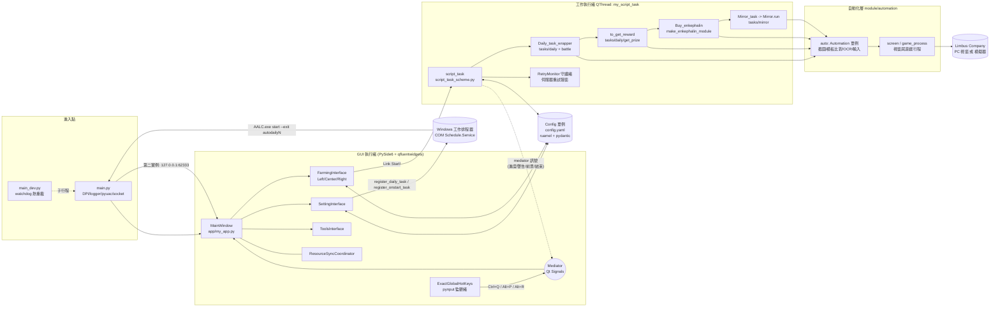
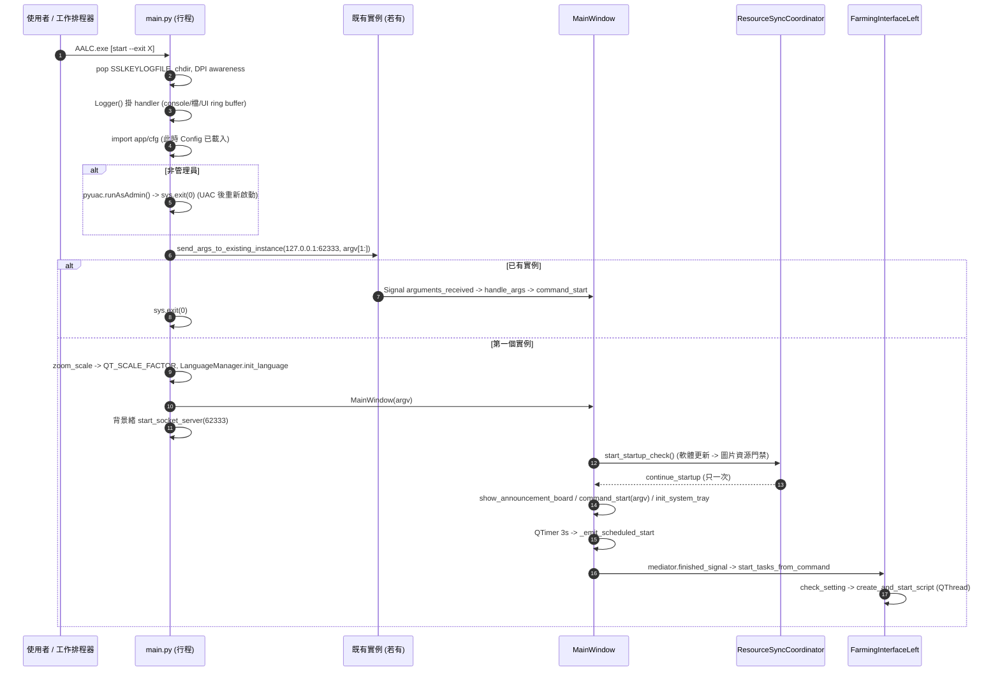
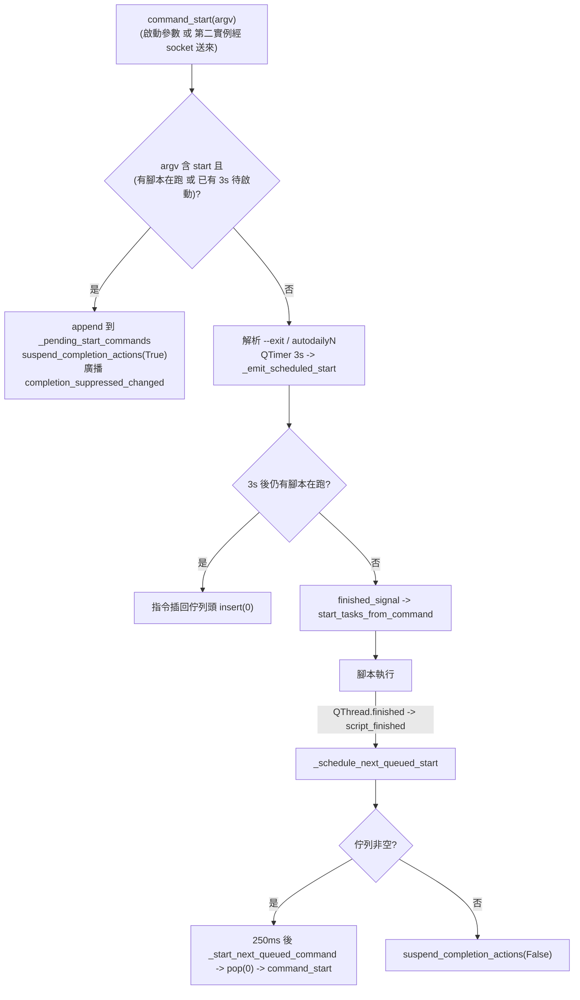

# 01 - 架構、啟動、排程與設定系統

> 來源基準：AALC（AhabAssistantLimbusCompany）SHA `b0f439321987f5f7b126ebbc424f6ef144c1bff0`（HEAD 為 `Merge branch 'loadingying-codex/pr-command-queue'`）。只用程式碼與 repo 內文件（`assets/doc/*`、README）作為依據。
> 引用格式：`[path:Lx-Ly]` 皆為指向該 SHA 的 GitHub permalink。標示「推論」的句子是由程式碼推得、非原文明言。

## 目的

本章回答「AALC 如何從 `python main.py` 變成一個會自動玩遊戲的程序」：進入點與權限、單一實例與命令列、GUI 與工作執行緒的分工、任務排程順序（日常 / 領獎 / 換餅 / 鏡牢）、設定檔系統、遊戲啟動與視窗處理、更新與圖片資源同步、失敗處理與「斷點」語意。影像辨識 / 輸入細節交給 [02](02-recognition-and-input.md)，日常細節交給 [03](03-daily-tasks.md)，鏡牢本體交給 [10](10-mirror-dungeon-overview.md) 以降。總索引見 [README](README.md)。

---

## 1. 架構總覽

### 1.1 資料流圖

### 1.2 分層與依賴方向

| 層 | 路徑 | 職責 |
|---|---|---|
| 進入 | [main.py:L1-L145](https://github.com/KIYI671/AhabAssistantLimbusCompany/blob/b0f439321987f5f7b126ebbc424f6ef144c1bff0/main.py#L1-L145)、[main_dev.py:L1-L391](https://github.com/KIYI671/AhabAssistantLimbusCompany/blob/b0f439321987f5f7b126ebbc424f6ef144c1bff0/main_dev.py#L1-L391) | 見 §2 |
| GUI | `app/*` | 視窗、設定頁、啟停按鈕、訊號中介；見 §11 |
| 設定 | `module/config/*` | pydantic 型別 + ruamel YAML 持久化 + 備份 + 升級；見 §7 |
| 排程編排 | `tasks/base/script_task_scheme.py` | 工作執行緒本體與任務順序；見 §4、§5 |
| 任務 | `tasks/{daily,battle,mirror,teams,event}/*` | 各業務流程 |
| 自動化 | `module/automation/*`、`module/game_and_screen/*` | 截圖 / 比對 / 輸入 / 視窗 |
| 橫切 | `module/logger`、`module/my_error`、`module/decorator`、`utils/*` | 日誌、例外、計時裝飾器、時間 / 路徑工具 |

一個層次上的小違規：`module/game_and_screen/screen.py` 反向 `from app import mediator`（[module/game_and_screen/screen.py:L8](https://github.com/KIYI671/AhabAssistantLimbusCompany/blob/b0f439321987f5f7b126ebbc424f6ef144c1bff0/module/game_and_screen/screen.py#L8)），`tasks/base/script_task_scheme.py` 同樣直接 import `app.mediator` 與 `app.windows_toast`（[tasks/base/script_task_scheme.py:L12-L13](https://github.com/KIYI671/AhabAssistantLimbusCompany/blob/b0f439321987f5f7b126ebbc424f6ef144c1bff0/tasks/base/script_task_scheme.py#L12-L13)）。「執行層透過 Mediator 發訊號給 GUI」是刻意的低耦合手段，但 import 方向仍是 task -> app。

---

## 2. 啟動流程

### 2.1 時序圖

### 2.2 逐步實作

1. **清環境變數與工作目錄**：行程一開始就 `pop("SSLKEYLOGFILE")`（避免除錯代理設的變數讓內嵌 OpenSSL 在 Windows 崩潰，之後若原本有值會在 `__main__` 記 warning），然後 `os.chdir` 到 exe / 腳本所在目錄，確保相對路徑（`./assets/...`、`./config.yaml`）穩定。[main.py:L6-L15](https://github.com/KIYI671/AhabAssistantLimbusCompany/blob/b0f439321987f5f7b126ebbc424f6ef144c1bff0/main.py#L6-L15)、[main.py:L97-L99](https://github.com/KIYI671/AhabAssistantLimbusCompany/blob/b0f439321987f5f7b126ebbc424f6ef144c1bff0/main.py#L97-L99)
2. **DPI awareness**：依序嘗試 Per-Monitor V2 -> Per-Monitor -> System aware，全部包 try/except。這會影響 Qt 與後面的 Win32 視窗座標（遊戲視窗大小計算依賴實體像素）。[main.py:L17-L33](https://github.com/KIYI671/AhabAssistantLimbusCompany/blob/b0f439321987f5f7b126ebbc424f6ef144c1bff0/main.py#L17-L33)
3. **日誌先於 import**：先 `Logger()` 掛好 handler，再 import 會在 import 期就打日誌的 `app` / `cfg`，否則啟動日誌會遺失。[main.py:L35-L47](https://github.com/KIYI671/AhabAssistantLimbusCompany/blob/b0f439321987f5f7b126ebbc424f6ef144c1bff0/main.py#L35-L47)
4. **管理員提權**：`pyuac.isUserAdmin()` 為假則 `pyuac.runAsAdmin(False)` 後 `sys.exit(0)`（失敗 `sys.exit(1)`）。注意順序：此檢查在 `from module.config import cfg` **之後**（[main.py:L42-L54](https://github.com/KIYI671/AhabAssistantLimbusCompany/blob/b0f439321987f5f7b126ebbc424f6ef144c1bff0/main.py#L42-L54)），因此「未提權的那個行程」也已建構過 `Config` 單例（含備份輪替與寫檔，見 §7）。需要管理員的原因見 FAQ：請「以管理員身份運行」（[assets/doc/zh/FAQ.md:L29](https://github.com/KIYI671/AhabAssistantLimbusCompany/blob/b0f439321987f5f7b126ebbc424f6ef144c1bff0/assets/doc/zh/FAQ.md#L29)）。
5. **單一實例 / 參數轉送**：固定埠 `APP_PORT = 62333`。啟動時先嘗試連 `127.0.0.1:62333` 把 `argv[1:]` 用 `|` 串起來送出（逾時 1 秒），成功就直接結束。[main.py:L82-L93](https://github.com/KIYI671/AhabAssistantLimbusCompany/blob/b0f439321987f5f7b126ebbc424f6ef144c1bff0/main.py#L82-L93)、[main.py:L102-L106](https://github.com/KIYI671/AhabAssistantLimbusCompany/blob/b0f439321987f5f7b126ebbc424f6ef144c1bff0/main.py#L102-L106) 否則自己成為第一個實例，起一條 daemon 緒 `start_socket_server` 在該埠 listen，收到資料以 `|` 切開，經 `ArgumentSignaler.arguments_received` 轉到 GUI 緒，由 `handle_args` 插入 `"aalc"` 當 argv[0]、呼叫 `ui.command_start(args)` 並把主視窗拉到前景。[main.py:L64-L79](https://github.com/KIYI671/AhabAssistantLimbusCompany/blob/b0f439321987f5f7b126ebbc424f6ef144c1bff0/main.py#L64-L79)、[main.py:L121-L141](https://github.com/KIYI671/AhabAssistantLimbusCompany/blob/b0f439321987f5f7b126ebbc424f6ef144c1bff0/main.py#L121-L141)
   - 注意 1：`try: Thread(...).start() except OSError` 抓不到 bind 失敗（`bind` 發生在執行緒內），註解寫的「競爭保護」實際上不成立；bind 失敗只會讓 listener 緒帶 traceback 結束，GUI 仍運作但失去接收參數能力。[main.py:L136-L141](https://github.com/KIYI671/AhabAssistantLimbusCompany/blob/b0f439321987f5f7b126ebbc424f6ef144c1bff0/main.py#L136-L141)
   - 注意 2：沒有任何驗證，任何本機行程對 62333 送 `start` 都能觸發自動化（僅 loopback）。
   - 注意 3：`recv(1024)` 單次讀取，參數超過 1024 bytes 會截斷。[main.py:L76](https://github.com/KIYI671/AhabAssistantLimbusCompany/blob/b0f439321987f5f7b126ebbc424f6ef144c1bff0/main.py#L76)
6. **縮放與語言**：`cfg.zoom_scale != 0` 才設 `QT_SCALE_FACTOR`；`LanguageManager().init_language()` 在 `language_in_program` 為空時以系統 locale 比對（zh_cn / en，預設 en）並寫回設定；真正套用翻譯用 `QTimer.singleShot(50, set_language)`，等視窗建好後再做。[main.py:L108-L113](https://github.com/KIYI671/AhabAssistantLimbusCompany/blob/b0f439321987f5f7b126ebbc424f6ef144c1bff0/main.py#L108-L113)、[main.py:L143](https://github.com/KIYI671/AhabAssistantLimbusCompany/blob/b0f439321987f5f7b126ebbc424f6ef144c1bff0/main.py#L143)、[app/language_manager.py:L69-L97](https://github.com/KIYI671/AhabAssistantLimbusCompany/blob/b0f439321987f5f7b126ebbc424f6ef144c1bff0/app/language_manager.py#L69-L97)
7. **建 MainWindow**：標題含 `cfg.version`；套用主題色 / 字型；還原上次視窗位置（驗證落在某個螢幕內才採用）；建立 `FarmingInterface`（一鍵長草）/ `ToolsInterface` / `SettingInterface`，以及說明頁（依語言載 `How_to_use.md` 或 `How_to_use_EN.md`）；若螢幕太小自動算出較小的 `zoom_scale` 寫入設定（重啟後生效）。[app/my_app.py:L92-L247](https://github.com/KIYI671/AhabAssistantLimbusCompany/blob/b0f439321987f5f7b126ebbc424f6ef144c1bff0/app/my_app.py#L92-L247)
8. **啟動門禁鏈**：`MainWindow.__init__` 尾端呼叫 `resource_sync_coordinator.start_startup_check()`；這條鏈是「軟體更新檢查 -> 圖片資源檢查 / 同步 -> `_continue_main_startup_sequence`」，只有鏈走完（`_continue_startup_sequence_once` 保證只一次）才會依序做 `show_announcement_board()`、`command_start(argv)`、`init_system_tray()`。[app/my_app.py:L210-L215](https://github.com/KIYI671/AhabAssistantLimbusCompany/blob/b0f439321987f5f7b126ebbc424f6ef144c1bff0/app/my_app.py#L210-L215)、[app/my_app.py:L258-L265](https://github.com/KIYI671/AhabAssistantLimbusCompany/blob/b0f439321987f5f7b126ebbc424f6ef144c1bff0/app/my_app.py#L258-L265)、[app/resource_sync_coordinator.py:L107-L116](https://github.com/KIYI671/AhabAssistantLimbusCompany/blob/b0f439321987f5f7b126ebbc424f6ef144c1bff0/app/resource_sync_coordinator.py#L107-L116) 因此帶 `start` 的排程啟動，會被更新 / 資源檢查延遲（網路逾時級）。對自動任務，資源同步確認框會被略過（視為不同步）。[app/resource_sync_coordinator.py:L564-L568](https://github.com/KIYI671/AhabAssistantLimbusCompany/blob/b0f439321987f5f7b126ebbc424f6ef144c1bff0/app/resource_sync_coordinator.py#L564-L568)
9. **進入事件迴圈**：`sys.exit(app.exec())`。[main.py:L145](https://github.com/KIYI671/AhabAssistantLimbusCompany/blob/b0f439321987f5f7b126ebbc424f6ef144c1bff0/main.py#L145)

### 2.3 `main_dev.py`（開發模式）

`main_dev.py` 是一個 **watcher 行程**：設 `AALC_DEV_MODE/AALC_SKIP_ADMIN/AALC_FAST_START` 環境變數，用 watchdog 監看 `app module tasks utils i18n` 與根目錄的 `.py`（以 SHA-256 內容雜湊判斷是否真的變更，忽略 `config.yaml`、`theme_pack_list.yaml`、`logs` 等），變更時 terminate 並重啟子行程；`Ctrl+R` 手動重載（pynput）。[main_dev.py:L65-L163](https://github.com/KIYI671/AhabAssistantLimbusCompany/blob/b0f439321987f5f7b126ebbc424f6ef144c1bff0/main_dev.py#L65-L163)、[main_dev.py:L247-L370](https://github.com/KIYI671/AhabAssistantLimbusCompany/blob/b0f439321987f5f7b126ebbc424f6ef144c1bff0/main_dev.py#L247-L370) 子行程不是直接跑 `main.py`，而是產生 `__main_dev_temp__.py`：把 `main.py` 全文塞進去，並用字串取代把 `if not pyuac.isUserAdmin():` 改成 `if False and ...`。[main_dev.py:L195-L221](https://github.com/KIYI671/AhabAssistantLimbusCompany/blob/b0f439321987f5f7b126ebbc424f6ef144c1bff0/main_dev.py#L195-L221)

與註解 / 文件不一致處：
- docstring 宣稱「Disables mutex lock (allows multiple instances)」（[main_dev.py:L13](https://github.com/KIYI671/AhabAssistantLimbusCompany/blob/b0f439321987f5f7b126ebbc424f6ef144c1bff0/main_dev.py#L13)），但 `main.py` 已改成 socket 單一實例，沒有 `mutex` 變數，所以 [main_dev.py:L214-L218](https://github.com/KIYI671/AhabAssistantLimbusCompany/blob/b0f439321987f5f7b126ebbc424f6ef144c1bff0/main_dev.py#L214-L218) 的取代是空操作；第二個 dev 實例仍會把參數丟給第一個再退出。
- `AALC_SKIP_ADMIN`、`AALC_FAST_START` 在整個 repo 內沒有任何程式讀取（只有 `main_dev.py` 設定），`AALC_DEV_MODE` 只用於顯示 `DevWatermark`。[app/my_app.py:L202-L206](https://github.com/KIYI671/AhabAssistantLimbusCompany/blob/b0f439321987f5f7b126ebbc424f6ef144c1bff0/app/my_app.py#L202-L206)
- 開發指南見 [assets/doc/zh/develop_guide.md:L1-L60](https://github.com/KIYI671/AhabAssistantLimbusCompany/blob/b0f439321987f5f7b126ebbc424f6ef144c1bff0/assets/doc/zh/develop_guide.md#L1-L60)。

---

## 3. 命令列、排程啟動與 command queue

### 3.1 文件承諾 vs 程式碼

官方文件只記載 `AALC.exe start [--exit [int]]`：`start` 啟動後自動跑任務，`--exit` 的整數是長草介面 combobox 的索引，缺省為 5（退出 AALC）。[assets/doc/zh/How_to_use.md:L148-L170](https://github.com/KIYI671/AhabAssistantLimbusCompany/blob/b0f439321987f5f7b126ebbc424f6ef144c1bff0/assets/doc/zh/How_to_use.md#L148-L170) 程式碼實作在 `MainWindow.command_start`：[app/my_app.py:L332-L424](https://github.com/KIYI671/AhabAssistantLimbusCompany/blob/b0f439321987f5f7b126ebbc424f6ef144c1bff0/app/my_app.py#L332-L424)

- `start`：`start_flag=True`、`last_cmd="start"`。[app/my_app.py:L362-L365](https://github.com/KIYI671/AhabAssistantLimbusCompany/blob/b0f439321987f5f7b126ebbc424f6ef144c1bff0/app/my_app.py#L362-L365)
- `--exit`（僅當前一個指令是 `start`）：預設 `exit_type=5`；下一個參數若以 `autodaily` 開頭（**文件未記載的內部用法**，由 §3.3 的工作排程器產生），則讀 `cfg.<name>_task_exit` 轉成 after-completion 設定，並依 `cfg.<name>_task`（`[日常, 領獎, 狂氣換體, 鏡牢]`）直接勾 / 取消主頁的四個核取方塊；否則視為整數 0~8（超界記錯並歸 0），查 `LEGACY_AFTER_COMPLETION_TO_CONFIG`。[app/my_app.py:L366-L407](https://github.com/KIYI671/AhabAssistantLimbusCompany/blob/b0f439321987f5f7b126ebbc424f6ef144c1bff0/app/my_app.py#L366-L407)、[module/after_completion_types.py:L61-L73](https://github.com/KIYI671/AhabAssistantLimbusCompany/blob/b0f439321987f5f7b126ebbc424f6ef144c1bff0/module/after_completion_types.py#L61-L73)
- 結果以 `after_completion_selector.set_from_external()` 套用，這是「一次性」設定（`keep_after_completion=False`，不持久化）。[app/my_app.py:L410-L418](https://github.com/KIYI671/AhabAssistantLimbusCompany/blob/b0f439321987f5f7b126ebbc424f6ef144c1bff0/app/my_app.py#L410-L418)、[app/farming_interface.py:L310-L315](https://github.com/KIYI671/AhabAssistantLimbusCompany/blob/b0f439321987f5f7b126ebbc424f6ef144c1bff0/app/farming_interface.py#L310-L315)
- `start` 後不立刻跑，而是 `QTimer.singleShot(3000, _emit_scheduled_start)`（給 UI 3 秒），`_emit_scheduled_start` 發 `mediator.finished_signal`，由 `FarmingInterfaceLeft.start_tasks_from_command` 接手（與手按 Link Start 不同：若已在跑則拒絕，而不是切成停止）。[app/my_app.py:L420-L448](https://github.com/KIYI671/AhabAssistantLimbusCompany/blob/b0f439321987f5f7b126ebbc424f6ef144c1bff0/app/my_app.py#L420-L448)、[app/farming_interface.py:L676-L684](https://github.com/KIYI671/AhabAssistantLimbusCompany/blob/b0f439321987f5f7b126ebbc424f6ef144c1bff0/app/farming_interface.py#L676-L684)
- 副作用：以 `autodailyN` 啟動會透過 `set_check_true/false` 改寫主頁任務勾選（走 `BaseCheckBox.on_toggle` -> `cfg.set_value`），所以**排程任務會覆寫使用者手動保存的任務勾選**。[app/base_tools.py:L172-L186](https://github.com/KIYI671/AhabAssistantLimbusCompany/blob/b0f439321987f5f7b126ebbc424f6ef144c1bff0/app/base_tools.py#L172-L186)

### 3.2 Command queue（最新合併 `pr-command-queue`）

這是文件完全沒提的功能（`assets/doc` 與 README 搜尋不到「queue / 队列」）。實作都在 `MainWindow`：

要點：
- 佇列是純記憶體 `list[list[str]]`，**不持久化**，GUI 結束即消失。[app/my_app.py:L95-L97](https://github.com/KIYI671/AhabAssistantLimbusCompany/blob/b0f439321987f5f7b126ebbc424f6ef144c1bff0/app/my_app.py#L95-L97)、[app/my_app.py:L336-L343](https://github.com/KIYI671/AhabAssistantLimbusCompany/blob/b0f439321987f5f7b126ebbc424f6ef144c1bff0/app/my_app.py#L336-L343)
- 佇列非空時，`execute_after_completion()` 整體略過（不關遊戲 / 模擬器 / AALC / 電源動作），以免打斷後面的排隊任務；僅用 `threading.Event` 抑制，不改使用者保存的設定。[module/system_actions.py:L33-L38](https://github.com/KIYI671/AhabAssistantLimbusCompany/blob/b0f439321987f5f7b126ebbc424f6ef144c1bff0/module/system_actions.py#L33-L38)、[module/system_actions.py:L258-L262](https://github.com/KIYI671/AhabAssistantLimbusCompany/blob/b0f439321987f5f7b126ebbc424f6ef144c1bff0/module/system_actions.py#L258-L262)
- 抑制狀態會廣播給 `AfterCompletionSelector`，把「結束後操作」摘要改顯示「排隊中，本次不會執行」。[app/my_app.py:L450-L456](https://github.com/KIYI671/AhabAssistantLimbusCompany/blob/b0f439321987f5f7b126ebbc424f6ef144c1bff0/app/my_app.py#L450-L456)、[app/farming_interface.py:L336-L350](https://github.com/KIYI671/AhabAssistantLimbusCompany/blob/b0f439321987f5f7b126ebbc424f6ef144c1bff0/app/farming_interface.py#L336-L350)
- `script_finished` 訊號的 GUI 側有兩個接收者：`FarmingInterfaceLeft._on_script_finished`（還原按鈕）與 `MainWindow._schedule_next_queued_start`（推進佇列）。[app/my_app.py:L636-L638](https://github.com/KIYI671/AhabAssistantLimbusCompany/blob/b0f439321987f5f7b126ebbc424f6ef144c1bff0/app/my_app.py#L636-L638)、[app/farming_interface.py:L797-L804](https://github.com/KIYI671/AhabAssistantLimbusCompany/blob/b0f439321987f5f7b126ebbc424f6ef144c1bff0/app/farming_interface.py#L797-L804)
- 手動以 Link Start 啟動不經過佇列；只有帶 `start` 的命令才排隊（`_is_start_command`）。[app/my_app.py:L426-L428](https://github.com/KIYI671/AhabAssistantLimbusCompany/blob/b0f439321987f5f7b126ebbc424f6ef144c1bff0/app/my_app.py#L426-L428)

### 3.3 Windows 工作排程器（`utils/schedule_helper.py`）

- `ScheduleHelper` 只是平台外殼，`os.name == "nt"` 時委派給 `ScheduleHelper_Win32`（COM `Schedule.Service`）。[utils/schedule_helper.py:L17-L27](https://github.com/KIYI671/AhabAssistantLimbusCompany/blob/b0f439321987f5f7b126ebbc424f6ef144c1bff0/utils/schedule_helper.py#L17-L27)、[utils/schedule_helper.py:L68-L76](https://github.com/KIYI671/AhabAssistantLimbusCompany/blob/b0f439321987f5f7b126ebbc424f6ef144c1bff0/utils/schedule_helper.py#L68-L76)
- `register_daily_task(name, cmd_line, h, m)`：建每日觸發器（`Triggers.Create(2)`，`DaysInterval=1`，`StartBoundary` = 今天的 h:m），動作 = `sys.executable` + `cmd_line`，工作目錄 = exe 目錄，最高權限（`RunLevel=1`），無執行時間上限（`PT0S`），電池供電也啟動 / 不中止；以 `RegisterTaskDefinition(..., 6 (CREATE_OR_UPDATE), ..., 3)` 註冊。[utils/schedule_helper.py:L78-L109](https://github.com/KIYI671/AhabAssistantLimbusCompany/blob/b0f439321987f5f7b126ebbc424f6ef144c1bff0/utils/schedule_helper.py#L78-L109)
- `register_onstart_task`：登入觸發器（`Create(9)`），參數為空字串。[utils/schedule_helper.py:L111-L137](https://github.com/KIYI671/AhabAssistantLimbusCompany/blob/b0f439321987f5f7b126ebbc424f6ef144c1bff0/utils/schedule_helper.py#L111-L137)
- `unregister_task`：若名稱是 `AALC Autostart` 還會順手清 `HKCU\...\Run` 登錄項（舊版自啟動機制的殘留）；任務不存在時 log warning 並 re-raise `com_error`。[utils/schedule_helper.py:L139-L161](https://github.com/KIYI671/AhabAssistantLimbusCompany/blob/b0f439321987f5f7b126ebbc424f6ef144c1bff0/utils/schedule_helper.py#L139-L161)
- 呼叫端：
  - 設定頁「定時執行」共 4 組（`autodaily`、`autodaily2~4`）：`DailySettingCard` 勾選時註冊任務 `AALC Daily Task`（2~4 組加後綴），命令列為 `start --exit <config_name>`，時間變更時先 unregister 再 register。[app/base_combination.py:L1207-L1243](https://github.com/KIYI671/AhabAssistantLimbusCompany/blob/b0f439321987f5f7b126ebbc424f6ef144c1bff0/app/base_combination.py#L1207-L1243)、[app/setting_interface.py:L259-L290](https://github.com/KIYI671/AhabAssistantLimbusCompany/blob/b0f439321987f5f7b126ebbc424f6ef144c1bff0/app/setting_interface.py#L259-L290)
  - 「開機自啟動」開關：註冊 / 移除 `AALC Autostart`（命令列空字串，只啟動 GUI 不自動執行）。[app/setting_interface.py:L715-L721](https://github.com/KIYI671/AhabAssistantLimbusCompany/blob/b0f439321987f5f7b126ebbc424f6ef144c1bff0/app/setting_interface.py#L715-L721)
- 推論：`register_daily_task` 的動作用 `sys.executable` 且 `Arguments` 只有 `cmd_line`（沒有腳本路徑），只有打包後的 `AALC.exe` 才會正確；原始碼模式註冊出的排程會變成 `python.exe start --exit ...`。[utils/schedule_helper.py:L88-L91](https://github.com/KIYI671/AhabAssistantLimbusCompany/blob/b0f439321987f5f7b126ebbc424f6ef144c1bff0/utils/schedule_helper.py#L88-L91)

---

## 4. 任務排程 / 執行順序

核心都在 `tasks/base/script_task_scheme.py`（508 行），入口函式 `script_task()`：[tasks/base/script_task_scheme.py:L360-L449](https://github.com/KIYI671/AhabAssistantLimbusCompany/blob/b0f439321987f5f7b126ebbc424f6ef144c1bff0/tasks/base/script_task_scheme.py#L360-L449)

### 4.1 `script_task()` 全序

1. `init_game()`（§6）-> `_warn_if_game_monitor_hdr_enabled()`。[tasks/base/script_task_scheme.py:L363-L364](https://github.com/KIYI671/AhabAssistantLimbusCompany/blob/b0f439321987f5f7b126ebbc424f6ef144c1bff0/tasks/base/script_task_scheme.py#L363-L364)
2. 警告類檢查（不中止）：`skip_enkephalin` 提示；PC 模式下讀登錄檔 `_renderingScale == 2`（渲染比例「低」）與 `set_win_size == 720` 都只記 warning。[tasks/base/script_task_scheme.py:L366-L372](https://github.com/KIYI671/AhabAssistantLimbusCompany/blob/b0f439321987f5f7b126ebbc424f6ef144c1bff0/tasks/base/script_task_scheme.py#L366-L372)、[tasks/base/script_task_scheme.py:L214-L239](https://github.com/KIYI671/AhabAssistantLimbusCompany/blob/b0f439321987f5f7b126ebbc424f6ef144c1bff0/tasks/base/script_task_scheme.py#L214-L239)
3. `path_manager.initialize_paths()`（重設 `dark/zh_cn, dark/en, dark/share, default/*` 圖片搜尋順序，見 [02](02-recognition-and-input.md)）、`auto.clear_img_cache()`、啟動 `retry_monitor`。[tasks/base/script_task_scheme.py:L374-L377](https://github.com/KIYI671/AhabAssistantLimbusCompany/blob/b0f439321987f5f7b126ebbc424f6ef144c1bff0/tasks/base/script_task_scheme.py#L374-L377)、[utils/path_manager.py:L10-L44](https://github.com/KIYI671/AhabAssistantLimbusCompany/blob/b0f439321987f5f7b126ebbc424f6ef144c1bff0/utils/path_manager.py#L10-L44)
4. 可選：`resonate_with_Ahab` 播隨機一首 `assets/audio/This_is_all_your_fault_{1-4}.mp3`（開頭 / 結尾各一次）。[tasks/base/script_task_scheme.py:L209-L211](https://github.com/KIYI671/AhabAssistantLimbusCompany/blob/b0f439321987f5f7b126ebbc424f6ef144c1bff0/tasks/base/script_task_scheme.py#L209-L211)、[tasks/base/script_task_scheme.py:L379-L380](https://github.com/KIYI671/AhabAssistantLimbusCompany/blob/b0f439321987f5f7b126ebbc424f6ef144c1bff0/tasks/base/script_task_scheme.py#L379-L380)
5. **接續進行中的戰鬥**：若截圖有 `battle/turn_assets.png` 就先 `battle.fight()`；該函式在 `first_battle` 時回傳 `"EXP"` / `"thread"`（辨識到是哪種經驗 / 紐本的獎勵畫面），記為 `get_reward`，之後從日常次數扣 1。[tasks/base/script_task_scheme.py:L382-L385](https://github.com/KIYI671/AhabAssistantLimbusCompany/blob/b0f439321987f5f7b126ebbc424f6ef144c1bff0/tasks/base/script_task_scheme.py#L382-L385)、[tasks/battle/battle.py:L503-L508](https://github.com/KIYI671/AhabAssistantLimbusCompany/blob/b0f439321987f5f7b126ebbc424f6ef144c1bff0/tasks/battle/battle.py#L503-L508)、[tasks/battle/battle.py:L551-L556](https://github.com/KIYI671/AhabAssistantLimbusCompany/blob/b0f439321987f5f7b126ebbc424f6ef144c1bff0/tasks/battle/battle.py#L551-L556)
6. 依勾選建立 `task_list`，**固定順序**：日常 -> 領獎 -> 狂氣換體 -> 鏡牢；逐一同步呼叫。[tasks/base/script_task_scheme.py:L387-L405](https://github.com/KIYI671/AhabAssistantLimbusCompany/blob/b0f439321987f5f7b126ebbc424f6ef144c1bff0/tasks/base/script_task_scheme.py#L387-L405)
7. 收尾：PC 且 `set_reduce_miscontact` -> `screen.reset_win(activate=False)`（只還原視窗樣式，不搶前景）；log、發 Windows toast（含總耗時 `HH:MM:SS`）；結束聲音。[tasks/base/script_task_scheme.py:L407-L427](https://github.com/KIYI671/AhabAssistantLimbusCompany/blob/b0f439321987f5f7b126ebbc424f6ef144c1bff0/tasks/base/script_task_scheme.py#L407-L427)
8. After-completion（§9）：先 `retry_monitor.stop()`（避免關了遊戲 / 模擬器被誤判成斷線而自動拉起），讀設定、`execute_after_completion`，例外只記 log；MuMu 模式清連線；若 actions 含 `exit_aalc` 回傳 `0`。[tasks/base/script_task_scheme.py:L429-L449](https://github.com/KIYI671/AhabAssistantLimbusCompany/blob/b0f439321987f5f7b126ebbc424f6ef144c1bff0/tasks/base/script_task_scheme.py#L429-L449)

### 4.2 各子任務

| 任務（勾選鍵） | 函式 | 次數 / 迴圈 | 停止條件 |
|---|---|---|---|
| 日常（`daily_task`） | `Daily_task_wrapper(get_reward)` [tasks/base/script_task_scheme.py:L267-L284](https://github.com/KIYI671/AhabAssistantLimbusCompany/blob/b0f439321987f5f7b126ebbc424f6ef144c1bff0/tasks/base/script_task_scheme.py#L267-L284) | 先 `back_init_menu()` + `make_enkephalin_module()`；經驗本 `set_EXP_count`、紐本 `set_thread_count`（預設 1 / 3），若步驟 5 接續了一場則各自 -1；`use_continuous_combat` 為真且 `use_continuous_combat_select>0` 時走 `_batch_combat`，否則逐次單場 | 次數跑完 |
| 領獎（`get_reward`） | `to_get_reward` [tasks/base/script_task_scheme.py:L110-L124](https://github.com/KIYI671/AhabAssistantLimbusCompany/blob/b0f439321987f5f7b126ebbc424f6ef144c1bff0/tasks/base/script_task_scheme.py#L110-L124) | `set_get_prize`：0=通行證+信箱、1=只通行證、2=只信箱；每步前後 `back_init_menu()` | 一次性 |
| 狂氣換體（`buy_enkephalin`） | `Buy_enkephalin` [tasks/base/script_task_scheme.py:L287-L290](https://github.com/KIYI671/AhabAssistantLimbusCompany/blob/b0f439321987f5f7b126ebbc424f6ef144c1bff0/tasks/base/script_task_scheme.py#L287-L290) | `lunacy_to_enkephalin(times=set_lunacy_to_enkephalin)` | 一次性 |
| 鏡牢（`mirror`） | `Mirror_task` [tasks/base/script_task_scheme.py:L293-L357](https://github.com/KIYI671/AhabAssistantLimbusCompany/blob/b0f439321987f5f7b126ebbc424f6ef144c1bff0/tasks/base/script_task_scheme.py#L293-L357) | 見 §4.4 | 見 §4.4 |

`_batch_combat(process_fn, times, max_times)`：`times > max` 時以 `max_times` 為一批執行 `times // max_times` 次、再執行餘數；每批把 `combat_count` 傳給 `EXP_luxcavation / thread_luxcavation` 與 `battle.fight(combat_count=...)`（利用遊戲的「連續作戰」一次打多場）。[tasks/base/script_task_scheme.py:L242-L257](https://github.com/KIYI671/AhabAssistantLimbusCompany/blob/b0f439321987f5f7b126ebbc424f6ef144c1bff0/tasks/base/script_task_scheme.py#L242-L257)、[tasks/base/script_task_scheme.py:L52-L81](https://github.com/KIYI671/AhabAssistantLimbusCompany/blob/b0f439321987f5f7b126ebbc424f6ef144c1bff0/tasks/base/script_task_scheme.py#L52-L81) `ConfigModel` 的驗證器保證 `use_continuous_combat_select >= 1`。[module/config/config_typing.py:L546-L551](https://github.com/KIYI671/AhabAssistantLimbusCompany/blob/b0f439321987f5f7b126ebbc424f6ef144c1bff0/module/config/config_typing.py#L546-L551)

單次經驗 / 紐本流程：`EXP_luxcavation` / `thread_luxcavation` 進本 -> `select_battle_team(team)` -> `battle.to_battle()`（回 False 就放棄本次）-> `battle.fight()` -> `back_init_menu()` -> `make_enkephalin_module()`。隊伍選擇：`targeted_teaming_EXP` 時用 `EXP_day_{1_2|3_4|5_6|7}`，紐本用 `thread_day_{1..7}`，否則 `daily_teams`；星期以**首爾時間、06:00 換日**計算。[tasks/base/script_task_scheme.py:L52-L81](https://github.com/KIYI671/AhabAssistantLimbusCompany/blob/b0f439321987f5f7b126ebbc424f6ef144c1bff0/tasks/base/script_task_scheme.py#L52-L81)、[utils/utils.py:L17-L30](https://github.com/KIYI671/AhabAssistantLimbusCompany/blob/b0f439321987f5f7b126ebbc424f6ef144c1bff0/utils/utils.py#L17-L30)、[utils/utils.py:L53-L62](https://github.com/KIYI671/AhabAssistantLimbusCompany/blob/b0f439321987f5f7b126ebbc424f6ef144c1bff0/utils/utils.py#L53-L62)

### 4.3 次數與體力

每次單場結束都 `make_enkephalin_module()`（換體 / 合成腦啡肽），所以體力不足不是停止條件，而是被動補給；`skip_enkephalin` 可關掉。[tasks/base/make_enkephalin_module.py:L83-L86](https://github.com/KIYI671/AhabAssistantLimbusCompany/blob/b0f439321987f5f7b126ebbc424f6ef144c1bff0/tasks/base/make_enkephalin_module.py#L83-L86) 細節見 [03](03-daily-tasks.md)。

### 4.4 `Mirror_task`（鏡牢迴圈）

1. 次數：`set_mirror_count`；`infinite_dungeons` -> 9999；`save_rewards and hard_mirror` -> 強制 1 次且不結算。[tasks/base/script_task_scheme.py:L295-L300](https://github.com/KIYI671/AhabAssistantLimbusCompany/blob/b0f439321987f5f7b126ebbc424f6ef144c1bff0/tasks/base/script_task_scheme.py#L295-L300)
2. 發 `mediator.mirror_signal(0, total)` 驅動 GUI 進度條，並 `normalize_and_sync_team_state(persist=False)`。[tasks/base/script_task_scheme.py:L302-L303](https://github.com/KIYI671/AhabAssistantLimbusCompany/blob/b0f439321987f5f7b126ebbc424f6ef144c1bff0/tasks/base/script_task_scheme.py#L302-L303)
3. `while mir_times > 0`：
   - 可用性檢查：已勾選隊伍中至少一隊 `fixed_team_use` 為假，或其用途（0=困難 / 1=普通）符合當前 `hard_mirror`，否則 `break`；`teams_active_queue` 為空也 `break`。[tasks/base/script_task_scheme.py:L306-L325](https://github.com/KIYI671/AhabAssistantLimbusCompany/blob/b0f439321987f5f7b126ebbc424f6ef144c1bff0/tasks/base/script_task_scheme.py#L306-L325)
   - 取佇列首位隊伍；若該隊固定用途與當前模式不符，`rotate_team_queue()` 後 `continue`（輪到下一隊）。[tasks/base/script_task_scheme.py:L327-L335](https://github.com/KIYI671/AhabAssistantLimbusCompany/blob/b0f439321987f5f7b126ebbc424f6ef144c1bff0/tasks/base/script_task_scheme.py#L327-L335)
   - `onetime_mir_process(team_setting, team_num)`：每回合開頭**即時**檢查是否跨過首爾時間週四 05:00 的「困牢週期」，是則寫入 `last_auto_change`、`hard_mirror=True`、`hard_mirror_chance=3`；然後 `Mirror(team_setting, team_num).run()`；成功才 `back_init_menu()` + `make_enkephalin_module()`；**任何例外都被吞掉（log.exception）並回傳 False**。[tasks/base/script_task_scheme.py:L84-L107](https://github.com/KIYI671/AhabAssistantLimbusCompany/blob/b0f439321987f5f7b126ebbc424f6ef144c1bff0/tasks/base/script_task_scheme.py#L84-L107)、[utils/utils.py:L33-L50](https://github.com/KIYI671/AhabAssistantLimbusCompany/blob/b0f439321987f5f7b126ebbc424f6ef144c1bff0/utils/utils.py#L33-L50)
   - 成功：`rotate_team_queue()`、`mir_times -= 1`；若 `hard_mirror and auto_hard_mirror`，`hard_mirror_chance -= 1`，歸零後 `hard_mirror=False`；更新進度條；第一次成功且 `re_claim_rewards` 時立即 `to_get_reward()`。[tasks/base/script_task_scheme.py:L337-L353](https://github.com/KIYI671/AhabAssistantLimbusCompany/blob/b0f439321987f5f7b126ebbc424f6ef144c1bff0/tasks/base/script_task_scheme.py#L337-L353)
   - 失敗（False）：**不輪替、不扣次數，直接進入下一圈重試同一隊**。因此沒有「最大失敗次數」，會一直重試到使用者按停止。（推論：遞減只發生在 `if mirror_result:` 內，[tasks/base/script_task_scheme.py:L336-L353](https://github.com/KIYI671/AhabAssistantLimbusCompany/blob/b0f439321987f5f7b126ebbc424f6ef144c1bff0/tasks/base/script_task_scheme.py#L336-L353)。）
4. 迴圈結束：`mirror_bar_kill_signal`；若 `re_claim_rewards and finish_times > 1` 再領一次獎。[tasks/base/script_task_scheme.py:L355-L357](https://github.com/KIYI671/AhabAssistantLimbusCompany/blob/b0f439321987f5f7b126ebbc424f6ef144c1bff0/tasks/base/script_task_scheme.py#L355-L357)

重要細節：`Mirror` 內部會主動 `raise backMainWinError / cannotOperateGameError`（例如 [tasks/mirror/mirror.py:L528](https://github.com/KIYI671/AhabAssistantLimbusCompany/blob/b0f439321987f5f7b126ebbc424f6ef144c1bff0/tasks/mirror/mirror.py#L528)、[tasks/mirror/mirror.py:L694](https://github.com/KIYI671/AhabAssistantLimbusCompany/blob/b0f439321987f5f7b126ebbc424f6ef144c1bff0/tasks/mirror/mirror.py#L694)、[tasks/mirror/mirror.py:L867](https://github.com/KIYI671/AhabAssistantLimbusCompany/blob/b0f439321987f5f7b126ebbc424f6ef144c1bff0/tasks/mirror/mirror.py#L867)，訊息都是「請手動操作重試」），但因為 `onetime_mir_process` 的 `except Exception` 會攔下，**實際行為是自動重試而不是中止腳本**。這與 `my_script_task.run()` 裡列出的專用例外清單的設計意圖不符（見 §5.1、§8.4）。

### 4.5 「每週自動困牢」

`auto_hard_mirror`（週四自動切換困難鏡牢）在兩處生效：按下啟動前的 `check_setting()`（GUI 緒）與每次鏡牢開頭（工作緒）。`last_auto_change` 預設 `1715990400`（哨兵值），`check_setting` 遇到哨兵先改寫成 now，避免首次啟用就觸發。[app/farming_interface.py:L561-L577](https://github.com/KIYI671/AhabAssistantLimbusCompany/blob/b0f439321987f5f7b126ebbc424f6ef144c1bff0/app/farming_interface.py#L561-L577)、[assets/config/config.example.yaml:L22-L24](https://github.com/KIYI671/AhabAssistantLimbusCompany/blob/b0f439321987f5f7b126ebbc424f6ef144c1bff0/assets/config/config.example.yaml#L22-L24)

---

## 5. 工作執行緒、停止與暫停

### 5.1 `my_script_task`（QThread）

- 子類別 `QThread`，內含一個 `QMutex`；`run()` 先 lock，然後 `_run()`，`finally` 停 `retry_monitor` 並 unlock。[tasks/base/script_task_scheme.py:L452-L482](https://github.com/KIYI671/AhabAssistantLimbusCompany/blob/b0f439321987f5f7b126ebbc424f6ef144c1bff0/tasks/base/script_task_scheme.py#L452-L482)
- `_run()`：若 `experimental_keep_screen_awake` 則 `SetThreadExecutionState`（按執行緒計數，結束時先 `mediator.request_focus` 把 AALC 拉回前景並等 800ms 再釋放防息屏）；`script_task()` 回傳 0 時發 `mediator.kill_signal`，GUI 側 `stop_AALC` 直接 `sys.exit(0)`（= after-completion 的 `exit_aalc`）。[tasks/base/script_task_scheme.py:L494-L508](https://github.com/KIYI671/AhabAssistantLimbusCompany/blob/b0f439321987f5f7b126ebbc424f6ef144c1bff0/tasks/base/script_task_scheme.py#L494-L508)、[module/system_actions.py:L119-L141](https://github.com/KIYI671/AhabAssistantLimbusCompany/blob/b0f439321987f5f7b126ebbc424f6ef144c1bff0/module/system_actions.py#L119-L141)、[app/farming_interface.py:L546-L552](https://github.com/KIYI671/AhabAssistantLimbusCompany/blob/b0f439321987f5f7b126ebbc424f6ef144c1bff0/app/farming_interface.py#L546-L552)
- `run()` 的 `except` 會攔 11 種專用例外，只存到 `self.exception`（全 repo 沒有任何地方讀取它），不 log；其他例外才 `log.exception("脚本线程执行失败")`。[tasks/base/script_task_scheme.py:L458-L482](https://github.com/KIYI671/AhabAssistantLimbusCompany/blob/b0f439321987f5f7b126ebbc424f6ef144c1bff0/tasks/base/script_task_scheme.py#L458-L482) 因此像 `withOutGameWinError`（找不到遊戲視窗）這類會**靜默結束**工作緒，只留下 GUI 側「按鈕復位」。
- 停止 = `QThread.terminate()`（Windows `TerminateThread`，硬殺）。覆寫版本額外停 `retry_monitor` 並呼叫 `auto.reset_safety_locks()` 換新輸入 / 截圖鎖（被殺的緒持有的 RLock 不會釋放）。[tasks/base/script_task_scheme.py:L484-L488](https://github.com/KIYI671/AhabAssistantLimbusCompany/blob/b0f439321987f5f7b126ebbc424f6ef144c1bff0/tasks/base/script_task_scheme.py#L484-L488)、[module/automation/automation.py:L129-L136](https://github.com/KIYI671/AhabAssistantLimbusCompany/blob/b0f439321987f5f7b126ebbc424f6ef144c1bff0/module/automation/automation.py#L129-L136) 沒有協作式取消點：`userStopError` 與 `check_and_exit` 裝飾器存在（[module/decorator/decorator.py:L44-L58](https://github.com/KIYI671/AhabAssistantLimbusCompany/blob/b0f439321987f5f7b126ebbc424f6ef144c1bff0/module/decorator/decorator.py#L44-L58)）但 `check_and_exit` 在全 repo 沒有被使用。

### 5.2 GUI 啟停（`FarmingInterfaceLeft`）

- `start_and_stop_tasks`：按鈕文字 `Link Start!` -> `check_setting()`（有未存隊伍設定頁、沒有任何任務、鏡牢隊伍設定不合法等會 `mediator.warning` 並返回）-> 按鈕改 `S t o p !`、鎖設定、`create_and_start_script()`；再按一次走停止分支：PC 且 `set_reduce_miscontact` -> `reset_win(activate=False)`，否則清模擬器連線；恢復按鈕與設定、`terminate()` 工作緒、`auto.clear_img_cache()`。[app/farming_interface.py:L554-L625](https://github.com/KIYI671/AhabAssistantLimbusCompany/blob/b0f439321987f5f7b126ebbc424f6ef144c1bff0/app/farming_interface.py#L554-L625)、[app/farming_interface.py:L627-L674](https://github.com/KIYI671/AhabAssistantLimbusCompany/blob/b0f439321987f5f7b126ebbc424f6ef144c1bff0/app/farming_interface.py#L627-L674)
- `create_and_start_script`：`ui_log_dispatcher.clear()`、`my_script_task()`、`finished` 連到 `mediator.script_finished`、`start()`。[app/farming_interface.py:L743-L758](https://github.com/KIYI671/AhabAssistantLimbusCompany/blob/b0f439321987f5f7b126ebbc424f6ef144c1bff0/app/farming_interface.py#L743-L758)
- 暫停 / 繼續：同一個 `auto.set_pause()` 切換（`pause_hotkey` 與 `resume_hotkey` 綁同一個回呼），工作緒內輸入 handler 以 `wait_pause` 阻塞。[app/farming_interface.py:L770-L795](https://github.com/KIYI671/AhabAssistantLimbusCompany/blob/b0f439321987f5f7b126ebbc424f6ef144c1bff0/app/farming_interface.py#L770-L795)、[module/automation/automation.py:L100-L101](https://github.com/KIYI671/AhabAssistantLimbusCompany/blob/b0f439321987f5f7b126ebbc424f6ef144c1bff0/module/automation/automation.py#L100-L101)

### 5.3 全域熱鍵（`module/hotkey_listener.py`）

自製 `ExactGlobalHotKeys(pynput.keyboard.Listener)`：與 pynput 內建 `GlobalHotKeys` 的差別是要求「按下的修飾鍵集合**恰好等於**熱鍵要求的修飾鍵」，避免 `Ctrl+Alt+Q` 誤觸 `Ctrl+Q`；忽略 `injected` 事件（AALC 自己送的按鍵不會觸發）。[module/hotkey_listener.py:L16-L73](https://github.com/KIYI671/AhabAssistantLimbusCompany/blob/b0f439321987f5f7b126ebbc424f6ef144c1bff0/module/hotkey_listener.py#L16-L73) 預設：停止 `<ctrl>+q`、暫停 `<alt>+p`、繼續 `<alt>+r`。[assets/config/config.example.yaml:L11-L13](https://github.com/KIYI671/AhabAssistantLimbusCompany/blob/b0f439321987f5f7b126ebbc424f6ef144c1bff0/assets/config/config.example.yaml#L11-L13) `FarmingInterface` 啟動時建立，`mediator.hotkey_listener_stop/start_signal` 供設定頁編輯熱鍵時暫停 / 重建（格式非法時 `ValueError` 被吞並 log）。[app/farming_interface.py:L385-L409](https://github.com/KIYI671/AhabAssistantLimbusCompany/blob/b0f439321987f5f7b126ebbc424f6ef144c1bff0/app/farming_interface.py#L385-L409)

---

## 6. 遊戲啟動與視窗處理

### 6.1 `init_game()`（每次腳本開始、以及重啟遊戲時都會呼叫）

[tasks/base/script_task_scheme.py:L127-L178](https://github.com/KIYI671/AhabAssistantLimbusCompany/blob/b0f439321987f5f7b126ebbc424f6ef144c1bff0/tasks/base/script_task_scheme.py#L127-L178)

- **模擬器模式**（`cfg.simulator`）：
  - `simulator_type == 0`（MuMu）：由 `simulator_port` 或 `mumu_instance_number` 推出實例編號（port 16384 -> 0，其後每 +32 一個實例；否則用 `mumu_instance_number`；兩者皆未設用預設實例 0）-> `MumuControl(instance_number=...)`。
  - 其他（BlueStacks 5 等）：`SimulatorControl.clean_connect()` 後重建。
  - 然後 `auto.init_input()` 重新綁定輸入 handler，再呼叫連線物件的 `start_game()`。
- **PC 模式**：`game_process.start_game()`；`while not screen.init_handle(): sleep(10)`（無上限，會一直等到找到視窗）；`cfg.set_windows` 為真則 `screen.set_win()`。

### 6.2 `Game`（`module/game_and_screen/game.py`）

- `check_game_alive()` 用 psutil 掃描行程名是否包含 `cfg.game_process_name`（預設 `LimbusCompany.exe`）。[module/game_and_screen/game.py:L21-L33](https://github.com/KIYI671/AhabAssistantLimbusCompany/blob/b0f439321987f5f7b126ebbc424f6ef144c1bff0/module/game_and_screen/game.py#L21-L33)
- `start_game()`：已在跑則直接 True，但有「短時間重複呼叫」保護：60 秒內連續超過 5 次視為卡住，呼叫 `kill_game()` 後重新啟動。啟動方式：先 `webbrowser.open("steam://rungameid/1973530")`，等 5 秒；若行程仍不存在且 `game_path` 存在則 `os.startfile(game_path)`。[module/game_and_screen/game.py:L35-L66](https://github.com/KIYI671/AhabAssistantLimbusCompany/blob/b0f439321987f5f7b126ebbc424f6ef144c1bff0/module/game_and_screen/game.py#L35-L66)、[module/game_and_screen/game.py:L14](https://github.com/KIYI671/AhabAssistantLimbusCompany/blob/b0f439321987f5f7b126ebbc424f6ef144c1bff0/module/game_and_screen/game.py#L14)

### 6.3 `Screen` / `Handle`（`module/game_and_screen/screen.py`）

- 視窗尋找：`FindWindow("UnityWndClass", title)`，失敗則 `EnumWindows` 找 class=`UnityWndClass` 且標題=`LimbusCompany`；`hwnd` 屬性自帶「無效就重新取得」。[module/game_and_screen/screen.py:L26-L74](https://github.com/KIYI671/AhabAssistantLimbusCompany/blob/b0f439321987f5f7b126ebbc424f6ef144c1bff0/module/game_and_screen/screen.py#L26-L74)
- `Screen.init_handle()`：抓不到視窗 -> `game.start_game()` -> `sleep(30)` -> 再抓，仍失敗再 `start_game()` 並回 False（由 `init_game` 的外層迴圈 10 秒後重試）。[module/game_and_screen/screen.py:L314-L332](https://github.com/KIYI671/AhabAssistantLimbusCompany/blob/b0f439321987f5f7b126ebbc424f6ef144c1bff0/module/game_and_screen/screen.py#L314-L332)
- `set_win()`：視窗最小化或非前景（且非背景點擊模式）時 `restore` / `SetForegroundWindow`；依序 `check_win_size`（螢幕不夠大時警告；前景模式下若螢幕全尺寸夠大則 `mediator.link_start.emit()` 自動停止；若遊戲處於全螢幕則送 Alt+Enter 切回視窗模式，最多兩次）、`reduce_miscontact`（前景模式 TOPMOST；移除 `WS_THICKFRAME`，非 free 位置再移除標題列 / 邊框 / 最大化）、`adjust_win_size`（以「客戶區 = `size*16/9 x size`」反推外框大小）、`adjust_win_position`；之後迴圈每秒檢查客戶區尺寸，不符就重做，直到相符。[module/game_and_screen/screen.py:L334-L363](https://github.com/KIYI671/AhabAssistantLimbusCompany/blob/b0f439321987f5f7b126ebbc424f6ef144c1bff0/module/game_and_screen/screen.py#L334-L363)、[module/game_and_screen/screen.py:L365-L507](https://github.com/KIYI671/AhabAssistantLimbusCompany/blob/b0f439321987f5f7b126ebbc424f6ef144c1bff0/module/game_and_screen/screen.py#L365-L507)
- `reset_win(activate)`：還原 caption / thickframe / maximizebox、取消 TOPMOST、關閉透明、重算外框大小。[module/game_and_screen/screen.py:L509-L589](https://github.com/KIYI671/AhabAssistantLimbusCompany/blob/b0f439321987f5f7b126ebbc424f6ef144c1bff0/module/game_and_screen/screen.py#L509-L589)
- 解析度選項六檔：1080 -> 1920x1080 … 2160 -> 3840x2160。[app/__init__.py:L24-L31](https://github.com/KIYI671/AhabAssistantLimbusCompany/blob/b0f439321987f5f7b126ebbc424f6ef144c1bff0/app/__init__.py#L24-L31)
- 解析度太低的提示：720p 在 `script_task` 記 warning（§4.1）。
- 透明度（`WS_EX_LAYERED|TRANSPARENT`）僅 `background_click` 時生效，供背景輸入使用；截圖 / 輸入內部交給 [02](02-recognition-and-input.md)。[module/game_and_screen/screen.py:L284-L305](https://github.com/KIYI671/AhabAssistantLimbusCompany/blob/b0f439321987f5f7b126ebbc424f6ef144c1bff0/module/game_and_screen/screen.py#L284-L305)

### 6.4 HDR 偵測

`_warn_if_game_monitor_hdr_enabled()`：非模擬器且 `experimental_hdr_warning`（預設 True）時，用 `MonitorFromWindow` 取遊戲視窗所在螢幕，經 `hdr.get_monitor_hdr_info` 以 DXGI `IDXGIOutput6::GetDesc1` 的 ColorSpace 是否等於 `12 (RGB_FULL_G2084_NONE_P2020)` 判斷。若開啟 HDR，**工作緒發 `mediator.hdr_warning.emit(Event)` 後 `Event.wait()` 阻塞**，直到 GUI 緒的對話框關閉才 `set()` 繼續，所以無人值守時（排程啟動）會卡在這個對話框。[tasks/base/script_task_scheme.py:L181-L206](https://github.com/KIYI671/AhabAssistantLimbusCompany/blob/b0f439321987f5f7b126ebbc424f6ef144c1bff0/tasks/base/script_task_scheme.py#L181-L206)、[app/my_app.py:L603-L617](https://github.com/KIYI671/AhabAssistantLimbusCompany/blob/b0f439321987f5f7b126ebbc424f6ef144c1bff0/app/my_app.py#L603-L617)、[module/game_and_screen/hdr.py:L1-L26](https://github.com/KIYI671/AhabAssistantLimbusCompany/blob/b0f439321987f5f7b126ebbc424f6ef144c1bff0/module/game_and_screen/hdr.py#L1-L26)、[module/game_and_screen/hdr.py:L203-L243](https://github.com/KIYI671/AhabAssistantLimbusCompany/blob/b0f439321987f5f7b126ebbc424f6ef144c1bff0/module/game_and_screen/hdr.py#L203-L243)

---

## 7. 設定系統

### 7.1 檔案與單例

| 檔案 | 位置 | 說明 |
|---|---|---|
| `config.yaml` | 工作目錄 | 使用者設定，被 `.gitignore` 排除 |
| `assets/config/config.example.yaml` | repo | 帶註解的模板，**也是所有預設值的唯一來源** |
| `config_backup/*.yaml` | 工作目錄 | 每日最多一份備份，保留 10 份 |
| `theme_pack_list.yaml` / `theme_pack_weight/theme_pack_weight_team_N.yaml` | 工作目錄 | 主題包權重（全域 / 每隊），見 [14](14-md-navigation.md) |
| `assets/config/version.txt` | repo | 內容是 `DEFAULT VERSION`，release 時被取代 |
| `assets/config/image_resource_state.json` | 執行期 | 圖片同步狀態，見 §10 |

路徑常數：[module/__init__.py:L1-L6](https://github.com/KIYI671/AhabAssistantLimbusCompany/blob/b0f439321987f5f7b126ebbc424f6ef144c1bff0/module/__init__.py#L1-L6)。`cfg = Config(VERSION_PATH, EXAMPLE_PATH, CONFIG_PATH)` 在 `module/config/__init__.py` import 時建立，同時建 `theme_list = Theme_pack_list(...)`。[module/config/__init__.py:L14-L25](https://github.com/KIYI671/AhabAssistantLimbusCompany/blob/b0f439321987f5f7b126ebbc424f6ef144c1bff0/module/config/__init__.py#L14-L25)

### 7.2 載入、型別與升級

- `ConfigModel`（pydantic）只負責型別 / 校驗，**欄位全部必填、無預設值**；預設值全從 example.yaml 載入後 `ConfigModel(**defaults)`，再以 `{**defaults, **loaded}` 疊上使用者檔。[module/config/config.py:L45-L50](https://github.com/KIYI671/AhabAssistantLimbusCompany/blob/b0f439321987f5f7b126ebbc424f6ef144c1bff0/module/config/config.py#L45-L50)、[module/config/config.py:L244-L251](https://github.com/KIYI671/AhabAssistantLimbusCompany/blob/b0f439321987f5f7b126ebbc424f6ef144c1bff0/module/config/config.py#L244-L251)、[module/config/config_typing.py:L207-L216](https://github.com/KIYI671/AhabAssistantLimbusCompany/blob/b0f439321987f5f7b126ebbc424f6ef144c1bff0/module/config/config_typing.py#L207-L216)
- `config_version`（時間戳整數，目前 `1781049600`）比檔案新時，呼叫 `_old_version_cfg_upgrade(saved_version, loaded)` 做資料遷移：鏡牢歷史改存平均值（<1768403022）、`set_win_position` True -> `"free"`（<1771413380）、`background_click` -> `win_input_type`（<1771965838）、`after_completion` 數字 -> `after_completion_actions/power_action`（<1772205660）、`team{i}_setting` 合併為 `teams` 字典（<1775826004）、`opening_bonus` 格式（<1778889600）、刪除舊 `.bak/.backup/.old`（<1779444115）。[module/config/config.py:L55-L185](https://github.com/KIYI671/AhabAssistantLimbusCompany/blob/b0f439321987f5f7b126ebbc424f6ef144c1bff0/module/config/config.py#L55-L185)、[assets/config/config.example.yaml:L1](https://github.com/KIYI671/AhabAssistantLimbusCompany/blob/b0f439321987f5f7b126ebbc424f6ef144c1bff0/assets/config/config.example.yaml#L1)
- 讀不到 / 空檔 / 驗證失敗 / YAML 解析失敗時，依 `st_birthtime` 由新到舊嘗試 `config_backup/` 內的備份，全部失敗才拋例外。[module/config/config.py:L207-L326](https://github.com/KIYI671/AhabAssistantLimbusCompany/blob/b0f439321987f5f7b126ebbc424f6ef144c1bff0/module/config/config.py#L207-L326)
- 成功載入後立即 `backup_config()`（若今天沒有備份才寫）並 `_save_config()`，所以每次啟動至少會寫一次 `config.yaml`。[module/config/config.py:L258-L260](https://github.com/KIYI671/AhabAssistantLimbusCompany/blob/b0f439321987f5f7b126ebbc424f6ef144c1bff0/module/config/config.py#L258-L260)、[module/config/config.py:L589-L616](https://github.com/KIYI671/AhabAssistantLimbusCompany/blob/b0f439321987f5f7b126ebbc424f6ef144c1bff0/module/config/config.py#L589-L616)

### 7.3 讀寫語意

- 屬性式存取：`cfg.xxx` -> `__getattr__` -> `getattr(self.config, name)`；`cfg.get_value(key, default)` 同義；可變值回傳參考（不拷貝）。[module/config/config.py:L340-L349](https://github.com/KIYI671/AhabAssistantLimbusCompany/blob/b0f439321987f5f7b126ebbc424f6ef144c1bff0/module/config/config.py#L340-L349)、[module/config/config.py:L647-L651](https://github.com/KIYI671/AhabAssistantLimbusCompany/blob/b0f439321987f5f7b126ebbc424f6ef144c1bff0/module/config/config.py#L647-L651)
- 寫入：`set_value(key, value)` = 在 `RLock` 下 `setattr` + `_schedule_save()`（1 秒 `threading.Timer` 去抖動）-> 設 event -> 常駐 daemon 緒 `ConfigWriter` 呼叫 `_save_config()`；`unsaved_set_value` 只改記憶體；`save(instant=True)` 同步寫；`atexit` 會 `flush()`。[module/config/config.py:L28-L35](https://github.com/KIYI671/AhabAssistantLimbusCompany/blob/b0f439321987f5f7b126ebbc424f6ef144c1bff0/module/config/config.py#L28-L35)、[module/config/config.py:L471-L537](https://github.com/KIYI671/AhabAssistantLimbusCompany/blob/b0f439321987f5f7b126ebbc424f6ef144c1bff0/module/config/config.py#L471-L537)
- 寫檔時用 example.yaml 的 ruamel 物件 `update(snapshot)` 再 dump，所以**註解會保留**。[module/config/config.py:L328-L338](https://github.com/KIYI671/AhabAssistantLimbusCompany/blob/b0f439321987f5f7b126ebbc424f6ef144c1bff0/module/config/config.py#L328-L338)
- `mirrorchyan_cdk` 在 debug 日誌中被遮罩為「已加密」，實際值經 Windows DPAPI（`CryptUnprotectData`, entropy=`AALC`）保存 / 讀取。[module/config/config.py:L573-L575](https://github.com/KIYI671/AhabAssistantLimbusCompany/blob/b0f439321987f5f7b126ebbc424f6ef144c1bff0/module/config/config.py#L573-L575)、[utils/utils.py:L154-L176](https://github.com/KIYI671/AhabAssistantLimbusCompany/blob/b0f439321987f5f7b126ebbc424f6ef144c1bff0/utils/utils.py#L154-L176)
- 隊伍佇列：`teams_active_queue` 是「單一事實源」，`teams_be_select / teams_order / teams_be_select_num` 是由它反推的舊欄位（`_sync_legacy_team_state`）；`rotate_team_queue / set_team_enabled / remove_team_from_queue / reindex_team_queue` 都會立即 `save()`。[module/config/config.py:L364-L469](https://github.com/KIYI671/AhabAssistantLimbusCompany/blob/b0f439321987f5f7b126ebbc424f6ef144c1bff0/module/config/config.py#L364-L469)

### 7.4 關鍵設定欄位與去向

預設值取自 [assets/config/config.example.yaml](https://github.com/KIYI671/AhabAssistantLimbusCompany/blob/b0f439321987f5f7b126ebbc424f6ef144c1bff0/assets/config/config.example.yaml)（行號見該檔），型別取自 [module/config/config_typing.py:L207-L544](https://github.com/KIYI671/AhabAssistantLimbusCompany/blob/b0f439321987f5f7b126ebbc424f6ef144c1bff0/module/config/config_typing.py#L207-L544)。

| key | type | default | 驅動什麼 / used by |
|---|---|---|---|
| `config_version` | int | 1781049600 | 升級閘門 [module/config/config.py:L246-L249](https://github.com/KIYI671/AhabAssistantLimbusCompany/blob/b0f439321987f5f7b126ebbc424f6ef144c1bff0/module/config/config.py#L246-L249) |
| `game_title_name` / `game_process_name` / `game_path` | str | LimbusCompany / LimbusCompany.exe / Steam 路徑 | 視窗搜尋、行程偵測、啟動 [module/game_and_screen/__init__.py:L8](https://github.com/KIYI671/AhabAssistantLimbusCompany/blob/b0f439321987f5f7b126ebbc424f6ef144c1bff0/module/game_and_screen/__init__.py#L8)、[utils/utils.py:L208-L218](https://github.com/KIYI671/AhabAssistantLimbusCompany/blob/b0f439321987f5f7b126ebbc424f6ef144c1bff0/utils/utils.py#L208-L218)、[module/game_and_screen/game.py:L13-L16](https://github.com/KIYI671/AhabAssistantLimbusCompany/blob/b0f439321987f5f7b126ebbc424f6ef144c1bff0/module/game_and_screen/game.py#L13-L16) |
| `win_input_type` | str | `background` | 選輸入 handler（background / foreground / window_move）[module/automation/automation.py:L79-L94](https://github.com/KIYI671/AhabAssistantLimbusCompany/blob/b0f439321987f5f7b126ebbc424f6ef144c1bff0/module/automation/automation.py#L79-L94) |
| `background_click` | bool | True | 舊欄位，由設定頁同步自 `win_input_type` [app/setting_interface.py:L677-L692](https://github.com/KIYI671/AhabAssistantLimbusCompany/blob/b0f439321987f5f7b126ebbc424f6ef144c1bff0/app/setting_interface.py#L677-L692) |
| `set_windows` | bool | True | 是否自動調整視窗 [tasks/base/script_task_scheme.py:L177](https://github.com/KIYI671/AhabAssistantLimbusCompany/blob/b0f439321987f5f7b126ebbc424f6ef144c1bff0/tasks/base/script_task_scheme.py#L177)、[module/game_and_screen/screen.py:L346](https://github.com/KIYI671/AhabAssistantLimbusCompany/blob/b0f439321987f5f7b126ebbc424f6ef144c1bff0/module/game_and_screen/screen.py#L346) |
| `set_win_size` | int | 1080 | 客戶區高度（寬 = x16/9）[module/game_and_screen/screen.py:L344-L357](https://github.com/KIYI671/AhabAssistantLimbusCompany/blob/b0f439321987f5f7b126ebbc424f6ef144c1bff0/module/game_and_screen/screen.py#L344-L357) |
| `set_win_position` | str | free | 視窗位置 [module/game_and_screen/screen.py:L442-L468](https://github.com/KIYI671/AhabAssistantLimbusCompany/blob/b0f439321987f5f7b126ebbc424f6ef144c1bff0/module/game_and_screen/screen.py#L442-L468) |
| `set_reduce_miscontact` | bool | True | 防誤觸（TOPMOST、去邊框）與結束還原 [tasks/base/script_task_scheme.py:L407](https://github.com/KIYI671/AhabAssistantLimbusCompany/blob/b0f439321987f5f7b126ebbc424f6ef144c1bff0/tasks/base/script_task_scheme.py#L407)、[app/farming_interface.py:L638-L641](https://github.com/KIYI671/AhabAssistantLimbusCompany/blob/b0f439321987f5f7b126ebbc424f6ef144c1bff0/app/farming_interface.py#L638-L641) |
| `screenshot_interval` | float | 0.85 | 截圖節流 [module/automation/automation.py:L354](https://github.com/KIYI671/AhabAssistantLimbusCompany/blob/b0f439321987f5f7b126ebbc424f6ef144c1bff0/module/automation/automation.py#L354) |
| `mouse_action_interval` | float | 0.5 | 點擊間隔 [module/automation/automation.py:L309-L310](https://github.com/KIYI671/AhabAssistantLimbusCompany/blob/b0f439321987f5f7b126ebbc424f6ef144c1bff0/module/automation/automation.py#L309-L310) |
| `mouse_down_duration` | float | 0.1 | 非同步輸入按下延遲 [module/automation/input_handlers/input.py:L537](https://github.com/KIYI671/AhabAssistantLimbusCompany/blob/b0f439321987f5f7b126ebbc424f6ef144c1bff0/module/automation/input_handlers/input.py#L537) |
| `use_post_message` | bool | False | PostMessage 輸入 [module/automation/input_handlers/input.py:L106](https://github.com/KIYI671/AhabAssistantLimbusCompany/blob/b0f439321987f5f7b126ebbc424f6ef144c1bff0/module/automation/input_handlers/input.py#L106) |
| `memory_protection` | bool | False | 自動化層記憶體保護 [module/automation/automation.py:L119](https://github.com/KIYI671/AhabAssistantLimbusCompany/blob/b0f439321987f5f7b126ebbc424f6ef144c1bff0/module/automation/automation.py#L119) |
| `simulator` | bool | False | 模擬器模式總開關 [tasks/base/script_task_scheme.py:L129](https://github.com/KIYI671/AhabAssistantLimbusCompany/blob/b0f439321987f5f7b126ebbc424f6ef144c1bff0/tasks/base/script_task_scheme.py#L129) |
| `simulator_type` | int | 0 | 0=MuMu、1=BlueStacks 5、10=其他 [tasks/base/script_task_scheme.py:L130-L158](https://github.com/KIYI671/AhabAssistantLimbusCompany/blob/b0f439321987f5f7b126ebbc424f6ef144c1bff0/tasks/base/script_task_scheme.py#L130-L158) |
| `simulator_host` / `simulator_port` | str / int | 127.0.0.1 / 0 | ADB 端點；MuMu 由 port 推實例 [tasks/base/script_task_scheme.py:L132-L141](https://github.com/KIYI671/AhabAssistantLimbusCompany/blob/b0f439321987f5f7b126ebbc424f6ef144c1bff0/tasks/base/script_task_scheme.py#L132-L141) |
| `mumu_instance_number` | int | -1 | MuMu 實例 [tasks/base/script_task_scheme.py:L140-L141](https://github.com/KIYI671/AhabAssistantLimbusCompany/blob/b0f439321987f5f7b126ebbc424f6ef144c1bff0/tasks/base/script_task_scheme.py#L140-L141) |
| `bluestacks_instance_name` | str | "" | [module/automation/input_handlers/simulator/simulator_control.py:L176](https://github.com/KIYI671/AhabAssistantLimbusCompany/blob/b0f439321987f5f7b126ebbc424f6ef144c1bff0/module/automation/input_handlers/simulator/simulator_control.py#L176) |
| `start_emulator_timeout` | int | 120 | [module/automation/input_handlers/simulator/mumu_control.py:L486](https://github.com/KIYI671/AhabAssistantLimbusCompany/blob/b0f439321987f5f7b126ebbc424f6ef144c1bff0/module/automation/input_handlers/simulator/mumu_control.py#L486) |
| `adb_reconnect_on_error` | bool | True | [module/automation/input_handlers/simulator/simulator_control.py:L196](https://github.com/KIYI671/AhabAssistantLimbusCompany/blob/b0f439321987f5f7b126ebbc424f6ef144c1bff0/module/automation/input_handlers/simulator/simulator_control.py#L196) |
| `daily_task` / `get_reward` / `buy_enkephalin` / `mirror` | bool | False | 四個主任務開關，決定 `task_list` [tasks/base/script_task_scheme.py:L389-L402](https://github.com/KIYI671/AhabAssistantLimbusCompany/blob/b0f439321987f5f7b126ebbc424f6ef144c1bff0/tasks/base/script_task_scheme.py#L389-L402) |
| `set_EXP_count` / `set_thread_count` | int | 1 / 3 | 日常次數 [tasks/base/script_task_scheme.py:L271-L274](https://github.com/KIYI671/AhabAssistantLimbusCompany/blob/b0f439321987f5f7b126ebbc424f6ef144c1bff0/tasks/base/script_task_scheme.py#L271-L274) |
| `daily_teams`、`targeted_teaming_EXP/thread`、`EXP_day_*`、`thread_day_*` | int / bool | 1 / False | 日常隊伍選擇 [tasks/base/script_task_scheme.py:L52-L81](https://github.com/KIYI671/AhabAssistantLimbusCompany/blob/b0f439321987f5f7b126ebbc424f6ef144c1bff0/tasks/base/script_task_scheme.py#L52-L81) |
| `use_continuous_combat` / `use_continuous_combat_select` | bool / int | False / 1 | 連續作戰批次 [tasks/base/script_task_scheme.py:L277-L281](https://github.com/KIYI671/AhabAssistantLimbusCompany/blob/b0f439321987f5f7b126ebbc424f6ef144c1bff0/tasks/base/script_task_scheme.py#L277-L281) |
| `select_team_by_order` | bool | False | 依順序而非名稱選隊 [tasks/teams/team_formation.py:L147](https://github.com/KIYI671/AhabAssistantLimbusCompany/blob/b0f439321987f5f7b126ebbc424f6ef144c1bff0/tasks/teams/team_formation.py#L147) |
| `set_get_prize` | int | 0 | 領獎模式 [tasks/base/script_task_scheme.py:L111-L123](https://github.com/KIYI671/AhabAssistantLimbusCompany/blob/b0f439321987f5f7b126ebbc424f6ef144c1bff0/tasks/base/script_task_scheme.py#L111-L123) |
| `set_lunacy_to_enkephalin` | int | 2 | 狂氣換體次數 [tasks/base/script_task_scheme.py:L288](https://github.com/KIYI671/AhabAssistantLimbusCompany/blob/b0f439321987f5f7b126ebbc424f6ef144c1bff0/tasks/base/script_task_scheme.py#L288) |
| `skip_enkephalin` / `Dr_Grandet_mode` | bool | False | 跳過換體 / 葛朗台模式 [tasks/base/make_enkephalin_module.py:L85](https://github.com/KIYI671/AhabAssistantLimbusCompany/blob/b0f439321987f5f7b126ebbc424f6ef144c1bff0/tasks/base/make_enkephalin_module.py#L85)、[tasks/base/make_enkephalin_module.py:L205](https://github.com/KIYI671/AhabAssistantLimbusCompany/blob/b0f439321987f5f7b126ebbc424f6ef144c1bff0/tasks/base/make_enkephalin_module.py#L205) |
| `set_mirror_count` / `infinite_dungeons` / `save_rewards` | int / bool | 1 / False / False | 鏡牢次數 [tasks/base/script_task_scheme.py:L295-L300](https://github.com/KIYI671/AhabAssistantLimbusCompany/blob/b0f439321987f5f7b126ebbc424f6ef144c1bff0/tasks/base/script_task_scheme.py#L295-L300) |
| `hard_mirror` / `auto_hard_mirror` / `last_auto_change` / `hard_mirror_chance` | bool / bool / float / int | False / False / 1715990400 / 0 | 困難鏡牢與週期 [tasks/base/script_task_scheme.py:L87-L92](https://github.com/KIYI671/AhabAssistantLimbusCompany/blob/b0f439321987f5f7b126ebbc424f6ef144c1bff0/tasks/base/script_task_scheme.py#L87-L92)、[tasks/base/script_task_scheme.py:L341-L345](https://github.com/KIYI671/AhabAssistantLimbusCompany/blob/b0f439321987f5f7b126ebbc424f6ef144c1bff0/tasks/base/script_task_scheme.py#L341-L345) |
| `re_claim_rewards` | bool | False | 鏡牢後再領獎 [tasks/base/script_task_scheme.py:L352-L357](https://github.com/KIYI671/AhabAssistantLimbusCompany/blob/b0f439321987f5f7b126ebbc424f6ef144c1bff0/tasks/base/script_task_scheme.py#L352-L357) |
| `floor_3_exit`、`no_weekly_bonuses`、`hard_mirror_single_bonuses`、`select_event_pack`、`skip_event_pack`、`not_skip_whitegossypium`、`fight_to_last_man`、`mirror_keyboard_navigation`、`mirror_keyboard_simple_pathfinding` | bool | False | 鏡牢行為旗標，見 [10](10-mirror-dungeon-overview.md)-[14](14-md-navigation.md)；例 [tasks/mirror/mirror.py:L247](https://github.com/KIYI671/AhabAssistantLimbusCompany/blob/b0f439321987f5f7b126ebbc424f6ef144c1bff0/tasks/mirror/mirror.py#L247)、[tasks/mirror/select_theme_pack.py:L68](https://github.com/KIYI671/AhabAssistantLimbusCompany/blob/b0f439321987f5f7b126ebbc424f6ef144c1bff0/tasks/mirror/select_theme_pack.py#L68)、[tasks/mirror/search_road.py:L55](https://github.com/KIYI671/AhabAssistantLimbusCompany/blob/b0f439321987f5f7b126ebbc424f6ef144c1bff0/tasks/mirror/search_road.py#L55) |
| `teams_active_queue` / `teams_be_select(_num)` / `teams_order` / `teams` | list / dict | [] / [False] / 一支預設隊 | 鏡牢隊伍佇列與每隊 `TeamSetting`（約 60 欄）[tasks/base/script_task_scheme.py:L306-L335](https://github.com/KIYI671/AhabAssistantLimbusCompany/blob/b0f439321987f5f7b126ebbc424f6ef144c1bff0/tasks/base/script_task_scheme.py#L306-L335)、[module/config/config_typing.py:L6-L205](https://github.com/KIYI671/AhabAssistantLimbusCompany/blob/b0f439321987f5f7b126ebbc424f6ef144c1bff0/module/config/config_typing.py#L6-L205) |
| `after_completion_actions` / `after_completion_power_action` / `keep_after_completion` | list / str / bool | [] / none / False | 結束後動作 [module/system_actions.py:L72-L78](https://github.com/KIYI671/AhabAssistantLimbusCompany/blob/b0f439321987f5f7b126ebbc424f6ef144c1bff0/module/system_actions.py#L72-L78)、[app/farming_interface.py:L211-L212](https://github.com/KIYI671/AhabAssistantLimbusCompany/blob/b0f439321987f5f7b126ebbc424f6ef144c1bff0/app/farming_interface.py#L211-L212) |
| `autodaily{,2,3,4}`、`*_task`、`*_task_exit`、`autodaily_time{,2,3,4}` | bool / list / str | False / 全 False / "00:00" | 排程 [app/base_combination.py:L1207-L1243](https://github.com/KIYI671/AhabAssistantLimbusCompany/blob/b0f439321987f5f7b126ebbc424f6ef144c1bff0/app/base_combination.py#L1207-L1243)、[app/my_app.py:L371-L393](https://github.com/KIYI671/AhabAssistantLimbusCompany/blob/b0f439321987f5f7b126ebbc424f6ef144c1bff0/app/my_app.py#L371-L393) |
| `autostart` | bool | False | 登入自啟 [app/setting_interface.py:L715-L721](https://github.com/KIYI671/AhabAssistantLimbusCompany/blob/b0f439321987f5f7b126ebbc424f6ef144c1bff0/app/setting_interface.py#L715-L721) |
| `shutdown_hotkey` / `pause_hotkey` / `resume_hotkey` | str | `<ctrl>+q` / `<alt>+p` / `<alt>+r` | [app/farming_interface.py:L400-L404](https://github.com/KIYI671/AhabAssistantLimbusCompany/blob/b0f439321987f5f7b126ebbc424f6ef144c1bff0/app/farming_interface.py#L400-L404) |
| `resonate_with_Ahab` | bool | False | 播語音 [tasks/base/script_task_scheme.py:L379](https://github.com/KIYI671/AhabAssistantLimbusCompany/blob/b0f439321987f5f7b126ebbc424f6ef144c1bff0/tasks/base/script_task_scheme.py#L379) |
| `experimental_keep_screen_awake` / `experimental_hdr_warning` | bool | False / True | [tasks/base/script_task_scheme.py:L495](https://github.com/KIYI671/AhabAssistantLimbusCompany/blob/b0f439321987f5f7b126ebbc424f6ef144c1bff0/tasks/base/script_task_scheme.py#L495)、[tasks/base/script_task_scheme.py:L182](https://github.com/KIYI671/AhabAssistantLimbusCompany/blob/b0f439321987f5f7b126ebbc424f6ef144c1bff0/tasks/base/script_task_scheme.py#L182) |
| `language_in_program` | str | "" | UI 語言與說明文件 [app/language_manager.py:L38-L78](https://github.com/KIYI671/AhabAssistantLimbusCompany/blob/b0f439321987f5f7b126ebbc424f6ef144c1bff0/app/language_manager.py#L38-L78)、[app/my_app.py:L180-L183](https://github.com/KIYI671/AhabAssistantLimbusCompany/blob/b0f439321987f5f7b126ebbc424f6ef144c1bff0/app/my_app.py#L180-L183) |
| `zoom_scale` / `theme_mode` / `window_position_x/y` / `minimize_to_tray` / `default_page` / `announcement` | int / str / bool / float | 0 / AUTO / 0 / False / 0 / 1715990400 | GUI 狀態 [main.py:L109-L110](https://github.com/KIYI671/AhabAssistantLimbusCompany/blob/b0f439321987f5f7b126ebbc424f6ef144c1bff0/main.py#L109-L110)、[app/my_app.py:L110](https://github.com/KIYI671/AhabAssistantLimbusCompany/blob/b0f439321987f5f7b126ebbc424f6ef144c1bff0/app/my_app.py#L110)、[app/my_app.py:L134-L139](https://github.com/KIYI671/AhabAssistantLimbusCompany/blob/b0f439321987f5f7b126ebbc424f6ef144c1bff0/app/my_app.py#L134-L139)、[app/my_app.py:L544](https://github.com/KIYI671/AhabAssistantLimbusCompany/blob/b0f439321987f5f7b126ebbc424f6ef144c1bff0/app/my_app.py#L544)、[app/farming_interface.py:L858](https://github.com/KIYI671/AhabAssistantLimbusCompany/blob/b0f439321987f5f7b126ebbc424f6ef144c1bff0/app/farming_interface.py#L858)、[app/announcement_board.py:L64](https://github.com/KIYI671/AhabAssistantLimbusCompany/blob/b0f439321987f5f7b126ebbc424f6ef144c1bff0/app/announcement_board.py#L64) |
| `check_update` / `update_prerelease_enable` / `update_source` / `mirrorchyan_cdk` | bool / bool / str / str | True / False / GitHub / "" | 更新 [module/update/check_update.py:L136](https://github.com/KIYI671/AhabAssistantLimbusCompany/blob/b0f439321987f5f7b126ebbc424f6ef144c1bff0/module/update/check_update.py#L136)、[module/update/check_update.py:L180](https://github.com/KIYI671/AhabAssistantLimbusCompany/blob/b0f439321987f5f7b126ebbc424f6ef144c1bff0/module/update/check_update.py#L180)、[module/update/check_update.py:L254-L260](https://github.com/KIYI671/AhabAssistantLimbusCompany/blob/b0f439321987f5f7b126ebbc424f6ef144c1bff0/module/update/check_update.py#L254-L260) |
| `image_resource_sync` / `image_resource_source` | bool / str | True / Auto | 圖片同步 [app/resource_sync_coordinator.py:L246-L264](https://github.com/KIYI671/AhabAssistantLimbusCompany/blob/b0f439321987f5f7b126ebbc424f6ef144c1bff0/app/resource_sync_coordinator.py#L246-L264)、[app/resource_sync_coordinator.py:L291](https://github.com/KIYI671/AhabAssistantLimbusCompany/blob/b0f439321987f5f7b126ebbc424f6ef144c1bff0/app/resource_sync_coordinator.py#L291) |

預設值註解：`set_win_size` 對應 `1080:1920*1080 … 3200*1800`；`set_get_prize`：0 領信箱與通行證、1 只通行證、2 只信箱。[assets/config/config.example.yaml:L88](https://github.com/KIYI671/AhabAssistantLimbusCompany/blob/b0f439321987f5f7b126ebbc424f6ef144c1bff0/assets/config/config.example.yaml#L88)、[assets/config/config.example.yaml:L117](https://github.com/KIYI671/AhabAssistantLimbusCompany/blob/b0f439321987f5f7b126ebbc424f6ef144c1bff0/assets/config/config.example.yaml#L117)

小差異：example.yaml 的 `teams.'1'.total_mirror_time_*` 預設是 `[]`（[assets/config/config.example.yaml:L208-L210](https://github.com/KIYI671/AhabAssistantLimbusCompany/blob/b0f439321987f5f7b126ebbc424f6ef144c1bff0/assets/config/config.example.yaml#L208-L210)），而 `TeamSetting` 類別預設是 `[0.0, 0.0, 0.0]`（[module/config/config_typing.py:L195-L205](https://github.com/KIYI671/AhabAssistantLimbusCompany/blob/b0f439321987f5f7b126ebbc424f6ef144c1bff0/module/config/config_typing.py#L195-L205)）；example 的隊伍區段也沒有 `defense_for_solo*`、`prioritize_skill_3` 等欄位（由 pydantic 預設補上）。

### 7.5 隊伍與主題包匯入 / 匯出

- `export_team_settings`：`TeamSetting.model_dump()`，**排除** 4 個統計欄位（歷史用時 / 次數），保留 `team_number`；若該隊有 `theme_pack_weight_team_N.yaml` 則以 `custom_theme_pack_weight` 鍵內嵌。檔名 `team_settings_{備註|team_N}_{日期}.yaml`。[module/config/team_import_export.py:L13-L62](https://github.com/KIYI671/AhabAssistantLimbusCompany/blob/b0f439321987f5f7b126ebbc424f6ef144c1bff0/module/config/team_import_export.py#L13-L62)
- `import_team_settings`：驗證失敗且屬缺欄位時用 `model_construct` 補預設並回報 `missing_fields` 供 GUI 提示；`apply_team_settings` 寫入 `cfg.config.teams[N]` 與權重檔，再 `cfg.save()`。[module/config/team_import_export.py:L65-L120](https://github.com/KIYI671/AhabAssistantLimbusCompany/blob/b0f439321987f5f7b126ebbc424f6ef144c1bff0/module/config/team_import_export.py#L65-L120)
- 主題包權重：單隊檔案 YAML 匯出 / 匯入（深度合併 `_deep_merge_dicts`），另有 **Base64 配置碼**（把 YAML 全文 base64，匯入時 decode 再合併）。[module/config/theme_pack_import_export.py:L25-L60](https://github.com/KIYI671/AhabAssistantLimbusCompany/blob/b0f439321987f5f7b126ebbc424f6ef144c1bff0/module/config/theme_pack_import_export.py#L25-L60)、[module/config/theme_pack_import_export.py:L125-L175](https://github.com/KIYI671/AhabAssistantLimbusCompany/blob/b0f439321987f5f7b126ebbc424f6ef144c1bff0/module/config/theme_pack_import_export.py#L125-L175)
- 全域主題包名單 `Theme_pack_list`：example 為唯一關鍵字來源；使用者檔只保留「example 中仍存在的關鍵字」的權重，已改名 / 刪除的舊關鍵字會被丟棄；有效名單依 (困難模式, 語言 `_cn` 後綴, 隊伍, 是否自訂權重) 組合。[module/config/config.py:L654-L767](https://github.com/KIYI671/AhabAssistantLimbusCompany/blob/b0f439321987f5f7b126ebbc424f6ef144c1bff0/module/config/config.py#L654-L767)、[module/config/config.py:L795-L816](https://github.com/KIYI671/AhabAssistantLimbusCompany/blob/b0f439321987f5f7b126ebbc424f6ef144c1bff0/module/config/config.py#L795-L816)

---

## 8. 失敗處理、重啟與斷點

### 8.1 層層防線

| 偵測 | 位置 | 行為 |
|---|---|---|
| 伺服器錯誤彈窗（`base/retry.png` 中 / 英模板） | `RetryMonitor` 守護緒，0.5s 輪詢、點擊冷卻 2s、模板分數 >= 0.9 | 偵測到就關閉「交互門」`auto.suspend_interactions()` 阻止業務緒點擊、自己點重試；連續 2 幀消失才放行。門連續關閉超過 30 秒 `GATE_WAIT_TIMEOUT` 就強制放行，讓業務緒自己的卡死看門狗接手。[tasks/base/retry_monitor.py:L12-L143](https://github.com/KIYI671/AhabAssistantLimbusCompany/blob/b0f439321987f5f7b126ebbc424f6ef144c1bff0/tasks/base/retry_monitor.py#L12-L143)、[module/automation/automation.py:L26-L28](https://github.com/KIYI671/AhabAssistantLimbusCompany/blob/b0f439321987f5f7b126ebbc424f6ef144c1bff0/module/automation/automation.py#L26-L28)、[module/automation/automation.py:L138-L158](https://github.com/KIYI671/AhabAssistantLimbusCompany/blob/b0f439321987f5f7b126ebbc424f6ef144c1bff0/module/automation/automation.py#L138-L158) |
| 業務流程內遇到連線 / 重試畫面 | `retry()`（各任務在迴圈中呼叫） | 以 `check_times(start_time, timeout=90)` 判定卡死：>90 秒無進展 -> `kill_game()` + `restart_game()` 並回 False；視窗 handle 變動或 `auto.get_restore_time()`（暫停恢復）會重置計時；處理 `connecting`、`retry_countdown`、`clear_all_caches`、`only_option`（遊戲不在則 `init_game()`）。[tasks/base/retry.py:L123-L190](https://github.com/KIYI671/AhabAssistantLimbusCompany/blob/b0f439321987f5f7b126ebbc424f6ef144c1bff0/tasks/base/retry.py#L123-L190) |
| 呼叫端看到 `retry() is False` | 例：`back_init_menu`、`Mirror.road_to_mir`、`reward_card`、`get_prize`… | 多半 `return False` / 重新迴圈，由上層決定 |
| 回主畫面失敗 | `back_init_menu()` | 預設 30 次嘗試（`LOOP_COUNT`），載入畫面持續 90 秒內不遞減；用完則 `kill_game()` + `restart_game()` 並重置計數；`allow_restart=False` 時改回 False。偵測到維護公告（`notification_close_assets`）也會 kill 並重啟，且週四首爾 10:00-12:00 會 `sleep` 到 12:00。[tasks/base/back_init_menu.py:L10-L33](https://github.com/KIYI671/AhabAssistantLimbusCompany/blob/b0f439321987f5f7b126ebbc424f6ef144c1bff0/tasks/base/back_init_menu.py#L10-L33)、[tasks/base/back_init_menu.py:L42-L66](https://github.com/KIYI671/AhabAssistantLimbusCompany/blob/b0f439321987f5f7b126ebbc424f6ef144c1bff0/tasks/base/back_init_menu.py#L42-L66) |
| 戰鬥超時 | `battle.fight` | 超過 `900 + 300*combat_count` 秒 -> `check_times` 觸發重啟 -> `back_init_menu()` -> 回 False。[tasks/battle/battle.py:L241-L252](https://github.com/KIYI671/AhabAssistantLimbusCompany/blob/b0f439321987f5f7b126ebbc424f6ef144c1bff0/tasks/battle/battle.py#L241-L252) |
| 重啟遊戲 | `restart_game()` | 即 `init_game()` + `sleep(3)` + `back_init_menu()`；模擬器模式 `ensure_simulator_game_started()` 每 5 秒檢查前景 App 並自動拉起。[tasks/base/retry.py:L19-L52](https://github.com/KIYI671/AhabAssistantLimbusCompany/blob/b0f439321987f5f7b126ebbc424f6ef144c1bff0/tasks/base/retry.py#L19-L52)、[tasks/base/retry.py:L193-L200](https://github.com/KIYI671/AhabAssistantLimbusCompany/blob/b0f439321987f5f7b126ebbc424f6ef144c1bff0/tasks/base/retry.py#L193-L200) |
| 遊戲重複啟動保護 | `Game.start_game` | 60 秒內 >5 次呼叫 -> `kill_game()` [module/game_and_screen/game.py:L35-L49](https://github.com/KIYI671/AhabAssistantLimbusCompany/blob/b0f439321987f5f7b126ebbc424f6ef144c1bff0/module/game_and_screen/game.py#L35-L49) |
| 視窗 handle 失效 | `Handle.hwnd` | 自動重新抓取 [module/game_and_screen/screen.py:L61-L74](https://github.com/KIYI671/AhabAssistantLimbusCompany/blob/b0f439321987f5f7b126ebbc424f6ef144c1bff0/module/game_and_screen/screen.py#L61-L74) |
| 截圖找不到視窗 | `ScreenShot` | raise `withOutGameWinError` [module/automation/screenshot.py:L190](https://github.com/KIYI671/AhabAssistantLimbusCompany/blob/b0f439321987f5f7b126ebbc424f6ef144c1bff0/module/automation/screenshot.py#L190) |

### 8.2 計數器與模式漸進

`update_model_for_retry(remaining, normal_at=20, aggressive_at=10)`：隨剩餘次數減少把 `auto.model` 由 `clam` -> `normal` -> `aggressive`（比對越來越寬鬆 / 積極），`back_init_menu` 在 30 次預算內用它。[tasks/base/__init__.py:L1-L8](https://github.com/KIYI671/AhabAssistantLimbusCompany/blob/b0f439321987f5f7b126ebbc424f6ef144c1bff0/tasks/base/__init__.py#L1-L8)、[tasks/base/back_init_menu.py:L18-L20](https://github.com/KIYI671/AhabAssistantLimbusCompany/blob/b0f439321987f5f7b126ebbc424f6ef144c1bff0/tasks/base/back_init_menu.py#L18-L20) 細節見 [02](02-recognition-and-input.md)。

### 8.3 「斷點續跑」其實是「重新辨識畫面接續」

整個專案**沒有任務層級的檢查點檔案**。持久化的狀態只有 `config.yaml`：
- `teams_active_queue`（每次鏡牢成功後輪轉並寫檔）、`hard_mirror` / `hard_mirror_chance` / `last_auto_change`（困牢週期）、各隊 `total_mirror_time_*`（用時歷史）。
- 另有 GUI 暫態（視窗位置、勾選的任務）。

重啟遊戲或重新按 Link Start 之後，是靠畫面辨識接續：`script_task` 開頭偵測戰鬥中；`Mirror.road_to_mir` 若看到「繼續（resume）」「商店」「事件 skip」「選擇遭遇獎勵卡」就直接進主迴圈；`back_init_menu` 能處理劇情、戰鬥中放棄、鏡牢設定頁等。[tasks/base/script_task_scheme.py:L382-L385](https://github.com/KIYI671/AhabAssistantLimbusCompany/blob/b0f439321987f5f7b126ebbc424f6ef144c1bff0/tasks/base/script_task_scheme.py#L382-L385)、[tasks/mirror/mirror.py:L142-L200](https://github.com/KIYI671/AhabAssistantLimbusCompany/blob/b0f439321987f5f7b126ebbc424f6ef144c1bff0/tasks/mirror/mirror.py#L142-L200)、[tasks/base/back_init_menu.py:L68-L104](https://github.com/KIYI671/AhabAssistantLimbusCompany/blob/b0f439321987f5f7b126ebbc424f6ef144c1bff0/tasks/base/back_init_menu.py#L68-L104)

沒有存的：日常已完成幾次（每次腳本重啟都從 `set_EXP_count` / `set_thread_count` 重新計）、鏡牢已完成幾次（`finish_times` 是區域變數）、command queue、模擬器連線。

### 8.4 例外類別（`module/my_error/my_error.py`）

共 14 個，結構相同（`errorInfo` + `__str__`）：[module/my_error/my_error.py:L1-L167](https://github.com/KIYI671/AhabAssistantLimbusCompany/blob/b0f439321987f5f7b126ebbc424f6ef144c1bff0/module/my_error/my_error.py#L1-L167)。實際被 `raise` 的主要是 `backMainWinError`、`cannotOperateGameError`（鏡牢）、`withOutGameWinError`（截圖）、`userStopError`（`raise_exception`，且 MuMu 控制內有捕捉）。docstring 標明「未使用」的有 `notWaitError`、`netWorkUnstableError`、`unexpectNumError`、`serverCloseError`。`my_script_task.run()` 的 except 清單即這些類別（見 §5.1），但如 §4.4 所述，鏡牢內的例外先被 `onetime_mir_process` 吞掉。

---

## 9. 結束後動作（After completion）

- 型別：`ExitAction`（`exit_game` / `exit_emulator` / `exit_aalc`，可多選）+ `PowerAction`（`none/sleep/hibernate/shutdown/lock`，單選）。`ExitActionFlag(IntFlag)` 用於去重與排序（固定順序 game -> emulator -> aalc），設定檔一律存字串。[module/after_completion_types.py:L10-L59](https://github.com/KIYI671/AhabAssistantLimbusCompany/blob/b0f439321987f5f7b126ebbc424f6ef144c1bff0/module/after_completion_types.py#L10-L59)、[module/after_completion_types.py:L87-L133](https://github.com/KIYI671/AhabAssistantLimbusCompany/blob/b0f439321987f5f7b126ebbc424f6ef144c1bff0/module/after_completion_types.py#L87-L133)
- 舊版整數 0~8 的相容表 `LEGACY_AFTER_COMPLETION_TO_CONFIG`（也是命令列 `--exit N` 的語意）：0 無、1 睡眠、2 休眠、3 關機、4 退遊戲、5 退 AALC、6 退遊戲+AALC、7 退模擬器、8 退模擬器+AALC。[module/after_completion_types.py:L63-L73](https://github.com/KIYI671/AhabAssistantLimbusCompany/blob/b0f439321987f5f7b126ebbc424f6ef144c1bff0/module/after_completion_types.py#L63-L73)
- 執行 `execute_after_completion(actions, power_action)`（僅 Windows）：被 queue 抑制則整體略過；依序 `_action_exit_game`（模擬器 `close_current_app`；PC 以 `taskkill /F /PID`，失敗再 `/IM 行程名`）、`_action_exit_emulator`（MuMu `close_simulator` / BlueStacks）；電源動作：睡眠 / 休眠用 `rundll32 powrprof.dll,SetSuspendState`、關機 `shutdown /s /t 30`（30 秒緩衝）、鎖屏 `LockWorkStation`；`exit_aalc` 只回傳旗標，由 `script_task` 回傳 0 -> GUI `sys.exit(0)`。[module/system_actions.py:L144-L282](https://github.com/KIYI671/AhabAssistantLimbusCompany/blob/b0f439321987f5f7b126ebbc424f6ef144c1bff0/module/system_actions.py#L144-L282)
- `autodaily_task_exit` 是 7 欄布林 `[exit_game, exit_aalc, sleep, hibernate, shutdown, lock, exit_emulator]`；舊 4 欄資料（長度 <7）且 `exit_game` 為真時會連帶加 `exit_emulator`（向後相容）。電源動作優先序 lock > shutdown > hibernate > sleep。[module/system_actions.py:L87-L116](https://github.com/KIYI671/AhabAssistantLimbusCompany/blob/b0f439321987f5f7b126ebbc424f6ef144c1bff0/module/system_actions.py#L87-L116)
- 預設為**一次性**：`AfterCompletionSelector` 初始化時若 `keep_after_completion` 為假就把設定清成「無」；在編輯器勾「永久」才持久化。[app/farming_interface.py:L211-L212](https://github.com/KIYI671/AhabAssistantLimbusCompany/blob/b0f439321987f5f7b126ebbc424f6ef144c1bff0/app/farming_interface.py#L211-L212)、[app/farming_interface.py:L304-L308](https://github.com/KIYI671/AhabAssistantLimbusCompany/blob/b0f439321987f5f7b126ebbc424f6ef144c1bff0/app/farming_interface.py#L304-L308)
- 例外狀況：腳本以例外結束（§5.1）時完全不會執行這些動作，因為 `execute_after_completion` 在 `script_task()` 正常路徑尾端。

---

## 10. 更新、版本門禁與圖片資源同步

### 10.1 軟體更新（`module/update/check_update.py`）

- `UpdateThread.run()`：**一律先查 Mirror 酱**（`mirrorchyan.com/api/resources/AALC/latest`，無 CDK 只取版本資訊），失敗才退到 GitHub Releases API；比較 `cfg.version` 與最新版，發出 `UpdateStatus`；同時算出 `is_prerelease`、`is_current_version_latest` 給資源同步門禁。[module/update/check_update.py:L40-L66](https://github.com/KIYI671/AhabAssistantLimbusCompany/blob/b0f439321987f5f7b126ebbc424f6ef144c1bff0/module/update/check_update.py#L40-L66)、[module/update/check_update.py:L129-L171](https://github.com/KIYI671/AhabAssistantLimbusCompany/blob/b0f439321987f5f7b126ebbc424f6ef144c1bff0/module/update/check_update.py#L129-L171)、[module/update/check_update.py:L196-L222](https://github.com/KIYI671/AhabAssistantLimbusCompany/blob/b0f439321987f5f7b126ebbc424f6ef144c1bff0/module/update/check_update.py#L196-L222)
- `update_source`（GitHub / MirrorChyan）**只影響下載連結**（`get_assets_url`：MirrorChyan 需解密 CDK 並處理 7001-7005 錯誤碼），不影響「查版本」的先後。[module/update/check_update.py:L252-L300](https://github.com/KIYI671/AhabAssistantLimbusCompany/blob/b0f439321987f5f7b126ebbc424f6ef144c1bff0/module/update/check_update.py#L252-L300)
- 下載：串流寫入 `update_temp/AALC.7z`（OCR 套件則解到 `3rdparty`），完成後 `mediator.download_complete` -> `MainWindow.download_and_install` 詢問後 `Popen(["AALC Updater.exe", file_name], DETACHED_PROCESS)` 由外部 Updater 取代檔案。[module/update/check_update.py:L436-L501](https://github.com/KIYI671/AhabAssistantLimbusCompany/blob/b0f439321987f5f7b126ebbc424f6ef144c1bff0/module/update/check_update.py#L436-L501)、[app/my_app.py:L698-L703](https://github.com/KIYI671/AhabAssistantLimbusCompany/blob/b0f439321987f5f7b126ebbc424f6ef144c1bff0/app/my_app.py#L698-L703)

### 10.2 圖片資源同步（`module/resource_sync/*` + `app/resource_sync_coordinator.py`）

**圖片確實有另一個 repo 作為發布來源，但也隨主 repo 一起存在。**

- 主 repo 追蹤了 `assets/images/{dark,default}/{en,zh_cn,share}/...`（`git ls-files assets/images` = 491 檔）。
- 每次 GitHub Release `published`（或手動 dispatch）時，`image_resource_publish.yaml` 用 `scripts/build_image_resource_manifest.py` 產出 `manifest.json` + `packages/images.7z`，推到 `KIYI671/AALCImageResources`（GitHub, `main`）與 `KIYI/AALCImageResources`（Gitee, `master`）。[.github/workflows/image_resource_publish.yaml:L1-L50](https://github.com/KIYI671/AhabAssistantLimbusCompany/blob/b0f439321987f5f7b126ebbc424f6ef144c1bff0/.github/workflows/image_resource_publish.yaml#L1-L50)、[.github/workflows/image_resource_publish.yaml:L55-L122](https://github.com/KIYI671/AhabAssistantLimbusCompany/blob/b0f439321987f5f7b126ebbc424f6ef144c1bff0/.github/workflows/image_resource_publish.yaml#L55-L122)
- 客戶端在啟動時從 raw URL 取清單：GitHub `raw.githubusercontent.com/KIYI671/AALCImageResources/main/manifest.json`，Gitee `gitee.com/KIYI/AALCImageResources/raw/master/manifest.json`。[module/resource_sync/source.py:L7-L33](https://github.com/KIYI671/AhabAssistantLimbusCompany/blob/b0f439321987f5f7b126ebbc424f6ef144c1bff0/module/resource_sync/source.py#L7-L33)
- 清單協定：`schema_version=1`、`manifest_id`、`package{path,sha256,size,format="7z"}`、`files[{path,sha256,size}]`；未知欄位一律 `ValueError`。[module/resource_sync/manifest.py:L10-L26](https://github.com/KIYI671/AhabAssistantLimbusCompany/blob/b0f439321987f5f7b126ebbc424f6ef144c1bff0/module/resource_sync/manifest.py#L10-L26)、[module/resource_sync/manifest.py:L66-L160](https://github.com/KIYI671/AhabAssistantLimbusCompany/blob/b0f439321987f5f7b126ebbc424f6ef144c1bff0/module/resource_sync/manifest.py#L66-L160)
- 流程：
  1. 候選源排序：`Auto` 與 `Gitee` 先 Gitee 後 GitHub，`GitHub` 先 GitHub。[module/resource_sync/service.py:L211-L228](https://github.com/KIYI671/AhabAssistantLimbusCompany/blob/b0f439321987f5f7b126ebbc424f6ef144c1bff0/module/resource_sync/service.py#L211-L228)
  2. 條件式請求（ETag / Last-Modified；本地圖片目錄快照沒變才用）-> 304 或 `manifest_id` 相同 = 最新；僅 `requests.RequestException` 才換下一源。[module/resource_sync/service.py:L261-L355](https://github.com/KIYI671/AhabAssistantLimbusCompany/blob/b0f439321987f5f7b126ebbc424f6ef144c1bff0/module/resource_sync/service.py#L261-L355)
  3. `build_sync_plan`：逐檔比對 sha256 得 `add / update / delete`，**本地有但清單沒有的圖片一律列入刪除**（包含使用者自己放進去的模板）。[module/resource_sync/service.py:L440-L474](https://github.com/KIYI671/AhabAssistantLimbusCompany/blob/b0f439321987f5f7b126ebbc424f6ef144c1bff0/module/resource_sync/service.py#L440-L474)
  4. `apply_sync_plan`：只在有新增 / 變更時下載整包 7z（邊下邊算 sha256 + size 驗證）-> 安全解壓到 `update_temp/extracted`（`utils/archive_7z.py`）-> 逐檔再驗 sha256 後 `copy2` -> 刪除多餘 -> 寫 `image_resource_state.json` -> `auto.clear_img_cache()`；`finally` 清 `update_temp`。[module/resource_sync/service.py:L524-L557](https://github.com/KIYI671/AhabAssistantLimbusCompany/blob/b0f439321987f5f7b126ebbc424f6ef144c1bff0/module/resource_sync/service.py#L524-L557)、[module/resource_sync/service.py:L584-L692](https://github.com/KIYI671/AhabAssistantLimbusCompany/blob/b0f439321987f5f7b126ebbc424f6ef144c1bff0/module/resource_sync/service.py#L584-L692)、[module/resource_sync/state.py:L12-L33](https://github.com/KIYI671/AhabAssistantLimbusCompany/blob/b0f439321987f5f7b126ebbc424f6ef144c1bff0/module/resource_sync/state.py#L12-L33)
- GUI 編排 `ResourceSyncCoordinator`（背景 `ResourceSyncWorker(QThread)`，模式 `CHECK_ONLY / CHECK_AND_PLAN / APPLY_PLAN`，進度映射到標題列進度環）：
  - **版本門禁**：先跑軟體更新檢查；測試版（prerelease）、檢查失敗、或「本地版本不是最新」都**不做圖片同步**（避免用新圖覆蓋舊版程式碼）。[app/resource_sync_coordinator.py:L118-L153](https://github.com/KIYI671/AhabAssistantLimbusCompany/blob/b0f439321987f5f7b126ebbc424f6ef144c1bff0/app/resource_sync_coordinator.py#L118-L153)、[app/resource_sync_coordinator.py:L155-L206](https://github.com/KIYI671/AhabAssistantLimbusCompany/blob/b0f439321987f5f7b126ebbc424f6ef144c1bff0/app/resource_sync_coordinator.py#L155-L206)
  - `image_resource_sync=True`：啟動時 CHECK_AND_PLAN，有變更則彈確認框（`start` 自動任務略過確認、等同不同步）；`False`：只檢查並在標題列顯示「有更新」。[app/resource_sync_coordinator.py:L246-L265](https://github.com/KIYI671/AhabAssistantLimbusCompany/blob/b0f439321987f5f7b126ebbc424f6ef144c1bff0/app/resource_sync_coordinator.py#L246-L265)、[app/resource_sync_coordinator.py:L564-L568](https://github.com/KIYI671/AhabAssistantLimbusCompany/blob/b0f439321987f5f7b126ebbc424f6ef144c1bff0/app/resource_sync_coordinator.py#L564-L568)
  - 手動入口（設定頁）：若有腳本在跑，只檢查不套用（`_has_running_script`）。[app/resource_sync_coordinator.py:L353-L440](https://github.com/KIYI671/AhabAssistantLimbusCompany/blob/b0f439321987f5f7b126ebbc424f6ef144c1bff0/app/resource_sync_coordinator.py#L353-L440)、[app/my_app.py:L267-L275](https://github.com/KIYI671/AhabAssistantLimbusCompany/blob/b0f439321987f5f7b126ebbc424f6ef144c1bff0/app/my_app.py#L267-L275)
  - 啟動鏈任何分支結束都必須呼叫 `_continue_startup_sequence_once`，否則 `start` 命令 / 公告 / 托盤不會初始化。
- 結論：[90](90-asset-index.md) 的圖片清單是「主 repo 當下快照」；實際執行時被使用者端的同步改寫是可能的。

示例圖（`retry` 彈窗模板，zh_cn；`RetryMonitor` 會同時載入 `default/en` 與 `default/zh_cn` 的 `base/retry.png`，[tasks/base/retry_monitor.py:L15-L16](https://github.com/KIYI671/AhabAssistantLimbusCompany/blob/b0f439321987f5f7b126ebbc424f6ef144c1bff0/tasks/base/retry_monitor.py#L15-L16)）：[assets/images/default/zh_cn/base/retry.png](https://github.com/KIYI671/AhabAssistantLimbusCompany/blob/b0f439321987f5f7b126ebbc424f6ef144c1bff0/assets/images/default/zh_cn/base/retry.png)

### 10.3 公告

`AnnouncementThread` 從 `gitee.com/KIYI/aalcresource/raw/main/AALC/announcements.json` 取公告，時間戳大於 `cfg.announcement` 才彈窗；由 `MainWindow.show_announcement_board()` 在啟動鏈尾端觸發。[app/announcement_board.py:L34-L73](https://github.com/KIYI671/AhabAssistantLimbusCompany/blob/b0f439321987f5f7b126ebbc424f6ef144c1bff0/app/announcement_board.py#L34-L73)、[app/my_app.py:L716-L740](https://github.com/KIYI671/AhabAssistantLimbusCompany/blob/b0f439321987f5f7b126ebbc424f6ef144c1bff0/app/my_app.py#L716-L740)

---

## 11. GUI 層

### 11.1 `app/*` 檔案一覽

| 檔案 | 行數 | 職責 |
|---|---|---|
| [app/__init__.py](https://github.com/KIYI671/AhabAssistantLimbusCompany/blob/b0f439321987f5f7b126ebbc424f6ef144c1bff0/app/__init__.py) | 252 | 全域單例 `mediator`、`task_check_box`、各種 combobox 選項字典（解析度 / 位置 / 結束後 / 體系 / 商店策略…）、罪人 / 體系名稱表、`AnnouncementStatus` |
| [app/mediator.py](https://github.com/KIYI671/AhabAssistantLimbusCompany/blob/b0f439321987f5f7b126ebbc424f6ef144c1bff0/app/mediator.py) | 49 | `Mediator(QObject)` 單例，集中所有跨元件 Signal（見 §11.3）|
| [app/my_app.py](https://github.com/KIYI671/AhabAssistantLimbusCompany/blob/b0f439321987f5f7b126ebbc424f6ef144c1bff0/app/my_app.py) | 740 | `MainWindow`（無框視窗、Pivot 分頁、托盤、命令列與 queue、關閉確認、強制前景、更新下載）|
| [app/farming_interface.py](https://github.com/KIYI671/AhabAssistantLimbusCompany/blob/b0f439321987f5f7b126ebbc424f6ef144c1bff0/app/farming_interface.py) | 940 | 「一鍵長草」頁：左（任務勾選、結束後動作、Link Start / 暫停）、中（設定子頁切換）、右（日誌面板）；啟停工作緒；熱鍵 |
| [app/setting_interface.py](https://github.com/KIYI671/AhabAssistantLimbusCompany/blob/b0f439321987f5f7b126ebbc424f6ef144c1bff0/app/setting_interface.py) | 793 | 設定頁（遊戲 / 模擬器 / 鏡牢主題包 / 更新 / 定時執行 / 自啟動 / 實驗性…）|
| [app/tools_interface.py](https://github.com/KIYI671/AhabAssistantLimbusCompany/blob/b0f439321987f5f7b126ebbc424f6ef144c1bff0/app/tools_interface.py) | 142 | 小工具（自動戰鬥、自動體力換餅、截圖）的卡片入口，`self.tools` 記錄運行中的工具 |
| [app/page_card.py](https://github.com/KIYI671/AhabAssistantLimbusCompany/blob/b0f439321987f5f7b126ebbc424f6ef144c1bff0/app/page_card.py) | 1007 | 中欄各子頁（視窗、日常、領獎、換體、坐牢）與 `MarkdownViewer`（說明頁）|
| [app/team_setting_card.py](https://github.com/KIYI671/AhabAssistantLimbusCompany/blob/b0f439321987f5f7b126ebbc424f6ef144c1bff0/app/team_setting_card.py) | 1657 | 隊伍設定頁（`TeamSettingCard` + 自訂設定 / 資訊模組 + EGO 觀測選擇）|
| [app/base_combination.py](https://github.com/KIYI671/AhabAssistantLimbusCompany/blob/b0f439321987f5f7b126ebbc424f6ef144c1bff0/app/base_combination.py) | 1735 | 複合控件：`LabelWithComboBox/SpinBox`、`MirrorTeamCombination`、`SinnerSelect`、設定卡群、`DailySettingCard`、`AutoDailyView`、熱鍵編輯卡、`TextProgressBar` |
| [app/base_tools.py](https://github.com/KIYI671/AhabAssistantLimbusCompany/blob/b0f439321987f5f7b126ebbc424f6ef144c1bff0/app/base_tools.py) | 491 | 最底層控件：`BaseCheckBox/ComboBox/SpinBox/LineEdit`（以 `config_name` 直接讀寫 `cfg`）|
| [app/theme_pack_setting_interface.py](https://github.com/KIYI671/AhabAssistantLimbusCompany/blob/b0f439321987f5f7b126ebbc424f6ef144c1bff0/app/theme_pack_setting_interface.py) | 1248 | 主題包權重對話框 |
| [app/starlight_bonus.py](https://github.com/KIYI671/AhabAssistantLimbusCompany/blob/b0f439321987f5f7b126ebbc424f6ef144c1bff0/app/starlight_bonus.py) | 366 | 開局星光加成選擇 UI |
| [app/observe_ego_gift_selection.py](https://github.com/KIYI671/AhabAssistantLimbusCompany/blob/b0f439321987f5f7b126ebbc424f6ef144c1bff0/app/observe_ego_gift_selection.py) | 133 | 觀測 EGO 飾品選擇的資料模型與 `system_level_row_col` 格式讀寫 |
| [app/resource_sync_coordinator.py](https://github.com/KIYI671/AhabAssistantLimbusCompany/blob/b0f439321987f5f7b126ebbc424f6ef144c1bff0/app/resource_sync_coordinator.py) | 673 | 圖片資源同步編排（§10.2）|
| [app/announcement_board.py](https://github.com/KIYI671/AhabAssistantLimbusCompany/blob/b0f439321987f5f7b126ebbc424f6ef144c1bff0/app/announcement_board.py) | 465 | 公告線程與對話框 |
| [app/windows_toast.py](https://github.com/KIYI671/AhabAssistantLimbusCompany/blob/b0f439321987f5f7b126ebbc424f6ef144c1bff0/app/windows_toast.py) | 298 | Windows toast（`windows_toasts` 套件，缺套件時安靜返回）|
| [app/language_manager.py](https://github.com/KIYI671/AhabAssistantLimbusCompany/blob/b0f439321987f5f7b126ebbc424f6ef144c1bff0/app/language_manager.py) | 170 | i18n 管理（§12）|
| [app/custom_pivot.py](https://github.com/KIYI671/AhabAssistantLimbusCompany/blob/b0f439321987f5f7b126ebbc424f6ef144c1bff0/app/custom_pivot.py) | 194 | 全寬 Pivot 導覽 |
| [app/markdown_it_imgdiv.py](https://github.com/KIYI671/AhabAssistantLimbusCompany/blob/b0f439321987f5f7b126ebbc424f6ef144c1bff0/app/markdown_it_imgdiv.py) | 217 | markdown-it 外掛（說明頁圖片）|
| `app/card/messagebox_custom.py`、`app/common/{icons,ui_config}.py`、`app/widget/*` | — | 對話框、主題 / 字型樣式、setting nav、DevWatermark 等共用 UI（未深讀）|

### 11.2 設定如何映射到 config

- **同名直寫**：控件的 `config_name` 就是 `ConfigModel` 的欄位名。`BaseCheckBox / BaseComboBox / BaseSpinBox` 建構時 `cfg.get_value(config_name)` 回填 UI，變動時 `cfg.set_value(config_name, value)`（1 秒去抖寫檔）。[app/base_tools.py:L107-L195](https://github.com/KIYI671/AhabAssistantLimbusCompany/blob/b0f439321987f5f7b126ebbc424f6ef144c1bff0/app/base_tools.py#L107-L195)、[app/base_tools.py:L389-L475](https://github.com/KIYI671/AhabAssistantLimbusCompany/blob/b0f439321987f5f7b126ebbc424f6ef144c1bff0/app/base_tools.py#L389-L475)
- **不是頂層欄位**時的分流：`the_team_N`（鏡牢隊伍啟用）-> `cfg.set_team_enabled`；`autodaily*` -> `mediator.autodaily_setting`；其他（隊伍內欄位）-> `mediator.team_setting` 廣播給正在編輯的 `TeamSettingCard`，後者持有 `TeamSetting` 的**深拷貝草稿**，按存檔才 `cfg.set_value(f"{team_num}", team_setting, config_obj=cfg.config.teams)`。[app/base_tools.py:L172-L186](https://github.com/KIYI671/AhabAssistantLimbusCompany/blob/b0f439321987f5f7b126ebbc424f6ef144c1bff0/app/base_tools.py#L172-L186)、[app/team_setting_card.py:L75](https://github.com/KIYI671/AhabAssistantLimbusCompany/blob/b0f439321987f5f7b126ebbc424f6ef144c1bff0/app/team_setting_card.py#L75)、[app/team_setting_card.py:L334](https://github.com/KIYI671/AhabAssistantLimbusCompany/blob/b0f439321987f5f7b126ebbc424f6ef144c1bff0/app/team_setting_card.py#L334)、[app/team_setting_card.py:L381-L382](https://github.com/KIYI671/AhabAssistantLimbusCompany/blob/b0f439321987f5f7b126ebbc424f6ef144c1bff0/app/team_setting_card.py#L381-L382)
- 因此「有未存的隊伍設定頁」會擋住 Link Start（`check_setting` 的第一個條件）。[app/farming_interface.py:L554-L560](https://github.com/KIYI671/AhabAssistantLimbusCompany/blob/b0f439321987f5f7b126ebbc424f6ef144c1bff0/app/farming_interface.py#L554-L560)

### 11.3 GUI <-> worker 對照

| 方向 | 機制 | 說明 |
|---|---|---|
| GUI -> worker | 啟動 | `FarmingInterfaceLeft.create_and_start_script()` 建立並 `start()` `my_script_task`；worker 只讀 `cfg`（執行期不從 GUI 傳參）[app/farming_interface.py:L743-L758](https://github.com/KIYI671/AhabAssistantLimbusCompany/blob/b0f439321987f5f7b126ebbc424f6ef144c1bff0/app/farming_interface.py#L743-L758) |
| GUI -> worker | 停止 | `my_script.terminate()`（硬殺）[app/farming_interface.py:L760-L763](https://github.com/KIYI671/AhabAssistantLimbusCompany/blob/b0f439321987f5f7b126ebbc424f6ef144c1bff0/app/farming_interface.py#L760-L763) |
| GUI -> worker | 暫停 / 繼續 | `auto.set_pause()`（旗標），按鈕或熱鍵 [app/farming_interface.py:L770-L775](https://github.com/KIYI671/AhabAssistantLimbusCompany/blob/b0f439321987f5f7b126ebbc424f6ef144c1bff0/app/farming_interface.py#L770-L775) |
| GUI -> worker | 全域熱鍵 | pynput 緒 -> `mediator.link_start` / `pause_resume` [app/farming_interface.py:L411-L415](https://github.com/KIYI671/AhabAssistantLimbusCompany/blob/b0f439321987f5f7b126ebbc424f6ef144c1bff0/app/farming_interface.py#L411-L415) |
| worker -> GUI | 進度 | `mirror_signal(done, remaining)`、`mirror_bar_kill_signal` -> `PageMirror` 進度條 [app/page_card.py:L796-L797](https://github.com/KIYI671/AhabAssistantLimbusCompany/blob/b0f439321987f5f7b126ebbc424f6ef144c1bff0/app/page_card.py#L796-L797) |
| worker -> GUI | 警告 | `hdr_warning(Event)`（阻塞式）、`warning(str)`、`tasks_warning`、`save_warning` [app/my_app.py:L626-L638](https://github.com/KIYI671/AhabAssistantLimbusCompany/blob/b0f439321987f5f7b126ebbc424f6ef144c1bff0/app/my_app.py#L626-L638) |
| worker -> GUI | 前景 | `request_focus` -> `_force_foreground`（AttachThreadInput + SetForegroundWindow，立即 + 600ms 補一次）[app/my_app.py:L640-L677](https://github.com/KIYI671/AhabAssistantLimbusCompany/blob/b0f439321987f5f7b126ebbc424f6ef144c1bff0/app/my_app.py#L640-L677) |
| worker -> GUI | 結束 | `kill_signal`（退出 AALC）、QThread `finished` -> `script_finished`（還原按鈕、推進佇列）[app/farming_interface.py:L797-L804](https://github.com/KIYI671/AhabAssistantLimbusCompany/blob/b0f439321987f5f7b126ebbc424f6ef144c1bff0/app/farming_interface.py#L797-L804) |
| worker -> GUI | 自動停止 | `screen.check_win_size` 發 `link_start` [module/game_and_screen/screen.py:L484](https://github.com/KIYI671/AhabAssistantLimbusCompany/blob/b0f439321987f5f7b126ebbc424f6ef144c1bff0/module/game_and_screen/screen.py#L484) |
| 設定頁 -> 熱鍵 | `hotkey_listener_stop/start_signal` | 編輯熱鍵時暫停監聽 [app/farming_interface.py:L388-L389](https://github.com/KIYI671/AhabAssistantLimbusCompany/blob/b0f439321987f5f7b126ebbc424f6ef144c1bff0/app/farming_interface.py#L388-L389) |
| 日誌 | `UILogHandler`（INFO+）-> `UILogDispatcher`（deque 10000 行 + Signal）-> 右欄 | 不落盤；debug 日誌另寫 `logs/debugLog.log`（5MB x 10）[module/logger/my_log.py:L31-L60](https://github.com/KIYI671/AhabAssistantLimbusCompany/blob/b0f439321987f5f7b126ebbc424f6ef144c1bff0/module/logger/my_log.py#L31-L60)、[module/logger/my_log.py:L116-L169](https://github.com/KIYI671/AhabAssistantLimbusCompany/blob/b0f439321987f5f7b126ebbc424f6ef144c1bff0/module/logger/my_log.py#L116-L169) |
| 關閉視窗 | `closeEvent` | 存視窗位置；腳本運行中跳確認，確認則 terminate；工具運行中同理 [app/my_app.py:L495-L536](https://github.com/KIYI671/AhabAssistantLimbusCompany/blob/b0f439321987f5f7b126ebbc424f6ef144c1bff0/app/my_app.py#L495-L536) |

`Mediator` 訊號全表：[app/mediator.py:L4-L31](https://github.com/KIYI671/AhabAssistantLimbusCompany/blob/b0f439321987f5f7b126ebbc424f6ef144c1bff0/app/mediator.py#L4-L31)。

### 11.4 日誌系統

- `log = logging.getLogger("AALC")`（只取名，不帶 GUI import）；`Logger()` 單例在入口掛三個 handler：彩色 console（DEBUG）、`ConcurrentRotatingFileHandler` debug 檔（新檔頭會輸出版本與整份 config 內容，便於回報問題；因為直接讀 yaml 全文，`mirrorchyan_cdk` 在此**不會**被遮罩，不過它存的是 DPAPI 加密字串）、UI ring buffer（INFO）。[module/logger/__init__.py:L1-L8](https://github.com/KIYI671/AhabAssistantLimbusCompany/blob/b0f439321987f5f7b126ebbc424f6ef144c1bff0/module/logger/__init__.py#L1-L8)、[module/logger/my_log.py:L78-L113](https://github.com/KIYI671/AhabAssistantLimbusCompany/blob/b0f439321987f5f7b126ebbc424f6ef144c1bff0/module/logger/my_log.py#L78-L113)
- `TranslationFormatter` 對每條訊息做 `QApplication.translate("Logger", msg)`，所以日誌訊息本身也是 i18n key（中文原文）。[module/logger/my_log.py:L19-L28](https://github.com/KIYI671/AhabAssistantLimbusCompany/blob/b0f439321987f5f7b126ebbc424f6ef144c1bff0/module/logger/my_log.py#L19-L28)

---

## 12. i18n / 語言管理

- 原始字串是簡體中文（`self.tr("…")` / `QT_TRANSLATE_NOOP`），repo 只有 `i18n/myapp_en.ts`；`.qm` 被 `.gitignore`，需用 `scripts/translation_files_{build,compile}.py` 產出。[assets/doc/zh/develop_guide.md:L46-L60](https://github.com/KIYI671/AhabAssistantLimbusCompany/blob/b0f439321987f5f7b126ebbc424f6ef144c1bff0/assets/doc/zh/develop_guide.md#L46-L60)
- `LanguageManager`（單例）持有 `(component, needs_arg)` 清單；元件需有 `retranslateUi` 並 `register_component`；`set_language(code)` 載入 `qt_<code>`（Qt 內建）與 `i18n/myapp_<code>.qm`，然後呼叫所有元件的 `retranslateUi`。`zh_cn` 內部特別轉成 `zh_CN`。支援語言只有 `zh_cn` 與 `en`。[app/language_manager.py:L13-L16](https://github.com/KIYI671/AhabAssistantLimbusCompany/blob/b0f439321987f5f7b126ebbc424f6ef144c1bff0/app/language_manager.py#L13-L16)、[app/language_manager.py:L99-L150](https://github.com/KIYI671/AhabAssistantLimbusCompany/blob/b0f439321987f5f7b126ebbc424f6ef144c1bff0/app/language_manager.py#L99-L150)
- 臨時建立 / 銷毀的元件（隊伍設定頁）需手動 `unregister_component`。[app/my_app.py:L571-L591](https://github.com/KIYI671/AhabAssistantLimbusCompany/blob/b0f439321987f5f7b126ebbc424f6ef144c1bff0/app/my_app.py#L571-L591)
- 語言同時影響：說明文件選擇、`tasks/tools/*` 的資源路徑、主題包名單的 `_cn` 後綴（`Theme_pack_list.build_setting_key`）。圖片模板的語言則由 `path_manager` 在 `zh_cn / en / share` 間試錯淘汰（見 [02](02-recognition-and-input.md)）。[module/config/config.py:L667-L674](https://github.com/KIYI671/AhabAssistantLimbusCompany/blob/b0f439321987f5f7b126ebbc424f6ef144c1bff0/module/config/config.py#L667-L674)

---

## 13. 文件與程式碼的差異彙整

1. 命令列：文件只列 `start [--exit [int]]`，程式碼另有內部形式 `--exit autodailyN`（排程器使用）並會改寫勾選；佇列機制未入文件。[assets/doc/zh/How_to_use.md:L148-L170](https://github.com/KIYI671/AhabAssistantLimbusCompany/blob/b0f439321987f5f7b126ebbc424f6ef144c1bff0/assets/doc/zh/How_to_use.md#L148-L170)、[app/my_app.py:L336-L343](https://github.com/KIYI671/AhabAssistantLimbusCompany/blob/b0f439321987f5f7b126ebbc424f6ef144c1bff0/app/my_app.py#L336-L343)、[app/my_app.py:L371-L393](https://github.com/KIYI671/AhabAssistantLimbusCompany/blob/b0f439321987f5f7b126ebbc424f6ef144c1bff0/app/my_app.py#L371-L393)
2. `main_dev.py` 的 mutex 說明已過時（§2.3），`AALC_SKIP_ADMIN/FAST_START` 為死碼。
3. `main.py` 以註解宣稱捕獲 bind 競爭，實際捕捉不到（§2.2）。
4. 例外清單與實際行為：`cannotOperateGameError`「請手動操作重試」在鏡牢內被自動重試吞掉（§4.4）。
5. `update_source` 名義上選更新源，但版本檢查永遠 Mirror 酱優先（§10.1）。
6. `schedule_helper` 在原始碼模式下用 `sys.executable`（python.exe）註冊（§3.3，推論）。

---

## 14. 相關報告

- [README](README.md)：總索引
- [02 辨識與輸入](02-recognition-and-input.md)：`auto`、截圖 / 模板 / OCR、輸入 handler、`retry` 細節、`auto.model` 漸進
- [03 日常任務](03-daily-tasks.md)：luxcavation、領獎、換體、`make_enkephalin_module`
- [10 鏡牢總覽](10-mirror-dungeon-overview.md)、[11 組隊](11-md-team-formation.md)、[12 戰鬥](12-md-battle.md)、[13 EGO 飾品](13-md-ego-gifts.md)、[14 導航 / 主題包 / 事件](14-md-navigation.md)
- [90 資產索引](90-asset-index.md)、[99 未解問題](99-open-questions.md)

---

## 15. 未解問題

1. `my_script_task.exception` 被存下卻無人讀取；專用例外（尤其 `withOutGameWinError`）導致腳本靜默中止，是否為刻意？排程無人值守時使用者只能看 `logs/debugLog.log`。
2. `Mirror_task` 對失敗無上限重試：是否存在其他全域逾時（例如 `check_times` 90 秒）足以避免無限迴圈？需在 [10](10-mirror-dungeon-overview.md) 驗證 `Mirror.run` 何時回 False。
3. HDR 阻塞對話框在 `start` 排程啟動時如何處置？（目前會無限等待使用者點確認；只有關閉 `experimental_hdr_warning` 可避免。）
4. `ScheduleHelper_Win32.register_daily_task` 用 `sys.executable` 未帶腳本路徑：原始碼模式是否有人使用？
5. 單一實例埠 62333 被別的程式佔用時（bind 失敗），第二實例流程如何？目前推論是會建立第二個 GUI 而沒有 socket 接收。
6. `config.yaml` 在「未提權」行程中已被載入並寫回（§2.2 步驟 4）：兩個行程幾乎同時啟動時，`ConfigWriter` 與備份輪替是否可能競態？
7. 圖片同步的「刪除不在清單的圖片」對使用者自訂模板的影響（是否有白名單）？`utils/archive_7z.py` 的解壓安全策略細節未讀。
8. `Mirror.run` 內部對 `retry() is False` 後的處置分支多（約 30 處呼叫），完整重啟後接續點需在 [10](10-mirror-dungeon-overview.md)~[14](14-md-navigation.md) 彙整。
