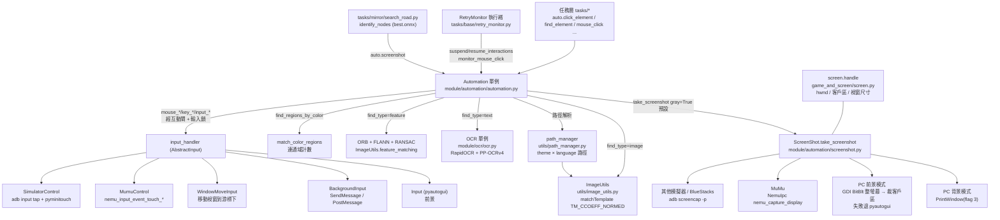
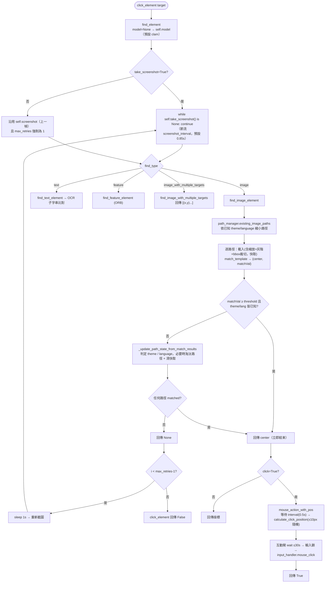

# 02 辨識與輸入核心（Recognition & Input）

> 基準：AALC 原始碼 SHA `b0f4393`。引用格式為 `[path:Lx-Ly]`，皆連到該 SHA 的 GitHub 永久連結。所謂「文件」指 [assets/doc/zh/image_recognition.md](https://github.com/KIYI671/AhabAssistantLimbusCompany/blob/b0f439321987f5f7b126ebbc424f6ef144c1bff0/assets/doc/zh/image_recognition.md)，與程式碼不一致處在「文件與程式碼差異」一節集中列出。

## 1. 目的

所有任務（日常、鏡牢、戰鬥、重試）都只透過同一個單例 `auto`（`Automation`）做三件事：**截圖 → 辨識（模板 / OCR / 特徵 / 顏色）→ 輸入（點擊 / 拖曳 / 鍵盤）**。本章說明這條共用管線的每一層，使後續章節（[03](03-daily-tasks.md)、[10](10-mirror-dungeon-overview.md)～[14](14-md-navigation.md)）只需引用「呼叫 `auto.xxx` 會發生什麼」，不必重述。

`auto` 在 [module/automation/__init__.py:L1-L4](https://github.com/KIYI671/AhabAssistantLimbusCompany/blob/b0f439321987f5f7b126ebbc424f6ef144c1bff0/module/automation/__init__.py#L1-L4) 以 `Automation(cfg.get_value("game_title_name"))` 建立；`Automation` 使用 `SingletonMeta`，因此全專案共用同一個實例、同一組截圖鎖與輸入鎖 [module/automation/automation.py:L40-L60](https://github.com/KIYI671/AhabAssistantLimbusCompany/blob/b0f439321987f5f7b126ebbc424f6ef144c1bff0/module/automation/automation.py#L40-L60)。

## 2. 整體架構

層次職責一句話版：

| 層 | 檔案 | 職責 |
|---|---|---|
| 任務 | `tasks/**` | 以 2560×1440 基準的相對檔名（如 `"home/window_assets.png"`）與 `scale = cfg.set_win_size / 1440` 的硬編碼偏移呼叫 `auto` |
| Automation | [module/automation/automation.py](https://github.com/KIYI671/AhabAssistantLimbusCompany/blob/b0f439321987f5f7b126ebbc424f6ef144c1bff0/module/automation/automation.py) | 截圖節流、模板/OCR/特徵/顏色查找、點擊間隔、輸入閘與鎖 |
| 路徑 | [utils/path_manager.py](https://github.com/KIYI671/AhabAssistantLimbusCompany/blob/b0f439321987f5f7b126ebbc424f6ef144c1bff0/utils/path_manager.py) | 維護 `dark|default × zh_cn|en|share` 的有效搜尋路徑與目前主題/語言 |
| 影像 | [utils/image_utils.py](https://github.com/KIYI671/AhabAssistantLimbusCompany/blob/b0f439321987f5f7b126ebbc424f6ef144c1bff0/utils/image_utils.py) | 載入並縮放模板、bbox、matchTemplate、NMS、顏色連通域、ORB |
| 截圖 | [module/automation/screenshot.py](https://github.com/KIYI671/AhabAssistantLimbusCompany/blob/b0f439321987f5f7b126ebbc424f6ef144c1bff0/module/automation/screenshot.py) | 依模式選擇截圖後端 |
| 視窗 | [module/game_and_screen/screen.py](https://github.com/KIYI671/AhabAssistantLimbusCompany/blob/b0f439321987f5f7b126ebbc424f6ef144c1bff0/module/game_and_screen/screen.py) | 視窗 handle、客戶區 rect、設定視窗大小/位置 |
| 輸入 | `module/automation/input_handlers/*` | 實際注入滑鼠/鍵盤事件 |

## 3. `find_element` / `click_element` 端到端流程

重點行為（皆為程式碼事實）：

- `find_element` 預設 `find_type="image"`、`threshold=0.8`、`max_retries=1`、`take_screenshot=False`、`model=None`（落到 `self.model`，初始 `"clam"`）、`min_dist=10` [module/automation/automation.py:L394-L405](https://github.com/KIYI671/AhabAssistantLimbusCompany/blob/b0f439321987f5f7b126ebbc424f6ef144c1bff0/module/automation/automation.py#L394-L405)。**不截圖就只有 1 次嘗試**（`max_retries = 1 if not take_screenshot`），重試之間固定 `sleep(1)` [module/automation/automation.py:L421-L459](https://github.com/KIYI671/AhabAssistantLimbusCompany/blob/b0f439321987f5f7b126ebbc424f6ef144c1bff0/module/automation/automation.py#L421-L459)。
- 找不到時各型別回傳值不同：image → `None`；text（str/list）→ `False`；text（dict）→ `None`；multiple → `[]`；feature → `False/None`。呼叫端只做真值判斷。
- `click_element` 找到才點；`click=False` 時等同「查位置」回傳座標；找不到回傳 `False` [module/automation/automation.py:L209-L254](https://github.com/KIYI671/AhabAssistantLimbusCompany/blob/b0f439321987f5f7b126ebbc424f6ef144c1bff0/module/automation/automation.py#L209-L254)。
- 點擊前套 ±10 px 隨機抖動（`offset=True`），並夾在截圖範圍內 [module/automation/automation.py:L256-L270](https://github.com/KIYI671/AhabAssistantLimbusCompany/blob/b0f439321987f5f7b126ebbc424f6ef144c1bff0/module/automation/automation.py#L256-L270)。
- 任務層慣用 `auto.model` 漸進放寬：`update_model_for_retry` 依剩餘重試次數切 `clam → normal → aggressive` [tasks/base/__init__.py:L1-L7](https://github.com/KIYI671/AhabAssistantLimbusCompany/blob/b0f439321987f5f7b126ebbc424f6ef144c1bff0/tasks/base/__init__.py#L1-L7)（用於 `back_init_menu` [tasks/base/back_init_menu.py:L14-L20](https://github.com/KIYI671/AhabAssistantLimbusCompany/blob/b0f439321987f5f7b126ebbc424f6ef144c1bff0/tasks/base/back_init_menu.py#L14-L20)）。

## 4. 座標系與解析度假設

- 文件：影像座標原點是**遊戲視窗客戶區左上角**；硬編碼座標以 2560×1440 為基準，使用 `find_element` 回傳值時需縮放 [assets/doc/zh/image_recognition.md](https://github.com/KIYI671/AhabAssistantLimbusCompany/blob/b0f439321987f5f7b126ebbc424f6ef144c1bff0/assets/doc/zh/image_recognition.md)。
- 實作：`cfg.set_win_size` 存的是**高度**（720/900/1080/1440/1800/2160），UI 選項見 [app/__init__.py:L24-L31](https://github.com/KIYI671/AhabAssistantLimbusCompany/blob/b0f439321987f5f7b126ebbc424f6ef144c1bff0/app/__init__.py#L24-L31)，預設值 `1080`（`config.example.yaml` 的 `set_win_size: 1080`）[assets/config/config.example.yaml](https://github.com/KIYI671/AhabAssistantLimbusCompany/blob/b0f439321987f5f7b126ebbc424f6ef144c1bff0/assets/config/config.example.yaml)。寬度恆為 `int(set_win_size * 16 / 9)`，`Screen.set_win` 會迴圈直到客戶區寬高符合才跳出 [module/game_and_screen/screen.py:L334-L363](https://github.com/KIYI671/AhabAssistantLimbusCompany/blob/b0f439321987f5f7b126ebbc424f6ef144c1bff0/module/game_and_screen/screen.py#L334-L363)。
- **模板縮放**：模板素材全是 2560×1440 全螢幕下擷取；載入時依 `cfg.set_win_size/1440` 縮放 —— 縮小用 `INTER_AREA`、放大用 `INTER_LINEAR`，然後轉灰階 [utils/image_utils.py:L101-L130](https://github.com/KIYI671/AhabAssistantLimbusCompany/blob/b0f439321987f5f7b126ebbc424f6ef144c1bff0/utils/image_utils.py#L101-L130)。**沒有多尺度搜尋**：截圖必須就是視窗客戶區大小，模板一次縮到同尺度。
- **任務層座標**：慣用 `scale = cfg.set_win_size / 1440` 乘上 1440 基準的像素偏移（例 [tasks/teams/team_formation.py:L34](https://github.com/KIYI671/AhabAssistantLimbusCompany/blob/b0f439321987f5f7b126ebbc424f6ef144c1bff0/tasks/teams/team_formation.py#L34)、[tasks/mirror/search_road.py:L475](https://github.com/KIYI671/AhabAssistantLimbusCompany/blob/b0f439321987f5f7b126ebbc424f6ef144c1bff0/tasks/mirror/search_road.py#L475) 的 `ROAD_COLUMN_GAP * cfg.set_win_size / 1440`）。
- **輸入端的另一個基準**：滾動/拖曳距離以 **1080p** 為基準 `scale = cfg.set_win_size / 1080`（`mouse_drag_down` 的 300 px、MuMu 隊伍捲動等）[module/automation/input_handlers/input.py:L185](https://github.com/KIYI671/AhabAssistantLimbusCompany/blob/b0f439321987f5f7b126ebbc424f6ef144c1bff0/module/automation/input_handlers/input.py#L185)、[module/automation/input_handlers/simulator/mumu_control.py:L1166](https://github.com/KIYI671/AhabAssistantLimbusCompany/blob/b0f439321987f5f7b126ebbc424f6ef144c1bff0/module/automation/input_handlers/simulator/mumu_control.py#L1166)。同一專案內兩個基準並存（1440 用於辨識偏移，1080 用於手勢距離）。
- **顏色區域**用 `image.shape[0] / 1440` 當 scale，ROI 與面積閾值（`min_area` 乘 scale²）都以 1440 高度書寫 [utils/image_utils.py:L277-L338](https://github.com/KIYI671/AhabAssistantLimbusCompany/blob/b0f439321987f5f7b126ebbc424f6ef144c1bff0/utils/image_utils.py#L277-L338)。
- **ORB 特徵**路徑把截圖縮放回 1440 基準；但 `set_win_size > 1440` 時程式用 `set_win_size / 1440`（放大）而非 `1440 / set_win_size`，與 `< 1440` 分支方向不對稱 [module/automation/automation.py:L679-L700](https://github.com/KIYI671/AhabAssistantLimbusCompany/blob/b0f439321987f5f7b126ebbc424f6ef144c1bff0/module/automation/automation.py#L679-L700)（見「未解問題」）。
- **MuMu** 例外：連線取得模擬器解析度後，若高度在 `(720, 900, 1080, 1440, 1800, 2160)` 內會自動 `cfg.set_value("set_win_size", height)` 並清圖片快取 [module/automation/input_handlers/simulator/mumu_control.py:L880-L911](https://github.com/KIYI671/AhabAssistantLimbusCompany/blob/b0f439321987f5f7b126ebbc424f6ef144c1bff0/module/automation/input_handlers/simulator/mumu_control.py#L880-L911)。其他 ADB 模擬器沒有此自動同步（程式內無對應碼）。
- **視窗設定**：`set_windows=True` 時 `Screen.set_win` 調整客戶區大小、移除邊框（`reduce_miscontact`）、依 `set_win_position`（free/left_top/…/center）擺位 [module/game_and_screen/screen.py:L365-L468](https://github.com/KIYI671/AhabAssistantLimbusCompany/blob/b0f439321987f5f7b126ebbc424f6ef144c1bff0/module/game_and_screen/screen.py#L365-L468)；螢幕解析度不足（<客戶區）時記錄錯誤並 `mediator.link_start.emit()` 結束 [module/game_and_screen/screen.py:L470-L486](https://github.com/KIYI671/AhabAssistantLimbusCompany/blob/b0f439321987f5f7b126ebbc424f6ef144c1bff0/module/game_and_screen/screen.py#L470-L486)；若視窗已是全螢幕會送 Alt+Enter 切回視窗 [module/game_and_screen/screen.py:L182-L195](https://github.com/KIYI671/AhabAssistantLimbusCompany/blob/b0f439321987f5f7b126ebbc424f6ef144c1bff0/module/game_and_screen/screen.py#L182-L195)。
- **DPI**：只在 GDI 與 pyautogui 兩條前景截圖路徑呼叫 `SetProcessDPIAware()` [module/automation/screenshot.py:L75-L76](https://github.com/KIYI671/AhabAssistantLimbusCompany/blob/b0f439321987f5f7b126ebbc424f6ef144c1bff0/module/automation/screenshot.py#L75-L76)、[module/automation/screenshot.py:L157-L158](https://github.com/KIYI671/AhabAssistantLimbusCompany/blob/b0f439321987f5f7b126ebbc424f6ef144c1bff0/module/automation/screenshot.py#L157-L158)；PrintWindow 路徑沒有。`scripts/match_steam_image.py` 另外以 `SetProcessDpiAwarenessContext(-4)`（Per-Monitor V2）→ `SetProcessDpiAwareness(2)` → `SetProcessDPIAware` 三段退讓 [scripts/match_steam_image.py:L20-L31](https://github.com/KIYI671/AhabAssistantLimbusCompany/blob/b0f439321987f5f7b126ebbc424f6ef144c1bff0/scripts/match_steam_image.py#L20-L31)。主程式本體沒有同等初始化（Qt 預設行為未在 repo 中確認）。
- **HDR**：`hdr.py` 以 ctypes 直呼 DXGI（`IDXGIOutput6::GetDesc1`），`ColorSpace == 12`（`RGB_FULL_G2084_NONE_P2020`）視為 HDR [module/game_and_screen/hdr.py:L8-L24](https://github.com/KIYI671/AhabAssistantLimbusCompany/blob/b0f439321987f5f7b126ebbc424f6ef144c1bff0/module/game_and_screen/hdr.py#L8-L24)、[module/game_and_screen/hdr.py:L203-L243](https://github.com/KIYI671/AhabAssistantLimbusCompany/blob/b0f439321987f5f7b126ebbc424f6ef144c1bff0/module/game_and_screen/hdr.py#L203-L243)。**只用於警告**：`script_task` 啟動時若遊戲所在螢幕為 HDR（且 `experimental_hdr_warning` 為真）就 `mediator.hdr_warning.emit` 並等使用者確認，不做任何色調修正 [tasks/base/script_task_scheme.py:L181-L203](https://github.com/KIYI671/AhabAssistantLimbusCompany/blob/b0f439321987f5f7b126ebbc424f6ef144c1bff0/tasks/base/script_task_scheme.py#L181-L203)、[tasks/base/script_task_scheme.py:L364](https://github.com/KIYI671/AhabAssistantLimbusCompany/blob/b0f439321987f5f7b126ebbc424f6ef144c1bff0/tasks/base/script_task_scheme.py#L364)。
- 啟動時另外警告：渲染比例為「低」、或解析度為 720 [tasks/base/script_task_scheme.py:L368-L372](https://github.com/KIYI671/AhabAssistantLimbusCompany/blob/b0f439321987f5f7b126ebbc424f6ef144c1bff0/tasks/base/script_task_scheme.py#L368-L372)。

## 5. 截圖層

### 5.1 `Automation.take_screenshot(gray=True)`

[module/automation/automation.py:L345-L392](https://github.com/KIYI671/AhabAssistantLimbusCompany/blob/b0f439321987f5f7b126ebbc424f6ef144c1bff0/module/automation/automation.py#L345-L392)：

1. 節流：距上次成功截圖不足 `cfg.screenshot_interval`（預設 0.85 s；為 0/空時也用 0.85）就先 `sleep` 補足。
2. 在 `_screenshot_lock` 內呼叫 `ScreenShot.take_screenshot(gray)`，並把結果記入 `_latest_screenshot`（供監控執行緒重用）。
3. 成功 → 存 `self.screenshot`、更新 `last_screenshot_time`；`ScreenShot` 回傳 `None` → 直接回 `None`（**不 sleep、不更新時間**，呼叫端慣例是 `while auto.take_screenshot() is None: continue`）。
4. 拋例外 → 記錄錯誤、`sleep(1)` 後重試；**累計 60 秒仍失敗**就 `taskkill /F /PID`（用 `screen.handle.hwnd`）並呼叫 `init_game()`，然後重置計時。

### 5.2 後端對照表

選擇邏輯在 [module/automation/screenshot.py:L18-L64](https://github.com/KIYI671/AhabAssistantLimbusCompany/blob/b0f439321987f5f7b126ebbc424f6ef144c1bff0/module/automation/screenshot.py#L18-L64)：

| 後端 | 何時使用 | 實作 | 輸出 | 備註 |
|---|---|---|---|---|
| **PrintWindow（PC 背景）** | `cfg.simulator=False` 且 `cfg.background_click=True`（預設） | `GetWindowDC` → 相容 DC/Bitmap → `PrintWindow(hwnd, dc, 3)` [module/automation/screenshot.py:L178-L235](https://github.com/KIYI671/AhabAssistantLimbusCompany/blob/b0f439321987f5f7b126ebbc424f6ef144c1bff0/module/automation/screenshot.py#L178-L235) | 客戶區大小，BGRX→RGB PIL | flag `3` = `PW_CLIENTONLY\|PW_RENDERFULLCONTENT`（依 Win32 常數推得，repo 內無註解）。視窗最小化時先設透明+還原再遞迴重試 [module/automation/screenshot.py:L252-L260](https://github.com/KIYI671/AhabAssistantLimbusCompany/blob/b0f439321987f5f7b126ebbc424f6ef144c1bff0/module/automation/screenshot.py#L252-L260) |
| **GDI BitBlt（PC 前景）** | `simulator=False` 且 `background_click=False` | `GetDC(0)` + `BitBlt(SRCCOPY)` 擷取**整個所在螢幕**，再依 `rect(client=True)` 裁出客戶區 [module/automation/screenshot.py:L66-L138](https://github.com/KIYI671/AhabAssistantLimbusCompany/blob/b0f439321987f5f7b126ebbc424f6ef144c1bff0/module/automation/screenshot.py#L66-L138) | 客戶區 | 截圖前呼叫 `bring_window_into_view(work_area)` 把視窗拉回可視區 |
| **pyautogui** | GDI 失敗時的後備 | `pyautogui.screenshot()` 全螢幕再裁 [module/automation/screenshot.py:L140-L176](https://github.com/KIYI671/AhabAssistantLimbusCompany/blob/b0f439321987f5f7b126ebbc424f6ef144c1bff0/module/automation/screenshot.py#L140-L176) | 客戶區 | 也失敗 → 回 `None` |
| **MuMu NemuIpc** | `simulator=True` 且 `simulator_type==0` | `MumuControl.screenshot(timeout=0.5)`：專用單執行緒執行器呼叫 `nemu_capture_display`，RGBA→RGB 並垂直翻轉 [module/automation/input_handlers/simulator/mumu_control.py:L948-L1011](https://github.com/KIYI671/AhabAssistantLimbusCompany/blob/b0f439321987f5f7b126ebbc424f6ef144c1bff0/module/automation/input_handlers/simulator/mumu_control.py#L948-L1011) | 模擬器整個顯示 | 在途超過 10 s 視為卡死，換執行器與 IPC 鎖 [module/automation/input_handlers/simulator/mumu_control.py:L922-L946](https://github.com/KIYI671/AhabAssistantLimbusCompany/blob/b0f439321987f5f7b126ebbc424f6ef144c1bff0/module/automation/input_handlers/simulator/mumu_control.py#L922-L946)；`userStopError` 會往上拋，其他例外回 `None` |
| **ADB screencap** | `simulator=True` 且 `simulator_type!=0`（BlueStacks 5=1、其他=10） | `adb shell screencap -p` → `cv2.imdecode` → RGB；資料 <500 bytes 視為異常 [module/automation/input_handlers/simulator/simulator_control.py:L502-L515](https://github.com/KIYI671/AhabAssistantLimbusCompany/blob/b0f439321987f5f7b126ebbc424f6ef144c1bff0/module/automation/input_handlers/simulator/simulator_control.py#L502-L515) | 模擬器整個顯示 | 失敗時 `_call_with_reconnect` 重建 ADB/minitouch 後重試一次 |

**程式碼中沒有** mss、dxcam、Windows Graphics Capture 後端（`rg` 全 repo 無 import）；任務要求的 mss/dxcam 項目因此不存在。模擬器截圖的 `gray=True` 是在 PIL 層 `convert("L")`。

其他：`ScreenShot.screenshot_benchmark(test_time=10)` 連拍 10 張回傳平均毫秒，供設定頁使用 [module/automation/screenshot.py:L289-L318](https://github.com/KIYI671/AhabAssistantLimbusCompany/blob/b0f439321987f5f7b126ebbc424f6ef144c1bff0/module/automation/screenshot.py#L289-L318)。

### 5.3 監控用快取

`take_monitor_screenshot(gray=True, max_age=0.0)`：若業務執行緒的最近一幀未超過 `max_age` 就重用（不覆蓋 `self.screenshot`），否則自己截一張 [module/automation/automation.py:L165-L190](https://github.com/KIYI671/AhabAssistantLimbusCompany/blob/b0f439321987f5f7b126ebbc424f6ef144c1bff0/module/automation/automation.py#L165-L190)。`RetryMonitor` 用 `max_age=3.0` [tasks/base/retry_monitor.py:L18-L33](https://github.com/KIYI671/AhabAssistantLimbusCompany/blob/b0f439321987f5f7b126ebbc424f6ef144c1bff0/tasks/base/retry_monitor.py#L18-L33)、[tasks/base/retry_monitor.py:L99-L103](https://github.com/KIYI671/AhabAssistantLimbusCompany/blob/b0f439321987f5f7b126ebbc424f6ef144c1bff0/tasks/base/retry_monitor.py#L99-L103)。

## 6. 視窗層 `screen.py`

- `Handle.init_handle(title="LimbusCompany", class_name="UnityWndClass")`：先 `FindWindow`，失敗則 `EnumWindows` 找 class+標題皆符者 [module/game_and_screen/screen.py:L26-L59](https://github.com/KIYI671/AhabAssistantLimbusCompany/blob/b0f439321987f5f7b126ebbc424f6ef144c1bff0/module/game_and_screen/screen.py#L26-L59)。`hwnd` 屬性會在 handle 失效（`IsWindow` 為假）時自動重抓；模擬器模式下不抓 [module/game_and_screen/screen.py:L61-L74](https://github.com/KIYI671/AhabAssistantLimbusCompany/blob/b0f439321987f5f7b126ebbc424f6ef144c1bff0/module/game_and_screen/screen.py#L61-L74)。
- `rect(client=True)` = `ClientToScreen(0,0)` + `GetClientRect` 的螢幕座標；這就是截圖裁切與前景點擊偏移的依據 [module/game_and_screen/screen.py:L95-L109](https://github.com/KIYI671/AhabAssistantLimbusCompany/blob/b0f439321987f5f7b126ebbc424f6ef144c1bff0/module/game_and_screen/screen.py#L95-L109)。
- `Screen.init_handle()`：抓不到視窗就 `game.start_game()`、睡 30 s 再抓；仍失敗回 `False`（`init_game` 會每 10 s 重試）[module/game_and_screen/screen.py:L314-L332](https://github.com/KIYI671/AhabAssistantLimbusCompany/blob/b0f439321987f5f7b126ebbc424f6ef144c1bff0/module/game_and_screen/screen.py#L314-L332)、[tasks/base/script_task_scheme.py:L127-L165](https://github.com/KIYI671/AhabAssistantLimbusCompany/blob/b0f439321987f5f7b126ebbc424f6ef144c1bff0/tasks/base/script_task_scheme.py#L127-L165)。
- `Game.start_game()`：已有進程則 60 s 內累計第 6 次以上的重啟請求就 `kill_game()`；否則用 `steam://rungameid/1973530` 開啟，5 s 後若沒進程且本地路徑存在再 `os.startfile` [module/game_and_screen/game.py:L35-L66](https://github.com/KIYI671/AhabAssistantLimbusCompany/blob/b0f439321987f5f7b126ebbc424f6ef144c1bff0/module/game_and_screen/game.py#L35-L66)。
- `set_window_transparent`：背景模式下把視窗設 `WS_EX_LAYERED|WS_EX_TRANSPARENT`、alpha=0（滑鼠穿透），僅在 `cfg.background_click` 為真時生效 [module/game_and_screen/screen.py:L284-L305](https://github.com/KIYI671/AhabAssistantLimbusCompany/blob/b0f439321987f5f7b126ebbc424f6ef144c1bff0/module/game_and_screen/screen.py#L284-L305)。
- `bring_window_into_view`：保證客戶區在螢幕（或工作區）內，前景截圖前每次都呼叫 [module/game_and_screen/screen.py:L256-L282](https://github.com/KIYI671/AhabAssistantLimbusCompany/blob/b0f439321987f5f7b126ebbc424f6ef144c1bff0/module/game_and_screen/screen.py#L256-L282)。
- `reset_win(activate)`：結束時還原樣式、取消置頂、放大回有邊框的尺寸 [module/game_and_screen/screen.py:L509-L589](https://github.com/KIYI671/AhabAssistantLimbusCompany/blob/b0f439321987f5f7b126ebbc424f6ef144c1bff0/module/game_and_screen/screen.py#L509-L589)。

## 7. 模板匹配（`ImageUtils` + `path_manager`）

### 7.1 演算法

- `match_template(screenshot, template, bbox, model)`：**灰階單尺度** `cv2.matchTemplate(..., TM_CCOEFF_NORMED)`，取 `minMaxLoc` 的最大值與位置，回傳 `(中心座標, 分數)`；無 mask、無多尺度、無金字塔 [utils/image_utils.py:L211-L249](https://github.com/KIYI671/AhabAssistantLimbusCompany/blob/b0f439321987f5f7b126ebbc424f6ef144c1bff0/utils/image_utils.py#L211-L249)。例外時只記錄並回傳 `None`（上層以 tuple unpack 失敗再被外層 try 吞掉，結果等同「找不到」）。
- 搜尋範圍由 `model` 與是否有 bbox 決定：

| model | 有 bbox（`*assets.png`） | 無 bbox |
|---|---|---|
| `clam`（預設） | bbox 四邊各外擴 **30 px**（夾在畫面內）後在該區搜尋 | 全畫面 |
| `normal` | 外擴 **100 px** | 全畫面 |
| `aggressive` | 全畫面 | 全畫面 |

  對應 [utils/image_utils.py:L219-L247](https://github.com/KIYI671/AhabAssistantLimbusCompany/blob/b0f439321987f5f7b126ebbc424f6ef144c1bff0/utils/image_utils.py#L219-L247)。注意外擴像素**不隨解析度縮放**（30/100 為固定像素）。
- **黑幕 bbox 自動 ROI**：檔名以 `assets.png` 結尾的模板（慣例 `_assets.png`）視為「2560×1440 含黑幕」；縮放+灰階後用 `get_bbox`（對每欄/列取最大值 > 0 的範圍）裁成非黑區塊，bbox 即其在畫面上的預期位置 [module/automation/automation.py:L724-L740](https://github.com/KIYI671/AhabAssistantLimbusCompany/blob/b0f439321987f5f7b126ebbc424f6ef144c1bff0/module/automation/automation.py#L724-L740)、[utils/image_utils.py:L146-L163](https://github.com/KIYI671/AhabAssistantLimbusCompany/blob/b0f439321987f5f7b126ebbc424f6ef144c1bff0/utils/image_utils.py#L146-L163)。非 assets 模板 bbox=None，預設全畫面搜尋（符合文件表格）。
- `_bbox.png` 後綴**不會**被匹配流程自動裁切，而是被任務程式碼拿來算 ROI：`ImageUtils.get_bbox(ImageUtils.load_image("..._bbox.png"))`，如 [tasks/mirror/mirror.py:L174](https://github.com/KIYI671/AhabAssistantLimbusCompany/blob/b0f439321987f5f7b126ebbc424f6ef144c1bff0/tasks/mirror/mirror.py#L174)、[tasks/mirror/mirror.py:L627](https://github.com/KIYI671/AhabAssistantLimbusCompany/blob/b0f439321987f5f7b126ebbc424f6ef144c1bff0/tasks/mirror/mirror.py#L627)、[tasks/mirror/mirror.py:L994](https://github.com/KIYI671/AhabAssistantLimbusCompany/blob/b0f439321987f5f7b126ebbc424f6ef144c1bff0/tasks/mirror/mirror.py#L994)。
- 有效匹配判定：數值型、非 inf、`>= threshold` [module/automation/automation.py:L742-L748](https://github.com/KIYI671/AhabAssistantLimbusCompany/blob/b0f439321987f5f7b126ebbc424f6ef144c1bff0/module/automation/automation.py#L742-L748)。
- 模板快取：`img_cache[(target, path)] = {template, bbox}`；`clear_img_cache()` 在路徑淘汰、`memory_protection` 且系統記憶體 >90%、`my_script_task._run` 結束時觸發 [module/automation/automation.py:L717-L740](https://github.com/KIYI671/AhabAssistantLimbusCompany/blob/b0f439321987f5f7b126ebbc424f6ef144c1bff0/module/automation/automation.py#L717-L740)、[module/automation/automation.py:L819-L825](https://github.com/KIYI671/AhabAssistantLimbusCompany/blob/b0f439321987f5f7b126ebbc424f6ef144c1bff0/module/automation/automation.py#L819-L825)、[tasks/base/script_task_scheme.py:L452-L499](https://github.com/KIYI671/AhabAssistantLimbusCompany/blob/b0f439321987f5f7b126ebbc424f6ef144c1bff0/tasks/base/script_task_scheme.py#L452-L499)。
- **多目標**（`image_with_multiple_targets`）：對整張（或 `my_crop`）做 matchTemplate，取所有 `>= threshold` 的像素，依分數降序做**貪婪 NMS**（保留與已保留點歐氏距離 `> min_dist`，預設 10 px、不隨解析度縮放），回傳模板中心清單；有 `my_crop` 時會加回裁切偏移 [utils/image_utils.py:L251-L275](https://github.com/KIYI671/AhabAssistantLimbusCompany/blob/b0f439321987f5f7b126ebbc424f6ef144c1bff0/utils/image_utils.py#L251-L275)、[module/automation/automation.py:L461-L495](https://github.com/KIYI671/AhabAssistantLimbusCompany/blob/b0f439321987f5f7b126ebbc424f6ef144c1bff0/module/automation/automation.py#L461-L495)。
- **特徵匹配**（`find_type="feature"`）：兩圖放大 2×，`ORB(nfeatures=1000)` + FLANN-LSH `knnMatch(k=2)` + Lowe 比值 0.7，良好匹配數 ≥ `min_matches`（預設 8）後 `findHomography(RANSAC, 5.0)`，內點比 < 0.3 視為不可靠；回傳 `(bool, 匹配數)`，`find_feature_element` 只取 bool [utils/image_utils.py:L349-L394](https://github.com/KIYI671/AhabAssistantLimbusCompany/blob/b0f439321987f5f7b126ebbc424f6ef144c1bff0/utils/image_utils.py#L349-L394)、[module/automation/automation.py:L657-L715](https://github.com/KIYI671/AhabAssistantLimbusCompany/blob/b0f439321987f5f7b126ebbc424f6ef144c1bff0/module/automation/automation.py#L657-L715)。模板載入失敗會記進 `_unavailable_feature_templates` 避免重複嘗試。目前呼叫者是鏡牢節點判別 [tasks/mirror/search_road.py:L116-L127](https://github.com/KIYI671/AhabAssistantLimbusCompany/blob/b0f439321987f5f7b126ebbc424f6ef144c1bff0/tasks/mirror/search_road.py#L116-L127)（歸 [14](14-md-navigation.md)）。
- **顏色區域計數** `find_regions_by_color(roi, mask_fn, min_area=300, min_dist=80)`：取彩色截圖，`mask_fn(ROI RGB)` 產生 0/255 掩碼 → `MORPH_CLOSE`（3×3, 2 次）→ `connectedComponentsWithStats` → 面積過濾 → 依面積降序以質心距離去重，回傳 `[(cx, cy, area)]`；出錯回 `None` [module/automation/automation.py:L497-L517](https://github.com/KIYI671/AhabAssistantLimbusCompany/blob/b0f439321987f5f7b126ebbc424f6ef144c1bff0/module/automation/automation.py#L497-L517)、[utils/image_utils.py:L277-L338](https://github.com/KIYI671/AhabAssistantLimbusCompany/blob/b0f439321987f5f7b126ebbc424f6ef144c1bff0/utils/image_utils.py#L277-L338)。目前唯一呼叫者 [tasks/mirror/get_floor.py:L45](https://github.com/KIYI671/AhabAssistantLimbusCompany/blob/b0f439321987f5f7b126ebbc424f6ef144c1bff0/tasks/mirror/get_floor.py#L45)。
- `ImageUtils.crop` 支援超出邊界（黑色補邊）[utils/image_utils.py:L165-L191](https://github.com/KIYI671/AhabAssistantLimbusCompany/blob/b0f439321987f5f7b126ebbc424f6ef144c1bff0/utils/image_utils.py#L165-L191)。`get_grey_normalized_pic`（CLAHE）存在但全 repo 無呼叫。

### 7.2 路徑與主題/語言判定

目錄為 `assets/images/{dark|default}/{zh_cn|en|share}/…`；`PathManager.DEFAULT_ACTIVE_PATHS` 順序固定為 `dark/zh_cn, dark/en, dark/share, default/zh_cn, default/en, default/share` [utils/path_manager.py:L10-L17](https://github.com/KIYI671/AhabAssistantLimbusCompany/blob/b0f439321987f5f7b126ebbc424f6ef144c1bff0/utils/path_manager.py#L10-L17)。素材總數 491 張 PNG；`dark` 只涵蓋 enkephalin/mail/mirror 等少數資料夾（`share` 較多）。

`script_task` 啟動時 `path_manager.initialize_paths()` + `auto.clear_img_cache()`，**不讀取使用者語言設定**（docstring 明言），主題/語言完全由首次匹配結果推斷 [utils/path_manager.py:L30-L44](https://github.com/KIYI671/AhabAssistantLimbusCompany/blob/b0f439321987f5f7b126ebbc424f6ef144c1bff0/utils/path_manager.py#L30-L44)、[tasks/base/script_task_scheme.py:L374-L377](https://github.com/KIYI671/AhabAssistantLimbusCompany/blob/b0f439321987f5f7b126ebbc424f6ef144c1bff0/tasks/base/script_task_scheme.py#L374-L377)。

查找一張圖時（`find_image_element`，[module/automation/automation.py:L806-L873](https://github.com/KIYI671/AhabAssistantLimbusCompany/blob/b0f439321987f5f7b126ebbc424f6ef144c1bff0/module/automation/automation.py#L806-L873)）：

1. `ImageUtils.existing_image_paths(target)`：先列出磁碟上存在的有效路徑，再依已知狀態縮小 —— theme=dark 且存在 dark 路徑 → 只留 dark；theme=default → 只留 default；language=zh_cn 且存在 zh_cn → 只留 zh_cn；language=en → 留 en（沒有則留 share）[utils/image_utils.py:L62-L86](https://github.com/KIYI671/AhabAssistantLimbusCompany/blob/b0f439321987f5f7b126ebbc424f6ef144c1bff0/utils/image_utils.py#L62-L86)。
2. **依序**對每條路徑載入模板並匹配、記錄 `{path, center, matched, matchVal}`；若該路徑命中且 theme 與 language **皆已知** → 立刻回傳 center。
3. 狀態未全知 → 跑完所有路徑，交給 `_update_path_state_from_match_results` 更新狀態，再回傳第一個命中者。

`_update_path_state_from_match_results`（[module/automation/automation.py:L752-L800](https://github.com/KIYI671/AhabAssistantLimbusCompany/blob/b0f439321987f5f7b126ebbc424f6ef144c1bff0/module/automation/automation.py#L752-L800)，`MATCH_GAP = 0.15` 在第 750 行）：

| 維度 | 條件 | 結果 |
|---|---|---|
| 主題 | 只有 dark 命中 | `set_theme("dark")` |
| 主題 | default 命中、存在 dark 路徑但 dark 未命中 | `set_theme("default")` + `eliminate_dark_paths()` + 清快取 |
| 主題 | 兩者皆命中 | 取各自最高分；`default − dark > 0.15` → default（淘汰 dark）；`dark − default > 0.15` → dark；差距內不決定 |
| 語言 | zh_cn 命中、en 未命中 | `set_language("zh_cn")` |
| 語言 | en 命中、zh_cn 未命中 | `set_language("en")` + `eliminate_zh_cn_paths()` + 清快取 |
| 語言 | 兩者皆命中 | 同上，差距 > 0.15 才決定 |
| 語言 | 只有 share 命中 | **不**決定語言（註解：share 為語言無關資源） |

`eliminate_*` 會從 `active_paths` 永久移除 dark 或 zh_cn 路徑直到下次 `initialize_paths(reset_eliminations=True)` [utils/path_manager.py:L69-L96](https://github.com/KIYI671/AhabAssistantLimbusCompany/blob/b0f439321987f5f7b126ebbc424f6ef144c1bff0/utils/path_manager.py#L69-L96)。`find_language_text` 也會反向同步語言（見 §8）。

**與文件的比對**見 §13：門檻 0.15、搜尋順序、`threshold=0.8` 與文件一致；有 3 處不一致。

## 8. OCR

- 引擎：`rapidocr==3.4.1`（`pyproject`/`requirements` 釘版），ONNXRuntime 後端；偵測/辨識皆 `LangDet.CH` / `LangRec.CH`、`ModelType.MOBILE`、`OCRVersion.PPOCRV4`，並載入 [assets/config/default_rapidocr.yaml](https://github.com/KIYI671/AhabAssistantLimbusCompany/blob/b0f439321987f5f7b126ebbc424f6ef144c1bff0/assets/config/default_rapidocr.yaml) [module/ocr/ocr.py:L13-L28](https://github.com/KIYI671/AhabAssistantLimbusCompany/blob/b0f439321987f5f7b126ebbc424f6ef144c1bff0/module/ocr/ocr.py#L13-L28)。**不是 PaddleOCR 本體**，是 RapidOCR 包 PP-OCRv4 ONNX 模型；`model_path/model_dir` 皆為 `null`，模型檔不在 repo（由 RapidOCR 依 `lang_type/model_type/ocr_version` 解析，下載行為屬套件，未於 repo 驗證）。中英共用同一個 `ch` 模型，沒有切換語系模型。
- 參數重點（yaml）：`text_score: 0.5`、`max_side_len: 1600`、`min_side_len: 30`、Det `limit_side_len: 736`／`limit_type: min`／`thresh 0.3`／`box_thresh 0.5`／`unclip_ratio 1.6`、Cls `cls_thresh 0.9`、Rec `rec_img_shape [3,48,320]`／`rec_batch_num 6`；ORT 執行緒 `intra/inter_op_num_threads: 2`、`use_cuda/use_dml: false`（純 CPU，刻意限制資源）。`font_path` 設成非空值只是為了跳過字型下載（註解說明）。
- 預處理：`OCR.run(image)` 接受 PIL / ndarray / 路徑；轉灰階後套 **CLAHE**（`clipLimit=2.0, tileGridSize=(8,8)`）再丟引擎；例外時記錄並回傳空 `RapidOCROutput()` [module/ocr/ocr.py:L30-L68](https://github.com/KIYI671/AhabAssistantLimbusCompany/blob/b0f439321987f5f7b126ebbc424f6ef144c1bff0/module/ocr/ocr.py#L30-L68)。
- `OCR` 為單例，於 `module/ocr/__init__.py` 建立 `ocr = OCR(log)` [module/ocr/__init__.py:L1-L6](https://github.com/KIYI671/AhabAssistantLimbusCompany/blob/b0f439321987f5f7b126ebbc424f6ef144c1bff0/module/ocr/__init__.py#L1-L6)。
- **文字比對方式**（`find_str_in_text`）：**不分大小寫的子字串包含**，且會再試一次「去除空格後的子字串包含」；**不是**模糊比對（無編輯距離）、**不是**正規表達式 [module/automation/automation.py:L519-L531](https://github.com/KIYI671/AhabAssistantLimbusCompany/blob/b0f439321987f5f7b126ebbc424f6ef144c1bff0/module/automation/automation.py#L519-L531)。
- `find_text_element(target, my_crop, all_text, only_text)` [module/automation/automation.py:L629-L638](https://github.com/KIYI671/AhabAssistantLimbusCompany/blob/b0f439321987f5f7b126ebbc424f6ef144c1bff0/module/automation/automation.py#L629-L638)：
  - `target: str` → 命中回傳 OCR 框中心 `[x, y]`（取 `box[0]` 與 `box[2]` 的平均），否則 `False`；
  - `target: list` → 預設任一命中即回該項座標；`all_text=True` 要求全部命中，成功回 `True`；
  - `target: dict` → 依鍵順序找，命中回 `TextMatchResult(value, text, position)`，否則 `None`（用於「文字 → 設定值」映射）；
  - `only_text=True` → 回傳辨識出的全部文字清單（或 `False`）。
  OCR 結果以 `{文字: 座標}` dict 保存 [module/automation/automation.py:L533-L555](https://github.com/KIYI671/AhabAssistantLimbusCompany/blob/b0f439321987f5f7b126ebbc424f6ef144c1bff0/module/automation/automation.py#L533-L555)，因此**同一文字出現多次只會保留最後一個**。
- `find_language_text(zh_text, en_text, …)`：只跑一次 OCR；已知語言就只比該語言字串，未知則先比中文，命中 → `set_language("zh_cn")`；再比英文，命中 → `set_language("en")` + 淘汰 zh_cn 路徑 + 清快取 [module/automation/automation.py:L579-L627](https://github.com/KIYI671/AhabAssistantLimbusCompany/blob/b0f439321987f5f7b126ebbc424f6ef144c1bff0/module/automation/automation.py#L579-L627)。換言之，**OCR 也是語言偵測的來源之一**。
- `get_text_from_screenshot(my_crop)`：回傳純文字清單 [module/automation/automation.py:L640-L655](https://github.com/KIYI671/AhabAssistantLimbusCompany/blob/b0f439321987f5f7b126ebbc424f6ef144c1bff0/module/automation/automation.py#L640-L655)。
- 座標注意：`my_crop` 時 OCR 與單目標圖像匹配回傳的是**裁切圖內座標，不加回偏移**（多目標才加）；既有呼叫端要嘛只用真值，要嘛讓裁切起點為 (0,0)，如 [tasks/teams/team_formation.py:L169-L173](https://github.com/KIYI671/AhabAssistantLimbusCompany/blob/b0f439321987f5f7b126ebbc424f6ef144c1bff0/tasks/teams/team_formation.py#L169-L173)（見未解問題）。

## 9. 輸入層

### 9.1 選擇與閘門（`Automation.init_input`）

[module/automation/automation.py:L62-L119](https://github.com/KIYI671/AhabAssistantLimbusCompany/blob/b0f439321987f5f7b126ebbc424f6ef144c1bff0/module/automation/automation.py#L62-L119)：

- `cfg.simulator` 為真：`simulator_type==0` → `MumuControl.connection_device`；否則 → `SimulatorControl.connection_device`（BlueStacks 與一般 ADB 共用，差別在 `simulator_type==1` 時會自動探索/啟動 BlueStacks）。
- 否則依 `cfg.win_input_type`：`"background"` → `BackgroundInput`、`"foreground"` → `Input`、`"window_move"` → `WindowMoveInput`；仍為 `None` 時退回 `BackgroundInput`。`win_input_type` 由舊設定 `background_click` 遷移而來 [module/config/config.py:L118-L122](https://github.com/KIYI671/AhabAssistantLimbusCompany/blob/b0f439321987f5f7b126ebbc424f6ef144c1bff0/module/config/config.py#L118-L122)；UI 選項見 [app/__init__.py:L233-L237](https://github.com/KIYI671/AhabAssistantLimbusCompany/blob/b0f439321987f5f7b126ebbc424f6ef144c1bff0/app/__init__.py#L233-L237)。
- 把 `mouse_*`、`key_*`、`input_*` 全部以 `_run_business_interaction(name)` 包裝：**先等待互動閘（最長 `GATE_WAIT_TIMEOUT=30s`），再取 `_input_lock`，取得後重新確認閘**；閘關閉超過 30 s 視為監控卡在持續彈窗而放行 [module/automation/automation.py:L138-L158](https://github.com/KIYI671/AhabAssistantLimbusCompany/blob/b0f439321987f5f7b126ebbc424f6ef144c1bff0/module/automation/automation.py#L138-L158)。`mouse_action_with_pos` 另外在算座標前也 `wait` 閘 [module/automation/automation.py:L318](https://github.com/KIYI671/AhabAssistantLimbusCompany/blob/b0f439321987f5f7b126ebbc424f6ef144c1bff0/module/automation/automation.py#L318)。
- 監控執行緒用 `monitor_mouse_click` 繞過閘，只取鎖 [module/automation/automation.py:L160-L163](https://github.com/KIYI671/AhabAssistantLimbusCompany/blob/b0f439321987f5f7b126ebbc424f6ef144c1bff0/module/automation/automation.py#L160-L163)；`suspend_interactions/resume_interactions` 控制閘 [module/automation/automation.py:L121-L127](https://github.com/KIYI671/AhabAssistantLimbusCompany/blob/b0f439321987f5f7b126ebbc424f6ef144c1bff0/module/automation/automation.py#L121-L127)。
- 硬終止（`my_script_task.terminate()` → QThread.terminate）後以 `reset_safety_locks()` 換新 RLock，避免被殺執行緒持有的鎖永遠不放 [module/automation/automation.py:L129-L136](https://github.com/KIYI671/AhabAssistantLimbusCompany/blob/b0f439321987f5f7b126ebbc424f6ef144c1bff0/module/automation/automation.py#L129-L136)、[tasks/base/script_task_scheme.py:L484-L488](https://github.com/KIYI671/AhabAssistantLimbusCompany/blob/b0f439321987f5f7b126ebbc424f6ef144c1bff0/tasks/base/script_task_scheme.py#L484-L488)。
- 點擊節奏：`mouse_action_with_pos` 以 `last_click_time` 保證兩次點擊間隔 ≥ `interval`（預設 0.5；若 `cfg.mouse_action_interval` 有值且 `interval` 仍是預設 0.5 就改用 cfg 值）[module/automation/automation.py:L309-L315](https://github.com/KIYI671/AhabAssistantLimbusCompany/blob/b0f439321987f5f7b126ebbc424f6ef144c1bff0/module/automation/automation.py#L309-L315)。`action` 支援 `click / drag / drag_down / scroll`，其他拋 `ValueError("未知的操作类型…")` [module/automation/automation.py:L321-L341](https://github.com/KIYI671/AhabAssistantLimbusCompany/blob/b0f439321987f5f7b126ebbc424f6ef144c1bff0/module/automation/automation.py#L321-L341)；`image_with_multiple_targets` 會對每個點逐一遞迴點擊（間隔 1 s）[module/automation/automation.py:L294-L307](https://github.com/KIYI671/AhabAssistantLimbusCompany/blob/b0f439321987f5f7b126ebbc424f6ef144c1bff0/module/automation/automation.py#L294-L307)。

### 9.2 抽象介面 `AbstractInput`

[module/automation/input_handlers/__init__.py:L6-L148](https://github.com/KIYI671/AhabAssistantLimbusCompany/blob/b0f439321987f5f7b126ebbc424f6ef144c1bff0/module/automation/input_handlers/__init__.py#L6-L148)：`mouse_click(x,y,times=1,move_back=False)`、`mouse_click_blank(coordinate=(1,1),…)`、`mouse_drag(x,y,drag_time=0.1,dx,dy)`、`mouse_swipe_for_scroll(x,y,duration=0.3,dx,dy)`、`mouse_swipe_for_team_scroll`（預設轉呼叫前者）、`mouse_drag_down`、`mouse_drag_link(position)`、`mouse_scroll(direction=-3)`、`mouse_to_blank`、`key_press(key)`、`input_text(text)`；未實作的一律 `raise InterruptedError`。暫停機制：`set_pause()` 切換 `is_pause`，各 handler 在點擊後呼叫 `wait_pause()` 阻塞（所以暫停在「下一次點擊」才生效）。`wait_pause` 內 `pause_identity is not False` 條件永遠為假，「AALC 已暫停」日誌實際不會輸出 [module/automation/input_handlers/__init__.py:L27-L37](https://github.com/KIYI671/AhabAssistantLimbusCompany/blob/b0f439321987f5f7b126ebbc424f6ef144c1bff0/module/automation/input_handlers/__init__.py#L27-L37)。

### 9.3 各後端比較

| 後端 | 類別 / 檔案 | 座標基準 | 點擊機制 | 拖曳 / 滾動 | 備註 |
|---|---|---|---|---|---|
| PC 前景 | `Input` [module/automation/input_handlers/input.py:L141-L314](https://github.com/KIYI671/AhabAssistantLimbusCompany/blob/b0f439321987f5f7b126ebbc424f6ef144c1bff0/module/automation/input_handlers/input.py#L141-L314) | 客戶區座標 + `rect(True)` 左上角 → 螢幕座標 | `pyautogui.click`（真實游標） | `mouse_drag`/`mouse_drag_down`（300×`set_win_size/1080` px，0.4 s）/`mouse_swipe_for_scroll`；**支援** `mouse_scroll`（`pyautogui.scroll`） | `FAILSAFE=False`；`input_text` 用 `pyperclip` 貼上 + Ctrl+V，失敗退 `typewrite`；`key_press` = `pyautogui.press` |
| PC 背景（預設） | `BackgroundInput` [module/automation/input_handlers/input.py:L317-L684](https://github.com/KIYI671/AhabAssistantLimbusCompany/blob/b0f439321987f5f7b126ebbc424f6ef144c1bff0/module/automation/input_handlers/input.py#L317-L684) | 客戶區座標直接塞進訊息 `MAKELONG(x,y)` | `set_mouse_pos`（仍用 `SetCursorPos` 把真實游標移到對應螢幕位置）→ `set_active`（`WM_ACTIVATE`）→ `WM_LBUTTONDOWN` → 0.03 s → `WM_LBUTTONUP`；預設 `SendMessage`，`use_post_message=True` 改 `PostMessage` 並多睡 `0.02+mouse_down_duration`（預設 0.1） [module/automation/input_handlers/input.py:L347-L376](https://github.com/KIYI671/AhabAssistantLimbusCompany/blob/b0f439321987f5f7b126ebbc424f6ef144c1bff0/module/automation/input_handlers/input.py#L347-L376)、[module/automation/input_handlers/input.py:L525-L557](https://github.com/KIYI671/AhabAssistantLimbusCompany/blob/b0f439321987f5f7b126ebbc424f6ef144c1bff0/module/automation/input_handlers/input.py#L525-L557) | 同樣用游標移動 + 按下/抬起訊息；**不支援滾輪**（`mouse_scroll` 回 `False`） [module/automation/input_handlers/input.py:L445-L455](https://github.com/KIYI671/AhabAssistantLimbusCompany/blob/b0f439321987f5f7b126ebbc424f6ef144c1bff0/module/automation/input_handlers/input.py#L445-L455) | 預設 `move_back=True` 動作後把游標移回原處；`key_down/up` 構造含 scan code 與 extended flag 的 `lParam`（註解：Unity 6+ 會忽略固定 lParam）[module/automation/input_handlers/input.py:L120-L134](https://github.com/KIYI671/AhabAssistantLimbusCompany/blob/b0f439321987f5f7b126ebbc424f6ef144c1bff0/module/automation/input_handlers/input.py#L120-L134)；`input_text` 逐字 `WM_CHAR` |
| PC 後援（window_move） | `WindowMoveInput` [module/automation/input_handlers/input.py:L686-L959](https://github.com/KIYI671/AhabAssistantLimbusCompany/blob/b0f439321987f5f7b126ebbc424f6ef144c1bff0/module/automation/input_handlers/input.py#L686-L959) | 同上 | **不動游標**：把遊戲視窗用 `SetWindowPos` 移到使「目標點正好在目前游標下」，再送 `WM_LBUTTON*`，完成後視窗移回 | 拖曳以逐步移動視窗模擬；`mouse_scroll` 回 `False`；`mouse_to_blank` 為空操作 | UI 名稱「後台增強 (pywin32+set_window_pos)」；螢幕過小檢查對此模式略過 [module/game_and_screen/screen.py:L476](https://github.com/KIYI671/AhabAssistantLimbusCompany/blob/b0f439321987f5f7b126ebbc424f6ef144c1bff0/module/game_and_screen/screen.py#L476) |
| MuMu | `MumuControl` [module/automation/input_handlers/simulator/mumu_control.py:L232-L1353](https://github.com/KIYI671/AhabAssistantLimbusCompany/blob/b0f439321987f5f7b126ebbc424f6ef144c1bff0/module/automation/input_handlers/simulator/mumu_control.py#L232-L1353) | 模擬器像素 | NemuIpc DLL：`nemu_input_event_touch_down/up`；click = down→15 ms→up→35 ms [module/automation/input_handlers/simulator/mumu_control.py:L1013-L1038](https://github.com/KIYI671/AhabAssistantLimbusCompany/blob/b0f439321987f5f7b126ebbc424f6ef144c1bff0/module/automation/input_handlers/simulator/mumu_control.py#L1013-L1038)、[module/automation/input_handlers/simulator/mumu_control.py:L1091-L1097](https://github.com/KIYI671/AhabAssistantLimbusCompany/blob/b0f439321987f5f7b126ebbc424f6ef144c1bff0/module/automation/input_handlers/simulator/mumu_control.py#L1091-L1097) | `insert_swipe`（三次貝茲曲線 + 隨機取樣）產生擬人路徑 [module/automation/input_handlers/simulator/__init__.py:L21-L75](https://github.com/KIYI671/AhabAssistantLimbusCompany/blob/b0f439321987f5f7b126ebbc424f6ef144c1bff0/module/automation/input_handlers/simulator/__init__.py#L21-L75)；`mouse_scroll` 是空操作回 `True` | 由登錄檔（`MuMuPlayer-12.0` 等）找安裝路徑，載入 `external_renderer_ipc.dll`（支援 DLL 版本 `12.0`/`15.0`）[module/automation/input_handlers/simulator/mumu_control.py:L366-L430](https://github.com/KIYI671/AhabAssistantLimbusCompany/blob/b0f439321987f5f7b126ebbc424f6ef144c1bff0/module/automation/input_handlers/simulator/mumu_control.py#L366-L430)、[module/automation/input_handlers/simulator/mumu_control.py:L739-L800](https://github.com/KIYI671/AhabAssistantLimbusCompany/blob/b0f439321987f5f7b126ebbc424f6ef144c1bff0/module/automation/input_handlers/simulator/mumu_control.py#L739-L800)；ADB 僅用於啟動遊戲/查包名；IPC 呼叫經 `ev_run_sync` 逾時 1 s 並全域序列化 |
| BlueStacks 5 | `SimulatorControl`（`simulator_type==1`）+ `BlueStacksLauncher` [module/automation/input_handlers/simulator/bluestacks_control.py:L108-L246](https://github.com/KIYI671/AhabAssistantLimbusCompany/blob/b0f439321987f5f7b126ebbc424f6ef144c1bff0/module/automation/input_handlers/simulator/bluestacks_control.py#L108-L246) | 模擬器像素（橫向原生，不旋轉） | 同下方 ADB | 拖曳不旋轉座標；`mouse_swipe_for_scroll` 直接 `adb shell input swipe` | 連線前讀 `bluestacks.conf`（註冊表 `SOFTWARE\BlueStacks_nxt`）找實例與 ADB port，必要時啟動/重啟實例、等 `sys.boot_completed` [module/automation/input_handlers/simulator/simulator_control.py:L302-L363](https://github.com/KIYI671/AhabAssistantLimbusCompany/blob/b0f439321987f5f7b126ebbc424f6ef144c1bff0/module/automation/input_handlers/simulator/simulator_control.py#L302-L363)、[module/automation/input_handlers/simulator/simulator_control.py:L265-L300](https://github.com/KIYI671/AhabAssistantLimbusCompany/blob/b0f439321987f5f7b126ebbc424f6ef144c1bff0/module/automation/input_handlers/simulator/simulator_control.py#L265-L300) |
| 通用 ADB 模擬器 | `SimulatorControl`（`simulator_type==10`）[module/automation/input_handlers/simulator/simulator_control.py:L94-L763](https://github.com/KIYI671/AhabAssistantLimbusCompany/blob/b0f439321987f5f7b126ebbc424f6ef144c1bff0/module/automation/input_handlers/simulator/simulator_control.py#L94-L763) | 模擬器像素；拖曳經 `_scale`（x,y 對調並以 `max_x−y` 反轉，假設直向原生）| 點擊：`adb shell input tap x y`（`_scale` 結果其實未使用）[module/automation/input_handlers/simulator/simulator_control.py:L540-L568](https://github.com/KIYI671/AhabAssistantLimbusCompany/blob/b0f439321987f5f7b126ebbc424f6ef144c1bff0/module/automation/input_handlers/simulator/simulator_control.py#L540-L568) | 拖曳/連續滑動走 **minitouch** socket（`pyminitouch`）：`ext_smooth_swipe`、`_send_swipe_plan_in_one_batch` [module/automation/input_handlers/simulator/pyminitouch/actions.py:L237-L263](https://github.com/KIYI671/AhabAssistantLimbusCompany/blob/b0f439321987f5f7b126ebbc424f6ef144c1bff0/module/automation/input_handlers/simulator/pyminitouch/actions.py#L237-L263) | `key_press` → `input keyevent`；`input_text` → `input text`（空格改 `%s`）；連線錯誤時 `_call_with_reconnect` 重建一次（受 `adb_reconnect_on_error` 控制） |

補充：

- **adb endpoint**：`build_adb_endpoint(host, port)` 驗證主機（IP/hostname，拒絕含協議/路徑）、port 1–65535，IPv6 加方括號，產出 adbutils 序號 [utils/adb_endpoint.py:L12-L49](https://github.com/KIYI671/AhabAssistantLimbusCompany/blob/b0f439321987f5f7b126ebbc424f6ef144c1bff0/utils/adb_endpoint.py#L12-L49)；`adb_connect` 以 `adb.connect` 嘗試最多 3 次，`simulator_type==1` 且為本機時改為啟動 BlueStacks 後輪詢直到 `start_emulator_timeout`（預設 120 s）[module/automation/input_handlers/simulator/simulator_control.py:L302-L363](https://github.com/KIYI671/AhabAssistantLimbusCompany/blob/b0f439321987f5f7b126ebbc424f6ef144c1bff0/module/automation/input_handlers/simulator/simulator_control.py#L302-L363)。
- **minitouch 部署**：`MNTInstaller` 讀 `ro.product.cpu.abi`，若裝置上 `/data/local/tmp/minitouch` 不存在就從 `assets/minitouch/<abi>/minitouch` 推送並 `chmod 777` [module/automation/input_handlers/simulator/pyminitouch/connection.py:L17-L81](https://github.com/KIYI671/AhabAssistantLimbusCompany/blob/b0f439321987f5f7b126ebbc424f6ef144c1bff0/module/automation/input_handlers/simulator/pyminitouch/connection.py#L17-L81)；`MNTServer` 從 20000–20999 之間隨機挑未佔用 port 做 `adb forward tcp:<port> localabstract:minitouch` 並啟動 [module/automation/input_handlers/simulator/pyminitouch/connection.py:L90-L175](https://github.com/KIYI671/AhabAssistantLimbusCompany/blob/b0f439321987f5f7b126ebbc424f6ef144c1bff0/module/automation/input_handlers/simulator/pyminitouch/connection.py#L90-L175)、[module/automation/input_handlers/simulator/pyminitouch/config.py:L3-L6](https://github.com/KIYI671/AhabAssistantLimbusCompany/blob/b0f439321987f5f7b126ebbc424f6ef144c1bff0/module/automation/input_handlers/simulator/pyminitouch/config.py#L3-L6)。`MNTConnection` 讀 `^ max_contacts max_x max_y …` 標頭；若 `max_x > 1440` 視為 BlueStacks，座標按 `real_width/real_height` 正規化到 minitouch 範圍 [module/automation/input_handlers/simulator/pyminitouch/actions.py:L184-L193](https://github.com/KIYI671/AhabAssistantLimbusCompany/blob/b0f439321987f5f7b126ebbc424f6ef144c1bff0/module/automation/input_handlers/simulator/pyminitouch/actions.py#L184-L193)。`send()` 每次都得 `_drain_logs()`，否則 TCP 緩衝區塞滿會讓 minitouch 阻塞 [module/automation/input_handlers/simulator/pyminitouch/connection.py:L260-L272](https://github.com/KIYI671/AhabAssistantLimbusCompany/blob/b0f439321987f5f7b126ebbc424f6ef144c1bff0/module/automation/input_handlers/simulator/pyminitouch/connection.py#L260-L272)。
- **`assets/minitouch/`** 含各 ABI（`arm64-v8a`、`armeabi`、`armeabi-v7a`、`riscv64`、`x86`、`x86_64`）與一個 `maatouch/` 目錄；全 repo 沒有任何程式碼參考 `maatouch`（`rg -i maatouch` 只命中資產目錄本身），安裝器只讀 `assets/minitouch/<abi>/minitouch`，因此 **maatouch 是未使用的資產**。
- **捲動手勢** `scroll_swipe.py`：`build_scroll_swipe_plan` 在按下後先以 30 px 於 0.01 s 內「逃離長按判定區」再移向終點；Windows 版 `build_windows_scroll_swipe_plan` 再加一段 30 px 煞車尾段（0.5 s）與抬起前 0.3 s 停留，以避免遊戲把滑動當慣性拖動 [module/automation/input_handlers/scroll_swipe.py:L3-L68](https://github.com/KIYI671/AhabAssistantLimbusCompany/blob/b0f439321987f5f7b126ebbc424f6ef144c1bff0/module/automation/input_handlers/scroll_swipe.py#L3-L68)。MuMu 隊伍捲動另有專用實作（逃離距離 60 px@1080p，停留 0.5 s）[module/automation/input_handlers/simulator/mumu_control.py:L78-L81](https://github.com/KIYI671/AhabAssistantLimbusCompany/blob/b0f439321987f5f7b126ebbc424f6ef144c1bff0/module/automation/input_handlers/simulator/mumu_control.py#L78-L81)、[module/automation/input_handlers/simulator/mumu_control.py:L1214-L1283](https://github.com/KIYI671/AhabAssistantLimbusCompany/blob/b0f439321987f5f7b126ebbc424f6ef144c1bff0/module/automation/input_handlers/simulator/mumu_control.py#L1214-L1283)。

## 10. 等待 / 重試原語

repo 沒有通用的 `@retry` 裝飾器；`module/decorator/decorator.py` 只有 `begin_and_finish_time_log`（開始/結束/耗時日誌）與一個未被使用的 `check_and_exit`（連到 `raise userStopError`）[module/decorator/decorator.py:L8-L58](https://github.com/KIYI671/AhabAssistantLimbusCompany/blob/b0f439321987f5f7b126ebbc424f6ef144c1bff0/module/decorator/decorator.py#L8-L58)。實際的等待/重試是**手寫迴圈 + 計數器**，並由 `tasks/base/retry.py` 提供共用工具：

| 原語 | 位置 | 行為 |
|---|---|---|
| `find_element(..., take_screenshot=True, max_retries=n)` | [module/automation/automation.py:L421-L459](https://github.com/KIYI671/AhabAssistantLimbusCompany/blob/b0f439321987f5f7b126ebbc424f6ef144c1bff0/module/automation/automation.py#L421-L459) | n 次「截圖→找」，間隔 1 s（另受 0.85 s 截圖節流） |
| `check_times(start_time, timeout=90, logs=True)` | [tasks/base/retry.py:L123-L135](https://github.com/KIYI671/AhabAssistantLimbusCompany/blob/b0f439321987f5f7b126ebbc424f6ef144c1bff0/tasks/base/retry.py#L123-L135) | 超過 `timeout` 秒 → `kill_game()` + `restart_game()`，回 `True`；每滿 10 s 記一次「已卡死 N 秒」 |
| `retry()` | [tasks/base/retry.py:L138-L190](https://github.com/KIYI671/AhabAssistantLimbusCompany/blob/b0f439321987f5f7b126ebbc424f6ef144c1bff0/tasks/base/retry.py#L138-L190) | 處理斷線/重試彈窗的主迴圈：自帶 90 s 看門狗（`check_times`）；視窗 handle 改變或暫停結束會重置計時；依序處理 `connecting`、`retry_countdown`（睡 5 s 後點 3 下）、`retry.png`（threshold 0.9）、`try_again`、`clear_all_caches`、`only_option` 等；無任何已知彈窗就 `break`（回 `None`）；看門狗觸發回 `False` |
| `kill_game()` / `restart_game()` | [tasks/base/retry.py:L75-L120](https://github.com/KIYI671/AhabAssistantLimbusCompany/blob/b0f439321987f5f7b126ebbc424f6ef144c1bff0/tasks/base/retry.py#L75-L120)、[tasks/base/retry.py:L193-L200](https://github.com/KIYI671/AhabAssistantLimbusCompany/blob/b0f439321987f5f7b126ebbc424f6ef144c1bff0/tasks/base/retry.py#L193-L200) | PC：`taskkill /F /PID` 後睡 10 s、輪詢進程消失（最多 30 s）；模擬器：`close_current_app()`。重啟 = `init_game()` → 睡 3 s → `back_init_menu()` |
| `ensure_simulator_game_started()` | [tasks/base/retry.py:L19-L52](https://github.com/KIYI671/AhabAssistantLimbusCompany/blob/b0f439321987f5f7b126ebbc424f6ef144c1bff0/tasks/base/retry.py#L19-L52) | 模擬器模式每 ≥5 s 檢查一次遊戲是否在前台，否則 `start_game()` |
| `click_title_screen_safely()` | [tasks/base/retry.py:L55-L72](https://github.com/KIYI671/AhabAssistantLimbusCompany/blob/b0f439321987f5f7b126ebbc424f6ef144c1bff0/tasks/base/retry.py#L55-L72) | PC 點空白處；模擬器在 3 組比例座標中輪流點，且 15 s 內最多一次 |
| `update_model_for_retry(remaining, normal_at=20, aggressive_at=10)` | [tasks/base/__init__.py:L1-L7](https://github.com/KIYI671/AhabAssistantLimbusCompany/blob/b0f439321987f5f7b126ebbc424f6ef144c1bff0/tasks/base/__init__.py#L1-L7) | 剩餘次數 <20 → `normal`，<10 → `aggressive` |
| `back_init_menu` 計數 | [tasks/base/back_init_menu.py:L10-L33](https://github.com/KIYI671/AhabAssistantLimbusCompany/blob/b0f439321987f5f7b126ebbc424f6ef144c1bff0/tasks/base/back_init_menu.py#L10-L33) | `LOOP_COUNT=30`，耗盡且允許重啟時 `kill_game()+restart_game()` 後重設為 30；不允許重啟回 `False` |

**RetryMonitor**（背景執行緒，`daemon`，名稱 `ServerRetryMonitor`）：每 `poll_interval=0.5 s` 取監控截圖，對 `default/en` 與 `default/zh_cn` 兩張 `base/retry.png` 模板以 **0.9** 為門檻、`clam` 模式匹配；命中時 `suspend_interactions()` 關閉業務輸入閘、`click_cooldown=2.0 s` 冷卻內由監控執行緒自行 `monitor_mouse_click`，連續 2 幀沒看到才 `resume_interactions()` [tasks/base/retry_monitor.py:L12-L146](https://github.com/KIYI671/AhabAssistantLimbusCompany/blob/b0f439321987f5f7b126ebbc424f6ef144c1bff0/tasks/base/retry_monitor.py#L12-L146)。它在 `script_task` 啟動時 `start()`，在 `my_script_task.run` 的 `finally`、`terminate()`、收尾動作前 `stop()` [tasks/base/script_task_scheme.py:L377](https://github.com/KIYI671/AhabAssistantLimbusCompany/blob/b0f439321987f5f7b126ebbc424f6ef144c1bff0/tasks/base/script_task_scheme.py#L377)、[tasks/base/script_task_scheme.py:L452-L489](https://github.com/KIYI671/AhabAssistantLimbusCompany/blob/b0f439321987f5f7b126ebbc424f6ef144c1bff0/tasks/base/script_task_scheme.py#L452-L489)。

### 例外型別與傳遞

定義在 [module/my_error/my_error.py:L1-L167](https://github.com/KIYI671/AhabAssistantLimbusCompany/blob/b0f439321987f5f7b126ebbc424f6ef144c1bff0/module/my_error/my_error.py#L1-L167)，皆為 `Exception` 子類（帶 `errorInfo`）。實際 `raise` 的位置：

| 例外 | 拋出處 | 意義 |
|---|---|---|
| `withOutGameWinError` | `background_screenshot`（hwnd==0）[module/automation/screenshot.py:L189-L190](https://github.com/KIYI671/AhabAssistantLimbusCompany/blob/b0f439321987f5f7b126ebbc424f6ef144c1bff0/module/automation/screenshot.py#L189-L190) | 找不到遊戲視窗 —— 但同函式的 `except` 立即接住（見 §12），**不會**傳到排程器 |
| `backMainWinError` | [tasks/mirror/mirror.py:L528](https://github.com/KIYI671/AhabAssistantLimbusCompany/blob/b0f439321987f5f7b126ebbc424f6ef144c1bff0/tasks/mirror/mirror.py#L528) | 鏡牢道中無法回主畫面 |
| `cannotOperateGameError` | [tasks/mirror/mirror.py:L694](https://github.com/KIYI671/AhabAssistantLimbusCompany/blob/b0f439321987f5f7b126ebbc424f6ef144c1bff0/tasks/mirror/mirror.py#L694)、[tasks/mirror/mirror.py:L867](https://github.com/KIYI671/AhabAssistantLimbusCompany/blob/b0f439321987f5f7b126ebbc424f6ef144c1bff0/tasks/mirror/mirror.py#L867)、[tasks/mirror/mirror.py:L1599](https://github.com/KIYI671/AhabAssistantLimbusCompany/blob/b0f439321987f5f7b126ebbc424f6ef144c1bff0/tasks/mirror/mirror.py#L1599) | 領獎/進入鏡牢失敗，請手動 |
| `unableToFindTeamError` | [tasks/mirror/mirror.py:L1070](https://github.com/KIYI671/AhabAssistantLimbusCompany/blob/b0f439321987f5f7b126ebbc424f6ef144c1bff0/tasks/mirror/mirror.py#L1070) | 找不到名稱相符的隊伍 |
| `InputAttributeError` | [tasks/mirror/search_road.py:L252](https://github.com/KIYI671/AhabAssistantLimbusCompany/blob/b0f439321987f5f7b126ebbc424f6ef144c1bff0/tasks/mirror/search_road.py#L252) | 背景輸入不支援滾輪卻需要滾輪縮放 |
| `settingsTypeError` | [app/base_combination.py:L305](https://github.com/KIYI671/AhabAssistantLimbusCompany/blob/b0f439321987f5f7b126ebbc424f6ef144c1bff0/app/base_combination.py#L305) | 匯入設定格式錯誤（UI） |
| `userStopError` | 僅 `raise_exception`（`check_and_exit` 無呼叫者）| 實際的「使用者停止」走 `QThread.terminate()` 硬終止 |

排程器 `my_script_task.run` 捕捉 `ConnectionError, userStopError, unableToFindTeamError, unexpectNumError, cannotOperateGameError, netWorkUnstableError, backMainWinError, withOutGameWinError, notWaitError, withOutPicError, withOutAdminError` 存入 `self.exception`；其他例外 `log.exception("脚本线程执行失败")` 後同樣存入 `self.exception` [tasks/base/script_task_scheme.py:L452-L482](https://github.com/KIYI671/AhabAssistantLimbusCompany/blob/b0f439321987f5f7b126ebbc424f6ef144c1bff0/tasks/base/script_task_scheme.py#L452-L482)。`InputAttributeError` 不在清單內，走通用分支。UI 如何顯示例外見 [01](01-architecture.md)。

## 11. ONNX 模型 `assets/model/best.onnx`

載入點僅一處：`tasks/mirror/search_road.py::identify_nodes(bus_x)`，每次呼叫都 `ort.InferenceSession("./assets/model/best.onnx")`（**不快取 session**）[tasks/mirror/search_road.py:L404-L423](https://github.com/KIYI671/AhabAssistantLimbusCompany/blob/b0f439321987f5f7b126ebbc424f6ef144c1bff0/tasks/mirror/search_road.py#L404-L423)。檔案 9.8 MB，單一 ONNX；repo 內沒有訓練碼或模型卡。推論包裝（地圖/路徑邏輯歸 [14](14-md-navigation.md)）：

| 項目 | 值 |
|---|---|
| 輸入尺寸 | `960×544`（W×H），letterbox：等比縮放，灰色 `114` 填充並置中，保留 `image_scale/pad_x/pad_y` 還原 [tasks/mirror/search_road.py:L404-L436](https://github.com/KIYI671/AhabAssistantLimbusCompany/blob/b0f439321987f5f7b126ebbc424f6ef144c1bff0/tasks/mirror/search_road.py#L404-L436) |
| 輸入來源 | `auto.take_screenshot(gray=False)` 的彩色截圖，取前 3 通道（RGB，不交換 R/B：`swapRB=False`） |
| 前處理 | `cv2.dnn.blobFromImage(scalefactor=1/255)` → NCHW float |
| 輸出解碼 | 取 `outputs[0]` 轉置後每列 `[cx, cy, w, h, 各類分數…]`（YOLOv8 風格，無 objectness）；`minMaxLoc(output[4:])` 取最高類別 |
| 置信度閾值 | `0.4`（也是 `NMSBoxes` 的 score threshold） |
| NMS | `cv2.dnn.NMSBoxes(boxes, scores, 0.4, 0.4, 0.5)`：score 0.4、NMS IoU 0.4，最後參數 `eta=0.5` [tasks/mirror/search_road.py:L456-L461](https://github.com/KIYI671/AhabAssistantLimbusCompany/blob/b0f439321987f5f7b126ebbc424f6ef144c1bff0/tasks/mirror/search_road.py#L456-L461) |
| 類別（7） | `battle`, `boss_battle`, `event`, `focused_encounter`, `risky_encounter`, `shop`, `abnormality_focused_encounter` |
| 後處理 | 框中心還原到截圖座標；只保留 `center.x >= bus_x + ROAD_COLUMN_GAP * set_win_size/1440 / 2` 且 `0 <= y < height` 的節點；全部被濾掉或無框回 `None` [tasks/mirror/search_road.py:L463-L477](https://github.com/KIYI671/AhabAssistantLimbusCompany/blob/b0f439321987f5f7b126ebbc424f6ef144c1bff0/tasks/mirror/search_road.py#L463-L477) |

模型輸入是**實際截圖大小**而非 1440 基準，因此對不同 `set_win_size` 以 letterbox 自然適應；`ROAD_COLUMN_GAP` 才需要乘 `set_win_size/1440`。使用 `onnxruntime==1.20.1`（與 RapidOCR 共用同一個 ORT）。

## 12. 失敗處理

| 情境 | 行為 |
|---|---|
| **模板檔不存在**（所有有效路徑都沒有該檔名） | `log.error("未找到图片： …")`，`find_image_element` 回 `None` [module/automation/automation.py:L827-L831](https://github.com/KIYI671/AhabAssistantLimbusCompany/blob/b0f439321987f5f7b126ebbc424f6ef144c1bff0/module/automation/automation.py#L827-L831)；`ImageUtils.load_image` 同樣 `log.error` 並回 `None` |
| **模板存在但分數 < threshold** | 回 `None`（`click_element` 回 `False`）；無例外。每個路徑的相似度、座標都以 `debug` 日誌輸出（`stacklevel` 調整成指向任務呼叫處）[module/automation/automation.py:L844-L851](https://github.com/KIYI671/AhabAssistantLimbusCompany/blob/b0f439321987f5f7b126ebbc424f6ef144c1bff0/module/automation/automation.py#L844-L851) |
| **匹配過程例外**（尺寸不符、通道不符等） | `match_template` 與 `find_image_element` 兩層 try，記 `log.error` 後視為未找到 |
| **截圖失敗** | `ScreenShot` 回 `None` → 任務層 `while auto.take_screenshot() is None: continue` 空轉；例外路徑則重試至 60 s 後 kill + `init_game()` |
| **遊戲視窗遺失（背景截圖）** | `hwnd==0` → `withOutGameWinError`，同函式 `except (pywintypes.error, withOutGameWinError)` 接住 → `taskkill` 該 pid（可能已不存在）→ `init_game()` 重新啟動遊戲並抓 handle，函式回 `None` [module/automation/screenshot.py:L237-L250](https://github.com/KIYI671/AhabAssistantLimbusCompany/blob/b0f439321987f5f7b126ebbc424f6ef144c1bff0/module/automation/screenshot.py#L237-L250) |
| **視窗最小化** | 背景截圖設透明 + `restore` + 睡 0.5 s 後遞迴重試 |
| **hwnd 失效** | `Handle.hwnd` 屬性自動重抓 [module/game_and_screen/screen.py:L61-L74](https://github.com/KIYI671/AhabAssistantLimbusCompany/blob/b0f439321987f5f7b126ebbc424f6ef144c1bff0/module/game_and_screen/screen.py#L61-L74) |
| **卡死在某畫面** | 由各任務迴圈的 `check_times(start, timeout=90)` 觸發 kill+restart；`retry()` 與 `back_init_menu` 各有看門狗（§10） |
| **伺服器錯誤彈窗** | `RetryMonitor` 背景處理並暫停業務點擊；`retry()` 為主動版本 |
| **模擬器連線失效** | `_call_with_reconnect`：判定為可恢復錯誤（含 `device/offline/timeout/…` 關鍵字）就 `reconnect()` 重建 ADB+minitouch 並重試一次；BlueStacks 連續 3 次 ADB 錯誤時整個實例重啟（只做一次）[module/automation/input_handlers/simulator/simulator_control.py:L139-L222](https://github.com/KIYI671/AhabAssistantLimbusCompany/blob/b0f439321987f5f7b126ebbc424f6ef144c1bff0/module/automation/input_handlers/simulator/simulator_control.py#L139-L222)、[module/automation/input_handlers/simulator/simulator_control.py:L446-L500](https://github.com/KIYI671/AhabAssistantLimbusCompany/blob/b0f439321987f5f7b126ebbc424f6ef144c1bff0/module/automation/input_handlers/simulator/simulator_control.py#L446-L500) |
| **MuMu 連不上 ADB** | `adb_connect` 3 輪 × 3 次失敗後 `close_simulator()` + `start()` 再試 [module/automation/input_handlers/simulator/mumu_control.py:L289-L310](https://github.com/KIYI671/AhabAssistantLimbusCompany/blob/b0f439321987f5f7b126ebbc424f6ef144c1bff0/module/automation/input_handlers/simulator/mumu_control.py#L289-L310) |
| **輸入方法未實作** | `InterruptedError("未实现的输入方法 …")` |
| **使用者停止** | `terminate()` 硬終止執行緒 + 換鎖 + 停監控 |

## 13. 文件與程式碼差異（對照 `image_recognition.md`）

1. **並發匹配**：文件寫「所有存在目標圖片的路徑**並發**匹配」；實作是**逐路徑序列迴圈**（`for loaded_path in existing_paths`），沒有執行緒池／asyncio [module/automation/automation.py:L838-L861](https://github.com/KIYI671/AhabAssistantLimbusCompany/blob/b0f439321987f5f7b126ebbc424f6ef144c1bff0/module/automation/automation.py#L838-L861)。（`image_similarity.py` 才用 `ThreadPoolExecutor`。）
2. **初始路徑**：文件寫「啟動時根據遊戲語言初始化圖片搜索路徑」；實作的 `initialize_paths` 明確「不讀取用户语言设置」，一律放入完整 6 條路徑 [utils/path_manager.py:L30-L44](https://github.com/KIYI671/AhabAssistantLimbusCompany/blob/b0f439321987f5f7b126ebbc424f6ef144c1bff0/utils/path_manager.py#L30-L44)。
3. **語言規則 7**：文件寫「zh_cn 存在但未命中，`en` **或 `share`** 命中 → 語言為 en」；實作中 share 不單獨決定語言（`elif share_matched: pass`），只有 `en` 命中才判 en [module/automation/automation.py:L781-L797](https://github.com/KIYI671/AhabAssistantLimbusCompany/blob/b0f439321987f5f7b126ebbc424f6ef144c1bff0/module/automation/automation.py#L781-L797)。
4. 一致項：`threshold=0.8` 預設、`MATCH_GAP=0.15`（嚴格大於才勝出）、dark/default 判定四種情況、`assets` 含黑幕自動 bbox、非 assets 預設全屏、搜尋順序 `dark/zh_cn → … → default/share`。
5. 小差異：文件說「`assets` 後綴」，程式判斷為 `target.endswith("assets.png")`（`xxxassets.png` 也會命中），而 `scripts/image_similarity.py` 的命名檢查要求 `_assets`／`_bbox` 底線格式 [scripts/image_similarity.py:L148-L150](https://github.com/KIYI671/AhabAssistantLimbusCompany/blob/b0f439321987f5f7b126ebbc424f6ef144c1bff0/scripts/image_similarity.py#L148-L150)、[scripts/image_similarity.py:L183-L187](https://github.com/KIYI671/AhabAssistantLimbusCompany/blob/b0f439321987f5f7b126ebbc424f6ef144c1bff0/scripts/image_similarity.py#L183-L187)。
6. `scripts/match_steam_image.py` 對**所有**候選圖片都算 bbox 並做 `clam` 與 `normal` 兩種比對，而線上流程只對 `assets.png` 做 bbox；因此該腳本對非 assets 圖的分數可能與實際執行不同 [scripts/match_steam_image.py:L78-L111](https://github.com/KIYI671/AhabAssistantLimbusCompany/blob/b0f439321987f5f7b126ebbc424f6ef144c1bff0/scripts/match_steam_image.py#L78-L111)。

## 14. 開發工具腳本（簡述）

- [scripts/match_steam_image.py:L1-L133](https://github.com/KIYI671/AhabAssistantLimbusCompany/blob/b0f439321987f5f7b126ebbc424f6ef144c1bff0/scripts/match_steam_image.py#L1-L133)：啟動 Steam 版遊戲（最多等 120 s）、存 `screenshot.png`、對 `assets/images/**/<target>` 的所有主題/語言副本以 `threshold=0.8`、`clam`/`normal` 兩模式打分並排序輸出（需手動改檔內 `target`）。
- [scripts/image_similarity.py:L1-L924](https://github.com/KIYI671/AhabAssistantLimbusCompany/blob/b0f439321987f5f7b126ebbc424f6ef144c1bff0/scripts/image_similarity.py#L1-L924)：對 `assets/images` 做 n×n `TM_CCOEFF_NORMED` 相似度矩陣（預設門檻 0.75、16 執行緒），輸出 CSV/TXT/Markdown/HTML 報告，並做 5 類命名檢查（缺 `_assets/_bbox` 後綴、疑似核心小圖誤用後綴、空白 bbox、後綴格式、`<theme>/<language>/…` 路徑結構）[scripts/image_similarity.py:L700-L717](https://github.com/KIYI671/AhabAssistantLimbusCompany/blob/b0f439321987f5f7b126ebbc424f6ef144c1bff0/scripts/image_similarity.py#L700-L717)、[scripts/image_similarity.py:L152-L181](https://github.com/KIYI671/AhabAssistantLimbusCompany/blob/b0f439321987f5f7b126ebbc424f6ef144c1bff0/scripts/image_similarity.py#L152-L181)。
- 範例素材（`assets` 含黑幕 vs. 僅核心）：[assets/images/default/share/home/window_assets.png](https://github.com/KIYI671/AhabAssistantLimbusCompany/blob/b0f439321987f5f7b126ebbc424f6ef144c1bff0/assets/images/default/share/home/window_assets.png)  與 [assets/images/default/share/pass/pass_coin.png](https://github.com/KIYI671/AhabAssistantLimbusCompany/blob/b0f439321987f5f7b126ebbc424f6ef144c1bff0/assets/images/default/share/pass/pass_coin.png) 。

## 15. 參數總表

| 函式 | 預設 threshold | ROI／裁切 | 其他參數與備註 |
|---|---|---|---|
| `find_element(target, find_type="image", threshold=0.8, max_retries=1, take_screenshot=False, model=None, my_crop=None, min_dist=10, additional_stack=0)` | 0.8（僅 image/multiple） | `my_crop=(x1,y1,x2,y2)` 畫面像素 | `model=None`→`self.model`；text 型忽略 threshold/model |
| `click_element(target, find_type="image", threshold=0.8, max_retries=1, take_screenshot=False, offset=True, action="click", times=1, dx=0, dy=0, model=None, my_crop=None, click=True, drag_time=None, interval=0.5)` | 0.8 | 同上 | 找到才動作；`click=False` 只回座標；失敗回 `False` |
| `find_image_element(target, threshold, cacheable=True, model="clam", my_crop=None)` | 無預設（必傳） | `my_crop` 先裁，**回傳座標不加偏移** | 多路徑、主題/語言偵測；`memory_protection` 時 >90% 記憶體清快取 |
| `find_image_with_multiple_targets(target, threshold, my_crop=None, min_dist=10)` | 必傳 | `my_crop`（結果加回偏移） | 貪婪 NMS；出錯回 `[]` |
| `find_text_element(target, my_crop=None, all_text=False, only_text=False)` | 無（OCR 本身 `text_score 0.5`） | `my_crop` 以 PIL `crop`，座標為裁切內 | str/list/dict 三型回傳；子字串、不分大小寫、去空格再比 |
| `find_language_text(zh_text, en_text, my_crop=None, all_text=False)` | 無 | 同上 | 單次 OCR；同步 `path_manager` 語言 |
| `get_text_from_screenshot(my_crop=None)` | 無 | 同上 | 回 `list[str]` |
| `find_feature_element(target, pic_crop=None, min_matches=8)` | 比值 0.7、內點比 0.3 | `pic_crop` 先換算到 1440 基準 | 模板 `resize=False`；失敗模板進黑名單 |
| `find_regions_by_color(roi, mask_fn, min_area=300, min_dist=80)` | — | `roi` 為 1440 高度基準 | 自動重截彩色圖；回 `[(cx,cy,area)]`/`[]`/`None` |
| `get_screenshot_crop(crop)` | — | `crop` 為截圖像素 | 重截彩色，回 **BGR** ndarray（`[:, :, ::-1]`）|
| `take_screenshot(gray=True)` | — | — | 節流 `screenshot_interval`（0.85）；60 s 失敗 kill+`init_game` |
| `take_monitor_screenshot(gray=True, max_age=0.0)` | — | — | 監控專用，不覆蓋 `self.screenshot` |
| `mouse_action_with_pos(coordinates, offset=True, action="click", times=1, drag_time=None, dx=0, dy=0, find_type=None, interval=0.5)` | — | — | ±10 px 抖動；間隔補足；多目標遞迴 |
| `ImageUtils.match_template(screenshot, template, bbox, model="clam")` | 不判斷門檻 | bbox±30/±100/全圖 | 回 `(center, max_val)`；例外回 `None` |
| `ImageUtils.match_color_regions(image, mask_fn, roi=None, min_area=300, min_dist=80, close_size=3, close_iter=2)` | — | `roi` 1440 基準 | 面積×scale²、距離×scale |
| `RetryMonitor` | 0.9（`best_score` 初值） | 全圖、`clam` | `poll 0.5s / cooldown 2.0s / max_age 3.0s` |
| `identify_nodes(bus_x)` | 置信 0.4／NMS IoU 0.4 | 全圖 letterbox 960×544 | 7 類 |

## 16. 相關報告

- [01 架構](01-architecture.md)：執行緒模型、`my_script_task`、設定與 UI 如何接收例外。
- [03 日常任務](03-daily-tasks.md)：大量使用 `click_element` 與 `back_init_menu` 的典型流程。
- [10 鏡牢總覽](10-mirror-dungeon-overview.md)、[11 編隊](11-md-team-formation.md)（OCR 找隊伍名）、[12 戰鬥](12-md-battle.md)（`find_skill3`、`get_screenshot_crop`）、[13 EGO 飾品](13-md-ego-gifts.md)（`my_crop` + 文字/圖像混用）、[14 導航](14-md-navigation.md)（ONNX 節點辨識、道路模板、ORB 節點分類）。
- [90 素材索引](90-asset-index.md)：`assets/images` 目錄與命名慣例。
- [99 未解問題](99-open-questions.md)：彙整用。

## 17. 未解問題

1. **`my_crop` 的座標語意不一致**：單目標圖像與 OCR 回傳裁切內座標（不加偏移），多目標才加回偏移 [module/automation/automation.py:L482-L483](https://github.com/KIYI671/AhabAssistantLimbusCompany/blob/b0f439321987f5f7b126ebbc424f6ef144c1bff0/module/automation/automation.py#L482-L483) vs [module/automation/automation.py:L833-L835](https://github.com/KIYI671/AhabAssistantLimbusCompany/blob/b0f439321987f5f7b126ebbc424f6ef144c1bff0/module/automation/automation.py#L833-L835)。是刻意（呼叫端自行加偏移）還是遺漏？需逐一檢查帶 `my_crop` 且接著點擊的呼叫端（本章只抽查了 `team_formation` 以 (0,0) 為起點的情形）。
2. **ORB 路徑在 `set_win_size > 1440` 的縮放方向**：與 `< 1440` 分支不對稱 [module/automation/automation.py:L679-L700](https://github.com/KIYI671/AhabAssistantLimbusCompany/blob/b0f439321987f5f7b126ebbc424f6ef144c1bff0/module/automation/automation.py#L679-L700)，2160p 下是否仍能匹配？無測試佐證。
3. **`get_screenshot_crop` 之後 `self.screenshot` 保持彩色**：之後若未重新 `take_screenshot()` 就做灰階模板匹配，通道不符會被吞成「找不到」。未全面檢查呼叫序。
4. **DPI 感知**：背景（PrintWindow）路徑從未呼叫 `SetProcessDPIAware`；主程式是否靠 Qt 6 預設的 Per-Monitor 感知，repo 內無證據。
5. **RapidOCR 模型來源**：yaml 無本地 `model_path`，模型檔是否隨安裝包發佈或首次下載，屬套件／打包行為，未在原始碼確認。
6. **`ScreenShot` 回 `None` 時的空轉**：`take_screenshot` 在 `result` 為假時直接 `return None`，不更新 `last_screenshot_time`，呼叫端 `while ... is None: continue` 可能形成無節流的緊密迴圈，僅靠 `ScreenShot` 內部耗時緩衝。
7. **`maatouch` 資產**：未被引用，疑為預留或遺留。
8. **`background_screenshot` 的 `finally` 在 `CreateCompatibleBitmap` 之前失敗時使用尚未賦值的 `old_obj`**（[module/automation/screenshot.py:L271-L273](https://github.com/KIYI671/AhabAssistantLimbusCompany/blob/b0f439321987f5f7b126ebbc424f6ef144c1bff0/module/automation/screenshot.py#L271-L273)）：極端情況下會造成 `UnboundLocalError`；是否實際發生未驗證。
9. **PC 背景模式其實仍移動真實游標**（`set_mouse_pos` 用 `SetCursorPos`）並在動作後移回；「背景」是指不需視窗在前景／不遮擋，而非完全不干擾使用者滑鼠。這與 UI 文案「後台模式」的使用者預期是否一致，需實機驗證。
