# 03 - 非鏡牢（Mirror Dungeon 以外）的自動化動作

> 基準 commit：`b0f439321987f5f7b126ebbc424f6ef144c1bff0`。來源僅限程式碼與倉庫文件（`assets/doc/zh/How_to_use.md`、`Custom_setting.md`、`FAQ.md`）。
> 座標一律以 2560×1440（高 1440）為基準；程式內以 `scale = cfg.set_win_size / 1440` 換算（`cfg.set_win_size` 是「高度」，例如 1080/1440）。
> 相關章節：[README.md](README.md)、[01-architecture.md](01-architecture.md)（排程 / 設定 / GUI）、[02-recognition-and-input.md](02-recognition-and-input.md)（find_element / OCR / 輸入原語）。

## 0. 先備知識（本章引用的辨識慣例）

下面幾點在 02 章有完整說明，這裡只列本章表格會用到的結論，並附出處。

- `find_element(target, threshold=0.8, model=...)` 預設閾值 0.8；`click_element` 預設同樣 0.8，找到後點擊「匹配中心」，`offset=True` 時再加 ±10 px 隨機抖動。[module/automation/automation.py:L209-270](https://github.com/KIYI671/AhabAssistantLimbusCompany/blob/b0f439321987f5f7b126ebbc424f6ef144c1bff0/module/automation/automation.py#L209-L270)、[module/automation/automation.py:L394-459](https://github.com/KIYI671/AhabAssistantLimbusCompany/blob/b0f439321987f5f7b126ebbc424f6ef144c1bff0/module/automation/automation.py#L394-L459)
- 檔名以 `assets.png` 結尾的模板是 2560×1440 的整張透明底圖，只有按鈕所在區域有像素；程式用 `get_bbox` 取出「非黑像素外框」當模板並記住該 bbox。[module/automation/automation.py:L724-740](https://github.com/KIYI671/AhabAssistantLimbusCompany/blob/b0f439321987f5f7b126ebbc424f6ef144c1bff0/module/automation/automation.py#L724-L740)、[utils/image_utils.py:L147-163](https://github.com/KIYI671/AhabAssistantLimbusCompany/blob/b0f439321987f5f7b126ebbc424f6ef144c1bff0/utils/image_utils.py#L147-L163)
- 搜尋範圍由 `model` 決定：`clam` = bbox ±30 px、`normal` = bbox ±100 px、`aggressive` = 全畫面（bbox 以外的小圖模板如 `exp_enter.png` 本來就是全畫面搜）。[utils/image_utils.py:L212-247](https://github.com/KIYI671/AhabAssistantLimbusCompany/blob/b0f439321987f5f7b126ebbc424f6ef144c1bff0/utils/image_utils.py#L212-L247)
- 模板載入會依 `cfg.set_win_size` 縮放，轉灰階；多個路徑按 `dark/zh_cn → dark/en → dark/share → default/zh_cn → default/en → default/share` 的順序嘗試。[utils/image_utils.py:L102-130](https://github.com/KIYI671/AhabAssistantLimbusCompany/blob/b0f439321987f5f7b126ebbc424f6ef144c1bff0/utils/image_utils.py#L102-L130)、[utils/path_manager.py:L6-30](https://github.com/KIYI671/AhabAssistantLimbusCompany/blob/b0f439321987f5f7b126ebbc424f6ef144c1bff0/utils/path_manager.py#L6-L30)
- 「重試升級」輔助函式 `update_model_for_retry(remaining, normal_at, aggressive_at)`：剩餘次數少於門檻就把 `auto.model` 由 clam 升為 normal / aggressive。[tasks/base/__init__.py:L1-7](https://github.com/KIYI671/AhabAssistantLimbusCompany/blob/b0f439321987f5f7b126ebbc424f6ef144c1bff0/tasks/base/__init__.py#L1-L7)
- 本章表格的 bbox 欄是我用 PIL 對 `default/` 版本模板重新計算的「非黑像素外框」（與 `get_bbox` 同義，單位為 2560×1440 像素）；`dark/` 版本 bbox 略有不同，只在 dark 版本相差明顯時另註。這是本章推導出來的數字，不是程式碼中的常數。

---

## 1. 總覽表：每個非鏡牢動作 → 入口函式 → 設定鍵 → 素材目錄

`script_task()` 依序組出 task_list：日常本、領獎、狂氣換體、鏡牢。[tasks/base/script_task_scheme.py:L387-405](https://github.com/KIYI671/AhabAssistantLimbusCompany/blob/b0f439321987f5f7b126ebbc424f6ef144c1bff0/tasks/base/script_task_scheme.py#L387-L405)

| 動作 | 入口函式（檔案） | 控制的 config 鍵 | 主要素材目錄（`assets/images/{default,dark}/{zh_cn,en,share}/`） |
|---|---|---|---|
| 遊戲啟動 / 視窗初始化 | `init_game()`（[tasks/base/script_task_scheme.py:L127-178](https://github.com/KIYI671/AhabAssistantLimbusCompany/blob/b0f439321987f5f7b126ebbc424f6ef144c1bff0/tasks/base/script_task_scheme.py#L127-L178)） | `simulator`, `simulator_type`, `simulator_port`, `mumu_instance_number`, `set_windows`, `set_win_size` | 無（不辨識圖片） |
| 回主選單 | `back_init_menu()`（[tasks/base/back_init_menu.py:L13-122](https://github.com/KIYI671/AhabAssistantLimbusCompany/blob/b0f439321987f5f7b126ebbc424f6ef144c1bff0/tasks/base/back_init_menu.py#L13-L122)） | 無專屬鍵；`allow_restart` 為呼叫參數 | `home/`、`base/`、`scenes/`、`battle/`、`mirror/road_in_mir/` |
| 體力換餅（腦啡肽→模組） | `make_enkephalin_module()`（[tasks/base/make_enkephalin_module.py:L78-174](https://github.com/KIYI671/AhabAssistantLimbusCompany/blob/b0f439321987f5f7b126ebbc424f6ef144c1bff0/tasks/base/make_enkephalin_module.py#L78-L174)） | `skip_enkephalin` | `enkephalin/`、`home/enkephalin_box_assets.png`、`base/` |
| 狂氣換體 | `lunacy_to_enkephalin(times)` / `Buy_enkephalin()`（[tasks/base/make_enkephalin_module.py:L177-235](https://github.com/KIYI671/AhabAssistantLimbusCompany/blob/b0f439321987f5f7b126ebbc424f6ef144c1bff0/tasks/base/make_enkephalin_module.py#L177-L235)、[tasks/base/script_task_scheme.py:L287-290](https://github.com/KIYI671/AhabAssistantLimbusCompany/blob/b0f439321987f5f7b126ebbc424f6ef144c1bff0/tasks/base/script_task_scheme.py#L287-L290)） | `buy_enkephalin`, `set_lunacy_to_enkephalin`, `Dr_Grandet_mode` | `enkephalin/lunacy_*`、`enkephalin/use_lunacy_assets.png` |
| 經驗本（EXP Luxcavation） | `EXP_luxcavation()` + `onetime_EXP_process()` | `daily_task`, `set_EXP_count`, `daily_teams`, `targeted_teaming_EXP`, `EXP_day_1_2/3_4/5_6/7`, `use_continuous_combat`, `use_continuous_combat_select` | `luxcavation/`、`home/` |
| 紐本（Thread Luxcavation） | `thread_luxcavation()` + `onetime_thread_process()` | `daily_task`, `set_thread_count`, `daily_teams`, `targeted_teaming_thread`, `thread_day_1..7`, 連續戰鬥同上 | `luxcavation/`、`home/` |
| 領通行證日常/週常 | `get_pass_prize()`（[tasks/daily/get_prize.py:L11-69](https://github.com/KIYI671/AhabAssistantLimbusCompany/blob/b0f439321987f5f7b126ebbc424f6ef144c1bff0/tasks/daily/get_prize.py#L11-L69)） | `get_reward`, `set_get_prize`(0/1) | `pass/`、`home/season_assets.png` |
| 領郵件 | `get_mail_prize()`（[tasks/daily/get_prize.py:L72-98](https://github.com/KIYI671/AhabAssistantLimbusCompany/blob/b0f439321987f5f7b126ebbc424f6ef144c1bff0/tasks/daily/get_prize.py#L72-L98)） | `get_reward`, `set_get_prize`(0/2) | `mail/`、`home/mail_assets.png` |
| 再次領獎 | `to_get_reward()`（[tasks/base/script_task_scheme.py:L110-124](https://github.com/KIYI671/AhabAssistantLimbusCompany/blob/b0f439321987f5f7b126ebbc424f6ef144c1bff0/tasks/base/script_task_scheme.py#L110-L124)） | `re_claim_rewards` | 同上 |
| 小工具：自動戰鬥 | `InfiniteBattles` / `BattleWorker`（[tasks/tools/infinite_battle.py:L22-262](https://github.com/KIYI671/AhabAssistantLimbusCompany/blob/b0f439321987f5f7b126ebbc424f6ef144c1bff0/tasks/tools/infinite_battle.py#L22-L262)） | `shutdown_hotkey`, `background_click` | 沿用 `battle/`、`event/`（見 12 章） |
| 小工具：自動換餅 | `ProductionModule` / `ProductionWork`（[tasks/tools/production_module.py:L33-351](https://github.com/KIYI671/AhabAssistantLimbusCompany/blob/b0f439321987f5f7b126ebbc424f6ef144c1bff0/tasks/tools/production_module.py#L33-L351)） | `simulator`, `set_reduce_miscontact` | 沿用 `enkephalin/` |
| 小工具：截圖 | `ScreenshotGet`（[tasks/tools/screenshot_module.py:L11-42](https://github.com/KIYI671/AhabAssistantLimbusCompany/blob/b0f439321987f5f7b126ebbc424f6ef144c1bff0/tasks/tools/screenshot_module.py#L11-L42)） | `set_windows`, `set_reduce_miscontact` | 無 |
| 事件處理（日常僅間接用到） | `EventHandling`（[tasks/event/event_handling.py:L8-73](https://github.com/KIYI671/AhabAssistantLimbusCompany/blob/b0f439321987f5f7b126ebbc424f6ef144c1bff0/tasks/event/event_handling.py#L8-L73)） | `choice_event_handling`（呼叫參數） | `event/` |
| 重試彈窗 | `retry()`（[tasks/base/retry.py:L138-190](https://github.com/KIYI671/AhabAssistantLimbusCompany/blob/b0f439321987f5f7b126ebbc424f6ef144c1bff0/tasks/base/retry.py#L138-L190)）與 `RetryMonitor`（[tasks/base/retry_monitor.py:L12-146](https://github.com/KIYI671/AhabAssistantLimbusCompany/blob/b0f439321987f5f7b126ebbc424f6ef144c1bff0/tasks/base/retry_monitor.py#L12-L146)） | 無 | `base/` |

GUI 端的設定頁：`PageDailyTask`（[app/page_card.py:L180-299](https://github.com/KIYI671/AhabAssistantLimbusCompany/blob/b0f439321987f5f7b126ebbc424f6ef144c1bff0/app/page_card.py#L180-L299)）、`PageGetPrize`（[app/page_card.py:L321-341](https://github.com/KIYI671/AhabAssistantLimbusCompany/blob/b0f439321987f5f7b126ebbc424f6ef144c1bff0/app/page_card.py#L321-L341)）、`PageLunacyToEnkephalin`（[app/page_card.py:L344-384](https://github.com/KIYI671/AhabAssistantLimbusCompany/blob/b0f439321987f5f7b126ebbc424f6ef144c1bff0/app/page_card.py#L344-L384)）；選項值表在 [app/__init__.py:L44-55](https://github.com/KIYI671/AhabAssistantLimbusCompany/blob/b0f439321987f5f7b126ebbc424f6ef144c1bff0/app/__init__.py#L44-L55)；預設值在 [assets/config/config.example.yaml:L95-136](https://github.com/KIYI671/AhabAssistantLimbusCompany/blob/b0f439321987f5f7b126ebbc424f6ef144c1bff0/assets/config/config.example.yaml#L95-L136)。官方文件對各欄位的說明見 [assets/doc/zh/How_to_use.md:L67-81](https://github.com/KIYI671/AhabAssistantLimbusCompany/blob/b0f439321987f5f7b126ebbc424f6ef144c1bff0/assets/doc/zh/How_to_use.md#L67-L81)（編隊 / 針對性配隊 / 葛朗台模式）。

### 1.1 設定鍵詳表

| 鍵 | 預設 | 意義 | 出處 |
|---|---|---|---|
| `daily_task` | False | 是否跑日常本（EXP+紐本） | [assets/config/config.example.yaml:L95-95](https://github.com/KIYI671/AhabAssistantLimbusCompany/blob/b0f439321987f5f7b126ebbc424f6ef144c1bff0/assets/config/config.example.yaml#L95-L95) |
| `set_EXP_count` / `set_thread_count` | 1 / 3 | 經驗本 / 紐本次數 | [assets/config/config.example.yaml:L96-97](https://github.com/KIYI671/AhabAssistantLimbusCompany/blob/b0f439321987f5f7b126ebbc424f6ef144c1bff0/assets/config/config.example.yaml#L96-L97) |
| `daily_teams` | 1 | 日常本使用的隊伍編號（Team1..Team40） | [assets/config/config.example.yaml:L98-98](https://github.com/KIYI671/AhabAssistantLimbusCompany/blob/b0f439321987f5f7b126ebbc424f6ef144c1bff0/assets/config/config.example.yaml#L98-L98)、[app/__init__.py:L66-66](https://github.com/KIYI671/AhabAssistantLimbusCompany/blob/b0f439321987f5f7b126ebbc424f6ef144c1bff0/app/__init__.py#L66-L66) |
| `use_continuous_combat` / `use_continuous_combat_select` | False / 1 | 是否使用「連續作戰」及單場最大次數（GUI 下拉 1..10） | [assets/config/config.example.yaml:L99-100](https://github.com/KIYI671/AhabAssistantLimbusCompany/blob/b0f439321987f5f7b126ebbc424f6ef144c1bff0/assets/config/config.example.yaml#L99-L100)、[app/__init__.py:L67-67](https://github.com/KIYI671/AhabAssistantLimbusCompany/blob/b0f439321987f5f7b126ebbc424f6ef144c1bff0/app/__init__.py#L67-L67) |
| `targeted_teaming_EXP`、`EXP_day_*` | False / 1 | 依星期選不同隊伍；週一二斬擊、週三四突刺、週五六打擊、週日 | [app/page_card.py:L216-237](https://github.com/KIYI671/AhabAssistantLimbusCompany/blob/b0f439321987f5f7b126ebbc424f6ef144c1bff0/app/page_card.py#L216-L237) |
| `targeted_teaming_thread`、`thread_day_1..7` | False / 1 | 紐本依星期（色慾→暴怒）選隊 | [app/page_card.py:L238-278](https://github.com/KIYI671/AhabAssistantLimbusCompany/blob/b0f439321987f5f7b126ebbc424f6ef144c1bff0/app/page_card.py#L238-L278) |
| `get_reward` / `set_get_prize` | False / 0 | 0=郵件+日週常、1=只日週常、2=只郵件 | [app/__init__.py:L50-54](https://github.com/KIYI671/AhabAssistantLimbusCompany/blob/b0f439321987f5f7b126ebbc424f6ef144c1bff0/app/__init__.py#L50-L54)、[assets/config/config.example.yaml:L116-117](https://github.com/KIYI671/AhabAssistantLimbusCompany/blob/b0f439321987f5f7b126ebbc424f6ef144c1bff0/assets/config/config.example.yaml#L116-L117) |
| `re_claim_rewards` | False | 鏡牢第 1 次完成後、全部完成後再領一次獎 | [tasks/base/script_task_scheme.py:L352-357](https://github.com/KIYI671/AhabAssistantLimbusCompany/blob/b0f439321987f5f7b126ebbc424f6ef144c1bff0/tasks/base/script_task_scheme.py#L352-L357) |
| `buy_enkephalin` / `set_lunacy_to_enkephalin` | False / 2 | 是否狂氣換體；換 0~3 次 | [app/__init__.py:L44-49](https://github.com/KIYI671/AhabAssistantLimbusCompany/blob/b0f439321987f5f7b126ebbc424f6ef144c1bff0/app/__init__.py#L44-L49)、[assets/config/config.example.yaml:L120-121](https://github.com/KIYI671/AhabAssistantLimbusCompany/blob/b0f439321987f5f7b126ebbc424f6ef144c1bff0/assets/config/config.example.yaml#L120-L121) |
| `Dr_Grandet_mode` | False | 葛朗台模式：下一點體力回復時間「超過 5 分 20 秒」才換 | [assets/doc/zh/How_to_use.md:L81-81](https://github.com/KIYI671/AhabAssistantLimbusCompany/blob/b0f439321987f5f7b126ebbc424f6ef144c1bff0/assets/doc/zh/How_to_use.md#L81-L81)、[assets/config/config.example.yaml:L122-122](https://github.com/KIYI671/AhabAssistantLimbusCompany/blob/b0f439321987f5f7b126ebbc424f6ef144c1bff0/assets/config/config.example.yaml#L122-L122) |
| `skip_enkephalin` | False | 跳過「體力換餅」（狂氣換體不受影響） | [app/page_card.py:L366-372](https://github.com/KIYI671/AhabAssistantLimbusCompany/blob/b0f439321987f5f7b126ebbc424f6ef144c1bff0/app/page_card.py#L366-L372)、[tasks/base/make_enkephalin_module.py:L85-86](https://github.com/KIYI671/AhabAssistantLimbusCompany/blob/b0f439321987f5f7b126ebbc424f6ef144c1bff0/tasks/base/make_enkephalin_module.py#L85-L86) |

「星期」判定：`get_day_of_week()` 取 Asia/Seoul 時間，凌晨 6 點前算前一天，週一凌晨回 7；`calculate_the_teams()` 把 1-2 / 3-4 / 5-6 / 7 對應成 `EXP_day_*` 的後綴。[utils/utils.py:L17-30](https://github.com/KIYI671/AhabAssistantLimbusCompany/blob/b0f439321987f5f7b126ebbc424f6ef144c1bff0/utils/utils.py#L17-L30)、[utils/utils.py:L53-62](https://github.com/KIYI671/AhabAssistantLimbusCompany/blob/b0f439321987f5f7b126ebbc424f6ef144c1bff0/utils/utils.py#L53-L62)

---

## 2. 遊戲啟動與初始化（`init_game`）

與 01 章（排程 / 執行緒）銜接：`my_script_task.run()` → `_run()` → `script_task()`，第一步即 `init_game()`。[tasks/base/script_task_scheme.py:L360-364](https://github.com/KIYI671/AhabAssistantLimbusCompany/blob/b0f439321987f5f7b126ebbc424f6ef144c1bff0/tasks/base/script_task_scheme.py#L360-L364)、[tasks/base/script_task_scheme.py:L452-508](https://github.com/KIYI671/AhabAssistantLimbusCompany/blob/b0f439321987f5f7b126ebbc424f6ef144c1bff0/tasks/base/script_task_scheme.py#L452-L508)

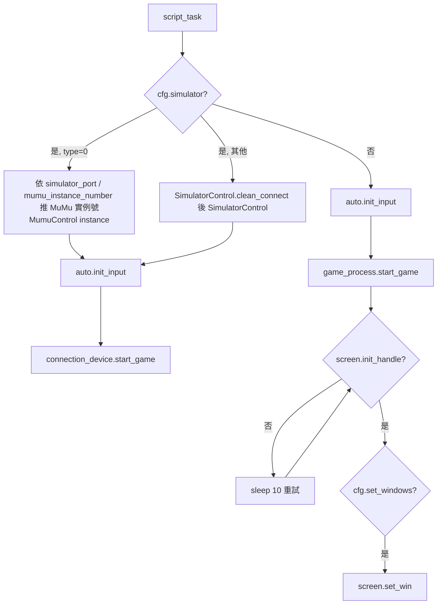

步驟與引用：

1. 模擬器分支：MuMu 實例號可由 `simulator_port`（16384 起，間隔 32）或 `mumu_instance_number` 推得，否則用預設實例 0。[tasks/base/script_task_scheme.py:L129-150](https://github.com/KIYI671/AhabAssistantLimbusCompany/blob/b0f439321987f5f7b126ebbc424f6ef144c1bff0/tasks/base/script_task_scheme.py#L129-L150) 其他模擬器先 `SimulatorControl.clean_connect()`。[tasks/base/script_task_scheme.py:L151-158](https://github.com/KIYI671/AhabAssistantLimbusCompany/blob/b0f439321987f5f7b126ebbc424f6ef144c1bff0/tasks/base/script_task_scheme.py#L151-L158)
2. `auto.init_input()` 後呼叫裝置的 `start_game()`；非模擬器則 `game_process.start_game()`，再 `while not screen.init_handle(): sleep(10)`，最後 `set_win()`（依 `set_win_size` 調整窗口、位置）。[tasks/base/script_task_scheme.py:L159-178](https://github.com/KIYI671/AhabAssistantLimbusCompany/blob/b0f439321987f5f7b126ebbc424f6ef144c1bff0/tasks/base/script_task_scheme.py#L159-L178)
3. Windows 啟動遊戲：已存在進程則直接返回；否則 `steam://rungameid/1973530`，5 秒後若進程仍不存在且 `game_path` 存在，再 `os.startfile`。[module/game_and_screen/game.py:L35-65](https://github.com/KIYI671/AhabAssistantLimbusCompany/blob/b0f439321987f5f7b126ebbc424f6ef144c1bff0/module/game_and_screen/game.py#L35-L65)；`init_handle` 以類別 `UnityWndClass`、標題 `LimbusCompany` 找視窗，找不到再啟動遊戲、等 30 秒。[module/game_and_screen/screen.py:L26-44](https://github.com/KIYI671/AhabAssistantLimbusCompany/blob/b0f439321987f5f7b126ebbc424f6ef144c1bff0/module/game_and_screen/screen.py#L26-L44)、[module/game_and_screen/screen.py:L314-332](https://github.com/KIYI671/AhabAssistantLimbusCompany/blob/b0f439321987f5f7b126ebbc424f6ef144c1bff0/module/game_and_screen/screen.py#L314-L332)
4. `set_win` 持續檢查窗口寬高是否等於 `size*16/9 × size`，不符就重設。[module/game_and_screen/screen.py:L334-364](https://github.com/KIYI671/AhabAssistantLimbusCompany/blob/b0f439321987f5f7b126ebbc424f6ef144c1bff0/module/game_and_screen/screen.py#L334-L364)
5. `script_task` 其餘前置：HDR 警告（等待使用者確認）、渲染比例 / 720p 警告、`path_manager.initialize_paths()`、清圖片快取、啟動 `retry_monitor`。[tasks/base/script_task_scheme.py:L181-206](https://github.com/KIYI671/AhabAssistantLimbusCompany/blob/b0f439321987f5f7b126ebbc424f6ef144c1bff0/tasks/base/script_task_scheme.py#L181-L206)、[tasks/base/script_task_scheme.py:L366-380](https://github.com/KIYI671/AhabAssistantLimbusCompany/blob/b0f439321987f5f7b126ebbc424f6ef144c1bff0/tasks/base/script_task_scheme.py#L366-L380)
6. 若啟動時已在戰鬥中（`battle/turn_assets.png` 命中）先 `battle.fight()`，其回傳值（`"EXP"` / `"thread"` / None，由結算畫面判定）會傳給 `Daily_task_wrapper`，把該類型要跑的次數 −1。[tasks/base/script_task_scheme.py:L382-390](https://github.com/KIYI671/AhabAssistantLimbusCompany/blob/b0f439321987f5f7b126ebbc424f6ef144c1bff0/tasks/base/script_task_scheme.py#L382-L390)、[tasks/base/script_task_scheme.py:L267-284](https://github.com/KIYI671/AhabAssistantLimbusCompany/blob/b0f439321987f5f7b126ebbc424f6ef144c1bff0/tasks/base/script_task_scheme.py#L267-L284)、[tasks/battle/battle.py:L498-507](https://github.com/KIYI671/AhabAssistantLimbusCompany/blob/b0f439321987f5f7b126ebbc424f6ef144c1bff0/tasks/battle/battle.py#L498-L507)

結束時：toast、`execute_after_completion`（睡眠 / 休眠 / 關機 / 退遊戲等，選項表見 [app/__init__.py:L55-65](https://github.com/KIYI671/AhabAssistantLimbusCompany/blob/b0f439321987f5f7b126ebbc424f6ef144c1bff0/app/__init__.py#L55-L65)）、MuMu 斷線；回傳 0 會觸發 `kill_signal` 結束 AALC。[tasks/base/script_task_scheme.py:L407-449](https://github.com/KIYI671/AhabAssistantLimbusCompany/blob/b0f439321987f5f7b126ebbc424f6ef144c1bff0/tasks/base/script_task_scheme.py#L407-L449)

**中斷 / 重啟行為**：`init_game` 本身是冪等的（遊戲已活著就直接返回）；整個流程沒有磁碟 checkpoint，重新啟動後靠「畫面狀態偵測」恢復——先看是否在戰鬥，其後每個動作都先 `back_init_menu()`。

---

## 3. 回主選單（`back_init_menu`）

用途：所有動作的「重置到已知狀態」原語。判斷依據是「主選單才看得到的 `home/window_assets.png`（視窗/Window 按鈕）+ `home/mail_assets.png`」。[tasks/base/back_init_menu.py:L39-40](https://github.com/KIYI671/AhabAssistantLimbusCompany/blob/b0f439321987f5f7b126ebbc424f6ef144c1bff0/tasks/base/back_init_menu.py#L39-L40)

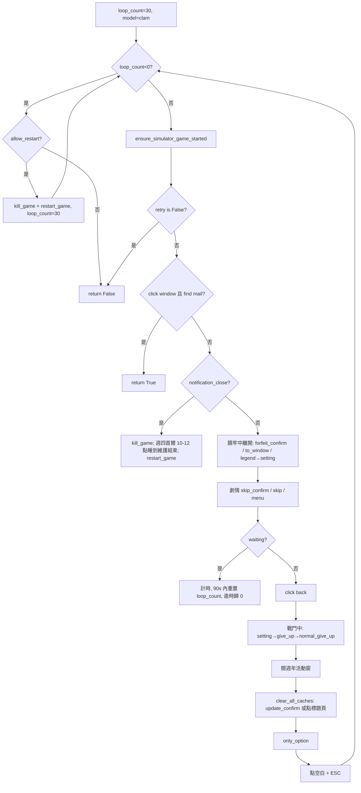

步驟：

| # | 動作 | 出處 |
|---|---|---|
| 1 | `loop_count=30`，`auto.model="clam"`；每圈 −1，`update_model_for_retry(normal_at=20, aggressive_at=10)` | [tasks/base/back_init_menu.py:L15-20](https://github.com/KIYI671/AhabAssistantLimbusCompany/blob/b0f439321987f5f7b126ebbc424f6ef144c1bff0/tasks/base/back_init_menu.py#L15-L20) |
| 2 | 次數用盡：`allow_restart=False` 直接 `return False`（自動換餅工具用此模式）；否則 `kill_game()` + `restart_game()` 後重置 30 | [tasks/base/back_init_menu.py:L21-33](https://github.com/KIYI671/AhabAssistantLimbusCompany/blob/b0f439321987f5f7b126ebbc424f6ef144c1bff0/tasks/base/back_init_menu.py#L21-L33) |
| 3 | 模擬器模式下遊戲不在前台就拉起（每 5 秒最多檢查一次） | [tasks/base/back_init_menu.py:L34-35](https://github.com/KIYI671/AhabAssistantLimbusCompany/blob/b0f439321987f5f7b126ebbc424f6ef144c1bff0/tasks/base/back_init_menu.py#L34-L35)、[tasks/base/retry.py:L19-52](https://github.com/KIYI671/AhabAssistantLimbusCompany/blob/b0f439321987f5f7b126ebbc424f6ef144c1bff0/tasks/base/retry.py#L19-L52) |
| 4 | `retry()` 處理斷線重連；回 False（卡死）則整個 `back_init_menu` 回 False | [tasks/base/back_init_menu.py:L36-37](https://github.com/KIYI671/AhabAssistantLimbusCompany/blob/b0f439321987f5f7b126ebbc424f6ef144c1bff0/tasks/base/back_init_menu.py#L36-L37)、[tasks/base/retry.py:L138-190](https://github.com/KIYI671/AhabAssistantLimbusCompany/blob/b0f439321987f5f7b126ebbc424f6ef144c1bff0/tasks/base/retry.py#L138-L190) |
| 5 | 成功條件：點擊 `home/window_assets.png` 後仍能看到 `home/mail_assets.png`（`model="normal"`）→ `return True` | [tasks/base/back_init_menu.py:L39-40](https://github.com/KIYI671/AhabAssistantLimbusCompany/blob/b0f439321987f5f7b126ebbc424f6ef144c1bff0/tasks/base/back_init_menu.py#L39-L40) |
| 6 | 看到 `base/notification_close_assets.png`（公告/維護通知）→ `kill_game`；若 Asia/Seoul 星期四（`get_day_of_week()==4`）10:00–12:00 則 `sleep` 到 12:00；再 `restart_game` | [tasks/base/back_init_menu.py:L42-66](https://github.com/KIYI671/AhabAssistantLimbusCompany/blob/b0f439321987f5f7b126ebbc424f6ef144c1bff0/tasks/base/back_init_menu.py#L42-L66) |
| 7 | 鏡牢殘留：點 `towindow&forfeit_confirm`、`to_window`（threshold 0.75）；看到 `legend_assets.png` 就點 `setting_assets.png`；看到選擇遭遇獎勵卡畫面呼叫 `get_reward_card()` | [tasks/base/back_init_menu.py:L68-77](https://github.com/KIYI671/AhabAssistantLimbusCompany/blob/b0f439321987f5f7b126ebbc424f6ef144c1bff0/tasks/base/back_init_menu.py#L68-L77) |
| 8 | 劇情：依序點 `story_skip_confirm` → `story_skip` → `story_meun` | [tasks/base/back_init_menu.py:L79-85](https://github.com/KIYI671/AhabAssistantLimbusCompany/blob/b0f439321987f5f7b126ebbc424f6ef144c1bff0/tasks/base/back_init_menu.py#L79-L85) |
| 9 | 讀取中（`waiting_assets` / `waiting_2_assets`）：記錄起點，未滿 `LOADING_TIMEOUT=90` 秒每圈把 `loop_count` 重設為 30，滿了設 0 觸發重啟 | [tasks/base/back_init_menu.py:L10-11](https://github.com/KIYI671/AhabAssistantLimbusCompany/blob/b0f439321987f5f7b126ebbc424f6ef144c1bff0/tasks/base/back_init_menu.py#L10-L11)、[tasks/base/back_init_menu.py:L87-93](https://github.com/KIYI671/AhabAssistantLimbusCompany/blob/b0f439321987f5f7b126ebbc424f6ef144c1bff0/tasks/base/back_init_menu.py#L87-L93) |
| 10 | 左上有返回鍵（`home/back_assets.png`）就點 | [tasks/base/back_init_menu.py:L95-97](https://github.com/KIYI671/AhabAssistantLimbusCompany/blob/b0f439321987f5f7b126ebbc424f6ef144c1bff0/tasks/base/back_init_menu.py#L95-L97) |
| 11 | 戰鬥中：點 `battle/setting_assets.png` → `sleep(1)` → `give_up` → `normal_give_up`（放棄戰鬥） | [tasks/base/back_init_menu.py:L99-104](https://github.com/KIYI671/AhabAssistantLimbusCompany/blob/b0f439321987f5f7b126ebbc424f6ef144c1bff0/tasks/base/back_init_menu.py#L99-L104) |
| 12 | 週年活動彈窗：`home/close_anniversary_event_assets.png` | [tasks/base/back_init_menu.py:L106-108](https://github.com/KIYI671/AhabAssistantLimbusCompany/blob/b0f439321987f5f7b126ebbc424f6ef144c1bff0/tasks/base/back_init_menu.py#L106-L108) |
| 13 | 標題頁（`base/clear_all_caches_assets.png` 可見）：有 `update_confirm` 就點，否則 `click_title_screen_safely()` 並重置計數 | [tasks/base/back_init_menu.py:L110-116](https://github.com/KIYI671/AhabAssistantLimbusCompany/blob/b0f439321987f5f7b126ebbc424f6ef144c1bff0/tasks/base/back_init_menu.py#L110-L116)、[tasks/base/retry.py:L55-72](https://github.com/KIYI671/AhabAssistantLimbusCompany/blob/b0f439321987f5f7b126ebbc424f6ef144c1bff0/tasks/base/retry.py#L55-L72) |
| 14 | `base/only_option_assets.png`（只有一個選項的對話框）點掉 | [tasks/base/back_init_menu.py:L118-119](https://github.com/KIYI671/AhabAssistantLimbusCompany/blob/b0f439321987f5f7b126ebbc424f6ef144c1bff0/tasks/base/back_init_menu.py#L118-L119) |
| 15 | 都沒命中：點 (1,1) 附近空白（+0~10 隨機）再按 ESC | [tasks/base/back_init_menu.py:L121-122](https://github.com/KIYI671/AhabAssistantLimbusCompany/blob/b0f439321987f5f7b126ebbc424f6ef144c1bff0/tasks/base/back_init_menu.py#L121-L122)、[module/automation/input_handlers/input.py:L242-258](https://github.com/KIYI671/AhabAssistantLimbusCompany/blob/b0f439321987f5f7b126ebbc424f6ef144c1bff0/module/automation/input_handlers/input.py#L242-L258) |

辨識表（坐標為 2560×1440、`default` 版 bbox；click = 匹配中心 ±10 抖動，除非另註）：

| 步驟 | 模板（變體） | 方法 | 閾值 | bbox（x1,y1,x2,y2） | model |
|---|---|---|---|---|---|
| 5 | [default/share/home/window_assets.png](https://github.com/KIYI671/AhabAssistantLimbusCompany/blob/b0f439321987f5f7b126ebbc424f6ef144c1bff0/assets/images/default/share/home/window_assets.png)（另有 [dark/share/home/window_assets.png](https://github.com/KIYI671/AhabAssistantLimbusCompany/blob/b0f439321987f5f7b126ebbc424f6ef144c1bff0/assets/images/dark/share/home/window_assets.png)） | find/click | 0.8 | 1597,1242,1703,1302 | clam（初始） |
| 5 | [default/share/home/mail_assets.png](https://github.com/KIYI671/AhabAssistantLimbusCompany/blob/b0f439321987f5f7b126ebbc424f6ef144c1bff0/assets/images/default/share/home/mail_assets.png)（dark 同名 share） | find | 0.8 | 2206,224,2274,274 | normal |
| 6 | [default/zh_cn/base/notification_close_assets.png](https://github.com/KIYI671/AhabAssistantLimbusCompany/blob/b0f439321987f5f7b126ebbc424f6ef144c1bff0/assets/images/default/zh_cn/base/notification_close_assets.png) / [default/en/base/notification_close_assets.png](https://github.com/KIYI671/AhabAssistantLimbusCompany/blob/b0f439321987f5f7b126ebbc424f6ef144c1bff0/assets/images/default/en/base/notification_close_assets.png) | find | 0.8 | 1086,875,1460,996 / 1089,876,1467,995 | 當前 |
| 7 | [default/share/mirror/road_in_mir/towindow&forfeit_confirm_assets.png](https://github.com/KIYI671/AhabAssistantLimbusCompany/blob/b0f439321987f5f7b126ebbc424f6ef144c1bff0/assets/images/default/share/mirror/road_in_mir/towindow&forfeit_confirm_assets.png)（dark share 亦有） | click | 0.8 | 1403,946,1482,1004 | 當前 |
| 7 | [default/share/mirror/road_in_mir/to_window_assets.png](https://github.com/KIYI671/AhabAssistantLimbusCompany/blob/b0f439321987f5f7b126ebbc424f6ef144c1bff0/assets/images/default/share/mirror/road_in_mir/to_window_assets.png)（dark share 亦有） | click | 0.75 | 1412,772,1541,853 | 當前 |
| 7 | [default/share/mirror/road_in_mir/legend_assets.png](https://github.com/KIYI671/AhabAssistantLimbusCompany/blob/b0f439321987f5f7b126ebbc424f6ef144c1bff0/assets/images/default/share/mirror/road_in_mir/legend_assets.png) → [default/share/mirror/road_in_mir/setting_assets.png](https://github.com/KIYI671/AhabAssistantLimbusCompany/blob/b0f439321987f5f7b126ebbc424f6ef144c1bff0/assets/images/default/share/mirror/road_in_mir/setting_assets.png) | find→click | 0.8 | 2435,180,2493,224 → 2431,52,2498,129 | 當前 |
| 7 | [default/zh_cn/mirror/road_in_mir/select_encounter_reward_card_assets.png](https://github.com/KIYI671/AhabAssistantLimbusCompany/blob/b0f439321987f5f7b126ebbc424f6ef144c1bff0/assets/images/default/zh_cn/mirror/road_in_mir/select_encounter_reward_card_assets.png) / [default/en/mirror/road_in_mir/select_encounter_reward_card_assets.png](https://github.com/KIYI671/AhabAssistantLimbusCompany/blob/b0f439321987f5f7b126ebbc424f6ef144c1bff0/assets/images/default/en/mirror/road_in_mir/select_encounter_reward_card_assets.png) | find | 0.8 | 783,232,1352,314 / 566,223,1588,320 | 當前 |
| 8 | [default/share/scenes/story_skip_confirm_assets.png](https://github.com/KIYI671/AhabAssistantLimbusCompany/blob/b0f439321987f5f7b126ebbc424f6ef144c1bff0/assets/images/default/share/scenes/story_skip_confirm_assets.png)（dark share 亦有）、[default/share/scenes/story_skip_assets.png](https://github.com/KIYI671/AhabAssistantLimbusCompany/blob/b0f439321987f5f7b126ebbc424f6ef144c1bff0/assets/images/default/share/scenes/story_skip_assets.png)、[default/share/scenes/story_meun_assets.png](https://github.com/KIYI671/AhabAssistantLimbusCompany/blob/b0f439321987f5f7b126ebbc424f6ef144c1bff0/assets/images/default/share/scenes/story_meun_assets.png) | click | 0.8 | 1402,949,1473,1005 / 1718,64,1782,131 / 2356,69,2420,128 | 當前 |
| 9 | [default/share/base/waiting_assets.png](https://github.com/KIYI671/AhabAssistantLimbusCompany/blob/b0f439321987f5f7b126ebbc424f6ef144c1bff0/assets/images/default/share/base/waiting_assets.png)、[default/share/base/waiting_2_assets.png](https://github.com/KIYI671/AhabAssistantLimbusCompany/blob/b0f439321987f5f7b126ebbc424f6ef144c1bff0/assets/images/default/share/base/waiting_2_assets.png) | find | 0.8 | 1870,1327,1967,1373 / 2370,1323,2442,1378 | 當前 |
| 10 | [default/share/home/back_assets.png](https://github.com/KIYI671/AhabAssistantLimbusCompany/blob/b0f439321987f5f7b126ebbc424f6ef144c1bff0/assets/images/default/share/home/back_assets.png)（dark share 亦有） | click | 0.8 | 114,43,270,135 | 當前 |
| 11 | [default/share/battle/setting_assets.png](https://github.com/KIYI671/AhabAssistantLimbusCompany/blob/b0f439321987f5f7b126ebbc424f6ef144c1bff0/assets/images/default/share/battle/setting_assets.png)、[default/share/battle/give_up_assets.png](https://github.com/KIYI671/AhabAssistantLimbusCompany/blob/b0f439321987f5f7b126ebbc424f6ef144c1bff0/assets/images/default/share/battle/give_up_assets.png)（dark 亦有）、[default/share/battle/normal_give_up_assets.png](https://github.com/KIYI671/AhabAssistantLimbusCompany/blob/b0f439321987f5f7b126ebbc424f6ef144c1bff0/assets/images/default/share/battle/normal_give_up_assets.png)（dark 亦有） | click | 0.8 | 2427,42,2514,125 / 1147,821,1228,888 / 1167,766,1228,830 | 當前 |
| 12 | [default/share/home/close_anniversary_event_assets.png](https://github.com/KIYI671/AhabAssistantLimbusCompany/blob/b0f439321987f5f7b126ebbc424f6ef144c1bff0/assets/images/default/share/home/close_anniversary_event_assets.png) | click | 0.8 | 2017,258,2093,329 | 當前 |
| 13 | [default/share/base/clear_all_caches_assets.png](https://github.com/KIYI671/AhabAssistantLimbusCompany/blob/b0f439321987f5f7b126ebbc424f6ef144c1bff0/assets/images/default/share/base/clear_all_caches_assets.png)、[default/share/base/update_confirm_assets.png](https://github.com/KIYI671/AhabAssistantLimbusCompany/blob/b0f439321987f5f7b126ebbc424f6ef144c1bff0/assets/images/default/share/base/update_confirm_assets.png) | find / click | 0.8 | 396,1274,409,1351 / 1287,837,1406,982 | clam（強制） |
| 14 | [default/share/base/only_option_assets.png](https://github.com/KIYI671/AhabAssistantLimbusCompany/blob/b0f439321987f5f7b126ebbc424f6ef144c1bff0/assets/images/default/share/base/only_option_assets.png) | click | 0.8 | 1081,877,1185,998 | clam |

 

（上列 `*_assets.png` 為整張透明底圖，縮圖幾乎全黑屬正常。）

**標題頁點擊座標**：非模擬器用 (1,1) 空白；模擬器在 `(0.86,0.80)`、`(0.74,0.83)`、`(0.91,0.58)`（寬高比例）三點間依 `now//10` 輪換，並限制 15 秒一次。[tasks/base/retry.py:L55-72](https://github.com/KIYI671/AhabAssistantLimbusCompany/blob/b0f439321987f5f7b126ebbc424f6ef144c1bff0/tasks/base/retry.py#L55-L72)

**失敗 / 恢復**：計數用盡 → 殺遊戲 → `restart_game()` = `init_game()` + `sleep(3)` + 遞迴 `back_init_menu()`。[tasks/base/retry.py:L193-200](https://github.com/KIYI671/AhabAssistantLimbusCompany/blob/b0f439321987f5f7b126ebbc424f6ef144c1bff0/tasks/base/retry.py#L193-L200) 殺遊戲：模擬器 `close_current_app()`；Windows `taskkill /F /PID`，等進程消失最多 30 秒。[tasks/base/retry.py:L75-120](https://github.com/KIYI671/AhabAssistantLimbusCompany/blob/b0f439321987f5f7b126ebbc424f6ef144c1bff0/tasks/base/retry.py#L75-L120) 逾時判定 `check_times(timeout=90)`。[tasks/base/retry.py:L123-135](https://github.com/KIYI671/AhabAssistantLimbusCompany/blob/b0f439321987f5f7b126ebbc424f6ef144c1bff0/tasks/base/retry.py#L123-L135)

### 3.1 斷線重試（`retry()` 與 `RetryMonitor`）

- `retry()` 每圈強制重新截圖：`base/connecting_assets.png` → 繼續等；`retry_countdown` → sleep 5 後連點 3 下；`retry.png`（threshold 0.9）→ 點；標題頁快取清理 → `update_confirm` 或點標題頁；`only_option` → sleep 5，若遊戲未運行就 `init_game()`。全部都未命中就 `break`（回傳 None，也就是「沒事」）；`check_times` 逾時回傳 False。[tasks/base/retry.py:L138-190](https://github.com/KIYI671/AhabAssistantLimbusCompany/blob/b0f439321987f5f7b126ebbc424f6ef144c1bff0/tasks/base/retry.py#L138-L190)
- `RetryMonitor` 是獨立執行緒（0.5 s 輪詢、2 s 冷卻）專門偵測 `base/retry.png`（zh_cn 與 en 兩版、閾值 0.9），命中時 `suspend_interactions()` 暫停業務點擊、`monitor_mouse_click` 點重試，彈窗消失連續 2 幀後恢復。[tasks/base/retry_monitor.py:L12-146](https://github.com/KIYI671/AhabAssistantLimbusCompany/blob/b0f439321987f5f7b126ebbc424f6ef144c1bff0/tasks/base/retry_monitor.py#L12-L146) `script_task` 啟動時 `retry_monitor.start()`，結束 / 例外 / terminate 時 `stop()`。[tasks/base/script_task_scheme.py:L377-377](https://github.com/KIYI671/AhabAssistantLimbusCompany/blob/b0f439321987f5f7b126ebbc424f6ef144c1bff0/tasks/base/script_task_scheme.py#L377-L377)、[tasks/base/script_task_scheme.py:L480-482](https://github.com/KIYI671/AhabAssistantLimbusCompany/blob/b0f439321987f5f7b126ebbc424f6ef144c1bff0/tasks/base/script_task_scheme.py#L480-L482)
- 素材：[default/zh_cn/base/retry.png](https://github.com/KIYI671/AhabAssistantLimbusCompany/blob/b0f439321987f5f7b126ebbc424f6ef144c1bff0/assets/images/default/zh_cn/base/retry.png)、[default/en/base/retry.png](https://github.com/KIYI671/AhabAssistantLimbusCompany/blob/b0f439321987f5f7b126ebbc424f6ef144c1bff0/assets/images/default/en/base/retry.png)（`retry_countdown.png`、`try_again.png` 亦各有 zh_cn / en）、[default/share/base/connecting_assets.png](https://github.com/KIYI671/AhabAssistantLimbusCompany/blob/b0f439321987f5f7b126ebbc424f6ef144c1bff0/assets/images/default/share/base/connecting_assets.png)。

---

## 4. 體力換餅（`make_enkephalin_module`）

用途：打開主選單左下的「腦啡肽」面板，按「全部兌換」把目前腦啡肽換成模組（程式碼只稱 `all_in`；「換成模組」是依 FAQ 與工具說明推得）。`skip=True` 且 `cfg.skip_enkephalin` 時整段直接 return。[tasks/base/make_enkephalin_module.py:L78-86](https://github.com/KIYI671/AhabAssistantLimbusCompany/blob/b0f439321987f5f7b126ebbc424f6ef144c1bff0/tasks/base/make_enkephalin_module.py#L78-L86)

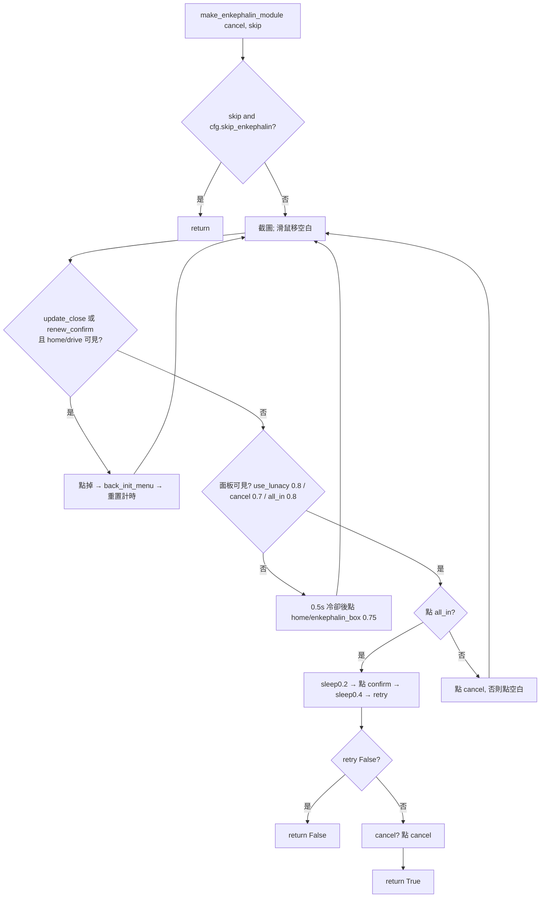

步驟與引用：

1. 常數：`use_lunacy_threshold=0.8`、`all_in_threshold=0.8`、`popup_marker_threshold=0.7`、開面板點擊冷卻 0.5 s。[tasks/base/make_enkephalin_module.py:L92-96](https://github.com/KIYI671/AhabAssistantLimbusCompany/blob/b0f439321987f5f7b126ebbc424f6ef144c1bff0/tasks/base/make_enkephalin_module.py#L92-L96)
2. 計時防呆：超過 20 秒每 10 秒警告「請確認語言設定」；超過 60 秒彈出 GUI 警告（`mediator.warning`、`link_start.emit()`）但迴圈並不 return。[tasks/base/make_enkephalin_module.py:L98-116](https://github.com/KIYI671/AhabAssistantLimbusCompany/blob/b0f439321987f5f7b126ebbc424f6ef144c1bff0/tasks/base/make_enkephalin_module.py#L98-L116)（`auto.get_restore_time()` 會把起點推到暫停恢復之後，避免暫停被算作卡死。）
3. 遇到「更新/續約」彈窗（`base/update_close` 或 `base/renew_confirm` 且 `home/drive` 可見）→ 點掉 → `back_init_menu()` → 重置計時。[tasks/base/make_enkephalin_module.py:L121-138](https://github.com/KIYI671/AhabAssistantLimbusCompany/blob/b0f439321987f5f7b126ebbc424f6ef144c1bff0/tasks/base/make_enkephalin_module.py#L121-L138)
4. 面板可見性 = `use_lunacy` ∪ `enkephalin_cancel` ∪ `all_in` 任一命中。不可見就點 `home/enkephalin_box_assets.png`（threshold 0.75、`offset=False` 精準點中心）。[tasks/base/make_enkephalin_module.py:L139-152](https://github.com/KIYI671/AhabAssistantLimbusCompany/blob/b0f439321987f5f7b126ebbc424f6ef144c1bff0/tasks/base/make_enkephalin_module.py#L139-L152)
5. 面板可見且 `all_in` 命中：點它 → sleep 0.2 → 重新截圖 → 點 `enkephalin_confirm` → sleep 0.4 → `retry()`；為 False 時 log 網路失敗並 `return False`；`cancel=True` 時再點 `enkephalin_cancel` 關面板；`return True`。[tasks/base/make_enkephalin_module.py:L153-167](https://github.com/KIYI671/AhabAssistantLimbusCompany/blob/b0f439321987f5f7b126ebbc424f6ef144c1bff0/tasks/base/make_enkephalin_module.py#L153-L167)
6. 面板可見但沒有 `all_in`（上次未復原）：點 `enkephalin_cancel`，點不到就點空白，等 0.2 s 重來。[tasks/base/make_enkephalin_module.py:L168-174](https://github.com/KIYI671/AhabAssistantLimbusCompany/blob/b0f439321987f5f7b126ebbc424f6ef144c1bff0/tasks/base/make_enkephalin_module.py#L168-L174)

辨識表：

| 步驟 | 模板（變體） | 方法 | 閾值 | bbox | 點擊 |
|---|---|---|---|---|---|
| 4 | [default/share/home/enkephalin_box_assets.png](https://github.com/KIYI671/AhabAssistantLimbusCompany/blob/b0f439321987f5f7b126ebbc424f6ef144c1bff0/assets/images/default/share/home/enkephalin_box_assets.png) | click | 0.75 | 592,1249,668,1317 | 中心，無抖動 |
| 4/5 | [default/zh_cn/enkephalin/use_lunacy_assets.png](https://github.com/KIYI671/AhabAssistantLimbusCompany/blob/b0f439321987f5f7b126ebbc424f6ef144c1bff0/assets/images/default/zh_cn/enkephalin/use_lunacy_assets.png) / [default/en/enkephalin/use_lunacy_assets.png](https://github.com/KIYI671/AhabAssistantLimbusCompany/blob/b0f439321987f5f7b126ebbc424f6ef144c1bff0/assets/images/default/en/enkephalin/use_lunacy_assets.png)（dark 亦有 zh_cn / en 各一） | find | 0.8 | 1150,422,1407,482 / 1151,422,1409,482 | - |
| 4/6 | [default/share/enkephalin/enkephalin_cancel_assets.png](https://github.com/KIYI671/AhabAssistantLimbusCompany/blob/b0f439321987f5f7b126ebbc424f6ef144c1bff0/assets/images/default/share/enkephalin/enkephalin_cancel_assets.png)（dark share 亦有） | find / click | 0.7（find）/ 0.8（click） | 943,1035,1005,1095 | 中心±10 |
| 5 | [default/share/enkephalin/all_in_assets.png](https://github.com/KIYI671/AhabAssistantLimbusCompany/blob/b0f439321987f5f7b126ebbc424f6ef144c1bff0/assets/images/default/share/enkephalin/all_in_assets.png)（dark share 亦有） | click | 0.8 | 1585,627,1643,690 | 中心±10 |
| 5 | [default/share/enkephalin/enkephalin_confirm_assets.png](https://github.com/KIYI671/AhabAssistantLimbusCompany/blob/b0f439321987f5f7b126ebbc424f6ef144c1bff0/assets/images/default/share/enkephalin/enkephalin_confirm_assets.png)（dark share 亦有） | click | 0.8 | 1403,1039,1479,1092 | 中心±10 |

 

模板語言：只有 `use_lunacy_assets.png` 有 zh_cn / en 分版；其餘都在 `share`。FAQ 把「無限卡在換餅界面」歸因於遊戲語言設定與 AALC 不符、HDR、畫面品質或字型 MOD。[assets/doc/zh/FAQ.md:L33-37](https://github.com/KIYI671/AhabAssistantLimbusCompany/blob/b0f439321987f5f7b126ebbc424f6ef144c1bff0/assets/doc/zh/FAQ.md#L33-L37)

### 4.1 輔助函式：讀取目前腦啡肽 / 下一點回復倒數

- `get_current_enkephalin()`：以 `enkephalin/enkephalin_now_bbox.png`（bbox 約 1104,809,1394,911）裁圖，二值化（閾值 110；最後備援 150）後 OCR，找 `/` 分隔，取左側數字；重試 5 次，失敗回 None。[tasks/base/make_enkephalin_module.py:L40-75](https://github.com/KIYI671/AhabAssistantLimbusCompany/blob/b0f439321987f5f7b126ebbc424f6ef144c1bff0/tasks/base/make_enkephalin_module.py#L40-L75)
- `get_the_timing(return_time=False)`：以 `enkephalin/lunacy_assets.png`（1043,526,1158,639）定位，OCR 區域為其 `(-200,+150)~(+600,+220)×scale`，解析 `mm:ss`。`return_time=True` 回秒數；否則回 `minute>=5 and seconds>=20`（葛朗台判斷）。[tasks/base/make_enkephalin_module.py:L11-37](https://github.com/KIYI671/AhabAssistantLimbusCompany/blob/b0f439321987f5f7b126ebbc424f6ef144c1bff0/tasks/base/make_enkephalin_module.py#L11-L37)

---

## 5. 狂氣換體（`lunacy_to_enkephalin` / `Buy_enkephalin`）

入口：`Buy_enkephalin()` 讀 `set_lunacy_to_enkephalin`（0~3），`back_init_menu()` 後呼叫 `lunacy_to_enkephalin(times)`。[tasks/base/script_task_scheme.py:L287-290](https://github.com/KIYI671/AhabAssistantLimbusCompany/blob/b0f439321987f5f7b126ebbc424f6ef144c1bff0/tasks/base/script_task_scheme.py#L287-L290)

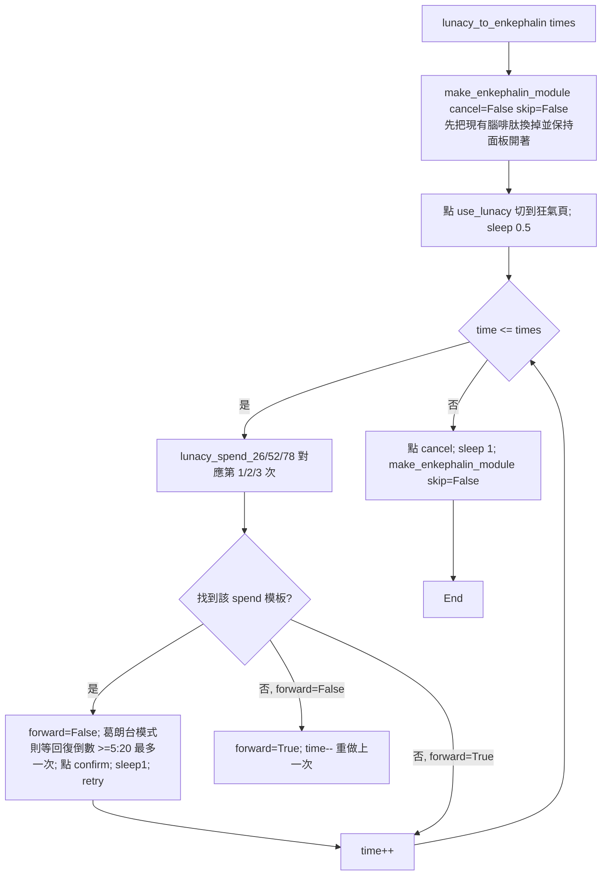

細節：

1. `lunacy_map = {1:"26", 2:"52", 3:"78"}`：第 N 次購買所需狂氣數，對應模板 `lunacy_spend_26/52/78_assets.png`（只在 `default/share/enkephalin/`，皆 bbox 約 (1169~1177, 534~543, 1275~1286, 633~636)）。[tasks/base/make_enkephalin_module.py:L183-187](https://github.com/KIYI671/AhabAssistantLimbusCompany/blob/b0f439321987f5f7b126ebbc424f6ef144c1bff0/tasks/base/make_enkephalin_module.py#L183-L187)、[default/share/enkephalin/lunacy_spend_26_assets.png](https://github.com/KIYI671/AhabAssistantLimbusCompany/blob/b0f439321987f5f7b126ebbc424f6ef144c1bff0/assets/images/default/share/enkephalin/lunacy_spend_26_assets.png)、[default/share/enkephalin/lunacy_spend_52_assets.png](https://github.com/KIYI671/AhabAssistantLimbusCompany/blob/b0f439321987f5f7b126ebbc424f6ef144c1bff0/assets/images/default/share/enkephalin/lunacy_spend_52_assets.png)、[default/share/enkephalin/lunacy_spend_78_assets.png](https://github.com/KIYI671/AhabAssistantLimbusCompany/blob/b0f439321987f5f7b126ebbc424f6ef144c1bff0/assets/images/default/share/enkephalin/lunacy_spend_78_assets.png)
2. 「前向模式」旗標：還沒看到過 spend 模板時 `forward=True`；看到並點擊後 `forward=False`。非前向時又找不到模板，推測上次點擊可能失敗或已完成，於是 `forward=True` 並把 `time` 減 1 重做一次。[tasks/base/make_enkephalin_module.py:L188-221](https://github.com/KIYI671/AhabAssistantLimbusCompany/blob/b0f439321987f5f7b126ebbc424f6ef144c1bff0/tasks/base/make_enkephalin_module.py#L188-L221)
3. 最後一步（`time==times`）：前向代表已成功直接結束；非前向則再確認模板是否還在，仍在就 `continue` 重點。[tasks/base/make_enkephalin_module.py:L222-232](https://github.com/KIYI671/AhabAssistantLimbusCompany/blob/b0f439321987f5f7b126ebbc424f6ef144c1bff0/tasks/base/make_enkephalin_module.py#L222-L232)
4. 葛朗台模式：`while get_the_timing() is False: if Grandet: break; sleep(2)`，也就是只在第一次購買前等待（`Grandet` 之後為 True）；`get_the_timing()` 找不到 `lunacy_assets` 時回 None，不被視為「等待」。[tasks/base/make_enkephalin_module.py:L205-210](https://github.com/KIYI671/AhabAssistantLimbusCompany/blob/b0f439321987f5f7b126ebbc424f6ef144c1bff0/tasks/base/make_enkephalin_module.py#L205-L210)
5. 收尾：點 `enkephalin_cancel`、sleep 1、再呼叫 `make_enkephalin_module(skip=False)` 把新買的腦啡肽換成模組。[tasks/base/make_enkephalin_module.py:L233-235](https://github.com/KIYI671/AhabAssistantLimbusCompany/blob/b0f439321987f5f7b126ebbc424f6ef144c1bff0/tasks/base/make_enkephalin_module.py#L233-L235)
6. 閾值：一律 `find_element` / `click_element` 預設 0.8；`use_lunacy_assets.png`、`lunacy_assets.png`、`enkephalin_confirm_assets.png` 見 §4。[default/share/enkephalin/lunacy_assets.png](https://github.com/KIYI671/AhabAssistantLimbusCompany/blob/b0f439321987f5f7b126ebbc424f6ef144c1bff0/assets/images/default/share/enkephalin/lunacy_assets.png)

**失敗 / 恢復**：截圖兩次失敗、次數代碼未知、`retry()` 回 False 都只 `break` 並走收尾，沒有拋例外。中斷後重啟：`make_enkephalin_module` 開頭的「面板可見但沒有 all_in → 點 cancel」分支能把殘留的面板關掉。

---

## 6. 日常本（經驗本 / 紐本）

### 6.1 流程總覽

`Daily_task_wrapper(get_reward)` 回傳一個閉包，由 task_list 執行：[tasks/base/script_task_scheme.py:L267-284](https://github.com/KIYI671/AhabAssistantLimbusCompany/blob/b0f439321987f5f7b126ebbc424f6ef144c1bff0/tasks/base/script_task_scheme.py#L267-L284)

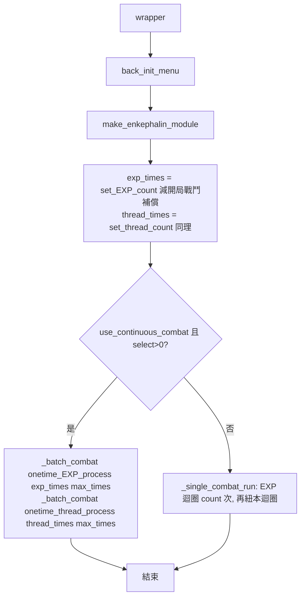

- `_batch_combat(fn, times, max_times)`：`times<=0` 不做；`times>max_times` 時 `total = times//max_times` 批各打 `max_times` 場，餘數 `times%max_times` 再一批；`times<=max_times` 一批打完。[tasks/base/script_task_scheme.py:L242-257](https://github.com/KIYI671/AhabAssistantLimbusCompany/blob/b0f439321987f5f7b126ebbc424f6ef144c1bff0/tasks/base/script_task_scheme.py#L242-L257)（`process_fn(n)` 的 n = 「這一批連續作戰場次」。）
- 單場模式 `_single_combat_run`：先 EXP 迴圈、再紐本迴圈，各呼叫 `process()`（`combat_count=1`）。[tasks/base/script_task_scheme.py:L260-264](https://github.com/KIYI671/AhabAssistantLimbusCompany/blob/b0f439321987f5f7b126ebbc424f6ef144c1bff0/tasks/base/script_task_scheme.py#L260-L264)
- 一次流程 `onetime_EXP_process(combat_count)`：選隊 → `EXP_luxcavation` → `select_battle_team(team)` → `battle.to_battle()`（False 則 return False，不回主選單）→ `battle.fight(combat_count=...)` → `back_init_menu()` → `make_enkephalin_module()`。[tasks/base/script_task_scheme.py:L52-65](https://github.com/KIYI671/AhabAssistantLimbusCompany/blob/b0f439321987f5f7b126ebbc424f6ef144c1bff0/tasks/base/script_task_scheme.py#L52-L65) `onetime_thread_process` 同構，只是用 `thread_day_{get_day_of_week()}`。[tasks/base/script_task_scheme.py:L68-81](https://github.com/KIYI671/AhabAssistantLimbusCompany/blob/b0f439321987f5f7b126ebbc424f6ef144c1bff0/tasks/base/script_task_scheme.py#L68-L81)
- 隊伍選擇：`targeted_teaming_EXP` 開啟時用 `EXP_day_{calculate_the_teams()}`，否則 `daily_teams`；紐本同理用 `thread_day_N`。[tasks/base/script_task_scheme.py:L55-58](https://github.com/KIYI671/AhabAssistantLimbusCompany/blob/b0f439321987f5f7b126ebbc424f6ef144c1bff0/tasks/base/script_task_scheme.py#L55-L58)、[tasks/base/script_task_scheme.py:L71-74](https://github.com/KIYI671/AhabAssistantLimbusCompany/blob/b0f439321987f5f7b126ebbc424f6ef144c1bff0/tasks/base/script_task_scheme.py#L71-L74)
- 選隊（`select_battle_team`）與按下「進入戰鬥」（`to_battle`）屬 11 / 12 章，這裡只摘要：`select_battle_team` 以 `teams/identify_assets.png`（bbox 2365,327,2436,384）當錨點，位置 = 錨點 −2150×scale、+215×scale，按順序或用 OCR 找 `编队#N` / `TEAMS #N`，找不到每次滑動重試 10 次。[tasks/teams/team_formation.py:L120-190](https://github.com/KIYI671/AhabAssistantLimbusCompany/blob/b0f439321987f5f7b126ebbc424f6ef144c1bff0/tasks/teams/team_formation.py#L120-L190) `to_battle` 在 `battle/normal_to_battle_assets.png`（zh_cn 2159,1129,2427,1216）或 `chaim_to_battle_assets.png` 之間重試最多 15 次，點完後看到仍在畫面就呼叫 `deal_with_spills()`。[tasks/battle/battle.py:L49-86](https://github.com/KIYI671/AhabAssistantLimbusCompany/blob/b0f439321987f5f7b126ebbc424f6ef144c1bff0/tasks/battle/battle.py#L49-L86)、[default/zh_cn/battle/normal_to_battle_assets.png](https://github.com/KIYI671/AhabAssistantLimbusCompany/blob/b0f439321987f5f7b126ebbc424f6ef144c1bff0/assets/images/default/zh_cn/battle/normal_to_battle_assets.png)、[default/en/battle/normal_to_battle_assets.png](https://github.com/KIYI671/AhabAssistantLimbusCompany/blob/b0f439321987f5f7b126ebbc424f6ef144c1bff0/assets/images/default/en/battle/normal_to_battle_assets.png)、[default/zh_cn/battle/chaim_to_battle_assets.png](https://github.com/KIYI671/AhabAssistantLimbusCompany/blob/b0f439321987f5f7b126ebbc424f6ef144c1bff0/assets/images/default/zh_cn/battle/chaim_to_battle_assets.png)、[default/en/battle/chaim_to_battle_assets.png](https://github.com/KIYI671/AhabAssistantLimbusCompany/blob/b0f439321987f5f7b126ebbc424f6ef144c1bff0/assets/images/default/en/battle/chaim_to_battle_assets.png)
- 戰鬥迴圈（`Battle.fight`）詳見 [12-md-battle.md](12-md-battle.md)。日常本唯一和戰鬥相關的參數是 `combat_count`，只用來放寬卡死逾時：`check_times(start_time, timeout=900 + 300*combat_count)`，超時會殺遊戲重啟。[tasks/battle/battle.py:L248-248](https://github.com/KIYI671/AhabAssistantLimbusCompany/blob/b0f439321987f5f7b126ebbc424f6ef144c1bff0/tasks/battle/battle.py#L248-L248)
- **有沒有「跳過戰鬥 / 掃蕩」？** 本章涉及的程式碼中沒有「掃蕩 / skip battle」；日常本一律進入戰鬥並呼叫 `fight()`。「連續作戰」是遊戲內建的連打選項，AALC 只負責把次數調到 `combat_count`。

### 6.2 連續作戰次數設定（`_prepare_continuous_combat_count`）

[tasks/daily/luxcavation.py:L8-45](https://github.com/KIYI671/AhabAssistantLimbusCompany/blob/b0f439321987f5f7b126ebbc424f6ef144c1bff0/tasks/daily/luxcavation.py#L8-L45)

1. 若呼叫端給了 `box_position`（EXP）就直接點；否則（紐本）以 `luxcavation/thread_continuous_combat_show_box.png`（32×28，threshold 0.85，`click=False` 只取座標）找「連戰次數框」再點。
2. 最多 2 次（sleep 0.4 / 0.2）找 `luxcavation/continuous_combat_up_box.png`（40×38，threshold 0.85，`take_screenshot=True`）。
3. 點該「+」鈕 `combat_count − 1` 次，每次 sleep 0.1。
4. 任何一步失敗回 False（EXP 會換下一關、紐本會重新偵測）。

素材（皆僅 `default/share/luxcavation/`，無 zh_cn / en / dark 版）：[default/share/luxcavation/continuous_combat_up_box.png](https://github.com/KIYI671/AhabAssistantLimbusCompany/blob/b0f439321987f5f7b126ebbc424f6ef144c1bff0/assets/images/default/share/luxcavation/continuous_combat_up_box.png)、[default/share/luxcavation/thread_continuous_combat_show_box.png](https://github.com/KIYI671/AhabAssistantLimbusCompany/blob/b0f439321987f5f7b126ebbc424f6ef144c1bff0/assets/images/default/share/luxcavation/thread_continuous_combat_show_box.png)。

 

### 6.3 經驗本進入（`EXP_luxcavation`）

[tasks/daily/luxcavation.py:L48-123](https://github.com/KIYI671/AhabAssistantLimbusCompany/blob/b0f439321987f5f7b126ebbc424f6ef144c1bff0/tasks/daily/luxcavation.py#L48-L123)

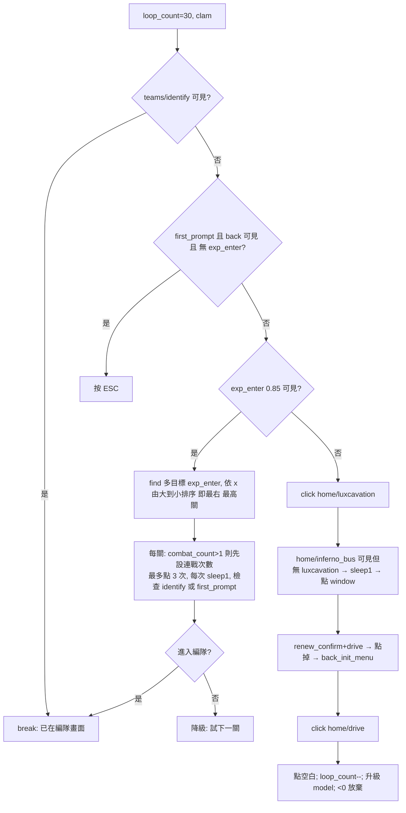

重點：

- 「最高等級」的決定方式：把畫面上所有 `exp_enter.png`（各關卡入口的小圖示）按 **x 由大到小** 排序，先點最右邊的。官方 FAQ：「AALC 會自動選擇已通關過的最高等級日常本，請確保已經自行通關過一次最高等級」。[tasks/daily/luxcavation.py:L64-69](https://github.com/KIYI671/AhabAssistantLimbusCompany/blob/b0f439321987f5f7b126ebbc424f6ef144c1bff0/tasks/daily/luxcavation.py#L64-L69)、[assets/doc/zh/FAQ.md:L85-87](https://github.com/KIYI671/AhabAssistantLimbusCompany/blob/b0f439321987f5f7b126ebbc424f6ef144c1bff0/assets/doc/zh/FAQ.md#L85-L87)
- 連戰框位置：`(lv.x + 300*scale, lv.y − 450*scale)`，即以關卡入口為基準的偏移（2560×1440 下 +300、−450）。[tasks/daily/luxcavation.py:L70-74](https://github.com/KIYI671/AhabAssistantLimbusCompany/blob/b0f439321987f5f7b126ebbc424f6ef144c1bff0/tasks/daily/luxcavation.py#L70-L74)
- 進入判定：`teams/identify_assets.png`（編隊畫面右側的識別標記）或 `home/first_prompt_assets.png`（bbox 2364,665,2455,775）。[tasks/daily/luxcavation.py:L82-90](https://github.com/KIYI671/AhabAssistantLimbusCompany/blob/b0f439321987f5f7b126ebbc424f6ef144c1bff0/tasks/daily/luxcavation.py#L82-L90)
- 路徑導航：`home/luxcavation_assets.png`（Luxcavation 入口）→ 若在「地獄巴士」畫面（`home/inferno_bus_assets.png`）而看不到入口，點 `home/window_assets.png` 回主頁；`home/drive_assets.png` 是主選單的「驅動」鍵，用來進入。[tasks/daily/luxcavation.py:L96-113](https://github.com/KIYI671/AhabAssistantLimbusCompany/blob/b0f439321987f5f7b126ebbc424f6ef144c1bff0/tasks/daily/luxcavation.py#L96-L113)
- 迴圈上限 30，`<20` 切 normal，`<10` 切 aggressive，`<0` log「無法進入經驗本…此次經驗本無效」後 `break`（不拋例外，隨後 `select_battle_team` 仍會執行，可能因畫面不對而失敗）。[tasks/daily/luxcavation.py:L116-123](https://github.com/KIYI671/AhabAssistantLimbusCompany/blob/b0f439321987f5f7b126ebbc424f6ef144c1bff0/tasks/daily/luxcavation.py#L116-L123)
- 名稱遮蔽備註：函式內 `for retry in range(3)` 的迴圈變數遮蔽了 import 進來的 `retry`，但此函式沒有呼叫 `retry()`，目前無影響。[tasks/daily/luxcavation.py:L77-77](https://github.com/KIYI671/AhabAssistantLimbusCompany/blob/b0f439321987f5f7b126ebbc424f6ef144c1bff0/tasks/daily/luxcavation.py#L77-L77)

辨識表：

| 步驟 | 模板（變體） | 方法 | 閾值 | bbox / 尺寸 | 點擊 |
|---|---|---|---|---|---|
| 結束條件 | [default/share/teams/identify_assets.png](https://github.com/KIYI671/AhabAssistantLimbusCompany/blob/b0f439321987f5f7b126ebbc424f6ef144c1bff0/assets/images/default/share/teams/identify_assets.png) | find | 0.8 | 2365,327,2436,384 | - |
| 起始 | [default/zh_cn/home/luxcavation_assets.png](https://github.com/KIYI671/AhabAssistantLimbusCompany/blob/b0f439321987f5f7b126ebbc424f6ef144c1bff0/assets/images/default/zh_cn/home/luxcavation_assets.png) / [default/en/home/luxcavation_assets.png](https://github.com/KIYI671/AhabAssistantLimbusCompany/blob/b0f439321987f5f7b126ebbc424f6ef144c1bff0/assets/images/default/en/home/luxcavation_assets.png) | click | 0.8 | 839,372,957,433 / 775,372,1028,431 | 中心±10 |
| 關卡 | [default/share/luxcavation/exp_enter.png](https://github.com/KIYI671/AhabAssistantLimbusCompany/blob/b0f439321987f5f7b126ebbc424f6ef144c1bff0/assets/images/default/share/luxcavation/exp_enter.png)（另有 [dark/share/luxcavation/exp_enter.png](https://github.com/KIYI671/AhabAssistantLimbusCompany/blob/b0f439321987f5f7b126ebbc424f6ef144c1bff0/assets/images/dark/share/luxcavation/exp_enter.png)） | find（單 + 多目標） | 0.85（單）/ 預設 0.8（多） | 47×52 小圖，全畫面搜 | `mouse_click(lv.x, lv.y)` 無抖動 |
| 回頭 | [default/share/home/first_prompt_assets.png](https://github.com/KIYI671/AhabAssistantLimbusCompany/blob/b0f439321987f5f7b126ebbc424f6ef144c1bff0/assets/images/default/share/home/first_prompt_assets.png)、[default/share/home/back_assets.png](https://github.com/KIYI671/AhabAssistantLimbusCompany/blob/b0f439321987f5f7b126ebbc424f6ef144c1bff0/assets/images/default/share/home/back_assets.png) | find | 0.8 | 2364,665,2455,775 / 114,43,270,135 | ESC |
| 位置判定 | [default/share/home/inferno_bus_assets.png](https://github.com/KIYI671/AhabAssistantLimbusCompany/blob/b0f439321987f5f7b126ebbc424f6ef144c1bff0/assets/images/default/share/home/inferno_bus_assets.png)、[default/share/home/window_assets.png](https://github.com/KIYI671/AhabAssistantLimbusCompany/blob/b0f439321987f5f7b126ebbc424f6ef144c1bff0/assets/images/default/share/home/window_assets.png)、[default/share/home/drive_assets.png](https://github.com/KIYI671/AhabAssistantLimbusCompany/blob/b0f439321987f5f7b126ebbc424f6ef144c1bff0/assets/images/default/share/home/drive_assets.png) | find/click | 0.8 | 1927,230,2032,385 / 1597,1242,1703,1302 / 1908,1232,2018,1297 | 中心±10 |
| 彈窗 | [default/share/base/renew_confirm_assets.png](https://github.com/KIYI671/AhabAssistantLimbusCompany/blob/b0f439321987f5f7b126ebbc424f6ef144c1bff0/assets/images/default/share/base/renew_confirm_assets.png)（dark 亦有） | find/click | 0.8 | 1191,968,1265,1024 | 中心±10 |

### 6.4 紐本進入（`thread_luxcavation`）

[tasks/daily/luxcavation.py:L126-250](https://github.com/KIYI671/AhabAssistantLimbusCompany/blob/b0f439321987f5f7b126ebbc424f6ef144c1bff0/tasks/daily/luxcavation.py#L126-L250)

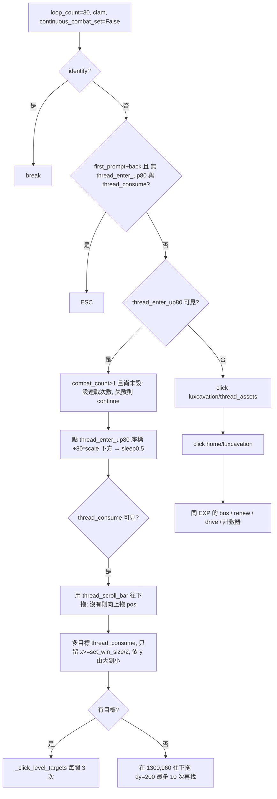

要點：

- 入口卡 `thread_enter_up80_assets.png`（bbox 830,846,869,902）是紐本卡片，進入關卡列表時點的是其座標 `y + 80*scale`。「up80」的字面意義依檔名推測為「解鎖到較高等級」，程式碼未註明（見未解問題）。[tasks/daily/luxcavation.py:L159-168](https://github.com/KIYI671/AhabAssistantLimbusCompany/blob/b0f439321987f5f7b126ebbc424f6ef144c1bff0/tasks/daily/luxcavation.py#L159-L168)
- 連戰次數框「位於外層紡錘卡片，需在進入關卡列表前設置」（程式碼註解），且只設定一次（`continuous_combat_set`）。[tasks/daily/luxcavation.py:L161-167](https://github.com/KIYI671/AhabAssistantLimbusCompany/blob/b0f439321987f5f7b126ebbc424f6ef144c1bff0/tasks/daily/luxcavation.py#L161-L167)
- 關卡消耗錨點 `thread_consume.png`（68×70 小圖）找到後，嘗試用 `thread_scroll_bar.png`（37×74）`mouse_drag_down(..., reverse=2)`（向下 600×scale1080 px）；沒有滾動條則 `reverse=-2`（反向）。[tasks/daily/luxcavation.py:L169-174](https://github.com/KIYI671/AhabAssistantLimbusCompany/blob/b0f439321987f5f7b126ebbc424f6ef144c1bff0/tasks/daily/luxcavation.py#L169-L174)、[module/automation/input_handlers/input.py:L378-400](https://github.com/KIYI671/AhabAssistantLimbusCompany/blob/b0f439321987f5f7b126ebbc424f6ef144c1bff0/module/automation/input_handlers/input.py#L378-L400)
- 過濾：「只識別右半螢幕」，但實作為 `min_x = cfg.set_win_size / 2`，而 `set_win_size` 是**高度**（如 1080），因此實際門檻是 `x >= 高/2`（約畫面寬的 28%）而非寬的一半；排序 `y` 由大到小（先試畫面最下方、即最高關）。[tasks/daily/luxcavation.py:L181-183](https://github.com/KIYI671/AhabAssistantLimbusCompany/blob/b0f439321987f5f7b126ebbc424f6ef144c1bff0/tasks/daily/luxcavation.py#L181-L183)
- 所有關卡都未解鎖時（找不到 consume 目標）：在 `(1300, 960)×scale` 往下拖 `dy=200×scale`（0.5 s），每次拖完重找，最多滑 10 次。[tasks/daily/luxcavation.py:L188-216](https://github.com/KIYI671/AhabAssistantLimbusCompany/blob/b0f439321987f5f7b126ebbc424f6ef144c1bff0/tasks/daily/luxcavation.py#L188-L216)
- `_click_level_targets`：每個目標最多點 3 次（點後 sleep 1、`mouse_to_blank`、3 次檢查 `teams/identify` 或 `first_prompt`），失敗則降級試下一個。[tasks/daily/luxcavation.py:L127-141](https://github.com/KIYI671/AhabAssistantLimbusCompany/blob/b0f439321987f5f7b126ebbc424f6ef144c1bff0/tasks/daily/luxcavation.py#L127-L141)
- 其餘導航（`luxcavation/thread_assets.png` → `home/luxcavation_assets.png` → bus/window → renew → drive）與計數器、放棄行為（`log.error("无法进入纽本…")`）和經驗本相同。[tasks/daily/luxcavation.py:L221-250](https://github.com/KIYI671/AhabAssistantLimbusCompany/blob/b0f439321987f5f7b126ebbc424f6ef144c1bff0/tasks/daily/luxcavation.py#L221-L250)

辨識表：

| 步驟 | 模板（變體） | 方法 | 閾值 | bbox / 尺寸 | 點擊 |
|---|---|---|---|---|---|
| 入口卡 | [default/share/luxcavation/thread_enter_up80_assets.png](https://github.com/KIYI671/AhabAssistantLimbusCompany/blob/b0f439321987f5f7b126ebbc424f6ef144c1bff0/assets/images/default/share/luxcavation/thread_enter_up80_assets.png) | click(click=False) 取座標 | 0.8 | 830,846,869,902 | `mouse_click(x, y+80*scale)` |
| 入口（對比版） | [default/share/luxcavation/thread_enter_assets.png](https://github.com/KIYI671/AhabAssistantLimbusCompany/blob/b0f439321987f5f7b126ebbc424f6ef144c1bff0/assets/images/default/share/luxcavation/thread_enter_assets.png)（dark share 亦有） | 本檔未使用（見未解問題） | - | 678,936,726,986 | - |
| 分頁 | [default/share/luxcavation/thread_assets.png](https://github.com/KIYI671/AhabAssistantLimbusCompany/blob/b0f439321987f5f7b126ebbc424f6ef144c1bff0/assets/images/default/share/luxcavation/thread_assets.png) | click | 0.8 | 158,616,239,708 | 中心±10 |
| 關卡 | [default/share/luxcavation/thread_consume.png](https://github.com/KIYI671/AhabAssistantLimbusCompany/blob/b0f439321987f5f7b126ebbc424f6ef144c1bff0/assets/images/default/share/luxcavation/thread_consume.png)（dark share 亦有） | find / 多目標 | 0.8 | 68×70 | `mouse_click(x,y)` |
| 捲軸 | [default/share/luxcavation/thread_scroll_bar.png](https://github.com/KIYI671/AhabAssistantLimbusCompany/blob/b0f439321987f5f7b126ebbc424f6ef144c1bff0/assets/images/default/share/luxcavation/thread_scroll_bar.png)（dark share 亦有） | find | 0.8 | 37×74 | 拖曳 |

 

### 6.5 失敗 / 重試 / 中斷恢復（日常本）

- 沒有任何持久化進度：每個函式都是「看畫面決定下一步」的狀態機。重啟 AALC 後 `script_task` 先偵測戰鬥中（`battle/turn_assets.png`），再 `Daily_task_wrapper` 以 `back_init_menu()` 開頭重新回到主選單。[tasks/base/script_task_scheme.py:L382-390](https://github.com/KIYI671/AhabAssistantLimbusCompany/blob/b0f439321987f5f7b126ebbc424f6ef144c1bff0/tasks/base/script_task_scheme.py#L382-L390)
- 被中斷的那場戰鬥在重啟時只會「補償一次次數」：`fight()` 判讀結算畫面（`clear_rewards_EXP_1/2/3` 或 `clear_rewards_thread`），回傳 `"EXP"` / `"thread"`，`Daily_task_wrapper` 對應減 1。[tasks/battle/battle.py:L498-507](https://github.com/KIYI671/AhabAssistantLimbusCompany/blob/b0f439321987f5f7b126ebbc424f6ef144c1bff0/tasks/battle/battle.py#L498-L507)、[tasks/battle/battle.py:L554-556](https://github.com/KIYI671/AhabAssistantLimbusCompany/blob/b0f439321987f5f7b126ebbc424f6ef144c1bff0/tasks/battle/battle.py#L554-L556)
- 若「進入」階段超過 30 圈：只記 error 並 break，**不重試整個流程也不回主選單**，後續 `select_battle_team` / `to_battle` 自己處理（`to_battle` 15 次失敗回 False → `onetime_*` 直接 return False，外層 for 迴圈繼續下一次）。
- 進入戰鬥後卡住 `900 + 300*combat_count` 秒 → `check_times` 殺遊戲重啟（`kill_game` + `restart_game`）。

---

## 7. 領獎

### 7.1 通行證日常/週常（`get_pass_prize`）

[tasks/daily/get_prize.py:L11-69](https://github.com/KIYI671/AhabAssistantLimbusCompany/blob/b0f439321987f5f7b126ebbc424f6ef144c1bff0/tasks/daily/get_prize.py#L11-L69)

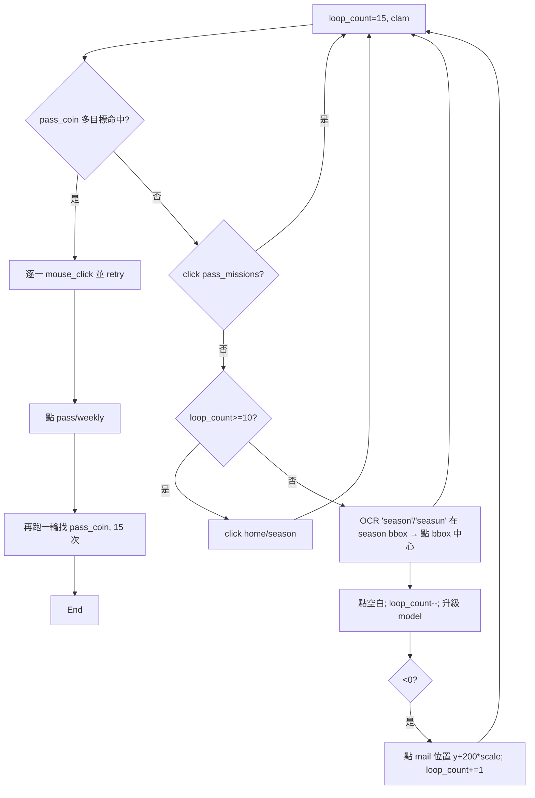

1. 先找 `pass/pass_coin.png`（領取獎勵的硬幣圖示，65×101，多目標）：全部座標逐一 `mouse_click(x, y)`（無抖動）並 `retry()`；然後跳出第一個迴圈。[tasks/daily/get_prize.py:L20-24](https://github.com/KIYI671/AhabAssistantLimbusCompany/blob/b0f439321987f5f7b126ebbc424f6ef144c1bff0/tasks/daily/get_prize.py#L20-L24)
2. 沒有硬幣：點 `pass/pass_missions_assets.png`（任務頁籤）→ 繼續；`loop_count>=10` 時點 `home/season_assets.png`（賽季/通行證入口，bbox 2021,373,2163,394）；之後（`loop_count<10`）改用 OCR 找文字 `["season","seasun"]`（範圍為 `season_assets` 的 bbox），點 bbox 中心。[tasks/daily/get_prize.py:L25-37](https://github.com/KIYI671/AhabAssistantLimbusCompany/blob/b0f439321987f5f7b126ebbc424f6ef144c1bff0/tasks/daily/get_prize.py#L25-L37)
3. 切換 `auto.model`（`normal_at=10, aggressive_at=5`）；`loop_count<0` 時點「郵件圖示位置下方 200×scale」（意圖推測是展開通行證側欄），`loop_count += 1` 再試。[tasks/daily/get_prize.py:L39-49](https://github.com/KIYI671/AhabAssistantLimbusCompany/blob/b0f439321987f5f7b126ebbc424f6ef144c1bff0/tasks/daily/get_prize.py#L39-L49)
4. 日常領完後：點 `pass/weekly_assets.png`（週常頁籤，bbox 約 516,713,568,883），再跑第二個 15 次迴圈找 `pass_coin` 並點擊，找不到只 log error。[tasks/daily/get_prize.py:L52-69](https://github.com/KIYI671/AhabAssistantLimbusCompany/blob/b0f439321987f5f7b126ebbc424f6ef144c1bff0/tasks/daily/get_prize.py#L52-L69)

辨識表：

| 模板（變體） | 方法 | 閾值 | bbox / 尺寸 |
|---|---|---|---|
| [default/share/pass/pass_coin.png](https://github.com/KIYI671/AhabAssistantLimbusCompany/blob/b0f439321987f5f7b126ebbc424f6ef144c1bff0/assets/images/default/share/pass/pass_coin.png) | 多目標 find | 0.8 | 65×101 |
| [default/zh_cn/pass/pass_missions_assets.png](https://github.com/KIYI671/AhabAssistantLimbusCompany/blob/b0f439321987f5f7b126ebbc424f6ef144c1bff0/assets/images/default/zh_cn/pass/pass_missions_assets.png) / [default/en/pass/pass_missions_assets.png](https://github.com/KIYI671/AhabAssistantLimbusCompany/blob/b0f439321987f5f7b126ebbc424f6ef144c1bff0/assets/images/default/en/pass/pass_missions_assets.png) | click | 0.8 | 636,89,835,136 / 655,98,887,135 |
| [default/zh_cn/pass/weekly_assets.png](https://github.com/KIYI671/AhabAssistantLimbusCompany/blob/b0f439321987f5f7b126ebbc424f6ef144c1bff0/assets/images/default/zh_cn/pass/weekly_assets.png) / [default/en/pass/weekly_assets.png](https://github.com/KIYI671/AhabAssistantLimbusCompany/blob/b0f439321987f5f7b126ebbc424f6ef144c1bff0/assets/images/default/en/pass/weekly_assets.png) | click | 0.8 | 522,714,563,886 / 516,713,568,883 |
| [default/share/home/season_assets.png](https://github.com/KIYI671/AhabAssistantLimbusCompany/blob/b0f439321987f5f7b126ebbc424f6ef144c1bff0/assets/images/default/share/home/season_assets.png) | click / OCR bbox | 0.8 | 2021,373,2163,394 |

**注意（疑似缺陷）**：`last_try` 只被賦值為 False、從未被設為 True，且 `mail_pos` 可能為 None。因此 `loop_count<0` 的分支每次都會走「點郵件下方 + loop_count+=1」，理論上永遠到不了 `log.error("无法收取日常/周常"); return`（只要一直找不到硬幣）。見未解問題。[tasks/daily/get_prize.py:L13-50](https://github.com/KIYI671/AhabAssistantLimbusCompany/blob/b0f439321987f5f7b126ebbc424f6ef144c1bff0/tasks/daily/get_prize.py#L13-L50)

### 7.2 郵件（`get_mail_prize`）

[tasks/daily/get_prize.py:L72-98](https://github.com/KIYI671/AhabAssistantLimbusCompany/blob/b0f439321987f5f7b126ebbc424f6ef144c1bff0/tasks/daily/get_prize.py#L72-L98)

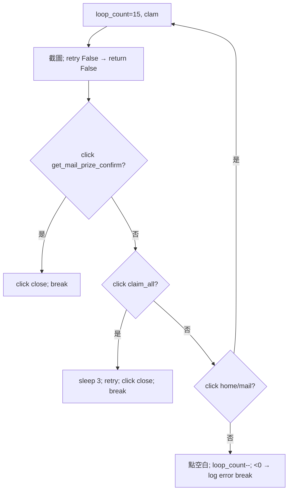

- 順序：先看有無「領取確認」彈窗（`mail/get_mail_prize_confirm.png`，87×58，無語言版）→ 關閉；否則「全部領取」（`mail/claim_all_assets.png`）→ sleep 3 → `retry()` → 點 `mail/close_assets.png` → break；再否則點 `home/mail_assets.png` 開信箱。[tasks/daily/get_prize.py:L82-92](https://github.com/KIYI671/AhabAssistantLimbusCompany/blob/b0f439321987f5f7b126ebbc424f6ef144c1bff0/tasks/daily/get_prize.py#L82-L92)
- 注意 `retry()` 正常結束回傳 None（只有卡死才回 False），所以 `if retry(): continue` 恆為假，領完全部後一定走 `close` 並 `break`。[tasks/daily/get_prize.py:L85-90](https://github.com/KIYI671/AhabAssistantLimbusCompany/blob/b0f439321987f5f7b126ebbc424f6ef144c1bff0/tasks/daily/get_prize.py#L85-L90)、[tasks/base/retry.py:L138-190](https://github.com/KIYI671/AhabAssistantLimbusCompany/blob/b0f439321987f5f7b126ebbc424f6ef144c1bff0/tasks/base/retry.py#L138-L190)
- `loop_count=15`；`update_model_for_retry(normal_at=20, aggressive_at=10)`（起始 15 < 20 所以首圈起就在 normal）；耗盡 log「无法收取邮箱」。[tasks/daily/get_prize.py:L93-98](https://github.com/KIYI671/AhabAssistantLimbusCompany/blob/b0f439321987f5f7b126ebbc424f6ef144c1bff0/tasks/daily/get_prize.py#L93-L98)

| 模板（變體） | 方法 | 閾值 | bbox / 尺寸 |
|---|---|---|---|
| [default/share/home/mail_assets.png](https://github.com/KIYI671/AhabAssistantLimbusCompany/blob/b0f439321987f5f7b126ebbc424f6ef144c1bff0/assets/images/default/share/home/mail_assets.png)（dark share 亦有） | click | 0.8 | 2206,224,2274,274 |
| [default/zh_cn/mail/claim_all_assets.png](https://github.com/KIYI671/AhabAssistantLimbusCompany/blob/b0f439321987f5f7b126ebbc424f6ef144c1bff0/assets/images/default/zh_cn/mail/claim_all_assets.png) / [default/en/mail/claim_all_assets.png](https://github.com/KIYI671/AhabAssistantLimbusCompany/blob/b0f439321987f5f7b126ebbc424f6ef144c1bff0/assets/images/default/en/mail/claim_all_assets.png)（dark 亦各有 zh_cn / en） | click | 0.8 | 1746,1053,2086,1129 / 1758,1062,2117,1143 |
| [default/share/mail/get_mail_prize_confirm.png](https://github.com/KIYI671/AhabAssistantLimbusCompany/blob/b0f439321987f5f7b126ebbc424f6ef144c1bff0/assets/images/default/share/mail/get_mail_prize_confirm.png) | click | 0.8 | 87×58 |
| [default/zh_cn/mail/close_assets.png](https://github.com/KIYI671/AhabAssistantLimbusCompany/blob/b0f439321987f5f7b126ebbc424f6ef144c1bff0/assets/images/default/zh_cn/mail/close_assets.png) / [default/en/mail/close_assets.png](https://github.com/KIYI671/AhabAssistantLimbusCompany/blob/b0f439321987f5f7b126ebbc424f6ef144c1bff0/assets/images/default/en/mail/close_assets.png) | click | 0.8 | 1499,1078,1611,1131 / 1486,1072,1629,1133 |

### 7.3 `to_get_reward` 組合與 `re_claim_rewards`

`set_get_prize`：0 → 通行證 + 郵件；1 → 只通行證；其他（2）→ 只郵件；每段前後都 `back_init_menu()`。[tasks/base/script_task_scheme.py:L110-124](https://github.com/KIYI671/AhabAssistantLimbusCompany/blob/b0f439321987f5f7b126ebbc424f6ef144c1bff0/tasks/base/script_task_scheme.py#L110-L124) 鏡牢模式下，`re_claim_rewards` 會在第一次鏡牢完成後與全部完成後各補領一次。[tasks/base/script_task_scheme.py:L352-357](https://github.com/KIYI671/AhabAssistantLimbusCompany/blob/b0f439321987f5f7b126ebbc424f6ef144c1bff0/tasks/base/script_task_scheme.py#L352-L357)

---

## 8. GUI 小工具（`tasks/tools/*`）

GUI 入口：`ToolsInterface` 三張卡片 → `tools.start("battle"|"production"|"screenshot")`；`ToolManager` 在主執行緒事件迴圈 `QTimer.singleShot(0, ...)` 建立視窗，`initialized` 為 True 才標示「運行中」。[app/tools_interface.py:L83-114](https://github.com/KIYI671/AhabAssistantLimbusCompany/blob/b0f439321987f5f7b126ebbc424f6ef144c1bff0/app/tools_interface.py#L83-L114)、[tasks/tools/__init__.py:L15-74](https://github.com/KIYI671/AhabAssistantLimbusCompany/blob/b0f439321987f5f7b126ebbc424f6ef144c1bff0/tasks/tools/__init__.py#L15-L74)

### 8.1 自動戰鬥（`infinite_battle.py`）

- 視窗：`InfiniteBattles`（按鈕「開始戰鬥」、核取「無限守備」、「第一回合開啟守備」、「不處理事件」），並註冊 `cfg.shutdown_hotkey`（預設 `<ctrl>+q`）為停止快捷鍵。[tasks/tools/infinite_battle.py:L86-147](https://github.com/KIYI671/AhabAssistantLimbusCompany/blob/b0f439321987f5f7b126ebbc424f6ef144c1bff0/tasks/tools/infinite_battle.py#L86-L147)、[assets/config/config.example.yaml:L11-11](https://github.com/KIYI671/AhabAssistantLimbusCompany/blob/b0f439321987f5f7b126ebbc424f6ef144c1bff0/assets/config/config.example.yaml#L11-L11)
- 工作執行緒 `BattleWorker`：`Battle(is_tool=True)`（「復用鏡牢戰鬥邏輯」）；`run()` 先 `init_game()`、`_set_win()`（暫時強制 `background_click=True` 並 `screen.set_win()`）、`path_manager.initialize_paths(reset_eliminations=False)`、清圖片快取，再呼叫 `battle.fight(infinite_battle=True, defense_on_turn1=..., defense_all_time=..., choice_event_handling=...)`。[tasks/tools/infinite_battle.py:L22-84](https://github.com/KIYI671/AhabAssistantLimbusCompany/blob/b0f439321987f5f7b126ebbc424f6ef144c1bff0/tasks/tools/infinite_battle.py#L22-L84)
- 停止：`stop()` 把 `battle.running=False`；等 1 秒仍在跑就 `terminate()` 並 `auto.reset_safety_locks()`，最後 `screen.reset_win()`、清快取。[tasks/tools/infinite_battle.py:L196-212](https://github.com/KIYI671/AhabAssistantLimbusCompany/blob/b0f439321987f5f7b126ebbc424f6ef144c1bff0/tasks/tools/infinite_battle.py#L196-L212)
- 戰鬥內部流程屬於 [12-md-battle.md](12-md-battle.md)。`infinite_battle=True` 時結算 / 回到編隊畫面不會 break 而是 `continue`，因此會一直打。[tasks/battle/battle.py:L496-518](https://github.com/KIYI671/AhabAssistantLimbusCompany/blob/b0f439321987f5f7b126ebbc424f6ef144c1bff0/tasks/battle/battle.py#L496-L518)

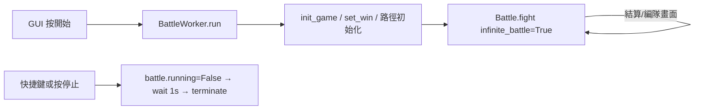

### 8.2 自動換餅（`production_module.py`）

用途：持續「以最少浪費」換模組——算好下一次腦啡肽湊滿 20 點的時間，睡到那時再起來換。GUI 說明文字是搞笑文案；核取方塊「等待期間關閉遊戲」。[tasks/tools/production_module.py:L196-253](https://github.com/KIYI671/AhabAssistantLimbusCompany/blob/b0f439321987f5f7b126ebbc424f6ef144c1bff0/tasks/tools/production_module.py#L196-L253)

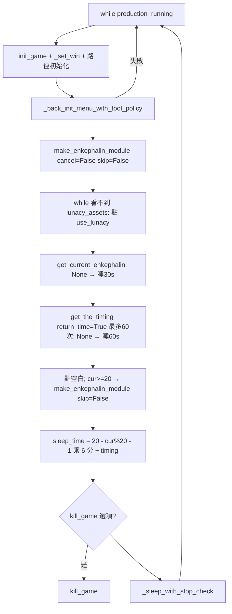

- 休眠時間公式：`(20 − cur % 20 − 1) × 6 × 60 + timing` 秒。可見每 6 分鐘回 1 點、每 20 點換一次；`timing` 是下一點回復的剩餘秒數。[tasks/tools/production_module.py:L106-112](https://github.com/KIYI671/AhabAssistantLimbusCompany/blob/b0f439321987f5f7b126ebbc424f6ef144c1bff0/tasks/tools/production_module.py#L106-L112)
- `_back_init_menu_with_tool_policy`：用 `back_init_menu(allow_restart=False)`，失敗時 1.5 s 後重試；累計超過 120 s（模擬器 180 s）才殺遊戲重啟，且重啟冷卻 60 s（模擬器 120 s）。[tasks/tools/production_module.py:L116-155](https://github.com/KIYI671/AhabAssistantLimbusCompany/blob/b0f439321987f5f7b126ebbc424f6ef144c1bff0/tasks/tools/production_module.py#L116-L155)
- 例外處理：`SetWindowPos` 拒絕存取（視窗還沒就緒）最多重試 8 次、等待 `min(2n, 10)` 秒。[tasks/tools/production_module.py:L64-82](https://github.com/KIYI671/AhabAssistantLimbusCompany/blob/b0f439321987f5f7b126ebbc424f6ef144c1bff0/tasks/tools/production_module.py#L64-L82)、[tasks/tools/production_module.py:L163-173](https://github.com/KIYI671/AhabAssistantLimbusCompany/blob/b0f439321987f5f7b126ebbc424f6ef144c1bff0/tasks/tools/production_module.py#L163-L173)
- 停止：`production_running=False`，休眠以 0.5 s 分段檢查，所以能很快響應；不使用全域快捷鍵。[tasks/tools/production_module.py:L157-161](https://github.com/KIYI671/AhabAssistantLimbusCompany/blob/b0f439321987f5f7b126ebbc424f6ef144c1bff0/tasks/tools/production_module.py#L157-L161)、[tasks/tools/production_module.py:L285-297](https://github.com/KIYI671/AhabAssistantLimbusCompany/blob/b0f439321987f5f7b126ebbc424f6ef144c1bff0/tasks/tools/production_module.py#L285-L297)
- 中斷 / 重啟：整個迴圈每一輪都重做 `init_game`，因此即使遊戲被關掉（`kill_game` 選項）下一輪也會自動拉起。

### 8.3 截圖（`screenshot_module.py`）

`ScreenshotGet(QThread)`：`init_game()` → `auto.take_screenshot(gray=False)` → 存成執行目錄下的 `screenshot_YYYYmmdd_HHMMSS.png`，發 `on_saved_timestr` 訊號（GUI 顯示完成提示）；若啟用 `set_windows` + `set_reduce_miscontact`（非模擬器）則收尾時 `screen.reset_win(activate=False)`。[tasks/tools/screenshot_module.py:L11-42](https://github.com/KIYI671/AhabAssistantLimbusCompany/blob/b0f439321987f5f7b126ebbc424f6ef144c1bff0/tasks/tools/screenshot_module.py#L11-L42)、[app/tools_interface.py:L111-112](https://github.com/KIYI671/AhabAssistantLimbusCompany/blob/b0f439321987f5f7b126ebbc424f6ef144c1bff0/app/tools_interface.py#L111-L112) 用途是讓使用者提供遊戲截圖給開發者 / 做素材（用途為依檔名與流程推測，檔案內無說明）。

### 8.4 `ui_style.py`

純 UI：`_THEMES` 定義 dark / light 調色盤，`_QSS` 模板，`apply_tool_window_theme(widget, selector)` 依 qfluentwidgets `isDarkTheme()` 套用並呼叫 `DwmSetWindowAttribute` 讓 Windows 標題列同步深色；`get_status_label_style()` 提供狀態標籤樣式。供兩個工具視窗共用，無自動化邏輯。[tasks/tools/ui_style.py:L1-60](https://github.com/KIYI671/AhabAssistantLimbusCompany/blob/b0f439321987f5f7b126ebbc424f6ef144c1bff0/tasks/tools/ui_style.py#L1-L60)、[tasks/tools/ui_style.py:L157-192](https://github.com/KIYI671/AhabAssistantLimbusCompany/blob/b0f439321987f5f7b126ebbc424f6ef144c1bff0/tasks/tools/ui_style.py#L157-L192)

---

## 9. 事件處理（`event_handling.py`）：日常本的牽涉範圍

- 日常本（經驗本 / 紐本）流程本身不呼叫 `EventHandling`；它是被 `Battle.fight(choice_event_handling=True)` 在戰鬥中的「事件」畫面使用（鏡牢中的 MD 事件屬 14 章），以及「自動戰鬥」工具的「不處理事件」核取方塊控制它。[tasks/battle/battle.py:L465-475](https://github.com/KIYI671/AhabAssistantLimbusCompany/blob/b0f439321987f5f7b126ebbc424f6ef144c1bff0/tasks/battle/battle.py#L465-L475)、[tasks/tools/infinite_battle.py:L143-173](https://github.com/KIYI671/AhabAssistantLimbusCompany/blob/b0f439321987f5f7b126ebbc424f6ef144c1bff0/tasks/tools/infinite_battle.py#L143-L173)
- 機制（供對照）：偵測到 `event/perform_the_check_feature_assets.png` 後呼叫 `decision_event_handling()`：依 `very_high → high → normal → low → very_low` 模板（閾值 0.74）找成功率最高的罪人點擊；全部找不到則 OCR（`extract_levels` 容許編輯距離 1）；再不行就以 `(150 + 140*i)*scale, 1300*scale` 輪流點底部 12 位罪人。每次動作間隔 ≥0.75 s。[tasks/event/event_handling.py:L8-73](https://github.com/KIYI671/AhabAssistantLimbusCompany/blob/b0f439321987f5f7b126ebbc424f6ef144c1bff0/tasks/event/event_handling.py#L8-L73)、[tasks/event/event_handling.py:L114-165](https://github.com/KIYI671/AhabAssistantLimbusCompany/blob/b0f439321987f5f7b126ebbc424f6ef144c1bff0/tasks/event/event_handling.py#L114-L165)
- 素材變體：`event/very_high.png`、`high.png`、`normal.png`、`low.png`、`very_low.png` 皆有 zh_cn 與 en 兩套（無 dark）；`perform_the_check_feature_assets.png`、`skip_assets.png`、`select_first_option_assets.png`、`unknown_event.png` 在 `default/share`。例：[default/zh_cn/event/very_high.png](https://github.com/KIYI671/AhabAssistantLimbusCompany/blob/b0f439321987f5f7b126ebbc424f6ef144c1bff0/assets/images/default/zh_cn/event/very_high.png)、[default/en/event/very_high.png](https://github.com/KIYI671/AhabAssistantLimbusCompany/blob/b0f439321987f5f7b126ebbc424f6ef144c1bff0/assets/images/default/en/event/very_high.png)、[default/share/event/perform_the_check_feature_assets.png](https://github.com/KIYI671/AhabAssistantLimbusCompany/blob/b0f439321987f5f7b126ebbc424f6ef144c1bff0/assets/images/default/share/event/perform_the_check_feature_assets.png)。

---

## 10. 失敗 / 重試 / 恢復：跨動作總結

| 層級 | 機制 | 出處 |
|---|---|---|
| 畫面狀態重置 | `back_init_menu()` 30 圈 → 殺遊戲重啟 | [tasks/base/back_init_menu.py:L13-33](https://github.com/KIYI671/AhabAssistantLimbusCompany/blob/b0f439321987f5f7b126ebbc424f6ef144c1bff0/tasks/base/back_init_menu.py#L13-L33) |
| 網路斷線 | `retry()`（同步）+ `RetryMonitor`（背景） | [tasks/base/retry.py:L138-190](https://github.com/KIYI671/AhabAssistantLimbusCompany/blob/b0f439321987f5f7b126ebbc424f6ef144c1bff0/tasks/base/retry.py#L138-L190)、[tasks/base/retry_monitor.py:L99-136](https://github.com/KIYI671/AhabAssistantLimbusCompany/blob/b0f439321987f5f7b126ebbc424f6ef144c1bff0/tasks/base/retry_monitor.py#L99-L136) |
| 識別範圍升級 | clam → normal → aggressive（隨剩餘次數） | [tasks/base/__init__.py:L1-7](https://github.com/KIYI671/AhabAssistantLimbusCompany/blob/b0f439321987f5f7b126ebbc424f6ef144c1bff0/tasks/base/__init__.py#L1-L7) |
| 逾時卡死 | `check_times(timeout=90)`；戰鬥 `900+300*count` | [tasks/base/retry.py:L123-135](https://github.com/KIYI671/AhabAssistantLimbusCompany/blob/b0f439321987f5f7b126ebbc424f6ef144c1bff0/tasks/base/retry.py#L123-L135)、[tasks/battle/battle.py:L248-248](https://github.com/KIYI671/AhabAssistantLimbusCompany/blob/b0f439321987f5f7b126ebbc424f6ef144c1bff0/tasks/battle/battle.py#L248-L248) |
| 暫停 | `auto.get_restore_time()` 將逾時起點推後 | [tasks/base/retry.py:L155-156](https://github.com/KIYI671/AhabAssistantLimbusCompany/blob/b0f439321987f5f7b126ebbc424f6ef144c1bff0/tasks/base/retry.py#L155-L156)、[tasks/base/make_enkephalin_module.py:L100-101](https://github.com/KIYI671/AhabAssistantLimbusCompany/blob/b0f439321987f5f7b126ebbc424f6ef144c1bff0/tasks/base/make_enkephalin_module.py#L100-L101) |
| 使用者終止 | `CTRL+Q` 終止；文件註明「可能導致再次啟動出現問題，重啟程式可解決」；`terminate()` 會換新鎖避免永久阻塞 | [assets/doc/zh/How_to_use.md:L14-16](https://github.com/KIYI671/AhabAssistantLimbusCompany/blob/b0f439321987f5f7b126ebbc424f6ef144c1bff0/assets/doc/zh/How_to_use.md#L14-L16)、[tasks/base/script_task_scheme.py:L484-488](https://github.com/KIYI671/AhabAssistantLimbusCompany/blob/b0f439321987f5f7b126ebbc424f6ef144c1bff0/tasks/base/script_task_scheme.py#L484-L488) |
| 例外 | `my_script_task.run` 捕捉 `userStopError`、`unableToFindTeamError`、`netWorkUnstableError` 等，存入 `self.exception` | [tasks/base/script_task_scheme.py:L458-482](https://github.com/KIYI671/AhabAssistantLimbusCompany/blob/b0f439321987f5f7b126ebbc424f6ef144c1bff0/tasks/base/script_task_scheme.py#L458-L482) |
| 重啟後狀態 | 無持久化；先偵測戰鬥中（`battle/turn_assets.png`，bbox 26,126,89,170），其餘從 `back_init_menu` 重來 | [tasks/base/script_task_scheme.py:L382-390](https://github.com/KIYI671/AhabAssistantLimbusCompany/blob/b0f439321987f5f7b126ebbc424f6ef144c1bff0/tasks/base/script_task_scheme.py#L382-L390) |

---

## 11. 相關報告

- [README.md](README.md)
- [01-architecture.md](01-architecture.md)（排程、設定、GUI 執行緒）
- [02-recognition-and-input.md](02-recognition-and-input.md)（find_element / OCR / 輸入）
- [10-mirror-dungeon-overview.md](10-mirror-dungeon-overview.md)
- [11-md-team-formation.md](11-md-team-formation.md)（`select_battle_team`）
- [12-md-battle.md](12-md-battle.md)（`Battle.fight` / `to_battle`）
- [13-md-ego-gifts.md](13-md-ego-gifts.md)
- [14-md-navigation.md](14-md-navigation.md)（MD 事件）
- [90-asset-index.md](90-asset-index.md)
- [99-open-questions.md](99-open-questions.md)

---

## 12. 未解問題

1. `get_pass_prize()` 的 `last_try` 從不設為 True，`mail_pos` 可能為 None（TypeError）；如果硬幣一直找不到，是否會無限迴圈？需實機或單元測試驗證。[tasks/daily/get_prize.py:L13-50](https://github.com/KIYI671/AhabAssistantLimbusCompany/blob/b0f439321987f5f7b126ebbc424f6ef144c1bff0/tasks/daily/get_prize.py#L13-L50)
2. `get_the_timing()` 的葛朗台判斷是 `minute >= 5 and seconds >= 20`：分鐘 ≥6 但秒 <20（如 6:10）會回 False，與文件「超過 5 分 20 秒」不完全一致；是否為刻意或 bug？[tasks/base/make_enkephalin_module.py:L32-34](https://github.com/KIYI671/AhabAssistantLimbusCompany/blob/b0f439321987f5f7b126ebbc424f6ef144c1bff0/tasks/base/make_enkephalin_module.py#L32-L34)、[assets/doc/zh/How_to_use.md:L81-81](https://github.com/KIYI671/AhabAssistantLimbusCompany/blob/b0f439321987f5f7b126ebbc424f6ef144c1bff0/assets/doc/zh/How_to_use.md#L81-L81)
3. `thread_luxcavation` 的「只識別右半螢幕」用 `cfg.set_win_size / 2`（高度的一半）而非寬度的一半，是否為筆誤？[tasks/daily/luxcavation.py:L181-183](https://github.com/KIYI671/AhabAssistantLimbusCompany/blob/b0f439321987f5f7b126ebbc424f6ef144c1bff0/tasks/daily/luxcavation.py#L181-L183)
4. `thread_enter_up80_assets.png`（使用中）與 `thread_enter_assets.png`（本檔未引用，可能由其他模組或舊版使用）的語意差異，以及 "up80" 的確切含義（推測：等級 ≥80？）。
5. 「全部兌換」`all_in` 的確切遊戲語意（體力→模組）是依用途推論，需對照遊戲畫面確認。
6. `onetime_EXP/thread_process` 在 `to_battle()` 失敗時 `return False` 但不回主選單；後續循環依賴 `EXP_luxcavation` 自己的狀態偵測恢復，是否有死角（如卡在編隊畫面）？
7. `EXP_luxcavation` 30 圈失敗後仍往下執行 `select_battle_team`；是否會誤選隊或誤點？
8. `RetryMonitor` 只載入 `default/en` 與 `default/zh_cn` 的 `retry.png`，dark 主題下是否仍有效？[tasks/base/retry_monitor.py:L15-16](https://github.com/KIYI671/AhabAssistantLimbusCompany/blob/b0f439321987f5f7b126ebbc424f6ef144c1bff0/tasks/base/retry_monitor.py#L15-L16)
9. 本章 bbox 為我用 PIL 對 `default/` 模板重新計算，與執行時 `get_bbox`（灰階 + 縮放後）可能有 1~2 px 差異；dark 變體 bbox 未逐一列出。
