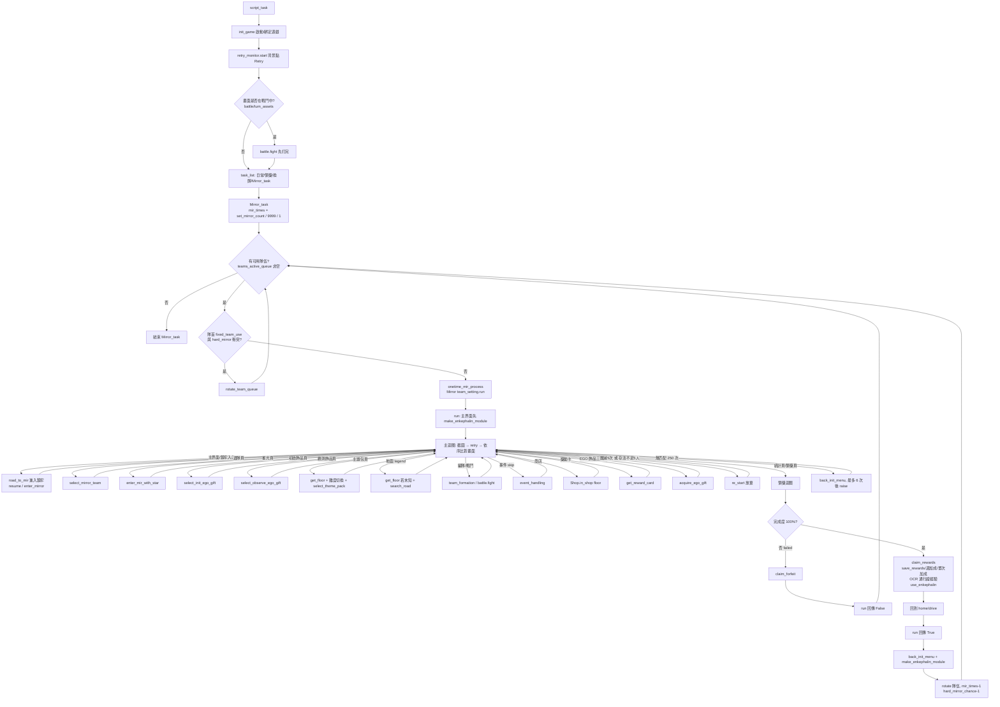
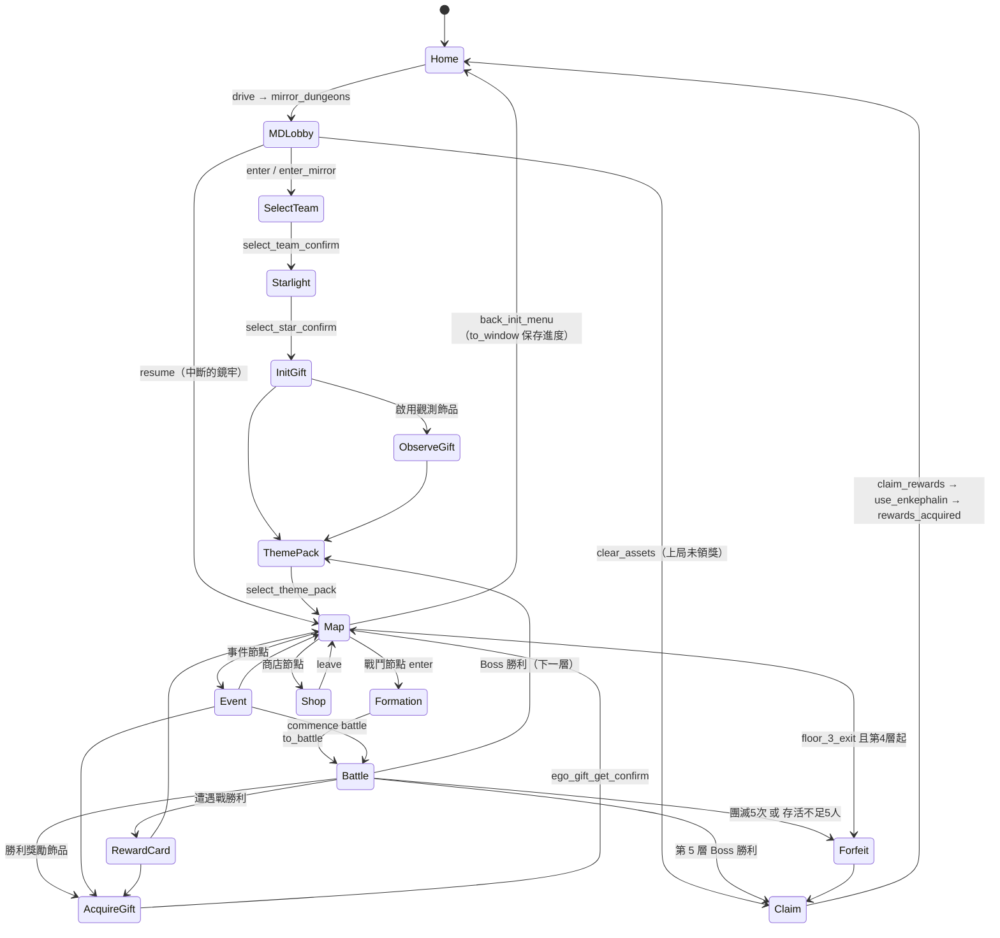
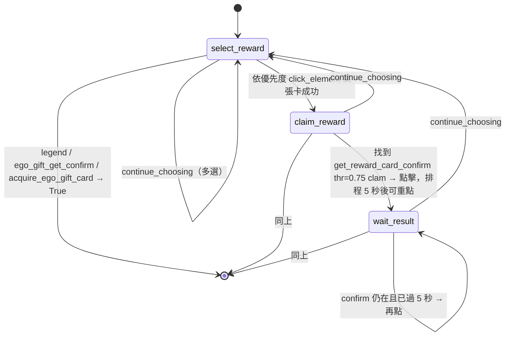

# 10 — 鏡牢（Mirror Dungeon）主迴圈與狀態機

> 來源：`KIYI671/AhabAssistantLimbusCompany` @ `b0f4393`。本章只依程式碼與 repo 內文件（`assets/doc/zh/*`）。子步驟（編隊、戰鬥、飾品、商店、尋路、主題包、事件）只給摘要與連結，細節見兄弟報告。

## 目的

鏡牢是 AALC 最重的任務：一次完整的鏡牢 = 進入 → 選隊 → 星光 → 初始 EGO 飾品 → 5 層（每層：主題包 → 地圖尋路 → 戰鬥／事件／商店／獎勵卡）→ 結算領獎。本章說明：

1. 外層排程（`Mirror_task` / `onetime_mir_process`）如何決定次數、隊伍輪替、困難／普通。
2. `Mirror.run()` 主迴圈如何「每輪截圖 → 依固定順序比對畫面 → 呼叫 handler」，也就是一個**無顯式狀態變數的畫面驅動狀態機**。
3. 獎勵卡（`reward_card.py`）與樓層識別（`get_floor.py`）的完整邏輯。
4. 斷點接續與錯誤恢復：中途啟動、遊戲崩潰、卡死時各怎麼處理，哪些記憶體狀態會遺失、哪些可以重新推導。

核心檔案：[tasks/mirror/mirror.py:L1-L1603](https://github.com/KIYI671/AhabAssistantLimbusCompany/blob/b0f439321987f5f7b126ebbc424f6ef144c1bff0/tasks/mirror/mirror.py#L1-L1603)、[tasks/mirror/reward_card.py:L1-L109](https://github.com/KIYI671/AhabAssistantLimbusCompany/blob/b0f439321987f5f7b126ebbc424f6ef144c1bff0/tasks/mirror/reward_card.py#L1-L109)、[tasks/mirror/get_floor.py:L1-L64](https://github.com/KIYI671/AhabAssistantLimbusCompany/blob/b0f439321987f5f7b126ebbc424f6ef144c1bff0/tasks/mirror/get_floor.py#L1-L64)、[tasks/base/script_task_scheme.py:L84-L357](https://github.com/KIYI671/AhabAssistantLimbusCompany/blob/b0f439321987f5f7b126ebbc424f6ef144c1bff0/tasks/base/script_task_scheme.py#L84-L357)、[tasks/base/retry.py:L1-L200](https://github.com/KIYI671/AhabAssistantLimbusCompany/blob/b0f439321987f5f7b126ebbc424f6ef144c1bff0/tasks/base/retry.py#L1-L200)、[tasks/base/retry_monitor.py:L1-L146](https://github.com/KIYI671/AhabAssistantLimbusCompany/blob/b0f439321987f5f7b126ebbc424f6ef144c1bff0/tasks/base/retry_monitor.py#L1-L146)、[tasks/base/back_init_menu.py:L1-L122](https://github.com/KIYI671/AhabAssistantLimbusCompany/blob/b0f439321987f5f7b126ebbc424f6ef144c1bff0/tasks/base/back_init_menu.py#L1-L122)。

---

## 1. 全流程 Flowchart

> 注意 `run()` 回傳 `False`（失敗／例外）時**不輪替、不扣次數**，下一輪會用同一隊伍重來（見 §3）。

---

## 2. 畫面狀態圖（stateDiagram-v2）

---

## 3. 入口：`Mirror_task` 與 `onetime_mir_process`

**任務排入**：`script_task()` 依 `cfg.mirror` 把 `Mirror_task` 放進 `task_list`，且排在日常、領獎、換餅之後 [tasks/base/script_task_scheme.py:L387-L405](https://github.com/KIYI671/AhabAssistantLimbusCompany/blob/b0f439321987f5f7b126ebbc424f6ef144c1bff0/tasks/base/script_task_scheme.py#L387-L405)。在任何任務之前，它會先 `init_game()`、啟動 `retry_monitor`，並且若畫面正在戰鬥就先 `battle.fight()` 打完 [tasks/base/script_task_scheme.py:L360-L385](https://github.com/KIYI671/AhabAssistantLimbusCompany/blob/b0f439321987f5f7b126ebbc424f6ef144c1bff0/tasks/base/script_task_scheme.py#L360-L385)。

**次數**（[tasks/base/script_task_scheme.py:L293-L303](https://github.com/KIYI671/AhabAssistantLimbusCompany/blob/b0f439321987f5f7b126ebbc424f6ef144c1bff0/tasks/base/script_task_scheme.py#L293-L303)）：

| 條件 | `mir_times` |
|---|---|
| 預設 | `cfg.set_mirror_count` |
| `cfg.infinite_dungeons` | `9999`（文件：「勾選後下方坐牢次數無效，自動執行9999次」[assets/doc/zh/How_to_use.md:L107](https://github.com/KIYI671/AhabAssistantLimbusCompany/blob/b0f439321987f5f7b126ebbc424f6ef144c1bff0/assets/doc/zh/How_to_use.md#L107)） |
| `cfg.save_rewards and cfg.hard_mirror` | `1`（只跑一次困牢且不結算） |

**隊伍輪替**（[tasks/base/script_task_scheme.py:L305-L339](https://github.com/KIYI671/AhabAssistantLimbusCompany/blob/b0f439321987f5f7b126ebbc424f6ef144c1bff0/tasks/base/script_task_scheme.py#L305-L339)）：

- 每輪先掃描 `teams_be_select`，至少要有一隊「可用」：`fixed_team_use=False`，或 `fixed_team_use_select==1` 且目前為普通，或 `fixed_team_use_select==0` 且目前為困難。全部不可用就 `break` 結束。
- 取 `cfg.teams_active_queue[0]` 當本次隊伍；若隊首固定用途與目前難度不符，就 `rotate_team_queue()` 把它轉到隊尾，然後 `continue`。
- `rotate_team_queue` 把隊首移到隊尾並**存檔** [module/config/config.py:L446-L452](https://github.com/KIYI671/AhabAssistantLimbusCompany/blob/b0f439321987f5f7b126ebbc424f6ef144c1bff0/module/config/config.py#L446-L452)，所以輪替進度在 AALC 重啟後仍保留。

**困難／普通**：

- `cfg.hard_mirror` 是全域開關（文件：「仅本次AALC运行期间有效，重启后失效」[assets/doc/zh/How_to_use.md:L101](https://github.com/KIYI671/AhabAssistantLimbusCompany/blob/b0f439321987f5f7b126ebbc424f6ef144c1bff0/assets/doc/zh/How_to_use.md#L101)）。
- `cfg.auto_hard_mirror` 時，`onetime_mir_process` 每次開跑前呼叫 `check_hard_mirror_time()`（首爾時間週四 05:00 為新週期 [utils/utils.py:L33-L50](https://github.com/KIYI671/AhabAssistantLimbusCompany/blob/b0f439321987f5f7b126ebbc424f6ef144c1bff0/utils/utils.py#L33-L50)）。進入新週期就設 `hard_mirror=True`、`hard_mirror_chance=3` [tasks/base/script_task_scheme.py:L86-L92](https://github.com/KIYI671/AhabAssistantLimbusCompany/blob/b0f439321987f5f7b126ebbc424f6ef144c1bff0/tasks/base/script_task_scheme.py#L86-L92)；每成功一次 `hard_mirror_chance-1`，歸零就關閉困牢 [tasks/base/script_task_scheme.py:L341-L345](https://github.com/KIYI671/AhabAssistantLimbusCompany/blob/b0f439321987f5f7b126ebbc424f6ef144c1bff0/tasks/base/script_task_scheme.py#L341-L345)。
- 隊伍層級的 `normal_to_hard_floor`：到第 N 層起改用困難主題包 [tasks/mirror/mirror.py:L135-L140](https://github.com/KIYI671/AhabAssistantLimbusCompany/blob/b0f439321987f5f7b126ebbc424f6ef144c1bff0/tasks/mirror/mirror.py#L135-L140)。
- 真正的難度切換發生在**每層的主題包頁**（`switch_theme_pack_difficulty`），不是進入鏡牢時 [tasks/mirror/mirror.py:L291-L293](https://github.com/KIYI671/AhabAssistantLimbusCompany/blob/b0f439321987f5f7b126ebbc424f6ef144c1bff0/tasks/mirror/mirror.py#L291-L293)、[tasks/mirror/select_theme_pack.py:L18-L31](https://github.com/KIYI671/AhabAssistantLimbusCompany/blob/b0f439321987f5f7b126ebbc424f6ef144c1bff0/tasks/mirror/select_theme_pack.py#L18-L31)。

**單次執行**（[tasks/base/script_task_scheme.py:L94-L107](https://github.com/KIYI671/AhabAssistantLimbusCompany/blob/b0f439321987f5f7b126ebbc424f6ef144c1bff0/tasks/base/script_task_scheme.py#L94-L107)）：建立 `Mirror(team_setting, team_num)` 並執行 `run()`。回傳 `True` 時會 `back_init_menu()` + `make_enkephalin_module()`，外層則輪替隊伍、扣次數、更新進度條，第一次完成且 `re_claim_rewards` 時會再領一次獎勵 [tasks/base/script_task_scheme.py:L337-L357](https://github.com/KIYI671/AhabAssistantLimbusCompany/blob/b0f439321987f5f7b126ebbc424f6ef144c1bff0/tasks/base/script_task_scheme.py#L337-L357)。

> **重要行為**：`onetime_mir_process` 用 `except Exception` 吞掉所有例外並回傳 `False`。所有自訂錯誤（`backMainWinError`、`cannotOperateGameError`、`unableToFindTeamError`…）都直接繼承 `Exception` [module/my_error/my_error.py:L46-L103](https://github.com/KIYI671/AhabAssistantLimbusCompany/blob/b0f439321987f5f7b126ebbc424f6ef144c1bff0/module/my_error/my_error.py#L46-L103)。而 `mirror_result` 為 False 時外層既不扣 `mir_times` 也不輪替，所以 `run()` 內 `raise backMainWinError("镜牢道中出错,请手动操作重试")` **不會停止腳本**，只會用同一隊伍重新建立 `Mirror` 再跑。連續失敗的情況下沒有上限。

---

## 4. `Mirror` 類別結構

| 方法 | 行 | 角色 |
|---|---|---|
| `__init__` | [tasks/mirror/mirror.py:L48-L108](https://github.com/KIYI671/AhabAssistantLimbusCompany/blob/b0f439321987f5f7b126ebbc424f6ef144c1bff0/tasks/mirror/mirror.py#L48-L108) | 從 `TeamSetting`（深拷貝）讀取隊伍參數，建立 `Shop`、`MirrorMap`，初始化計時與 `floor=0`、`LOOP_COUNT=250` |
| `_time_call` / `_log_floor_time` / `_fight` | [tasks/mirror/mirror.py:L110-L133](https://github.com/KIYI671/AhabAssistantLimbusCompany/blob/b0f439321987f5f7b126ebbc424f6ef144c1bff0/tasks/mirror/mirror.py#L110-L133) | 計時包裝；`_fight` 呼叫 `battle.fight(...)` 並累加戰鬥時間 |
| `_enter_hard_mode_if_needed` | [tasks/mirror/mirror.py:L135-L140](https://github.com/KIYI671/AhabAssistantLimbusCompany/blob/b0f439321987f5f7b126ebbc424f6ef144c1bff0/tasks/mirror/mirror.py#L135-L140) | `normal_to_hard_floor` 生效 |
| `road_to_mir` | [tasks/mirror/mirror.py:L142-L223](https://github.com/KIYI671/AhabAssistantLimbusCompany/blob/b0f439321987f5f7b126ebbc424f6ef144c1bff0/tasks/mirror/mirror.py#L142-L223) | 主界面 → 鏡牢入口 → 進入／續關 |
| `run` | [tasks/mirror/mirror.py:L225-L787](https://github.com/KIYI671/AhabAssistantLimbusCompany/blob/b0f439321987f5f7b126ebbc424f6ef144c1bff0/tasks/mirror/mirror.py#L225-L787) | **主迴圈** + 領獎迴圈 + 時間統計 |
| `enter_mir_with_star` | [tasks/mirror/mirror.py:L789-L867](https://github.com/KIYI671/AhabAssistantLimbusCompany/blob/b0f439321987f5f7b126ebbc424f6ef144c1bff0/tasks/mirror/mirror.py#L789-L867) | 星光（Dreaming Star）選擇 → [11](11-md-team-formation.md) |
| `select_init_ego_gift` | [tasks/mirror/mirror.py:L869-L951](https://github.com/KIYI671/AhabAssistantLimbusCompany/blob/b0f439321987f5f7b126ebbc424f6ef144c1bff0/tasks/mirror/mirror.py#L869-L951) | 初始 EGO 飾品 → [13](13-md-ego-gifts.md) |
| `select_observe_ego_gift` | [tasks/mirror/mirror.py:L953-L1062](https://github.com/KIYI671/AhabAssistantLimbusCompany/blob/b0f439321987f5f7b126ebbc424f6ef144c1bff0/tasks/mirror/mirror.py#L953-L1062) | 觀測 EGO 飾品 → [13](13-md-ego-gifts.md) |
| `select_mirror_team` | [tasks/mirror/mirror.py:L1064-L1107](https://github.com/KIYI671/AhabAssistantLimbusCompany/blob/b0f439321987f5f7b126ebbc424f6ef144c1bff0/tasks/mirror/mirror.py#L1064-L1107) | 選鏡牢隊伍、編隊碼 → [11](11-md-team-formation.md) |
| `search_road` | [tasks/mirror/mirror.py:L1109-L1183](https://github.com/KIYI671/AhabAssistantLimbusCompany/blob/b0f439321987f5f7b126ebbc424f6ef144c1bff0/tasks/mirror/mirror.py#L1109-L1183) | 尋路調度與 fallback → [14](14-md-navigation.md) |
| `re_start` | [tasks/mirror/mirror.py:L1185-L1211](https://github.com/KIYI671/AhabAssistantLimbusCompany/blob/b0f439321987f5f7b126ebbc424f6ef144c1bff0/tasks/mirror/mirror.py#L1185-L1211) | 放棄本局（forfeit）並重置樓層／計時 |
| `event_handling` | [tasks/mirror/mirror.py:L1213-L1341](https://github.com/KIYI671/AhabAssistantLimbusCompany/blob/b0f439321987f5f7b126ebbc424f6ef144c1bff0/tasks/mirror/mirror.py#L1213-L1341) | 事件處理 → [14](14-md-navigation.md) |
| `acquire_ego_gift` | [tasks/mirror/mirror.py:L1343-L1522](https://github.com/KIYI671/AhabAssistantLimbusCompany/blob/b0f439321987f5f7b126ebbc424f6ef144c1bff0/tasks/mirror/mirror.py#L1343-L1522) | 戰後／事件 EGO 飾品選擇 → [13](13-md-ego-gifts.md) |
| `get_reward_in_road` | [tasks/mirror/mirror.py:L1524-L1599](https://github.com/KIYI671/AhabAssistantLimbusCompany/blob/b0f439321987f5f7b126ebbc424f6ef144c1bff0/tasks/mirror/mirror.py#L1524-L1599) | 「上局遺留」獎勵的領取 |
| `in_shop` | [tasks/mirror/mirror.py:L1601-L1603](https://github.com/KIYI671/AhabAssistantLimbusCompany/blob/b0f439321987f5f7b126ebbc424f6ef144c1bff0/tasks/mirror/mirror.py#L1601-L1603) | 轉呼 `Shop.in_shop(self.floor)` → [13](13-md-ego-gifts.md) |

---

## 5. 主迴圈：畫面判定順序（完整表）

**共通機制**

- 每輪 `auto.take_screenshot()`，回傳 `None` 就重來 [tasks/mirror/mirror.py:L241-L243](https://github.com/KIYI671/AhabAssistantLimbusCompany/blob/b0f439321987f5f7b126ebbc424f6ef144c1bff0/tasks/mirror/mirror.py#L241-L243)；接著呼叫一次 `retry()` 處理連線／重試彈窗 [tasks/mirror/mirror.py:L245](https://github.com/KIYI671/AhabAssistantLimbusCompany/blob/b0f439321987f5f7b126ebbc424f6ef144c1bff0/tasks/mirror/mirror.py#L245)。
- 比對以 `if … : handler; continue` 串接，**順序就是優先權**；第一個命中的狀態處理完就進下一輪。
- `*_assets.png` 是 2560×1440 的畫布，模板放在它在畫面上的實際位置，非黑區域的 bbox 就是 ROI [module/automation/automation.py:L724-L740](https://github.com/KIYI671/AhabAssistantLimbusCompany/blob/b0f439321987f5f7b126ebbc424f6ef144c1bff0/module/automation/automation.py#L724-L740)。`clam` 模式只搜 bbox ±30px，`normal` ±100px，`aggressive` 搜全畫面 [utils/image_utils.py:L212-L240](https://github.com/KIYI671/AhabAssistantLimbusCompany/blob/b0f439321987f5f7b126ebbc424f6ef144c1bff0/utils/image_utils.py#L212-L240)。非 `assets` 結尾的檔名（如 `acquire_ego_gift_card.png`、`gain_cost.png`）是裁切好的小模板，不帶 bbox，搜全畫面。預設門檻為 `0.8` [module/automation/automation.py:L394-L399](https://github.com/KIYI671/AhabAssistantLimbusCompany/blob/b0f439321987f5f7b126ebbc424f6ef144c1bff0/module/automation/automation.py#L394-L399)。
- 迴圈開頭 `main_loop_count >= 50` 時把模式重設為 `clam` [tasks/mirror/mirror.py:L239-L240](https://github.com/KIYI671/AhabAssistantLimbusCompany/blob/b0f439321987f5f7b126ebbc424f6ef144c1bff0/tasks/mirror/mirror.py#L239-L240)。

**主迴圈前置**：若一開始就在主界面（`home/drive` 可點或 `home/window` 存在），先跑 `make_enkephalin_module()`（合成脑啡肽）[tasks/mirror/mirror.py:L229-L231](https://github.com/KIYI671/AhabAssistantLimbusCompany/blob/b0f439321987f5f7b126ebbc424f6ef144c1bff0/tasks/mirror/mirror.py#L229-L231)。

### 5.1 狀態處理表（`run()` 主迴圈，依檢查順序）

| # | 狀態 | 偵測（資產／方法／門檻／模式） | Handler（file:line） | 下一步 |
|---|---|---|---|---|
| 1 | 只打三層：第 4 層起放棄 | 條件 `cfg.floor_3_exit and self.floor >= 4`；依序點 `road_in_mir/towindow&forfeit_confirm_assets`（命中即 `break`）、`forfeit_assets`、`setting_assets` | [tasks/mirror/mirror.py:L247-L253](https://github.com/KIYI671/AhabAssistantLimbusCompany/blob/b0f439321987f5f7b126ebbc424f6ef144c1bff0/tasks/mirror/mirror.py#L247-L253) | 確認後跳出 → 領獎迴圈 |
| 2 | 結算「戰鬥統計」頁 | `claim_reward/battle_statistics_assets` | [tasks/mirror/mirror.py:L256-L265](https://github.com/KIYI671/AhabAssistantLimbusCompany/blob/b0f439321987f5f7b126ebbc424f6ef144c1bff0/tasks/mirror/mirror.py#L256-L265)：點 `claim_rewards_assets`，找不到就點其 bbox 中心 | `break` → 領獎迴圈 |
| 3 | 結算頁（100%） | `claim_rewards_assets` **且** `complete_mirror_100%_assets` | [tasks/mirror/mirror.py:L266-L269](https://github.com/KIYI671/AhabAssistantLimbusCompany/blob/b0f439321987f5f7b126ebbc424f6ef144c1bff0/tasks/mirror/mirror.py#L266-L269) | `break` → 領獎迴圈 |
| 4 | 領獎確認（耗脑啡肽）彈窗 | `claim_reward/use_enkephalin_assets` thr=0.9, clam | [tasks/mirror/mirror.py:L270-L275](https://github.com/KIYI671/AhabAssistantLimbusCompany/blob/b0f439321987f5f7b126ebbc424f6ef144c1bff0/tasks/mirror/mirror.py#L270-L275) | `break` → 領獎迴圈 |
| 5 | 鏡牢設定面板開著 | `road_in_mir/to_window_assets` thr=0.75 | [tasks/mirror/mirror.py:L278-L280](https://github.com/KIYI671/AhabAssistantLimbusCompany/blob/b0f439321987f5f7b126ebbc424f6ef144c1bff0/tasks/mirror/mirror.py#L278-L280)：點 to_window 左側 200px（×縮放），即關閉面板 | 下一輪 |
| 6 | 主題包頁 | `theme_pack/feature_theme_pack_assets` | [tasks/mirror/mirror.py:L283-L307](https://github.com/KIYI671/AhabAssistantLimbusCompany/blob/b0f439321987f5f7b126ebbc424f6ef144c1bff0/tasks/mirror/mirror.py#L283-L307)：新層才 `sleep(2)` → `get_floor(..., theme_pack_setting_assets)` → `mirror_map.refresh_floor(reset=True)` → `_enter_hard_mode_if_needed` → `switch_theme_pack_difficulty`；之後每次都 `select_theme_pack(...)`；`re_formation_each_floor` 時設 `first_battle=True`；新層會結算上一層耗時並 `main_loop_count += 50` | 地圖 |
| 7 | （非狀態）中途啟動計時起點 | `current_floor_start_time is None and not preparing` | [tasks/mirror/mirror.py:L310-L311](https://github.com/KIYI671/AhabAssistantLimbusCompany/blob/b0f439321987f5f7b126ebbc424f6ef144c1bff0/tasks/mirror/mirror.py#L310-L311) | 繼續往下比對 |
| 8 | 選擇增益事件（少見） | `road_in_mir/event_effect_button` thr=0.75（點擊） | [tasks/mirror/mirror.py:L314-L316](https://github.com/KIYI671/AhabAssistantLimbusCompany/blob/b0f439321987f5f7b126ebbc424f6ef144c1bff0/tasks/mirror/mirror.py#L314-L316) 再點 `select_event_effect_confirm` | 下一輪 |
| 9 | **地圖（尋路）** | `road_in_mir/legend_assets` | [tasks/mirror/mirror.py:L319-L349](https://github.com/KIYI671/AhabAssistantLimbusCompany/blob/b0f439321987f5f7b126ebbc424f6ef144c1bff0/tasks/mirror/mirror.py#L319-L349)：`theme_pack_active=False` → 移開滑鼠重截圖 → 若有 `ego_gift_get_confirm` 就點；若 `teams/identify` 或 `shop_coins`(normal) 在場就跳過 → 若是 100% 結算就 `break` → `retry()` → 樓層未知且本層未失敗就 `get_floor()` → `floor_3_exit && floor>=4` 跳過 → 再確認 legend 後 `self.search_road()` | 節點畫面 |
| 10 | 節點「進入」按鈕 | `road_in_mir/enter_assets`（點擊） | [tasks/mirror/mirror.py:L352-L353](https://github.com/KIYI671/AhabAssistantLimbusCompany/blob/b0f439321987f5f7b126ebbc424f6ef144c1bff0/tasks/mirror/mirror.py#L352-L353) | 戰鬥編隊／事件／商店 |
| 11 | 選鏡牢隊伍頁 | `road_to_mir/select_team_stars_assets` | [tasks/mirror/mirror.py:L356-L360](https://github.com/KIYI671/AhabAssistantLimbusCompany/blob/b0f439321987f5f7b126ebbc424f6ef144c1bff0/tasks/mirror/mirror.py#L356-L360)：`preparing=True`，清除樓層計時 → `select_mirror_team()` | 星光 |
| 12 | 團滅過多 | `battle.fail_times >= 5`（模組層級計數）| [tasks/mirror/mirror.py:L362-L366](https://github.com/KIYI671/AhabAssistantLimbusCompany/blob/b0f439321987f5f7b126ebbc424f6ef144c1bff0/tasks/mirror/mirror.py#L362-L366)：歸零 → `re_start()` | 放棄 → 結算 |
| 13 | 戰鬥編隊頁 | `teams/identify_assets` | [tasks/mirror/mirror.py:L369-L398](https://github.com/KIYI671/AhabAssistantLimbusCompany/blob/b0f439321987f5f7b126ebbc424f6ef144c1bff0/tasks/mirror/mirror.py#L369-L398)：`first_battle` → `team_formation(sinner_order)`；`teams/none_sinner`(clam) → 標記重編；未開 `fight_to_last_man`/`defense_for_solo` 且非 12/11/10 人存活（`12_sinner_live` thr=0.75 等）→ `check_team()` OCR「a/b」≥5 人，否則 `re_start()`；最後點 `battle/chaim_to_battle` 或 `normal_to_battle` | 戰鬥 |
| 14 | 未選罪人 | `battle/select_none_assets` | [tasks/mirror/mirror.py:L401-L404](https://github.com/KIYI671/AhabAssistantLimbusCompany/blob/b0f439321987f5f7b126ebbc424f6ef144c1bff0/tasks/mirror/mirror.py#L401-L404)：點空白，`first_battle=True` | 編隊 |
| 15 | 戰鬥中 | `battle/more_information_assets` 或 `battle/in_mirror_assets`；否則若 `battle.identify_keyword_turn` 則看 `battle/turn_assets`/`in_mirror`；否則 OCR `turn_assets` bbox 找 "turn" | [tasks/mirror/mirror.py:L407-L421](https://github.com/KIYI671/AhabAssistantLimbusCompany/blob/b0f439321987f5f7b126ebbc424f6ef144c1bff0/tasks/mirror/mirror.py#L407-L421) → `_fight()` | 戰後畫面 |
| 16 | 戰鬥中（勝率卡） | `battle/win_rate_card.png` **且** `battle/gear_right.png` | [tasks/mirror/mirror.py:L422-L424](https://github.com/KIYI671/AhabAssistantLimbusCompany/blob/b0f439321987f5f7b126ebbc424f6ef144c1bff0/tasks/mirror/mirror.py#L422-L424) → `_fight()` | 戰後畫面 |
| 17 | 星光頁 | `road_to_mir/dreaming_star/coins_assets` thr=0.9 | [tasks/mirror/mirror.py:L427-L431](https://github.com/KIYI671/AhabAssistantLimbusCompany/blob/b0f439321987f5f7b126ebbc424f6ef144c1bff0/tasks/mirror/mirror.py#L427-L431)：`preparing=True` → `enter_mir_with_star()` | 初始飾品 |
| 18 | EGO 飾品選擇（卡片） | `road_in_mir/acquire_ego_gift_card.png`（小模板） | [tasks/mirror/mirror.py:L434-L436](https://github.com/KIYI671/AhabAssistantLimbusCompany/blob/b0f439321987f5f7b126ebbc424f6ef144c1bff0/tasks/mirror/mirror.py#L434-L436) → `acquire_ego_gift()` | 地圖 |
| 19 | EGO 飾品選擇（箱型，後備） | `main_loop_count < 50` 且 `acquire_ego_gift_box_assets` + `acquire_ego_gift_refuse_assets`（clam） | [tasks/mirror/mirror.py:L437-L446](https://github.com/KIYI671/AhabAssistantLimbusCompany/blob/b0f439321987f5f7b126ebbc424f6ef144c1bff0/tasks/mirror/mirror.py#L437-L446) → `acquire_ego_gift(type=2)` | 地圖 |
| 20 | EGO 飾品選擇（OCR 後備） | `main_loop_count < 30` 且 OCR「拒绝饰品」/"refuse" | [tasks/mirror/mirror.py:L447-L449](https://github.com/KIYI671/AhabAssistantLimbusCompany/blob/b0f439321987f5f7b126ebbc424f6ef144c1bff0/tasks/mirror/mirror.py#L447-L449) → `acquire_ego_gift(type=2)` | 地圖 |
| 21 | 飾品獲得確認 | `road_in_mir/ego_gift_get_confirm_assets`（點擊） | [tasks/mirror/mirror.py:L452-L453](https://github.com/KIYI671/AhabAssistantLimbusCompany/blob/b0f439321987f5f7b126ebbc424f6ef144c1bff0/tasks/mirror/mirror.py#L452-L453) | 地圖 |
| 22 | 事件 | `event/skip_assets`（點擊 ×6） | [tasks/mirror/mirror.py:L456-L458](https://github.com/KIYI671/AhabAssistantLimbusCompany/blob/b0f439321987f5f7b126ebbc424f6ef144c1bff0/tasks/mirror/mirror.py#L456-L458) → `event_handling()` | 地圖／戰鬥 |
| 23 | 商店 | `mirror/shop/shop_coins_assets` | [tasks/mirror/mirror.py:L461-L464](https://github.com/KIYI671/AhabAssistantLimbusCompany/blob/b0f439321987f5f7b126ebbc424f6ef144c1bff0/tasks/mirror/mirror.py#L461-L464) → `in_shop()` → `Shop.in_shop(self.floor)` | 地圖 |
| 24 | 遭遇戰獎勵卡 | `road_in_mir/select_encounter_reward_card_assets`（zh_cn/en 各一） | [tasks/mirror/mirror.py:L467-L472](https://github.com/KIYI671/AhabAssistantLimbusCompany/blob/b0f439321987f5f7b126ebbc424f6ef144c1bff0/tasks/mirror/mirror.py#L467-L472) → `get_reward_card(reward_cards_select or 0)` | 地圖／飾品 |
| 25 | 主界面 | 點 `home/drive_assets` 或看到 `home/window_assets` | [tasks/mirror/mirror.py:L475-L479](https://github.com/KIYI671/AhabAssistantLimbusCompany/blob/b0f439321987f5f7b126ebbc424f6ef144c1bff0/tasks/mirror/mirror.py#L475-L479) → `road_to_mir()`；若回傳 True 且 `bequest_from_the_previous_game` 就 `break` | 選隊／續關／遺留領獎 |
| 26 | 鏡牢入口頁 | 點 `road_to_mir/enter_assets` | [tasks/mirror/mirror.py:L481-L484](https://github.com/KIYI671/AhabAssistantLimbusCompany/blob/b0f439321987f5f7b126ebbc424f6ef144c1bff0/tasks/mirror/mirror.py#L481-L484) → `road_to_mir()`（同上） | 同上 |
| 27 | 初始飾品頁 | `road_to_mir/activate_gift_search_on_assets` 或 `_off_assets` | [tasks/mirror/mirror.py:L487-L493](https://github.com/KIYI671/AhabAssistantLimbusCompany/blob/b0f439321987f5f7b126ebbc424f6ef144c1bff0/tasks/mirror/mirror.py#L487-L493)：`preparing=True` → `select_init_ego_gift()` | 觀測飾品／主題包 |
| 28 | 觀測飾品頁 | `observe_ego_gift/observe_bleed_assets` 或 `observe_burn_assets`（clam） | [tasks/mirror/mirror.py:L495-L500](https://github.com/KIYI671/AhabAssistantLimbusCompany/blob/b0f439321987f5f7b126ebbc424f6ef144c1bff0/tasks/mirror/mirror.py#L495-L500) → `select_observe_ego_gift()` | 主題包 |
| 29 | 「無限鏡牢」(十層) 彈窗 | `mirror/infinity_mirror_assets` | [tasks/mirror/mirror.py:L503-L505](https://github.com/KIYI671/AhabAssistantLimbusCompany/blob/b0f439321987f5f7b126ebbc424f6ef144c1bff0/tasks/mirror/mirror.py#L503-L505)：點 `infinity_mirror_close_assets` | 下一輪 |
| 30 | 首次提示 | `home/first_prompt_assets`(clam) 且 `home/back_assets`(normal) | [tasks/mirror/mirror.py:L507-L511](https://github.com/KIYI671/AhabAssistantLimbusCompany/blob/b0f439321987f5f7b126ebbc424f6ef144c1bff0/tasks/mirror/mirror.py#L507-L511)：點 back | 下一輪 |
| 31 | **都不符（防卡死）** | — | [tasks/mirror/mirror.py:L514-L532](https://github.com/KIYI671/AhabAssistantLimbusCompany/blob/b0f439321987f5f7b126ebbc424f6ef144c1bff0/tasks/mirror/mirror.py#L514-L532)：點空白 → `retry()` → `main_loop_count -= 1`；<75 改 normal、<15 改 aggressive；<0 → `back_init_menu()`，`back_menu_count+1`，計數重設 250；`back_menu_count > 5` → `raise backMainWinError` | 下一輪 |

> 細節：#15 的 `elif battle.identify_keyword_turn and self.LOOP_COUNT - main_loop_count < 5` 中，`main_loop_count` 每層會 +50，所以差值通常是負數，條件實際上等於「`identify_keyword_turn` 為真」。`identify_keyword_turn` 被 battle 模組關掉後 [tasks/battle/battle.py:L351-L366](https://github.com/KIYI671/AhabAssistantLimbusCompany/blob/b0f439321987f5f7b126ebbc424f6ef144c1bff0/tasks/battle/battle.py#L351-L366)，就會走 `else` 分支，**每一輪**都跑一次 `turn` OCR [tasks/mirror/mirror.py:L412-L421](https://github.com/KIYI671/AhabAssistantLimbusCompany/blob/b0f439321987f5f7b126ebbc424f6ef144c1bff0/tasks/mirror/mirror.py#L412-L421)。

### 5.2 `road_to_mir()`：主界面 → 鏡牢

判定順序（每輪截圖、移開滑鼠、`retry()`，失敗回傳 False）[tasks/mirror/mirror.py:L142-L223](https://github.com/KIYI671/AhabAssistantLimbusCompany/blob/b0f439321987f5f7b126ebbc424f6ef144c1bff0/tasks/mirror/mirror.py#L142-L223)：

| # | 偵測 | 動作 / 出口 |
|---|---|---|
| 1 | `home/first_prompt` + `home/back` | 點 back |
| 2 | `claim_reward/clear_assets`（上局已通關但未領獎） | `bequest_from_the_previous_game=True`，回傳 True → `run` 跳過主迴圈，改走 `get_reward_in_road()` [tasks/mirror/mirror.py:L158-L160](https://github.com/KIYI671/AhabAssistantLimbusCompany/blob/b0f439321987f5f7b126ebbc424f6ef144c1bff0/tasks/mirror/mirror.py#L158-L160)、[tasks/mirror/mirror.py:L537-L538](https://github.com/KIYI671/AhabAssistantLimbusCompany/blob/b0f439321987f5f7b126ebbc424f6ef144c1bff0/tasks/mirror/mirror.py#L537-L538) |
| 3 | `shop_coins` / `legend` / `event/skip` / `select_encounter_reward_card` | `break` 交回主迴圈（中途接續）[tasks/mirror/mirror.py:L161-L169](https://github.com/KIYI671/AhabAssistantLimbusCompany/blob/b0f439321987f5f7b126ebbc424f6ef144c1bff0/tasks/mirror/mirror.py#L161-L169) |
| 4 | 點 `road_to_mir/resume_assets`（**續關**；default/dark × zh_cn/en 四版） | `break` |
| 5 | 點 `road_to_mir/enter_mirror_assets` thr=0.78 | `break` |
| 6 | OCR「無限鏡牢」開關 bbox（`infinity_mirror_bbox` 調整後）找不到 "off"/"ff" | 點 `infinity_mirror_enter_assets` 切換 [tasks/mirror/mirror.py:L174-L182](https://github.com/KIYI671/AhabAssistantLimbusCompany/blob/b0f439321987f5f7b126ebbc424f6ef144c1bff0/tasks/mirror/mirror.py#L174-L182) |
| 7 | 點 `road_to_mir/enter_assets` / `home/mirror_dungeons_assets` | 繼續 |
| 8 | 有 `inferno_bus` 而無 `mirror_dungeons` | 1 秒後仍無就點 `home/window` |
| 9 | `base/renew_confirm`(clam) + `home/drive` | 點確認並 `back_init_menu()`（每日刷新彈窗） |
| 10 | 點 `home/drive_assets`(normal) | 繼續 |
| 11 | `select_team_stars` / `dreaming_star/coins` / `feature_theme_pack` | `break`（防卡死） |
| — | 計數 30 次；<20 normal、<10 aggressive、<0 → `back_init_menu()` 並跳出 | [tasks/mirror/mirror.py:L215-L223](https://github.com/KIYI671/AhabAssistantLimbusCompany/blob/b0f439321987f5f7b126ebbc424f6ef144c1bff0/tasks/mirror/mirror.py#L215-L223) |

`quick_start_assets` 那一行被註解掉（註解說會誤入軌道線）[tasks/mirror/mirror.py:L201-L203](https://github.com/KIYI671/AhabAssistantLimbusCompany/blob/b0f439321987f5f7b126ebbc424f6ef144c1bff0/tasks/mirror/mirror.py#L201-L203)。

---

## 6. 各階段摘要（子步驟連結兄弟報告）

### 6.1 選隊（`select_mirror_team`）→ [11](11-md-team-formation.md)

最多重試 6 次 `select_battle_team(team_number)`，失敗就 `raise unableToFindTeamError`；可選載入編隊碼。之後等待星光頁（`dreaming_star/coins`）出現，期間點 `level_confirm`、`select_team_confirm`；計數 <5 時若 OCR 到「平均」/"current" 就點 `enter_mirror_confirm`；計數 <0 就 `back_init_menu()` [tasks/mirror/mirror.py:L1064-L1107](https://github.com/KIYI671/AhabAssistantLimbusCompany/blob/b0f439321987f5f7b126ebbc424f6ef144c1bff0/tasks/mirror/mirror.py#L1064-L1107)。

### 6.2 星光（`enter_mir_with_star`）→ [11](11-md-team-formation.md)

以 `coins_assets` 位置推算 2×5 星光格座標，依 `opening_bonus`（0/1/2/3 = 未選/基礎/+/++）點選，全選同級時走 `select_all_stars` 捷徑；`use_starlight` 決定是否把星光換成成本；看到 `bleed_gift_assets`（初始飾品頁）或點到 `select_star_confirm` 就結束；30 次後 `raise cannotOperateGameError` [tasks/mirror/mirror.py:L789-L867](https://github.com/KIYI671/AhabAssistantLimbusCompany/blob/b0f439321987f5f7b126ebbc424f6ef144c1bff0/tasks/mirror/mirror.py#L789-L867)。

### 6.3 初始／觀測 EGO 飾品 → [13](13-md-ego-gifts.md)

`select_init_ego_gift` 依體系（或 `opening_items_system`）捲動並點三個初始飾品，處理「觀測」開關，再按確認；看到主題包頁或觀測頁就結束 [tasks/mirror/mirror.py:L869-L951](https://github.com/KIYI671/AhabAssistantLimbusCompany/blob/b0f439321987f5f7b126ebbc424f6ef144c1bff0/tasks/mirror/mirror.py#L869-L951)。`select_observe_ego_gift` 依 `observe_ego_gift_selected` 的檔名（`<體系>_<等級>_<行>_<列>`）推算格位並點擊，最後以 OCR「选择」/「拒绝」收尾 [tasks/mirror/mirror.py:L953-L1062](https://github.com/KIYI671/AhabAssistantLimbusCompany/blob/b0f439321987f5f7b126ebbc424f6ef144c1bff0/tasks/mirror/mirror.py#L953-L1062)。

### 6.4 主題包與難度 → [14](14-md-navigation.md)

見表 #6。樓層識別 → 依 `normal_to_hard_floor` 切換困難 → `switch_theme_pack_difficulty(hard_mode)` → `select_theme_pack(hard_mode, floor, team_order, use_custom_theme_pack_weight)` [tasks/mirror/mirror.py:L283-L307](https://github.com/KIYI671/AhabAssistantLimbusCompany/blob/b0f439321987f5f7b126ebbc424f6ef144c1bff0/tasks/mirror/mirror.py#L283-L307)。

### 6.5 地圖尋路（`search_road`）→ [14](14-md-navigation.md)

三層 fallback [tasks/mirror/mirror.py:L1109-L1183](https://github.com/KIYI671/AhabAssistantLimbusCompany/blob/b0f439321987f5f7b126ebbc424f6ef144c1bff0/tasks/mirror/mirror.py#L1109-L1183)：

1. `cfg.mirror_keyboard_simple_pathfinding` → `search_road_simple_keyboard()`。
2. `MirrorMap.get_next_step()` / `enter_next_node()`（ONNX 路線圖）。
3. `search_road_default_distance()` ×3（每次後嘗試點 `enter`）→ `search_road_farthest_distance()` ×3（`background_click` 時跳過）。

全部失敗就進入「重進鏡牢」迴圈：90 秒 `check_times` 看門狗，點 `setting` → `to_window` → `towindow&forfeit_confirm` 回主界面（**保存進度、不放棄**），由主迴圈 #25 + `resume` 接續 [tasks/mirror/mirror.py:L1154-L1183](https://github.com/KIYI671/AhabAssistantLimbusCompany/blob/b0f439321987f5f7b126ebbc424f6ef144c1bff0/tasks/mirror/mirror.py#L1154-L1183)。

### 6.6 戰鬥 → [12](12-md-battle.md)

主迴圈表 #12–#16。`first_battle` 為真時（新 `Mirror`、`re_start` 後、`re_formation_each_floor` 每層、`none_sinner`／`select_none`）先 `team_formation`。`battle.fail_times` 是 battle 單例的團滅計數，每次 `dead_all_confirm` 加一 [tasks/battle/battle.py:L300-L306](https://github.com/KIYI671/AhabAssistantLimbusCompany/blob/b0f439321987f5f7b126ebbc424f6ef144c1bff0/tasks/battle/battle.py#L300-L306)，到 5 次主迴圈就 `re_start()`。

### 6.7 事件 → [14](14-md-navigation.md)

`event_handling()`：以 `event_chance=15` 倒數，依序偏好 `unknown_event`(???) → `select_to_gain_ego` → `advantage_check` → `gain_a_ego_depending_on_result` → 判定 `decision_event_handling()` → continue/proceed/commence；看到 `battle/turn` 或 `legend` 就結束；30 次後 `back_init_menu()` [tasks/mirror/mirror.py:L1213-L1341](https://github.com/KIYI671/AhabAssistantLimbusCompany/blob/b0f439321987f5f7b126ebbc424f6ef144c1bff0/tasks/mirror/mirror.py#L1213-L1341)。

### 6.8 EGO 飾品獲取、商店 → [13](13-md-ego-gifts.md)

`acquire_ego_gift()`：用 OCR 排除白棉花（`not_skip_whitegossypium`），把「已持有」排在後面，優先本體系，其次第二體系（`second_system_setting==1` 時需 `shop.fuse_IV`），再依 OCR 的「0/1、0/2」決定選幾個 [tasks/mirror/mirror.py:L1343-L1522](https://github.com/KIYI671/AhabAssistantLimbusCompany/blob/b0f439321987f5f7b126ebbc424f6ef144c1bff0/tasks/mirror/mirror.py#L1343-L1522)。商店完全委派給 `Shop.in_shop(self.floor)` [tasks/mirror/mirror.py:L1601-L1603](https://github.com/KIYI671/AhabAssistantLimbusCompany/blob/b0f439321987f5f7b126ebbc424f6ef144c1bff0/tasks/mirror/mirror.py#L1601-L1603)；`ignore_shop` 以樓層 1–5 為索引 [tasks/mirror/in_shop.py:L1335-L1345](https://github.com/KIYI671/AhabAssistantLimbusCompany/blob/b0f439321987f5f7b126ebbc424f6ef144c1bff0/tasks/mirror/in_shop.py#L1335-L1345)，所以 **floor=0（未知）時忽略商店的設定不會生效**。

---

## 7. 獎勵卡：`tasks/mirror/reward_card.py`（完整）

遭遇戰勝利後的「選擇遭遇戰獎勵卡」頁，由主迴圈 #24 觸發；`back_init_menu()` 遇到同一頁也會呼叫它 [tasks/base/back_init_menu.py:L76-L77](https://github.com/KIYI671/AhabAssistantLimbusCompany/blob/b0f439321987f5f7b126ebbc424f6ef144c1bff0/tasks/base/back_init_menu.py#L76-L77)。

**優先度表** `reward_card_model`（[tasks/mirror/reward_card.py:L8-L37](https://github.com/KIYI671/AhabAssistantLimbusCompany/blob/b0f439321987f5f7b126ebbc424f6ef144c1bff0/tasks/mirror/reward_card.py#L8-L37)），由 `TeamSetting.reward_cards`/`reward_cards_select` 決定（未啟用時用 0）[tasks/mirror/mirror.py:L467-L472](https://github.com/KIYI671/AhabAssistantLimbusCompany/blob/b0f439321987f5f7b126ebbc424f6ef144c1bff0/tasks/mirror/mirror.py#L467-L472)、[module/config/config_typing.py:L117-L121](https://github.com/KIYI671/AhabAssistantLimbusCompany/blob/b0f439321987f5f7b126ebbc424f6ef144c1bff0/module/config/config_typing.py#L117-L121)：

| model | 順序（依序嘗試，先點到的就選） |
|---|---|
| 0（預設） | starlight → ego → cost → cost_and_ego → ego_resource |
| 1 | starlight → cost → ego → cost_and_ego → ego_resource |
| 2 | cost → ego → cost_and_ego → ego_resource → starlight |
| 3 | ego → cost → cost_and_ego → ego_resource → starlight |

卡片模板（`share`，小模板、全畫面搜尋、thr=0.8）：[default/share/mirror/get_reward_card/gain_starlight.png](https://github.com/KIYI671/AhabAssistantLimbusCompany/blob/b0f439321987f5f7b126ebbc424f6ef144c1bff0/assets/images/default/share/mirror/get_reward_card/gain_starlight.png)、[default/share/mirror/get_reward_card/gain_ego.png](https://github.com/KIYI671/AhabAssistantLimbusCompany/blob/b0f439321987f5f7b126ebbc424f6ef144c1bff0/assets/images/default/share/mirror/get_reward_card/gain_ego.png)、[default/share/mirror/get_reward_card/gain_cost.png](https://github.com/KIYI671/AhabAssistantLimbusCompany/blob/b0f439321987f5f7b126ebbc424f6ef144c1bff0/assets/images/default/share/mirror/get_reward_card/gain_cost.png)、[default/share/mirror/get_reward_card/gain_cost_and_ego.png](https://github.com/KIYI671/AhabAssistantLimbusCompany/blob/b0f439321987f5f7b126ebbc424f6ef144c1bff0/assets/images/default/share/mirror/get_reward_card/gain_cost_and_ego.png)、[default/share/mirror/get_reward_card/gain_ego_resource.png](https://github.com/KIYI671/AhabAssistantLimbusCompany/blob/b0f439321987f5f7b126ebbc424f6ef144c1bff0/assets/images/default/share/mirror/get_reward_card/gain_ego_resource.png)。

    

**內部小狀態機**（`state ∈ {select_reward, claim_reward, wait_result}`，[tasks/mirror/reward_card.py:L44-L109](https://github.com/KIYI671/AhabAssistantLimbusCompany/blob/b0f439321987f5f7b126ebbc424f6ef144c1bff0/tasks/mirror/reward_card.py#L44-L109)）：

每輪先檢查出口（優先於狀態）[tasks/mirror/reward_card.py:L55-L65](https://github.com/KIYI671/AhabAssistantLimbusCompany/blob/b0f439321987f5f7b126ebbc424f6ef144c1bff0/tasks/mirror/reward_card.py#L55-L65)：

1. `road_in_mir/legend_assets` → 已回地圖，`return True`。
2. 點 `road_in_mir/ego_gift_get_confirm_assets`(clam) → 領取後的飾品確認，`return True`。
3. `road_in_mir/acquire_ego_gift_card.png` → 進入飾品三選一，交回主迴圈，`return True`。
4. 點 `get_reward_card/continue_choosing_assets`(clam) → 「繼續選擇」（可多選的情況）回到 `select_reward`。

`_CLAIM_RETRY_DELAY = 5.0` 秒的單調時鐘節流，避免畫面切換中重複點擊確認 [tasks/mirror/reward_card.py:L39](https://github.com/KIYI671/AhabAssistantLimbusCompany/blob/b0f439321987f5f7b126ebbc424f6ef144c1bff0/tasks/mirror/reward_card.py#L39)、[tasks/mirror/reward_card.py:L79-L89](https://github.com/KIYI671/AhabAssistantLimbusCompany/blob/b0f439321987f5f7b126ebbc424f6ef144c1bff0/tasks/mirror/reward_card.py#L79-L89)。沒有任何分支命中時 `retry()`，`loop_count`（30）遞減，<20 normal、<10 aggressive、<0 記錄「无法获取奖励卡」並 `return False` [tasks/mirror/reward_card.py:L100-L109](https://github.com/KIYI671/AhabAssistantLimbusCompany/blob/b0f439321987f5f7b126ebbc424f6ef144c1bff0/tasks/mirror/reward_card.py#L100-L109)；主迴圈不檢查回傳值，下一輪若仍在此頁會再進入。

---

## 8. 樓層識別：`tasks/mirror/get_floor.py`（完整）

**原理**（[tasks/mirror/get_floor.py:L30-L35](https://github.com/KIYI671/AhabAssistantLimbusCompany/blob/b0f439321987f5f7b126ebbc424f6ef144c1bff0/tasks/mirror/get_floor.py#L30-L35) 註解）：打開鏡牢設定面板後，會顯示樓層進度列。未進入的層是暗菱形，已進入的是金色菱形，已通過的金色菱形會加上**紅色 "CLEAR"** 標記。紅色 CLEAR 的數量 + 1 = 目前樓層。

**流程** `get_floor(previous_floor=0, setting_assets="mirror/road_in_mir/setting_assets.png")` [tasks/mirror/get_floor.py:L37-L64](https://github.com/KIYI671/AhabAssistantLimbusCompany/blob/b0f439321987f5f7b126ebbc424f6ef144c1bff0/tasks/mirror/get_floor.py#L37-L64)：

1. 截圖找設定按鈕（地圖頁用 `road_in_mir/setting_assets`，主題包頁傳入 `theme_pack/theme_pack_setting_assets`）→ 點擊，`sleep(1)`。
2. 確認面板已開：`road_in_mir/to_window_assets` thr=0.75。
3. `auto.find_regions_by_color(FLOOR_BAND_ROI, min_area=300, min_dist=80, mask_fn=clear_badge_mask)`：
   - `FLOOR_BAND_ROI = (760, 495, 1860, 590)`（1440p 基準，依實際高度縮放）[tasks/mirror/get_floor.py:L8-L12](https://github.com/KIYI671/AhabAssistantLimbusCompany/blob/b0f439321987f5f7b126ebbc424f6ef144c1bff0/tasks/mirror/get_floor.py#L8-L12)。
   - `clear_badge_mask`：`R - max(G,B) >= 60` 且 `R >= 190`，用來排除金黃色與暗紅 [tasks/mirror/get_floor.py:L15-L27](https://github.com/KIYI671/AhabAssistantLimbusCompany/blob/b0f439321987f5f7b126ebbc424f6ef144c1bff0/tasks/mirror/get_floor.py#L15-L27)。
   - `ImageUtils.match_color_regions`：做閉運算合併字母筆畫，按連通域計數，面積 ≥300（1440 基準），質心距離 <80 的合併 [utils/image_utils.py:L278-L318](https://github.com/KIYI671/AhabAssistantLimbusCompany/blob/b0f439321987f5f7b126ebbc424f6ef144c1bff0/utils/image_utils.py#L278-L318)。
4. `current_floor = len(regions) + 1`；若與 `previous_floor + 1` 不符，只記錄 info，**仍採用識別結果**。
5. 點空白關閉面板，`sleep(1)`。失敗（找不到按鈕、面板沒開、比對出錯回傳 None）則回傳 `0` = 未知。

**呼叫時機與「每層只識別一次」**：

| 位置 | 條件 | 失敗處理 |
|---|---|---|
| 主題包頁 [tasks/mirror/mirror.py:L284-L293](https://github.com/KIYI671/AhabAssistantLimbusCompany/blob/b0f439321987f5f7b126ebbc424f6ef144c1bff0/tasks/mirror/mirror.py#L284-L293) | `new_floor = not theme_pack_active or preparing`（同一主題包頁重試選包時不重測） | `floor_detect_failed = (floor == 0)`；`mirror_map.refresh_floor(floor, reset=True)` 一律清空路線快取 |
| 地圖頁 [tasks/mirror/mirror.py:L335-L339](https://github.com/KIYI671/AhabAssistantLimbusCompany/blob/b0f439321987f5f7b126ebbc424f6ef144c1bff0/tasks/mirror/mirror.py#L335-L339) | `floor == 0 and not floor_detect_failed`（中途啟動才會走到） | 失敗後本層不再重試（避免一直開關設定面板造成卡死，見 [tasks/mirror/mirror.py:L101](https://github.com/KIYI671/AhabAssistantLimbusCompany/blob/b0f439321987f5f7b126ebbc424f6ef144c1bff0/tasks/mirror/mirror.py#L101)） |

`floor` 影響：`normal_to_hard_floor`、`select_theme_pack` 權重、`Shop.in_shop(layer)` 的 `ignore_shop`、`MirrorMap` 地圖快取、`floor_3_exit`（`>=4`），以及計時日誌。

> 主題包頁的設定按鈕、地圖頁的設定按鈕、確認面板開啟的 `to_window`：
>
>   

---

## 9. 結算與領獎

### 9.1 領獎迴圈（`run()` 後半）[tasks/mirror/mirror.py:L534-L694](https://github.com/KIYI671/AhabAssistantLimbusCompany/blob/b0f439321987f5f7b126ebbc424f6ef144c1bff0/tasks/mirror/mirror.py#L534-L694)

`main_loop_count = 20`。若 `bequest_from_the_previous_game` 為真，先 `get_reward_in_road()`，**並跳過**下面整個迴圈（`while not self.bequest...`）。

| 順序 | 偵測 | 動作 |
|---|---|---|
| 1 | `base/waiting_assets` / `waiting_2_assets` | 等待 |
| 2 | 沒看到 `complete_mirror_100%` 且 `failed is None` 且 **非** `floor_3_exit` | `failed = True`（第一個畫面就判定失敗）[tasks/mirror/mirror.py:L550-L555](https://github.com/KIYI671/AhabAssistantLimbusCompany/blob/b0f439321987f5f7b126ebbc424f6ef144c1bff0/tasks/mirror/mirror.py#L550-L555) |
| 3 | 看到 `complete_mirror_100%` 或 `clear_assets` | `failed = False` |
| 4 | `home/drive_assets` | 回主界面，`break` |
| 5 | 點 `battle/battle_finish_confirm`、`claim_reward/rewards_acquired`、`claim_rewards_confirm`(thr=0.75, clam) | 推進 |
| 6a | `failed` | 點空白 → OCR `complete_mirror_100%` bbox 找 "100"（找到就改 `failed=False`）→ 點 `claim_rewards` → 點 `claim_forfeit_assets`（**只有 default/en 版本**）[tasks/mirror/mirror.py:L575-L587](https://github.com/KIYI671/AhabAssistantLimbusCompany/blob/b0f439321987f5f7b126ebbc424f6ef144c1bff0/tasks/mirror/mirror.py#L575-L587) |
| 6b | `hard_reward_eligible and cfg.save_rewards` | 點 `claim_rewards` → 在 `use_enkephalin` 左側 300px 點擊（不消耗、保留困牢獎勵）[tasks/mirror/mirror.py:L589-L599](https://github.com/KIYI671/AhabAssistantLimbusCompany/blob/b0f439321987f5f7b126ebbc424f6ef144c1bff0/tasks/mirror/mirror.py#L589-L599) |
| 6c | 其他（正常領取） | 點 `claim_rewards` →（`no_weekly_bonuses`：把多目標 `weekly_bonuses.png` 全部點掉＝取消勾選）→（`hard_mirror_single_bonuses`：依 x 排序，保留最左一個，其餘取消）→ OCR 通行證經驗 → 點 `use_enkephalin` [tasks/mirror/mirror.py:L600-L675](https://github.com/KIYI671/AhabAssistantLimbusCompany/blob/b0f439321987f5f7b126ebbc424f6ef144c1bff0/tasks/mirror/mirror.py#L600-L675) |
| 7 | `use_enkephalin` thr=0.75 | 點擊 |
| 8 | `home/close_anniversary_event_assets` | 關閉週年活動彈窗 |
| 9 | 都不符 | `retry()`，計數 -1；<10 normal、<5 aggressive、<0 `raise cannotOperateGameError` |

**通行證經驗 OCR**：先在 `claim_reward/coins_bbox.png` 的 bbox 內 OCR，拿 `x` 後面的數字；失敗再以 `claim_reward/coins.png` 的位置往右下取 100×80 區域重試，各 5 次 [tasks/mirror/mirror.py:L626-L668](https://github.com/KIYI671/AhabAssistantLimbusCompany/blob/b0f439321987f5f7b126ebbc424f6ef144c1bff0/tasks/mirror/mirror.py#L626-L668)。結果只寫 log。

**回傳與統計** [tasks/mirror/mirror.py:L696-L787](https://github.com/KIYI671/AhabAssistantLimbusCompany/blob/b0f439321987f5f7b126ebbc424f6ef144c1bff0/tasks/mirror/mirror.py#L696-L787)：`failed` 為真 → `return False`。否則只有 5 層都從主題包頁開始計時（`theme_pack_timing_start_count == 5`）才更新隊伍的平均耗時歷史（全部平均／近 5 次／近 10 次，依 `hard_reward_eligible` 分困難或普通）並寫回 `cfg.config.teams[...]`；然後輸出戰鬥、事件、商店、尋路與總耗時。

### 9.2 `get_reward_in_road()`（上局遺留）[tasks/mirror/mirror.py:L1524-L1599](https://github.com/KIYI671/AhabAssistantLimbusCompany/blob/b0f439321987f5f7b126ebbc424f6ef144c1bff0/tasks/mirror/mirror.py#L1524-L1599)

與 6b/6c 幾乎相同，但沒有 `failed` 判定、沒有 OCR 通行證經驗，點到 `rewards_acquired` 就 `return True`。

### 9.3 放棄與失敗

- **`re_start()`** [tasks/mirror/mirror.py:L1185-L1211](https://github.com/KIYI671/AhabAssistantLimbusCompany/blob/b0f439321987f5f7b126ebbc424f6ef144c1bff0/tasks/mirror/mirror.py#L1185-L1211)：循環點 `towindow&forfeit_confirm`（命中就跳出）→ `forfeit` → `battle/give_up` → `road_in_mir/setting`，否則按 ESC。之後重置 `first_battle`、`floor=0`、計時與 `floor_detect_failed`。觸發條件：團滅 ≥5（表 #12），或存活不足 5 人（表 #13）。放棄後畫面進入結算頁，主迴圈 #2/#3 `break`，領獎迴圈判定 `failed`（沒有 100%）→ 點 `claim_forfeit` → `run()` 回傳 False → 外層用同一隊伍重開一次新的 `Mirror`。
- **`floor_3_exit`（只打三層）**：表 #1 在 `floor>=4` 時走同樣的放棄路徑，但領獎迴圈不設 `failed=True`（條件包含 `cfg.floor_3_exit is False`），所以會正常領獎並回傳 True、計為一次 [tasks/mirror/mirror.py:L550-L555](https://github.com/KIYI671/AhabAssistantLimbusCompany/blob/b0f439321987f5f7b126ebbc424f6ef144c1bff0/tasks/mirror/mirror.py#L550-L555)。
- **`fight_to_last_man`**：關閉存活人數檢查 [tasks/mirror/mirror.py:L380-L393](https://github.com/KIYI671/AhabAssistantLimbusCompany/blob/b0f439321987f5f7b126ebbc424f6ef144c1bff0/tasks/mirror/mirror.py#L380-L393)。

### 9.4 狂氣（Lunacy）／脑啡肽

鏡牢本身不使用狂氣。`use_enkephalin_assets` 是領獎時「消耗脑啡肽領取」的確認按鈕。`make_enkephalin_module()` 在 `run()` 開始（若在主界面）與每次成功後執行 [tasks/mirror/mirror.py:L229-L231](https://github.com/KIYI671/AhabAssistantLimbusCompany/blob/b0f439321987f5f7b126ebbc424f6ef144c1bff0/tasks/mirror/mirror.py#L229-L231)、[tasks/base/script_task_scheme.py:L100-L101](https://github.com/KIYI671/AhabAssistantLimbusCompany/blob/b0f439321987f5f7b126ebbc424f6ef144c1bff0/tasks/base/script_task_scheme.py#L100-L101)；狂氣換餅是獨立任務 `Buy_enkephalin` [tasks/base/script_task_scheme.py:L287-L290](https://github.com/KIYI671/AhabAssistantLimbusCompany/blob/b0f439321987f5f7b126ebbc424f6ef144c1bff0/tasks/base/script_task_scheme.py#L287-L290) → [03](03-daily-tasks.md)。

---

## 10. 斷點接續與錯誤恢復（深入）

### 10.1 為什麼能中途接續

`run()` 沒有「目前階段」的狀態變數，每一輪都只看截圖決定動作（§5），所以從任何畫面啟動都會落到對應的處理器。`road_to_mir()` 也明確把地圖、商店、事件、獎勵卡、星光、主題包、選隊視為「已在鏡牢內」而直接交回主迴圈（註解：「中途接续可能回到事件或奖励卡页，交给主循环处理」[tasks/mirror/mirror.py:L165-L169](https://github.com/KIYI671/AhabAssistantLimbusCompany/blob/b0f439321987f5f7b126ebbc424f6ef144c1bff0/tasks/mirror/mirror.py#L165-L169)）。

### 10.2 中途啟動情境表

| 啟動時畫面 | 第一個命中的處理 | 備註 |
|---|---|---|
| 戰鬥中 | `script_task` 在任何任務前先 `battle.fight()` [tasks/base/script_task_scheme.py:L383-L385](https://github.com/KIYI671/AhabAssistantLimbusCompany/blob/b0f439321987f5f7b126ebbc424f6ef144c1bff0/tasks/base/script_task_scheme.py#L383-L385)；之後主迴圈 #15 | 打完回到地圖／獎勵卡 |
| 地圖 | #9 → `floor==0` → `get_floor()`（地圖頁設定按鈕）→ `search_road` | 下一場戰鬥因 `first_battle=True` 重新編隊 |
| 主題包頁 | #6 → `get_floor(theme_pack_setting)` | 該層計時完整 |
| 商店 | #23 → `Shop.in_shop(0)` | 樓層未知時 `ignore_shop` 不生效；`Shop` 為新物件，`fuse_IV` 等旗標重置 |
| 事件 | #22 `event/skip` → `event_handling()` | |
| 獎勵卡 | #24 → `get_reward_card()` | |
| EGO 飾品選擇 | #18–#21 | |
| 選隊／星光／初始飾品／觀測 | #11/#17/#27/#28 | `preparing=True`，清除樓層計時 |
| 鏡牢內但已「回到視窗」（主界面） | #25 → `road_to_mir` → 點 `resume_assets` | |
| 結算頁 | #2/#3/#4 → 領獎迴圈 | |
| 鏡牢入口顯示 CLEAR（上局沒領獎） | `road_to_mir` #2 → `get_reward_in_road()` | |
| 鏡牢設定面板開著 | #5 關閉 | |

**計時**：中途啟動時本層計時從 `run_start_time` 開始，並標記「计时不完整」[tasks/mirror/mirror.py:L309-L311](https://github.com/KIYI671/AhabAssistantLimbusCompany/blob/b0f439321987f5f7b126ebbc424f6ef144c1bff0/tasks/mirror/mirror.py#L309-L311)、[tasks/mirror/mirror.py:L116-L123](https://github.com/KIYI671/AhabAssistantLimbusCompany/blob/b0f439321987f5f7b126ebbc424f6ef144c1bff0/tasks/mirror/mirror.py#L116-L123)；`theme_pack_timing_start_count < 5` 不會寫入歷史平均。

### 10.3 遊戲崩潰／斷線／卡住

| 機制 | 位置 | 觸發 → 動作 |
|---|---|---|
| `retry()`（每輪主迴圈、各子迴圈都會呼叫） | [tasks/base/retry.py:L138-L190](https://github.com/KIYI671/AhabAssistantLimbusCompany/blob/b0f439321987f5f7b126ebbc424f6ef144c1bff0/tasks/base/retry.py#L138-L190) | `connecting` 等待；`retry_countdown` 等 5 秒點 3 次；`retry.png`(0.9)/`try_again` 點擊；標題畫面（`clear_all_caches`）點入；`only_option` 點擊後若 `check_game_running()` 為假 → `init_game()`；模擬器每 5 秒 `check_game_alive()`，不在前台就 `start_game()` [tasks/base/retry.py:L19-L52](https://github.com/KIYI671/AhabAssistantLimbusCompany/blob/b0f439321987f5f7b126ebbc424f6ef144c1bff0/tasks/base/retry.py#L19-L52) |
| `check_times` 90 秒看門狗 | [tasks/base/retry.py:L123-L135](https://github.com/KIYI671/AhabAssistantLimbusCompany/blob/b0f439321987f5f7b126ebbc424f6ef144c1bff0/tasks/base/retry.py#L123-L135) | **只在 `retry()` 內部的等待迴圈，以及 `search_road` 的重進迴圈中計時**；超時 → `kill_game()` + `restart_game()`（= `init_game()` + `back_init_menu()`）[tasks/base/retry.py:L193-L200](https://github.com/KIYI671/AhabAssistantLimbusCompany/blob/b0f439321987f5f7b126ebbc424f6ef144c1bff0/tasks/base/retry.py#L193-L200)。句柄改變或 `get_restore_time()`（暫停恢復）時重置計時 |
| `RetryMonitor` 背景執行緒 | [tasks/base/retry_monitor.py:L12-L146](https://github.com/KIYI671/AhabAssistantLimbusCompany/blob/b0f439321987f5f7b126ebbc424f6ef144c1bff0/tasks/base/retry_monitor.py#L12-L146) | 每 0.5 秒用最近 3 秒內的截圖比對 `base/retry.png`（en/zh_cn，≥0.9）；命中就 `suspend_interactions()` 暫停業務點擊，每 2 秒點一次 Retry，連續 2 幀消失後 `resume_interactions()` |
| 截圖逾時 | [module/automation/automation.py:L353-L391](https://github.com/KIYI671/AhabAssistantLimbusCompany/blob/b0f439321987f5f7b126ebbc424f6ef144c1bff0/module/automation/automation.py#L353-L391) | `take_screenshot` 例外持續 >60 秒 → `taskkill` 遊戲 PID → `init_game()` |
| `back_init_menu` 自身 | [tasks/base/back_init_menu.py:L14-L122](https://github.com/KIYI671/AhabAssistantLimbusCompany/blob/b0f439321987f5f7b126ebbc424f6ef144c1bff0/tasks/base/back_init_menu.py#L14-L122) | 30 次失敗 → `kill_game()`+`restart_game()`；維護公告（`notification_close`）→ 殺遊戲，週四 10–12 點（首爾）會睡到維護結束再重啟；載入畫面超過 90 秒視為卡死 [tasks/base/back_init_menu.py:L87-L93](https://github.com/KIYI671/AhabAssistantLimbusCompany/blob/b0f439321987f5f7b126ebbc424f6ef144c1bff0/tasks/base/back_init_menu.py#L87-L93) |

**重啟後如何接回鏡牢**：`restart_game()` 結束時 `back_init_menu()` 會回到主界面。若遊戲仍在鏡牢內，它會走 `legend → setting → to_window → towindow&forfeit_confirm`（**回到視窗、保存進度**，不是放棄）[tasks/base/back_init_menu.py:L68-L74](https://github.com/KIYI671/AhabAssistantLimbusCompany/blob/b0f439321987f5f7b126ebbc424f6ef144c1bff0/tasks/base/back_init_menu.py#L68-L74)。控制權回到主迴圈後命中 #25 → `road_to_mir` → `resume_assets` 續關。

### 10.4 卡死偵測（主迴圈與子迴圈的計數器）

| 迴圈 | 初值 | 降級門檻 | 歸零時 |
|---|---|---|---|
| `run` 主迴圈 | 250（每新層 +50，只在「都不符」時 -1） | <75 normal、<15 aggressive | `back_init_menu()`、重設 250；第 7 次 → `raise backMainWinError` [tasks/mirror/mirror.py:L514-L532](https://github.com/KIYI671/AhabAssistantLimbusCompany/blob/b0f439321987f5f7b126ebbc424f6ef144c1bff0/tasks/mirror/mirror.py#L514-L532) |
| `road_to_mir` | 30 | <20 / <10 | `back_init_menu()` 後跳出 |
| `enter_mir_with_star` | 30 | <20 / <10 | `raise cannotOperateGameError` |
| `select_init_ego_gift` / `select_mirror_team` / `event_handling` | 30 | <20 / <10 | `back_init_menu()` |
| `get_reward_card` | 30 | <20 / <10 | `return False` |
| 領獎迴圈 / `get_reward_in_road` | 20 | <10 / <5 | `raise cannotOperateGameError` |
| `search_road` 重進迴圈 | 90 秒 | — | `check_times` → 殺掉並重啟遊戲 |

「防卡死」的固定動作是 `auto.mouse_click_blank()`（主迴圈）以及 `back_init_menu` 的空白點擊 + ESC [tasks/base/back_init_menu.py:L121-L122](https://github.com/KIYI671/AhabAssistantLimbusCompany/blob/b0f439321987f5f7b126ebbc424f6ef144c1bff0/tasks/base/back_init_menu.py#L121-L122)。由於 §3 提到的例外吞噬，`raise` 最後都會變成「`run` 回傳 False → 同一隊伍重新建立 `Mirror`」。

### 10.5 記憶體狀態：遺失 vs 重新推導

| 狀態 | 來源 | 中途重啟／新 `Mirror` 後 |
|---|---|---|
| `floor` | `get_floor()` | 重新推導（地圖或主題包頁），失敗 = 0，該層不再重試 |
| `hard_mode` | `cfg.hard_mirror` + `normal_to_hard_floor` | 從設定重建；已知樓層後重新套用 |
| `hard_reward_eligible` | `__init__` = `cfg.hard_mirror` [tasks/mirror/mirror.py:L87-L88](https://github.com/KIYI671/AhabAssistantLimbusCompany/blob/b0f439321987f5f7b126ebbc424f6ef144c1bff0/tasks/mirror/mirror.py#L87-L88) | **不會從畫面推導**：中途接續時以設定值為準，可能和實際這局的難度不一致（影響 `save_rewards` 分支與歷史分類） |
| `first_battle` | True | 重設 → 下一場戰鬥重新編隊（相當於自我修復） |
| `mirror_map.floor_map` | 地圖快取 | 清空，重新建圖 |
| `Shop` 旗標（`fuse_IV`、`shop_sell_list` 等） | `Shop.__init__` [tasks/mirror/in_shop.py:L18-L59](https://github.com/KIYI671/AhabAssistantLimbusCompany/blob/b0f439321987f5f7b126ebbc424f6ef144c1bff0/tasks/mirror/in_shop.py#L18-L59) | **遺失**；`fuse_IV` 影響第二體系的飾品選擇 [tasks/mirror/mirror.py:L1458-L1461](https://github.com/KIYI671/AhabAssistantLimbusCompany/blob/b0f439321987f5f7b126ebbc424f6ef144c1bff0/tasks/mirror/mirror.py#L1458-L1461) |
| 已獲得飾品數、星光、成本 | 不追蹤 | 每次需要時再從畫面 OCR／比對 |
| `battle.fail_times` | battle 模組單例 | **跨 `Mirror` 保留**（不隨新物件重設），只在 battle 內部或主迴圈 #12 歸零 |
| `defense_for_solo_state` | 新建 | 重設回合計數 |
| 計時統計、`event_times` | 新建 | 遺失；不完整時不寫歷史 |
| 隊伍輪替、困牢剩餘次數 | `cfg`（落盤） | 保留 |

---

## 11. 影響鏡牢的設定鍵

**全域 `cfg`**（定義見 [module/config/config_typing.py:L249-L261](https://github.com/KIYI671/AhabAssistantLimbusCompany/blob/b0f439321987f5f7b126ebbc424f6ef144c1bff0/module/config/config_typing.py#L249-L261)、[module/config/config_typing.py:L486-L541](https://github.com/KIYI671/AhabAssistantLimbusCompany/blob/b0f439321987f5f7b126ebbc424f6ef144c1bff0/module/config/config_typing.py#L486-L541)）

| 鍵 | 用途 | 使用處 |
|---|---|---|
| `mirror` | 是否排入鏡牢任務 | [tasks/base/script_task_scheme.py:L400-L402](https://github.com/KIYI671/AhabAssistantLimbusCompany/blob/b0f439321987f5f7b126ebbc424f6ef144c1bff0/tasks/base/script_task_scheme.py#L400-L402) |
| `set_mirror_count` | 次數 | [tasks/base/script_task_scheme.py:L295](https://github.com/KIYI671/AhabAssistantLimbusCompany/blob/b0f439321987f5f7b126ebbc424f6ef144c1bff0/tasks/base/script_task_scheme.py#L295) |
| `infinite_dungeons` | 9999 次 | [tasks/base/script_task_scheme.py:L296-L297](https://github.com/KIYI671/AhabAssistantLimbusCompany/blob/b0f439321987f5f7b126ebbc424f6ef144c1bff0/tasks/base/script_task_scheme.py#L296-L297) |
| `hard_mirror` | 困難鏡牢 | [tasks/mirror/mirror.py:L87](https://github.com/KIYI671/AhabAssistantLimbusCompany/blob/b0f439321987f5f7b126ebbc424f6ef144c1bff0/tasks/mirror/mirror.py#L87)、[tasks/base/script_task_scheme.py:L298-L345](https://github.com/KIYI671/AhabAssistantLimbusCompany/blob/b0f439321987f5f7b126ebbc424f6ef144c1bff0/tasks/base/script_task_scheme.py#L298-L345) |
| `auto_hard_mirror` / `hard_mirror_chance` / `last_auto_change` | 週四自動切換困牢 3 次 | [tasks/base/script_task_scheme.py:L88-L92](https://github.com/KIYI671/AhabAssistantLimbusCompany/blob/b0f439321987f5f7b126ebbc424f6ef144c1bff0/tasks/base/script_task_scheme.py#L88-L92) |
| `save_rewards` | 困牢只跑一次且不結算 | [tasks/base/script_task_scheme.py:L298-L300](https://github.com/KIYI671/AhabAssistantLimbusCompany/blob/b0f439321987f5f7b126ebbc424f6ef144c1bff0/tasks/base/script_task_scheme.py#L298-L300)、[tasks/mirror/mirror.py:L589-L599](https://github.com/KIYI671/AhabAssistantLimbusCompany/blob/b0f439321987f5f7b126ebbc424f6ef144c1bff0/tasks/mirror/mirror.py#L589-L599) |
| `no_weekly_bonuses` | 取消每週加成 | [tasks/mirror/mirror.py:L602-L611](https://github.com/KIYI671/AhabAssistantLimbusCompany/blob/b0f439321987f5f7b126ebbc424f6ef144c1bff0/tasks/mirror/mirror.py#L602-L611) |
| `hard_mirror_single_bonuses` | 只保留一個每週加成 | [tasks/mirror/mirror.py:L612-L624](https://github.com/KIYI671/AhabAssistantLimbusCompany/blob/b0f439321987f5f7b126ebbc424f6ef144c1bff0/tasks/mirror/mirror.py#L612-L624) |
| `floor_3_exit` | 只打三層 | [tasks/mirror/mirror.py:L247-L253](https://github.com/KIYI671/AhabAssistantLimbusCompany/blob/b0f439321987f5f7b126ebbc424f6ef144c1bff0/tasks/mirror/mirror.py#L247-L253)、[tasks/mirror/mirror.py:L341-L342](https://github.com/KIYI671/AhabAssistantLimbusCompany/blob/b0f439321987f5f7b126ebbc424f6ef144c1bff0/tasks/mirror/mirror.py#L341-L342)、[tasks/mirror/mirror.py:L553](https://github.com/KIYI671/AhabAssistantLimbusCompany/blob/b0f439321987f5f7b126ebbc424f6ef144c1bff0/tasks/mirror/mirror.py#L553) |
| `fight_to_last_man` | 不檢查存活人數 | [tasks/mirror/mirror.py:L380-L393](https://github.com/KIYI671/AhabAssistantLimbusCompany/blob/b0f439321987f5f7b126ebbc424f6ef144c1bff0/tasks/mirror/mirror.py#L380-L393) |
| `not_skip_whitegossypium` | 不跳過白棉花 | [tasks/mirror/mirror.py:L1379](https://github.com/KIYI671/AhabAssistantLimbusCompany/blob/b0f439321987f5f7b126ebbc424f6ef144c1bff0/tasks/mirror/mirror.py#L1379) |
| `mirror_keyboard_simple_pathfinding` | 簡單鍵盤尋路 | [tasks/mirror/mirror.py:L1111-L1114](https://github.com/KIYI671/AhabAssistantLimbusCompany/blob/b0f439321987f5f7b126ebbc424f6ef144c1bff0/tasks/mirror/mirror.py#L1111-L1114) |
| `background_click` | 跳過最遠距離尋路 | [tasks/mirror/mirror.py:L1139-L1140](https://github.com/KIYI671/AhabAssistantLimbusCompany/blob/b0f439321987f5f7b126ebbc424f6ef144c1bff0/tasks/mirror/mirror.py#L1139-L1140) |
| `re_claim_rewards` | 鏡牢後再領通行證／郵件 | [tasks/base/script_task_scheme.py:L352-L357](https://github.com/KIYI671/AhabAssistantLimbusCompany/blob/b0f439321987f5f7b126ebbc424f6ef144c1bff0/tasks/base/script_task_scheme.py#L352-L357) |
| `teams_be_select` / `teams_active_queue` | 隊伍可用性與輪替佇列 | [tasks/base/script_task_scheme.py:L309-L334](https://github.com/KIYI671/AhabAssistantLimbusCompany/blob/b0f439321987f5f7b126ebbc424f6ef144c1bff0/tasks/base/script_task_scheme.py#L309-L334) |
| `set_win_size` | 所有像素偏移的縮放（÷1440） | 多處 |
| `mouse_action_interval` | 飾品點選間隔 | [tasks/mirror/mirror.py:L1350-L1352](https://github.com/KIYI671/AhabAssistantLimbusCompany/blob/b0f439321987f5f7b126ebbc424f6ef144c1bff0/tasks/mirror/mirror.py#L1350-L1352) |

**隊伍 `TeamSetting`**（[module/config/config_typing.py:L6-L200](https://github.com/KIYI671/AhabAssistantLimbusCompany/blob/b0f439321987f5f7b126ebbc424f6ef144c1bff0/module/config/config_typing.py#L6-L200)，在 `Mirror.__init__` 讀取 [tasks/mirror/mirror.py:L49-L89](https://github.com/KIYI671/AhabAssistantLimbusCompany/blob/b0f439321987f5f7b126ebbc424f6ef144c1bff0/tasks/mirror/mirror.py#L49-L89)）

| 鍵 | 用途 |
|---|---|
| `team_number`、`sinner_order`、`team_system`、`use_team_code`/`team_code` | 選隊與編隊 → [11](11-md-team-formation.md) |
| `fixed_team_use` / `fixed_team_use_select` | 0 = 只用於困難、1 = 只用於普通（由 [tasks/base/script_task_scheme.py:L330-L335](https://github.com/KIYI671/AhabAssistantLimbusCompany/blob/b0f439321987f5f7b126ebbc424f6ef144c1bff0/tasks/base/script_task_scheme.py#L330-L335) 推得） |
| `opening_bonus`、`use_starlight` | 星光 |
| `reward_cards`、`reward_cards_select` | 獎勵卡優先度（§7） |
| `opening_items*`、`observe_ego_gift*` | 初始／觀測飾品 |
| `re_formation_each_floor` | 每層重新編隊 |
| `normal_to_hard_floor` | 第 N 層起困難 |
| `second_system*` | 第二體系飾品 |
| `avoid_skill_3`、`prioritize_skill_3`、`defense_first_round`、`defense_for_solo(_turns)` | 戰鬥 → [12](12-md-battle.md) |
| `use_custom_theme_pack_weight` | 主題包權重 → [14](14-md-navigation.md) |
| 商店相關（`shop_strategy`、`ignore_shop`…） | → [13](13-md-ego-gifts.md) |
| `total_mirror_time_*`、`mirror_*_count` | 耗時歷史（`run` 寫回） |

---

## 12. 辨識資產表（主迴圈與領獎）

路徑以 `assets/images/<theme>/<lang>/` 為根；程式碼使用相對於 lang 目錄的路徑，搜尋順序為 dark/zh_cn → dark/en → dark/share → default/zh_cn → default/en → default/share [utils/path_manager.py:L10-L17](https://github.com/KIYI671/AhabAssistantLimbusCompany/blob/b0f439321987f5f7b126ebbc424f6ef144c1bff0/utils/path_manager.py#L10-L17)。

| 資產 | 變體 | 用途 | 縮圖 |
|---|---|---|---|
| [default/share/mirror/road_in_mir/legend_assets.png](https://github.com/KIYI671/AhabAssistantLimbusCompany/blob/b0f439321987f5f7b126ebbc424f6ef144c1bff0/assets/images/default/share/mirror/road_in_mir/legend_assets.png) | default/share | 地圖頁判定 |  |
| [default/share/mirror/theme_pack/feature_theme_pack_assets.png](https://github.com/KIYI671/AhabAssistantLimbusCompany/blob/b0f439321987f5f7b126ebbc424f6ef144c1bff0/assets/images/default/share/mirror/theme_pack/feature_theme_pack_assets.png) | default/share | 主題包頁 |  |
| [default/share/mirror/shop/shop_coins_assets.png](https://github.com/KIYI671/AhabAssistantLimbusCompany/blob/b0f439321987f5f7b126ebbc424f6ef144c1bff0/assets/images/default/share/mirror/shop/shop_coins_assets.png) | default/share | 商店 |  |
| [default/share/event/skip_assets.png](https://github.com/KIYI671/AhabAssistantLimbusCompany/blob/b0f439321987f5f7b126ebbc424f6ef144c1bff0/assets/images/default/share/event/skip_assets.png) | default/share | 事件 |  |
| [default/share/teams/identify_assets.png](https://github.com/KIYI671/AhabAssistantLimbusCompany/blob/b0f439321987f5f7b126ebbc424f6ef144c1bff0/assets/images/default/share/teams/identify_assets.png) | default/share | 戰鬥編隊頁 |  |
| [default/share/mirror/road_to_mir/select_team_stars_assets.png](https://github.com/KIYI671/AhabAssistantLimbusCompany/blob/b0f439321987f5f7b126ebbc424f6ef144c1bff0/assets/images/default/share/mirror/road_to_mir/select_team_stars_assets.png) | default/share | 選鏡牢隊伍頁 |  |
| [default/share/mirror/road_to_mir/dreaming_star/coins_assets.png](https://github.com/KIYI671/AhabAssistantLimbusCompany/blob/b0f439321987f5f7b126ebbc424f6ef144c1bff0/assets/images/default/share/mirror/road_to_mir/dreaming_star/coins_assets.png) | default/share | 星光頁（thr 0.9） |  |
| [default/share/mirror/road_to_mir/activate_gift_search_on_assets.png](https://github.com/KIYI671/AhabAssistantLimbusCompany/blob/b0f439321987f5f7b126ebbc424f6ef144c1bff0/assets/images/default/share/mirror/road_to_mir/activate_gift_search_on_assets.png) / `_off_` | default/share | 初始飾品頁 |  |
| [default/share/mirror/road_in_mir/acquire_ego_gift_card.png](https://github.com/KIYI671/AhabAssistantLimbusCompany/blob/b0f439321987f5f7b126ebbc424f6ef144c1bff0/assets/images/default/share/mirror/road_in_mir/acquire_ego_gift_card.png) | default/share（小模板） | 飾品三選一 |  |
| [default/share/mirror/road_in_mir/ego_gift_get_confirm_assets.png](https://github.com/KIYI671/AhabAssistantLimbusCompany/blob/b0f439321987f5f7b126ebbc424f6ef144c1bff0/assets/images/default/share/mirror/road_in_mir/ego_gift_get_confirm_assets.png) | default/share | 飾品獲得確認 |  |
| [default/zh_cn/mirror/road_in_mir/select_encounter_reward_card_assets.png](https://github.com/KIYI671/AhabAssistantLimbusCompany/blob/b0f439321987f5f7b126ebbc424f6ef144c1bff0/assets/images/default/zh_cn/mirror/road_in_mir/select_encounter_reward_card_assets.png) | default/zh_cn, default/en | 獎勵卡頁 | （見 §7） |
| [default/share/mirror/road_in_mir/enter_assets.png](https://github.com/KIYI671/AhabAssistantLimbusCompany/blob/b0f439321987f5f7b126ebbc424f6ef144c1bff0/assets/images/default/share/mirror/road_in_mir/enter_assets.png) | default/share | 節點進入 |  |
| [default/share/mirror/road_in_mir/setting_assets.png](https://github.com/KIYI671/AhabAssistantLimbusCompany/blob/b0f439321987f5f7b126ebbc424f6ef144c1bff0/assets/images/default/share/mirror/road_in_mir/setting_assets.png) | default/share | 鏡牢設定（樓層、回視窗、放棄） | （見 §8） |
| [default/share/mirror/road_in_mir/to_window_assets.png](https://github.com/KIYI671/AhabAssistantLimbusCompany/blob/b0f439321987f5f7b126ebbc424f6ef144c1bff0/assets/images/default/share/mirror/road_in_mir/to_window_assets.png) | default/share, dark/share | 設定面板已開 | （見 §8） |
| [default/share/mirror/road_in_mir/forfeit_assets.png](https://github.com/KIYI671/AhabAssistantLimbusCompany/blob/b0f439321987f5f7b126ebbc424f6ef144c1bff0/assets/images/default/share/mirror/road_in_mir/forfeit_assets.png) | default/share, dark/share | 放棄 |  |
| [default/share/mirror/road_in_mir/towindow&forfeit_confirm_assets.png](https://github.com/KIYI671/AhabAssistantLimbusCompany/blob/b0f439321987f5f7b126ebbc424f6ef144c1bff0/assets/images/default/share/mirror/road_in_mir/towindow%26forfeit_confirm_assets.png) | default/share, dark/share | 回視窗／放棄的共用確認 |  |
| [default/zh_cn/mirror/road_to_mir/resume_assets.png](https://github.com/KIYI671/AhabAssistantLimbusCompany/blob/b0f439321987f5f7b126ebbc424f6ef144c1bff0/assets/images/default/zh_cn/mirror/road_to_mir/resume_assets.png) | default/{zh_cn,en}, dark/{zh_cn,en} | 續關 |  |
| [default/share/mirror/road_to_mir/enter_mirror_assets.png](https://github.com/KIYI671/AhabAssistantLimbusCompany/blob/b0f439321987f5f7b126ebbc424f6ef144c1bff0/assets/images/default/share/mirror/road_to_mir/enter_mirror_assets.png) | default/share, dark/share | 進入鏡牢（thr 0.78） |  |
| [default/zh_cn/mirror/road_to_mir/enter_assets.png](https://github.com/KIYI671/AhabAssistantLimbusCompany/blob/b0f439321987f5f7b126ebbc424f6ef144c1bff0/assets/images/default/zh_cn/mirror/road_to_mir/enter_assets.png) | default/{zh_cn,en} | 鏡牢入口 |  |
| [default/zh_cn/home/mirror_dungeons_assets.png](https://github.com/KIYI671/AhabAssistantLimbusCompany/blob/b0f439321987f5f7b126ebbc424f6ef144c1bff0/assets/images/default/zh_cn/home/mirror_dungeons_assets.png) | default/{zh_cn,en} | 主界面鏡牢入口 |  |
| [default/share/mirror/infinity_mirror_assets.png](https://github.com/KIYI671/AhabAssistantLimbusCompany/blob/b0f439321987f5f7b126ebbc424f6ef144c1bff0/assets/images/default/share/mirror/infinity_mirror_assets.png) | default/share | 無限鏡牢彈窗 |  |
| [default/share/mirror/claim_reward/battle_statistics_assets.png](https://github.com/KIYI671/AhabAssistantLimbusCompany/blob/b0f439321987f5f7b126ebbc424f6ef144c1bff0/assets/images/default/share/mirror/claim_reward/battle_statistics_assets.png) | default/share | 結算統計頁 |  |
| [default/share/mirror/claim_reward/complete_mirror_100%_assets.png](https://github.com/KIYI671/AhabAssistantLimbusCompany/blob/b0f439321987f5f7b126ebbc424f6ef144c1bff0/assets/images/default/share/mirror/claim_reward/complete_mirror_100%25_assets.png) | default/share | 完成度 100% |  |
| [default/share/mirror/claim_reward/clear_assets.png](https://github.com/KIYI671/AhabAssistantLimbusCompany/blob/b0f439321987f5f7b126ebbc424f6ef144c1bff0/assets/images/default/share/mirror/claim_reward/clear_assets.png) | default/share | CLEAR（上局遺留／完成） |  |
| [default/share/mirror/claim_reward/claim_rewards_assets.png](https://github.com/KIYI671/AhabAssistantLimbusCompany/blob/b0f439321987f5f7b126ebbc424f6ef144c1bff0/assets/images/default/share/mirror/claim_reward/claim_rewards_assets.png) | default/share | 領取獎勵 |  |
| [default/share/mirror/claim_reward/claim_rewards_confirm_assets.png](https://github.com/KIYI671/AhabAssistantLimbusCompany/blob/b0f439321987f5f7b126ebbc424f6ef144c1bff0/assets/images/default/share/mirror/claim_reward/claim_rewards_confirm_assets.png) | default/share, dark/share | 領取確認 |  |
| [default/en/mirror/claim_reward/use_enkephalin_assets.png](https://github.com/KIYI671/AhabAssistantLimbusCompany/blob/b0f439321987f5f7b126ebbc424f6ef144c1bff0/assets/images/default/en/mirror/claim_reward/use_enkephalin_assets.png) | **default/en, dark/share**（無 zh_cn） | 消耗脑啡肽確認 |  |
| [default/en/mirror/claim_reward/claim_forfeit_assets.png](https://github.com/KIYI671/AhabAssistantLimbusCompany/blob/b0f439321987f5f7b126ebbc424f6ef144c1bff0/assets/images/default/en/mirror/claim_reward/claim_forfeit_assets.png) | **只有 default/en** | 失敗結算 |  |
| [default/share/mirror/claim_reward/weekly_bonuses.png](https://github.com/KIYI671/AhabAssistantLimbusCompany/blob/b0f439321987f5f7b126ebbc424f6ef144c1bff0/assets/images/default/share/mirror/claim_reward/weekly_bonuses.png) | default/share（多目標） | 每週加成勾選 |  |
| [default/share/mirror/claim_reward/rewards_acquired_assets.png](https://github.com/KIYI671/AhabAssistantLimbusCompany/blob/b0f439321987f5f7b126ebbc424f6ef144c1bff0/assets/images/default/share/mirror/claim_reward/rewards_acquired_assets.png) | default/share | 已獲得獎勵 |  |
| [default/share/mirror/claim_reward/coins_bbox.png](https://github.com/KIYI671/AhabAssistantLimbusCompany/blob/b0f439321987f5f7b126ebbc424f6ef144c1bff0/assets/images/default/share/mirror/claim_reward/coins_bbox.png) / `coins.png` | default/share | 通行證經驗 OCR ROI | — |
| [default/share/mirror/get_reward_card/get_reward_card_confirm_assets.png](https://github.com/KIYI671/AhabAssistantLimbusCompany/blob/b0f439321987f5f7b126ebbc424f6ef144c1bff0/assets/images/default/share/mirror/get_reward_card/get_reward_card_confirm_assets.png) | default/share | 獎勵卡確認 |  |
| [default/share/mirror/get_reward_card/continue_choosing_assets.png](https://github.com/KIYI671/AhabAssistantLimbusCompany/blob/b0f439321987f5f7b126ebbc424f6ef144c1bff0/assets/images/default/share/mirror/get_reward_card/continue_choosing_assets.png) | default/share | 繼續選擇 |  |
| `battle/more_information_assets`、`battle/in_mirror_assets`、`battle/turn_assets`、`battle/win_rate_card.png`、`battle/gear_right.png` | default/share | 戰鬥中判定 | → [12](12-md-battle.md) |
| `base/retry.png`、`retry_countdown.png`、`try_again.png` | default/{zh_cn,en} | 伺服器重試 | → [02](02-recognition-and-input.md) |

完整清單見 [90-asset-index.md](90-asset-index.md)。

---

## 13. 相關報告

- [README.md](README.md)：總覽
- [01-architecture.md](01-architecture.md)：執行緒、`my_script_task`、設定系統
- [02-recognition-and-input.md](02-recognition-and-input.md)：`find_element` 的 clam/normal/aggressive、OCR、`find_regions_by_color`
- [03-daily-tasks.md](03-daily-tasks.md)：`make_enkephalin_module`、狂氣換餅、領獎
- [11-md-team-formation.md](11-md-team-formation.md)：選隊、編隊、星光
- [12-md-battle.md](12-md-battle.md)：`battle.fight`、`fail_times`
- [13-md-ego-gifts.md](13-md-ego-gifts.md)：初始／觀測／獲取飾品、商店、合成、升級
- [14-md-navigation.md](14-md-navigation.md)：`search_road`、ONNX、主題包、事件
- [90-asset-index.md](90-asset-index.md)、[99-open-questions.md](99-open-questions.md)

---

## 14. 未解問題

1. **失敗無上限重試**：`onetime_mir_process` 吞掉所有例外，`run()` 回傳 False 時不扣次數、不輪替（[tasks/base/script_task_scheme.py:L95-L107](https://github.com/KIYI671/AhabAssistantLimbusCompany/blob/b0f439321987f5f7b126ebbc424f6ef144c1bff0/tasks/base/script_task_scheme.py#L95-L107)、[tasks/base/script_task_scheme.py:L337-L340](https://github.com/KIYI671/AhabAssistantLimbusCompany/blob/b0f439321987f5f7b126ebbc424f6ef144c1bff0/tasks/base/script_task_scheme.py#L337-L340)）。`unableToFindTeamError`（隊名錯誤）會導致無限迴圈嗎？程式碼看起來會，但沒有實機驗證。
2. **`re_start()` 後的行為**：程式在 `re_start()` 後設 `preparing=True`，看起來是想在同一個 `run()` 內重開新局，但放棄後的結算頁會讓主迴圈 `break` 並以 failed 回傳 False。實際的遊戲畫面流程（放棄後是否一定出現 `battle_statistics`）需要實機確認。
3. **`claim_forfeit_assets` 只有 en 版、`use_enkephalin_assets` 沒有 zh_cn 版**：中文客戶端靠 dark/share 或 en 模板命中嗎？是否因為按鈕無文字？
4. **`hard_reward_eligible` 中途接續不準**：它只取自 `cfg.hard_mirror`，中途啟動時不從畫面推導本局難度。
5. **`check_times` 不是全域看門狗**：主迴圈沒有「同一畫面 N 秒」的計時；只靠「都不符 250 次」計數。若某個 handler 一直命中卻沒有推進（例如 #13 一直點 `to_battle` 失敗），主迴圈計數不會減少，可能卡住，除非子 handler 自己有計數。
6. `get_floor` 的紅色 CLEAR 閾值（R≥190、R−max(G,B)≥60、面積 300）是否受 HDR／渲染比例影響（`script_task` 有 HDR 與低渲染比例警告 [tasks/base/script_task_scheme.py:L181-L206](https://github.com/KIYI671/AhabAssistantLimbusCompany/blob/b0f439321987f5f7b126ebbc424f6ef144c1bff0/tasks/base/script_task_scheme.py#L181-L206)、[tasks/base/script_task_scheme.py:L368-L372](https://github.com/KIYI671/AhabAssistantLimbusCompany/blob/b0f439321987f5f7b126ebbc424f6ef144c1bff0/tasks/base/script_task_scheme.py#L368-L372)）？
7. 表 #5 點 `to_window` 左側 200px 的按鈕究竟是什麼（推測為「繼續」或關閉）？需要看實際 UI。
