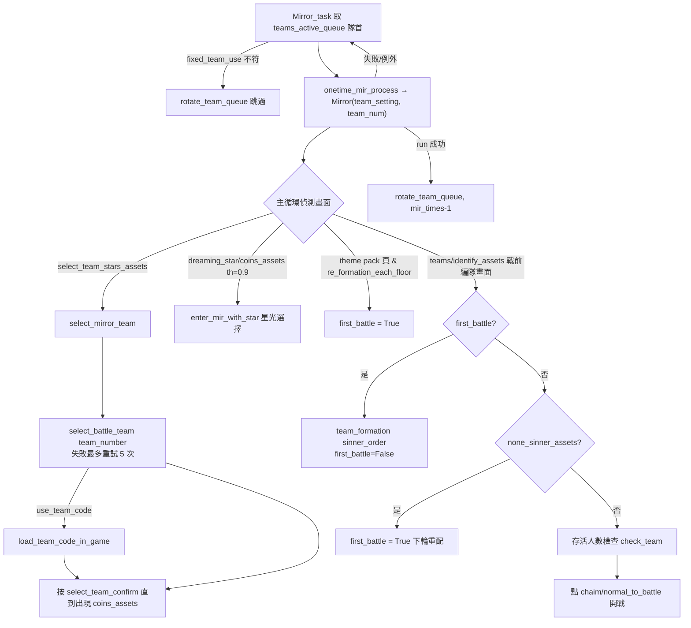
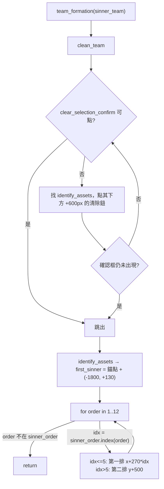

# 11 — 鏡牢自動配隊與開局準備（Team Formation / Starlight）

> 原始碼版本：`KIYI671/AhabAssistantLimbusCompany@b0f4393`。所有座標皆以 2560×1440 為基準，執行時乘上 `scale = cfg.set_win_size / 1440`（見 [tasks/teams/team_formation.py:L34-L34](https://github.com/KIYI671/AhabAssistantLimbusCompany/blob/b0f439321987f5f7b126ebbc424f6ef144c1bff0/tasks/teams/team_formation.py#L34-L34)；座標系統說明見 [assets/doc/zh/image_recognition.md:L3-L7](https://github.com/KIYI671/AhabAssistantLimbusCompany/blob/b0f439321987f5f7b126ebbc424f6ef144c1bff0/assets/doc/zh/image_recognition.md#L3-L7)）。

## 目的

本章說明 AALC 在「開始一輪鏡牢（MD）／鏡牢戰鬥前／日常本前」做的配隊相關工作：

1. **選隊（select team）**：在遊戲的編隊清單（最多 40 個隊伍欄位）中找到使用者指定的隊伍，用 OCR 找名稱，或依序號計算捲動距離。
2. **選罪人（team formation）**：在 12 罪人格子上清除現有選擇，再依使用者設定的順序點選罪人。
3. **編隊碼（team code）**：可選，在選隊後把遊戲內的編隊碼貼進該隊伍。
4. **開局星光（Dreaming Star / 星光加成）**：依每隊的 `opening_bonus` 點選 10 個星光加成與其 +/++ 等級，或改成「星光換錢」。
5. **隊伍輪替**：多次鏡牢之間，第 N 次使用哪一隊。
6. **`TeamSetting` 設定模型**：每隊的全部欄位、由哪個模組讀取、GUI 怎麼寫入，以及匯入/匯出。

一個重要的結論先講：**AALC 在遊戲內完全不辨識罪人身分**。罪人是用固定格子座標盲點的；`assets/app/sinner/*` 只拿來畫 GUI 頭像（[app/base_combination.py:L404-L436](https://github.com/KIYI671/AhabAssistantLimbusCompany/blob/b0f439321987f5f7b126ebbc424f6ef144c1bff0/app/base_combination.py#L404-L436)）。遊戲內唯一和「哪些罪人已選」有關的辨識，是 `deal_with_spills()` 用 `teams/selected.png` 加上 OCR 讀順序數字（只用在日常本，見下文）。

## 流程總覽

### 鏡牢一輪的配隊相關節點

### `team_formation()` 內部

## 步驟詳解

### 1. 選隊：`select_battle_team(num)`

定義於 [tasks/teams/team_formation.py:L118-L194](https://github.com/KIYI671/AhabAssistantLimbusCompany/blob/b0f439321987f5f7b126ebbc424f6ef144c1bff0/tasks/teams/team_formation.py#L118-L194)。

1. 截圖；若有新手提示（`home/first_prompt_assets.png` + `home/back_assets.png`）先按返回（[tasks/teams/team_formation.py:L124-L129](https://github.com/KIYI671/AhabAssistantLimbusCompany/blob/b0f439321987f5f7b126ebbc424f6ef144c1bff0/tasks/teams/team_formation.py#L124-L129)）。
2. 以 `teams/identify_assets.png` 為**錨點**（模板 bbox 約 (2365,327)-(2436,384)，中心約 (2400,355)）。找不到時函式落到結尾，隱式回傳 `None`，呼叫端當成失敗。
3. 隊伍清單左欄基準點 `position = 錨點 + (-2150, +215)`，約 (250,570)；先點 (1,1) 取消焦點，再點 `my_position = position + (0,150)`，約 (250,720)，讓清單取得焦點（[tasks/teams/team_formation.py:L130-L136](https://github.com/KIYI671/AhabAssistantLimbusCompany/blob/b0f439321987f5f7b126ebbc424f6ef144c1bff0/tasks/teams/team_formation.py#L130-L136)）。
4. **重置到頂端**：從 `my_position` 往下拖（`dy>0`）若干次。距離是「到視窗底部再留 60px 邊界」，次數用 40 列 × 72.5px 的捲動總長除以單次距離（[tasks/teams/team_formation.py:L90-L101](https://github.com/KIYI671/AhabAssistantLimbusCompany/blob/b0f439321987f5f7b126ebbc424f6ef144c1bff0/tasks/teams/team_formation.py#L90-L101)、[tasks/teams/team_formation.py:L137-L145](https://github.com/KIYI671/AhabAssistantLimbusCompany/blob/b0f439321987f5f7b126ebbc424f6ef144c1bff0/tasks/teams/team_formation.py#L137-L145)）。拖曳走 `mouse_swipe_for_team_scroll`，預設等同一般捲動（[module/automation/input_handlers/__init__.py:L92-L96](https://github.com/KIYI671/AhabAssistantLimbusCompany/blob/b0f439321987f5f7b126ebbc424f6ef144c1bff0/module/automation/input_handlers/__init__.py#L92-L96)）；MuMu 介面會覆寫它，先加一段 escape distance，避免被遊戲判成「拖曳隊伍改順序」（[module/automation/input_handlers/simulator/mumu_control.py:L1214-L1239](https://github.com/KIYI671/AhabAssistantLimbusCompany/blob/b0f439321987f5f7b126ebbc424f6ef144c1bff0/module/automation/input_handlers/simulator/mumu_control.py#L1214-L1239)）。
5. 依全域設定 `cfg.select_team_by_order` 分兩種模式（[module/config/config_typing.py:L408-L409](https://github.com/KIYI671/AhabAssistantLimbusCompany/blob/b0f439321987f5f7b126ebbc424f6ef144c1bff0/module/config/config_typing.py#L408-L409)；GUI 位置見 [assets/doc/zh/How_to_use.md:L35-L35](https://github.com/KIYI671/AhabAssistantLimbusCompany/blob/b0f439321987f5f7b126ebbc424f6ef144c1bff0/assets/doc/zh/How_to_use.md#L35-L35)、[assets/doc/zh/How_to_use.md:L67-L67](https://github.com/KIYI671/AhabAssistantLimbusCompany/blob/b0f439321987f5f7b126ebbc424f6ef144c1bff0/assets/doc/zh/How_to_use.md#L67-L67)）：
   - **依序號（ordered）**：一頁 5 列，列高 72.5px，一次顯示 6 列，共 40 隊（常數見 [tasks/teams/team_formation.py:L9-L29](https://github.com/KIYI671/AhabAssistantLimbusCompany/blob/b0f439321987f5f7b126ebbc424f6ef144c1bff0/tasks/teams/team_formation.py#L9-L29)）。`_ordered_team_location(num)` 算出要翻幾頁與頁內第幾列；最後一頁因為清單已到底，會加半列偏移（[tasks/teams/team_formation.py:L104-L115](https://github.com/KIYI671/AhabAssistantLimbusCompany/blob/b0f439321987f5f7b126ebbc424f6ef144c1bff0/tasks/teams/team_formation.py#L104-L115)）。每頁往上拖的距離依平台而定：Windows 400px、MuMu 362.5px（最後一頁另算）、其他模擬器 375px（[tasks/teams/team_formation.py:L80-L87](https://github.com/KIYI671/AhabAssistantLimbusCompany/blob/b0f439321987f5f7b126ebbc424f6ef144c1bff0/tasks/teams/team_formation.py#L80-L87)）。翻完頁後直接點 `first_position(≈250,640) + offset`，**不驗證**點到的隊伍，**永遠回傳 True**（[tasks/teams/team_formation.py:L147-L165](https://github.com/KIYI671/AhabAssistantLimbusCompany/blob/b0f439321987f5f7b126ebbc424f6ef144c1bff0/tasks/teams/team_formation.py#L147-L165)）。
   - **依名稱（named，預設行為）**：在 `(0,0,position.x+130,position.y+600)`（約 (0,0,380,1170)）範圍做 OCR，找 `编队#N` 或 `TEAMS #N` / `TEAMS#N` / `TFAMS#N`，最後一個是容忍 OCR 把 E 誤讀成 F 的寫法。找不到就往上拖 385px，最多 10 次（[tasks/teams/team_formation.py:L166-L194](https://github.com/KIYI671/AhabAssistantLimbusCompany/blob/b0f439321987f5f7b126ebbc424f6ef144c1bff0/tasks/teams/team_formation.py#L166-L194)）。比對走 `find_language_text`，依目前語言只比一邊；語言未知時用命中的結果反推語言（[module/automation/automation.py:L579-L627](https://github.com/KIYI671/AhabAssistantLimbusCompany/blob/b0f439321987f5f7b126ebbc424f6ef144c1bff0/module/automation/automation.py#L579-L627)）。比對是**子字串、不分大小寫、可去空白**（[module/automation/automation.py:L519-L531](https://github.com/KIYI671/AhabAssistantLimbusCompany/blob/b0f439321987f5f7b126ebbc424f6ef144c1bff0/module/automation/automation.py#L519-L531)），所以 `编队#1` 也會命中 `编队#10`～`#19`（見未解問題）。
6. 呼叫端：
   - 鏡牢：`Mirror.select_mirror_team()` 用 `TeamSetting.team_number`，失敗最多重試 5 次後丟 `unableToFindTeamError("…请检查队伍名称是否为默认名称")`（[tasks/mirror/mirror.py:L1064-L1070](https://github.com/KIYI671/AhabAssistantLimbusCompany/blob/b0f439321987f5f7b126ebbc424f6ef144c1bff0/tasks/mirror/mirror.py#L1064-L1070)）。
   - 經驗本／紋本：`onetime_EXP_process` / `onetime_thread_process` 用 `cfg.daily_teams`，或依星期取 `EXP_day_*` / `thread_day_*`（[tasks/base/script_task_scheme.py:L52-L81](https://github.com/KIYI671/AhabAssistantLimbusCompany/blob/b0f439321987f5f7b126ebbc424f6ef144c1bff0/tasks/base/script_task_scheme.py#L52-L81)、[utils/utils.py:L53-L62](https://github.com/KIYI671/AhabAssistantLimbusCompany/blob/b0f439321987f5f7b126ebbc424f6ef144c1bff0/utils/utils.py#L53-L62)）。**日常本只選隊，不呼叫 `team_formation`**，罪人組成沿用遊戲內該隊伍已存的設定。

### 2. 編隊碼：`load_team_code_in_game(team_code)`

[tasks/teams/team_formation.py:L281-L338](https://github.com/KIYI671/AhabAssistantLimbusCompany/blob/b0f439321987f5f7b126ebbc424f6ef144c1bff0/tasks/teams/team_formation.py#L281-L338)。只有在 `TeamSetting.use_team_code` 為真且 `team_code` 非空時，才會在選隊之後呼叫（[tasks/mirror/mirror.py:L1071-L1075](https://github.com/KIYI671/AhabAssistantLimbusCompany/blob/b0f439321987f5f7b126ebbc424f6ef144c1bff0/tasks/mirror/mirror.py#L1071-L1075)）。

- 前置檢查：畫面上要有 `mirror/road_to_mir/select_team_confirm_assets.png`，否則跳過（[tasks/teams/team_formation.py:L291-L294](https://github.com/KIYI671/AhabAssistantLimbusCompany/blob/b0f439321987f5f7b126ebbc424f6ef144c1bff0/tasks/teams/team_formation.py#L291-L294)）。
- 最多 3 輪：點 `teams/team_code_assets.png` → `teams/load_team_code_button_assets.png`（有 zh_cn/en 兩版）→ 以 `team_code_cancel_button_assets.png` 是否出現判斷輸入框開了 → `auto.input_text(team_code)` → 重複點 `team_code_confirm_button_assets.png`，直到它消失（最多 3 次）→ 若 `team_code_assets` 重新出現就視為成功（[tasks/teams/team_formation.py:L296-L334](https://github.com/KIYI671/AhabAssistantLimbusCompany/blob/b0f439321987f5f7b126ebbc424f6ef144c1bff0/tasks/teams/team_formation.py#L296-L334)）。
- 全部失敗：點 (100,100) 關閉並記警告，呼叫端繼續用目前的隊伍配置（[tasks/teams/team_formation.py:L336-L338](https://github.com/KIYI671/AhabAssistantLimbusCompany/blob/b0f439321987f5f7b126ebbc424f6ef144c1bff0/tasks/teams/team_formation.py#L336-L338)、[tasks/mirror/mirror.py:L1074-L1075](https://github.com/KIYI671/AhabAssistantLimbusCompany/blob/b0f439321987f5f7b126ebbc424f6ef144c1bff0/tasks/mirror/mirror.py#L1074-L1075)）。

### 3. 確認隊伍 → 進入星光頁

`select_mirror_team` 後半段：在 `dreaming_star/coins_assets.png` 出現之前，迴圈點 `level_confirm_assets.png` / `select_team_confirm_assets.png`；剩 5 次以內時，若 OCR 讀到「平均」或 "current"，就點 `enter_mirror_confirm.png`（應是隊伍平均等級不足的確認框，屬推論）。超過 30 次就 `back_init_menu()`（[tasks/mirror/mirror.py:L1076-L1107](https://github.com/KIYI671/AhabAssistantLimbusCompany/blob/b0f439321987f5f7b126ebbc424f6ef144c1bff0/tasks/mirror/mirror.py#L1076-L1107)）。

### 4. 選罪人：`team_formation(sinner_team)`

[tasks/teams/team_formation.py:L50-L77](https://github.com/KIYI671/AhabAssistantLimbusCompany/blob/b0f439321987f5f7b126ebbc424f6ef144c1bff0/tasks/teams/team_formation.py#L50-L77)。

**觸發時機**：鏡牢主循環看到 `teams/identify_assets.png`（戰前編隊畫面）且 `self.first_battle` 為真時（[tasks/mirror/mirror.py:L368-L374](https://github.com/KIYI671/AhabAssistantLimbusCompany/blob/b0f439321987f5f7b126ebbc424f6ef144c1bff0/tasks/mirror/mirror.py#L368-L374)）。`first_battle` 在以下情況設為 True：
- `Mirror.__init__`（[tasks/mirror/mirror.py:L86-L86](https://github.com/KIYI671/AhabAssistantLimbusCompany/blob/b0f439321987f5f7b126ebbc424f6ef144c1bff0/tasks/mirror/mirror.py#L86-L86)）、`road_to_mir()` 開頭（[tasks/mirror/mirror.py:L145-L145](https://github.com/KIYI671/AhabAssistantLimbusCompany/blob/b0f439321987f5f7b126ebbc424f6ef144c1bff0/tasks/mirror/mirror.py#L145-L145)）、`re_start()` 重開（[tasks/mirror/mirror.py:L1205-L1205](https://github.com/KIYI671/AhabAssistantLimbusCompany/blob/b0f439321987f5f7b126ebbc424f6ef144c1bff0/tasks/mirror/mirror.py#L1205-L1205)）。
- 每層選完主題包，且 `re_formation_each_floor` 為真（[tasks/mirror/mirror.py:L294-L296](https://github.com/KIYI671/AhabAssistantLimbusCompany/blob/b0f439321987f5f7b126ebbc424f6ef144c1bff0/tasks/mirror/mirror.py#L294-L296)）。
- 戰前畫面出現 `teams/none_sinner_assets.png`（配隊失敗提示），點掉後設為 True（[tasks/mirror/mirror.py:L375-L378](https://github.com/KIYI671/AhabAssistantLimbusCompany/blob/b0f439321987f5f7b126ebbc424f6ef144c1bff0/tasks/mirror/mirror.py#L375-L378)）。
- 出現 `battle/select_none_assets.png`（沒有選人）時（[tasks/mirror/mirror.py:L400-L404](https://github.com/KIYI671/AhabAssistantLimbusCompany/blob/b0f439321987f5f7b126ebbc424f6ef144c1bff0/tasks/mirror/mirror.py#L400-L404)）。

**清隊 `clean_team()`**（[tasks/teams/team_formation.py:L32-L47](https://github.com/KIYI671/AhabAssistantLimbusCompany/blob/b0f439321987f5f7b126ebbc424f6ef144c1bff0/tasks/teams/team_formation.py#L32-L47)）：無限迴圈。若 `teams/clear_selection_confirm_assets.png`（確認框，約 (1452,990)）可點就點下並結束；否則點 `identify_assets + (0,+600)`（約 (2400,955)，推定是「清除選擇」鈕），等 0.5 秒後若確認框**沒有**出現就結束，代表本來就沒選人，不會跳確認框。

**點選罪人**：
- 錨點 `first_sinner = identify + (-1800, +130)`，約 (600,485)（[tasks/teams/team_formation.py:L58-L62](https://github.com/KIYI671/AhabAssistantLimbusCompany/blob/b0f439321987f5f7b126ebbc424f6ef144c1bff0/tasks/teams/team_formation.py#L58-L62)）。
- `sinner_order` 是長度 12 的 list，**index 是罪人在遊戲格子中的位置**（順序同 `all_sinners_name`：李箱、浮士德、堂吉訶德、良秀、默爾索、鴻璐 / 希斯克利夫、以實瑪利、羅佳、辛克萊、奧提斯、格里高爾，見 [tasks/__init__.py:L14-L27](https://github.com/KIYI671/AhabAssistantLimbusCompany/blob/b0f439321987f5f7b126ebbc424f6ef144c1bff0/tasks/__init__.py#L14-L27)），**值是點選順序**（1 起算，0 表示未選）。
- 依 order = 1..12 迴圈：`idx = sinner_order.index(order)`；`idx<=5` 點第一排 `(600+270·idx, 485)`，否則點第二排 `(600+270·(idx-6), 985)`；遇到第一個不存在的 order 就 `return`（[tasks/teams/team_formation.py:L65-L77](https://github.com/KIYI671/AhabAssistantLimbusCompany/blob/b0f439321987f5f7b126ebbc424f6ef144c1bff0/tasks/teams/team_formation.py#L65-L77)）。點擊間隔是 `cfg.mouse_action_interval`。
- 換算成 2560×1440 的格子座標：x ∈ {600, 870, 1140, 1410, 1680, 1950}，y ∈ {485, 985}。
- 不檢查點選結果：沒有選取狀態的顏色比對，也不 OCR 順序數字。失敗只能等之後出現 `none_sinner_assets` / `select_none_assets` 時，靠 `first_battle=True` 再來一次。

罪人點選順序也會被商店的「技能替換」拿來決定前 1/3/7 名罪人（[tasks/mirror/in_shop.py:L1210-L1215](https://github.com/KIYI671/AhabAssistantLimbusCompany/blob/b0f439321987f5f7b126ebbc424f6ef144c1bff0/tasks/mirror/in_shop.py#L1210-L1215)），細節見 [13-md-ego-gifts.md](13-md-ego-gifts.md)。

### 5. 戰前存活人數檢查與開戰

仍在 `identify_assets` 畫面、且不需要重配時（[tasks/mirror/mirror.py:L379-L398](https://github.com/KIYI671/AhabAssistantLimbusCompany/blob/b0f439321987f5f7b126ebbc424f6ef144c1bff0/tasks/mirror/mirror.py#L379-L398)）：
- 若**沒有**開啟 `cfg.fight_to_last_man`、隊伍沒有 `defense_for_solo`，而且畫面上不是 12/11/10 人存活（`teams/1{2,1,0}_sinner_live_assets.png`，12 人那張閾值 0.75），就呼叫 `check_team()`：用 OCR 找 `a/b`（5≤a≤b≤9）字串（[tasks/teams/team_formation.py:L271-L278](https://github.com/KIYI671/AhabAssistantLimbusCompany/blob/b0f439321987f5f7b126ebbc424f6ef144c1bff0/tasks/teams/team_formation.py#L271-L278)）。找不到（可上場人數少於 5）且已經配過隊 → `re_start()` 放棄本輪鏡牢重開。
- 接著點 `battle/chaim_to_battle_assets.png` 或 `battle/normal_to_battle_assets.png` 開戰。之後的戰鬥流程見 [12-md-battle.md](12-md-battle.md)。

### 6. 人數溢出修正：`deal_with_spills()`（只用在日常本）

[tasks/teams/team_formation.py:L197-L268](https://github.com/KIYI671/AhabAssistantLimbusCompany/blob/b0f439321987f5f7b126ebbc424f6ef144c1bff0/tasks/teams/team_formation.py#L197-L268)，唯一呼叫點是 `Battle.to_battle()`：點過開戰鈕後，若仍停在編隊畫面就會呼叫（[tasks/battle/battle.py:L49-L73](https://github.com/KIYI671/AhabAssistantLimbusCompany/blob/b0f439321987f5f7b126ebbc424f6ef144c1bff0/tasks/battle/battle.py#L49-L73)）。`to_battle()` 只被日常本使用（[tasks/base/script_task_scheme.py:L61-L61](https://github.com/KIYI671/AhabAssistantLimbusCompany/blob/b0f439321987f5f7b126ebbc424f6ef144c1bff0/tasks/base/script_task_scheme.py#L61-L61)、[tasks/base/script_task_scheme.py:L77-L77](https://github.com/KIYI671/AhabAssistantLimbusCompany/blob/b0f439321987f5f7b126ebbc424f6ef144c1bff0/tasks/base/script_task_scheme.py#L77-L77)）；鏡牢自己直接點開戰鈕，不經過這裡。

- 讀人數：取 `battle/normal_to_battle_assets.png` 的 bbox 上移 115px，裁切、反相、二值化（inRange 220–255），貼到 300×300 黑底後 OCR，解析 `now/max`。
- `now > max` 時：用 `teams/selected.png`（249×63 小模板，多目標比對）找出所有「已選」標記，再 OCR 每個標記上方 (−40,−120)～(+40,−30) 的順序數字。`G` 視為 `6`；讀到 `1` 時先腐蝕 3 次、膨脹 2 次再讀一次。順序數字 `> max` 的罪人點掉，取消選取。
- 整段用裸 `except` 包住，失敗就安靜略過。

### 7. 開局星光：`enter_mir_with_star()`

觸發條件：主循環看到 `dreaming_star/coins_assets.png`（閾值 0.9）（[tasks/mirror/mirror.py:L426-L431](https://github.com/KIYI671/AhabAssistantLimbusCompany/blob/b0f439321987f5f7b126ebbc424f6ef144c1bff0/tasks/mirror/mirror.py#L426-L431)）。實作見 [tasks/mirror/mirror.py:L789-L867](https://github.com/KIYI671/AhabAssistantLimbusCompany/blob/b0f439321987f5f7b126ebbc424f6ef144c1bff0/tasks/mirror/mirror.py#L789-L867)。

- 錨點 `coins`（模板中心約 (2261,88)）；第一張星光卡 `first_starlight = coins + (-1800, +300)`，約 (461,388)。10 張卡排成 5×2，x 間距 400、y 間距 480（[tasks/mirror/mirror.py:L790-L794](https://github.com/KIYI671/AhabAssistantLimbusCompany/blob/b0f439321987f5f7b126ebbc424f6ef144c1bff0/tasks/mirror/mirror.py#L790-L794)）。
- 每輪迴圈依序：
  1. 看到 `mirror/road_to_mir/bleed_gift_assets.png`（已到初始 E.G.O 飾品頁）→ 結束（[tasks/mirror/mirror.py:L807-L808](https://github.com/KIYI671/AhabAssistantLimbusCompany/blob/b0f439321987f5f7b126ebbc424f6ef144c1bff0/tasks/mirror/mirror.py#L807-L808)）。
  2. **星光換錢**：`use_starlight=True` 時點 `no_convert_star_to_cost_assets.png`，False 時點 `convert_star_to_cost_assets.png`。兩張模板位置相同，約 (1427,703)-(1479,754)，是同一個勾選框的兩種狀態；點的是「目前狀態」，把它切到想要的狀態（[tasks/mirror/mirror.py:L810-L817](https://github.com/KIYI671/AhabAssistantLimbusCompany/blob/b0f439321987f5f7b126ebbc424f6ef144c1bff0/tasks/mirror/mirror.py#L810-L817)）。
  3. 看到確認框 `select_star_confirm_assets.png` 就點下並結束（[tasks/mirror/mirror.py:L819-L823](https://github.com/KIYI671/AhabAssistantLimbusCompany/blob/b0f439321987f5f7b126ebbc424f6ef144c1bff0/tasks/mirror/mirror.py#L819-L823)）。
  4. **選加成**，依 `opening_bonus`（0 未選、1 基礎、2 +、3 ++）處理（[tasks/mirror/mirror.py:L825-L848](https://github.com/KIYI671/AhabAssistantLimbusCompany/blob/b0f439321987f5f7b126ebbc424f6ef144c1bff0/tasks/mirror/mirror.py#L825-L848)）：
     - 10 個都是 1 → 點 `select_all_stars_assets.png`（全選，有 zh_cn/en 版）。
     - 10 個都是 2 → 全選後點 `level_one_bonus_assets.png`；10 個都是 3 → 全選後點 `level_two_bonus_assets.png`。
     - 其他情況逐張處理：值 ≥1 點卡片中心；值為 2 再點 `(x-80, y+320)`（+ 鈕）；值為 3 改點 `(x+80, y+320)`（++ 鈕）。
  5. 點 `dreaming_star_enter_assets.png` 進入（[tasks/mirror/mirror.py:L850-L852](https://github.com/KIYI671/AhabAssistantLimbusCompany/blob/b0f439321987f5f7b126ebbc424f6ef144c1bff0/tasks/mirror/mirror.py#L850-L852)），下一輪預期會出現確認框。
- 失敗處理：`loop_count=30`，辨識模式由 clam 逐步放寬到 normal、aggressive，用完就丟 `cannotOperateGameError`（[tasks/mirror/mirror.py:L854-L867](https://github.com/KIYI671/AhabAssistantLimbusCompany/blob/b0f439321987f5f7b126ebbc424f6ef144c1bff0/tasks/mirror/mirror.py#L854-L867)）。
- **不讀星光餘額、不驗證點擊結果**。費用只在 GUI 顯示：`STARLIGHT_BONUS_COSTS = [10,10,20,20,30,30,40,40,50,60]`（[app/common/ui_config.py:L258-L258](https://github.com/KIYI671/AhabAssistantLimbusCompany/blob/b0f439321987f5f7b126ebbc424f6ef144c1bff0/app/common/ui_config.py#L258-L258)），總額按「基礎費 × 等級值」估算（[app/team_setting_card.py:L1062-L1067](https://github.com/KIYI671/AhabAssistantLimbusCompany/blob/b0f439321987f5f7b126ebbc424f6ef144c1bff0/app/team_setting_card.py#L1062-L1067)、[app/starlight_bonus.py:L337-L343](https://github.com/KIYI671/AhabAssistantLimbusCompany/blob/b0f439321987f5f7b126ebbc424f6ef144c1bff0/app/starlight_bonus.py#L337-L343)）。這個 1×/2×/3× 的計價方式是 GUI 自己的假設，未對照遊戲。
- 10 個加成的名稱與效果說明：[app/common/ui_config.py:L244-L311](https://github.com/KIYI671/AhabAssistantLimbusCompany/blob/b0f439321987f5f7b126ebbc424f6ef144c1bff0/app/common/ui_config.py#L244-L311)（中文）、[app/common/ui_config.py:L313-L382](https://github.com/KIYI671/AhabAssistantLimbusCompany/blob/b0f439321987f5f7b126ebbc424f6ef144c1bff0/app/common/ui_config.py#L313-L382)（英文）。依序為：起始之星、層積星雲、星際旅行、傾落的流星雨、雙星商店、衛星商店、星雲的寵愛、星芒的引導、偶然的彗星、全面的可能性。
- `first_single_plus`、`double_plus_offset`、`star_card_size` 這三個區域變數有算但沒用到（[tasks/mirror/mirror.py:L796-L798](https://github.com/KIYI671/AhabAssistantLimbusCompany/blob/b0f439321987f5f7b126ebbc424f6ef144c1bff0/tasks/mirror/mirror.py#L796-L798)）。

### 8. 隊伍輪替（第 N 次鏡牢用哪隊）

- 單一事實來源是 `cfg.teams_active_queue: List[int]`（[module/config/config_typing.py:L534-L535](https://github.com/KIYI671/AhabAssistantLimbusCompany/blob/b0f439321987f5f7b126ebbc424f6ef144c1bff0/module/config/config_typing.py#L534-L535)）。舊欄位 `teams_be_select` / `teams_order` / `teams_be_select_num` 只是同步出來的鏡像（[module/config/config.py:L409-L423](https://github.com/KIYI671/AhabAssistantLimbusCompany/blob/b0f439321987f5f7b126ebbc424f6ef144c1bff0/module/config/config.py#L409-L423)）。第一次載入時用 `migrate_legacy_team_queue` 從舊欄位遷移（[module/config/config.py:L378-L407](https://github.com/KIYI671/AhabAssistantLimbusCompany/blob/b0f439321987f5f7b126ebbc424f6ef144c1bff0/module/config/config.py#L378-L407)）。
- `Mirror_task()`（[tasks/base/script_task_scheme.py:L293-L357](https://github.com/KIYI671/AhabAssistantLimbusCompany/blob/b0f439321987f5f7b126ebbc424f6ef144c1bff0/tasks/base/script_task_scheme.py#L293-L357)）：
  1. 開始前先 `normalize_and_sync_team_state(persist=False)`：去重、移除無效編號（[module/config/config.py:L364-L376](https://github.com/KIYI671/AhabAssistantLimbusCompany/blob/b0f439321987f5f7b126ebbc424f6ef144c1bff0/module/config/config.py#L364-L376)、[module/config/config.py:L425-L434](https://github.com/KIYI671/AhabAssistantLimbusCompany/blob/b0f439321987f5f7b126ebbc424f6ef144c1bff0/module/config/config.py#L425-L434)）。
  2. 每次都先確認至少有一個啟用隊伍符合目前難度（`fixed_team_use` / `fixed_team_use_select`：0=困難、1=普通，見 [app/__init__.py:L97-L100](https://github.com/KIYI671/AhabAssistantLimbusCompany/blob/b0f439321987f5f7b126ebbc424f6ef144c1bff0/app/__init__.py#L97-L100)）；沒有就結束（[tasks/base/script_task_scheme.py:L306-L322](https://github.com/KIYI671/AhabAssistantLimbusCompany/blob/b0f439321987f5f7b126ebbc424f6ef144c1bff0/tasks/base/script_task_scheme.py#L306-L322)）。
  3. 取隊首 `teams_active_queue[0]`。若用途不符，`rotate_team_queue()` 把它移到隊尾再重來（[tasks/base/script_task_scheme.py:L327-L335](https://github.com/KIYI671/AhabAssistantLimbusCompany/blob/b0f439321987f5f7b126ebbc424f6ef144c1bff0/tasks/base/script_task_scheme.py#L327-L335)）。
  4. `onetime_mir_process(team_setting, team_num)` 成功 → `rotate_team_queue()`，`mir_times -= 1`（[tasks/base/script_task_scheme.py:L337-L340](https://github.com/KIYI671/AhabAssistantLimbusCompany/blob/b0f439321987f5f7b126ebbc424f6ef144c1bff0/tasks/base/script_task_scheme.py#L337-L340)）。**失敗時不輪替也不扣次數**，下一次還是同一隊。
  5. `rotate_team_queue()` 把隊首移到隊尾並**立即存檔**（[module/config/config.py:L446-L452](https://github.com/KIYI671/AhabAssistantLimbusCompany/blob/b0f439321987f5f7b126ebbc424f6ef144c1bff0/module/config/config.py#L446-L452)），所以輪替進度會跨 AALC 重啟保留。
- 結果：第 N 次成功的鏡牢使用 `queue[(N-1) mod len]`，前提是用途都相符、而且中間沒有失敗。
- `Mirror` 拿到的是 `team_setting.model_copy(deep=True)`，執行中改動不會回寫設定（[tasks/mirror/mirror.py:L49-L50](https://github.com/KIYI671/AhabAssistantLimbusCompany/blob/b0f439321987f5f7b126ebbc424f6ef144c1bff0/tasks/mirror/mirror.py#L49-L50)）。唯一會回寫的是五層都完整計時時的統計欄位（[tasks/mirror/mirror.py:L702-L749](https://github.com/KIYI671/AhabAssistantLimbusCompany/blob/b0f439321987f5f7b126ebbc424f6ef144c1bff0/tasks/mirror/mirror.py#L702-L749)）。

## 辨識表

模板皆為 2560×1440 畫布，非黑色區域即 ROI（`ImageUtils.get_bbox`，[utils/image_utils.py:L147-L163](https://github.com/KIYI671/AhabAssistantLimbusCompany/blob/b0f439321987f5f7b126ebbc424f6ef144c1bff0/utils/image_utils.py#L147-L163)）。`clam` 模式只在模板位置附近比對，`normal` 擴大範圍，`aggressive` 搜全畫面（[module/automation/automation.py:L394-L420](https://github.com/KIYI671/AhabAssistantLimbusCompany/blob/b0f439321987f5f7b126ebbc424f6ef144c1bff0/module/automation/automation.py#L394-L420)）。預設閾值 0.8。路徑搜尋順序：dark/zh_cn → dark/en → dark/share → default/zh_cn → default/en → default/share（[assets/doc/zh/image_recognition.md:L13-L16](https://github.com/KIYI671/AhabAssistantLimbusCompany/blob/b0f439321987f5f7b126ebbc424f6ef144c1bff0/assets/doc/zh/image_recognition.md#L13-L16)）。

| 步驟 | 資產與變體 | 方法 | 閾值 | ROI／點擊座標（2560×1440） |
|---|---|---|---|---|
| 編隊畫面錨點 | [assets/images/default/share/teams/identify_assets.png](https://github.com/KIYI671/AhabAssistantLimbusCompany/blob/b0f439321987f5f7b126ebbc424f6ef144c1bff0/assets/images/default/share/teams/identify_assets.png)（只有 default/share）  | template | 0.8 | bbox (2365,327)-(2436,384)；罪人格、隊伍清單、清除鈕都由它推算 |
| 清隊確認 | [assets/images/default/share/teams/clear_selection_confirm_assets.png](https://github.com/KIYI671/AhabAssistantLimbusCompany/blob/b0f439321987f5f7b126ebbc424f6ef144c1bff0/assets/images/default/share/teams/clear_selection_confirm_assets.png)、[assets/images/dark/share/teams/clear_selection_confirm_assets.png](https://github.com/KIYI671/AhabAssistantLimbusCompany/blob/b0f439321987f5f7b126ebbc424f6ef144c1bff0/assets/images/dark/share/teams/clear_selection_confirm_assets.png) | template + click | 0.8 | default (1416,966)-(1488,1015)；清除鈕 = 錨點 + (0,600) |
| 罪人格點選 | 無模板 | 固定座標 | — | first = 錨點 + (-1800,130) ≈ (600,485)；Δx 270，第二排 +500 |
| 隊伍清單（依名稱） | OCR：`编队#N` / `TEAMS #N` / `TEAMS#N` / `TFAMS#N` | OCR 子字串比對 | — | crop (0,0,錨點x-2020,錨點y+815) ≈ (0,0,380,1170)；每次往上拖 385 |
| 隊伍清單（依序號） | 無模板 | 計算點擊 | — | 首列 ≈ (250,640)，列高 72.5，每頁 5 列；Windows 每頁拖 400 |
| 選隊確認 | [assets/images/default/zh_cn/mirror/road_to_mir/select_team_confirm_assets.png](https://github.com/KIYI671/AhabAssistantLimbusCompany/blob/b0f439321987f5f7b126ebbc424f6ef144c1bff0/assets/images/default/zh_cn/mirror/road_to_mir/select_team_confirm_assets.png)、[assets/images/default/en/mirror/road_to_mir/select_team_confirm_assets.png](https://github.com/KIYI671/AhabAssistantLimbusCompany/blob/b0f439321987f5f7b126ebbc424f6ef144c1bff0/assets/images/default/en/mirror/road_to_mir/select_team_confirm_assets.png) | template + click | 0.8 | zh (2202,1128)-(2386,1215) |
| 鏡牢選隊頁判定 | [assets/images/default/share/mirror/road_to_mir/select_team_stars_assets.png](https://github.com/KIYI671/AhabAssistantLimbusCompany/blob/b0f439321987f5f7b126ebbc424f6ef144c1bff0/assets/images/default/share/mirror/road_to_mir/select_team_stars_assets.png)  | template | 0.8 | (2276,1050)-(2323,1104) |
| 編隊碼按鈕 | [assets/images/default/share/teams/team_code_assets.png](https://github.com/KIYI671/AhabAssistantLimbusCompany/blob/b0f439321987f5f7b126ebbc424f6ef144c1bff0/assets/images/default/share/teams/team_code_assets.png)（+dark）、[assets/images/default/zh_cn/teams/load_team_code_button_assets.png](https://github.com/KIYI671/AhabAssistantLimbusCompany/blob/b0f439321987f5f7b126ebbc424f6ef144c1bff0/assets/images/default/zh_cn/teams/load_team_code_button_assets.png)（+en）、`team_code_cancel_button_assets.png` / `team_code_confirm_button_assets.png`（default+dark share） | template + click、`input_text` | 0.8 | team_code (946,215)-(1033,281)；load (1027,754)-(1532,876)；cancel (916,955)；confirm (1441,947) |
| 配隊失敗提示 | [assets/images/default/share/teams/none_sinner_assets.png](https://github.com/KIYI671/AhabAssistantLimbusCompany/blob/b0f439321987f5f7b126ebbc424f6ef144c1bff0/assets/images/default/share/teams/none_sinner_assets.png) | template（clam）+ click | 0.8 | (1195,959)-(1265,1014) |
| 存活 12/11/10 人 | [assets/images/default/share/teams/12_sinner_live_assets.png](https://github.com/KIYI671/AhabAssistantLimbusCompany/blob/b0f439321987f5f7b126ebbc424f6ef144c1bff0/assets/images/default/share/teams/12_sinner_live_assets.png)、`11_…`、`10_…`（只有 share） | template | 12 人 0.75，其餘 0.8 | 約 (2366,1017)-(2421,1086) |
| 可上場人數 | OCR `a/b`，5≤a≤b≤9 | OCR 全畫面 | — | — |
| 溢出修正：人數 | `battle/normal_to_battle_assets.png`（zh_cn/en）的 bbox 上移 115 | 反相 + 二值化 + OCR | inRange 220–255 | zh (2159,1014)-(2427,1101) |
| 溢出修正：已選標記 | [assets/images/default/share/teams/selected.png](https://github.com/KIYI671/AhabAssistantLimbusCompany/blob/b0f439321987f5f7b126ebbc424f6ef144c1bff0/assets/images/default/share/teams/selected.png)（249×63 小圖）  | 多目標 template + 順序數字 OCR | 0.8 | 數字 ROI = 標記中心 + (-40,-120)～(+40,-30) |
| 星光頁判定／錨點 | [assets/images/default/share/mirror/road_to_mir/dreaming_star/coins_assets.png](https://github.com/KIYI671/AhabAssistantLimbusCompany/blob/b0f439321987f5f7b126ebbc424f6ef144c1bff0/assets/images/default/share/mirror/road_to_mir/dreaming_star/coins_assets.png)  | template | 0.9 | (2239,67)-(2284,110)；卡片 = 錨點 + (-1800,300) + (400·col, 480·row) |
| 星光換錢勾選框 | `dreaming_star/convert_star_to_cost_assets.png` / `no_convert_star_to_cost_assets.png`（只有 default/share，RGB） | template + click | 0.8 | 兩張都是 (1427,703)-(1479,754) |
| 全選 / 全 + / 全 ++ | [assets/images/default/zh_cn/mirror/road_to_mir/select_all_stars_assets.png](https://github.com/KIYI671/AhabAssistantLimbusCompany/blob/b0f439321987f5f7b126ebbc424f6ef144c1bff0/assets/images/default/zh_cn/mirror/road_to_mir/select_all_stars_assets.png)（+en）、`dreaming_star/level_one_bonus_assets.png`、`level_two_bonus_assets.png` | template + click | 0.8 | 全選 (2306,989)；+ (2306,1115)；++ (2307,1170) |
| 單卡 + / ++ | 無模板 | 固定偏移 | — | 卡中心 + (-80,320) / (+80,320) |
| 星光進入 / 確認 | `dreaming_star/dreaming_star_enter_assets.png`（default+dark）、`select_star_confirm_assets.png` | template + click | 0.8 | enter (2277,1274)-(2506,1316)；confirm (1397,1036)-(1458,1088) |
| 星光結束判定 | `mirror/road_to_mir/bleed_gift_assets.png`（zh_cn/en） | template | 0.8 | 見 [13-md-ego-gifts.md](13-md-ego-gifts.md) |

GUI 頭像：[assets/app/sinner](https://github.com/KIYI671/AhabAssistantLimbusCompany/blob/b0f439321987f5f7b126ebbc424f6ef144c1bff0/assets/app/sinner)（12 個罪人資料夾 + `ui_components`），只給 `SinnerSelect` 元件使用。

## `TeamSetting` 欄位表

定義：[module/config/config_typing.py:L6-L205](https://github.com/KIYI671/AhabAssistantLimbusCompany/blob/b0f439321987f5f7b126ebbc424f6ef144c1bff0/module/config/config_typing.py#L6-L205)。每隊存在 `cfg.config.teams["<n>"]`（[module/config/config_typing.py:L543-L544](https://github.com/KIYI671/AhabAssistantLimbusCompany/blob/b0f439321987f5f7b126ebbc424f6ef144c1bff0/module/config/config_typing.py#L543-L544)）。`Mirror` 讀取欄位見 [tasks/mirror/mirror.py:L49-L89](https://github.com/KIYI671/AhabAssistantLimbusCompany/blob/b0f439321987f5f7b126ebbc424f6ef144c1bff0/tasks/mirror/mirror.py#L49-L89)，`Shop` 讀取欄位見 [tasks/mirror/in_shop.py:L16-L57](https://github.com/KIYI671/AhabAssistantLimbusCompany/blob/b0f439321987f5f7b126ebbc424f6ef144c1bff0/tasks/mirror/in_shop.py#L16-L57)。

| 欄位 | 型別 | 預設 | 用途 | 讀取端 |
|---|---|---|---|---|
| `team_system` | int | 0 | 主體系，對應 `all_systems` 0–9：burn…blunt | [tasks/mirror/mirror.py:L56-L56](https://github.com/KIYI671/AhabAssistantLimbusCompany/blob/b0f439321987f5f7b126ebbc424f6ef144c1bff0/tasks/mirror/mirror.py#L56-L56)、[tasks/mirror/in_shop.py:L18-L18](https://github.com/KIYI671/AhabAssistantLimbusCompany/blob/b0f439321987f5f7b126ebbc424f6ef144c1bff0/tasks/mirror/in_shop.py#L18-L18)；表見 [tasks/__init__.py:L1-L12](https://github.com/KIYI671/AhabAssistantLimbusCompany/blob/b0f439321987f5f7b126ebbc424f6ef144c1bff0/tasks/__init__.py#L1-L12) |
| `team_number` | int | 1 | 遊戲內隊伍欄位 1–40（GUI `Team1..Team40`，[app/__init__.py:L66-L66](https://github.com/KIYI671/AhabAssistantLimbusCompany/blob/b0f439321987f5f7b126ebbc424f6ef144c1bff0/app/__init__.py#L66-L66)） | [tasks/mirror/mirror.py:L1066-L1066](https://github.com/KIYI671/AhabAssistantLimbusCompany/blob/b0f439321987f5f7b126ebbc424f6ef144c1bff0/tasks/mirror/mirror.py#L1066-L1066) |
| `shop_strategy` | int | 0 | 0 出售／1 合成／2 合成：四級優先 | [tasks/mirror/in_shop.py:L27-L28](https://github.com/KIYI671/AhabAssistantLimbusCompany/blob/b0f439321987f5f7b126ebbc424f6ef144c1bff0/tasks/mirror/in_shop.py#L27-L28) |
| `sinners_be_select` | int | 0 | 已選人數（GUI 內部計數） | 只有 GUI [app/team_setting_card.py:L353-L359](https://github.com/KIYI671/AhabAssistantLimbusCompany/blob/b0f439321987f5f7b126ebbc424f6ef144c1bff0/app/team_setting_card.py#L353-L359) |
| `chosen_sinners` | List[int] | [0]*12 | 各格是否選取（GUI 回顯用） | 只有 GUI [app/team_setting_card.py:L442-L450](https://github.com/KIYI671/AhabAssistantLimbusCompany/blob/b0f439321987f5f7b126ebbc424f6ef144c1bff0/app/team_setting_card.py#L442-L450) |
| `sinner_order` | List[int] | [0]*12 | index = 罪人格位置，值 = 點選順序 | [tasks/teams/team_formation.py:L65-L76](https://github.com/KIYI671/AhabAssistantLimbusCompany/blob/b0f439321987f5f7b126ebbc424f6ef144c1bff0/tasks/teams/team_formation.py#L65-L76)（經由 [tasks/mirror/mirror.py:L53-L53](https://github.com/KIYI671/AhabAssistantLimbusCompany/blob/b0f439321987f5f7b126ebbc424f6ef144c1bff0/tasks/mirror/mirror.py#L53-L53)）、[tasks/mirror/in_shop.py:L1210-L1215](https://github.com/KIYI671/AhabAssistantLimbusCompany/blob/b0f439321987f5f7b126ebbc424f6ef144c1bff0/tasks/mirror/in_shop.py#L1210-L1215) |
| `system_burn` … `system_blunt`（10 個） | bool | False | 商店要捨棄（出售）的體系；與主體系相同的會被 GUI 強制關閉（[app/team_setting_card.py:L488-L497](https://github.com/KIYI671/AhabAssistantLimbusCompany/blob/b0f439321987f5f7b126ebbc424f6ef144c1bff0/app/team_setting_card.py#L488-L497)） | [tasks/mirror/in_shop.py:L20-L26](https://github.com/KIYI671/AhabAssistantLimbusCompany/blob/b0f439321987f5f7b126ebbc424f6ef144c1bff0/tasks/mirror/in_shop.py#L20-L26)（`getattr(f"system_{x}")`） |
| `do_not_heal` / `do_not_buy` / `do_not_fuse` / `do_not_sell` / `do_not_enhance` | bool | False | 商店行為開關 | [tasks/mirror/in_shop.py:L29-L33](https://github.com/KIYI671/AhabAssistantLimbusCompany/blob/b0f439321987f5f7b126ebbc424f6ef144c1bff0/tasks/mirror/in_shop.py#L29-L33) |
| `only_aggressive_fuse` / `do_not_system_fuse` / `only_system_fuse` | bool | False | 合成策略 | [tasks/mirror/in_shop.py:L35-L37](https://github.com/KIYI671/AhabAssistantLimbusCompany/blob/b0f439321987f5f7b126ebbc424f6ef144c1bff0/tasks/mirror/in_shop.py#L35-L37) |
| `aggressive_also_enhance` / `aggressive_save_systems` | bool | False | 激進合成時也升級／保護本體系 | [tasks/mirror/in_shop.py:L34-L34](https://github.com/KIYI671/AhabAssistantLimbusCompany/blob/b0f439321987f5f7b126ebbc424f6ef144c1bff0/tasks/mirror/in_shop.py#L34-L34)、[tasks/mirror/in_shop.py:L57-L57](https://github.com/KIYI671/AhabAssistantLimbusCompany/blob/b0f439321987f5f7b126ebbc424f6ef144c1bff0/tasks/mirror/in_shop.py#L57-L57) |
| `avoid_skill_3` / `prioritize_skill_3` | bool | False | 戰鬥中避免／優先 3 技能 | [tasks/mirror/mirror.py:L125-L133](https://github.com/KIYI671/AhabAssistantLimbusCompany/blob/b0f439321987f5f7b126ebbc424f6ef144c1bff0/tasks/mirror/mirror.py#L125-L133) → `battle.fight` |
| `re_formation_each_floor` | bool | False | 每層重新配隊 | [tasks/mirror/mirror.py:L295-L296](https://github.com/KIYI671/AhabAssistantLimbusCompany/blob/b0f439321987f5f7b126ebbc424f6ef144c1bff0/tasks/mirror/mirror.py#L295-L296) |
| `normal_to_hard_floor` | int | 0 | 從第幾層切換到困難（0 = 不切） | [tasks/mirror/mirror.py:L135-L140](https://github.com/KIYI671/AhabAssistantLimbusCompany/blob/b0f439321987f5f7b126ebbc424f6ef144c1bff0/tasks/mirror/mirror.py#L135-L140) |
| `use_starlight` | bool | False | 開局星光換錢 | [tasks/mirror/mirror.py:L810-L817](https://github.com/KIYI671/AhabAssistantLimbusCompany/blob/b0f439321987f5f7b126ebbc424f6ef144c1bff0/tasks/mirror/mirror.py#L810-L817) |
| `opening_bonus` | List[int] | [1,1,1,1,0,0,0,0,0,0] | 10 個星光加成：0 未選／1 基礎／2 +／3 ++ | [tasks/mirror/mirror.py:L825-L848](https://github.com/KIYI671/AhabAssistantLimbusCompany/blob/b0f439321987f5f7b126ebbc424f6ef144c1bff0/tasks/mirror/mirror.py#L825-L848) |
| `defense_first_round` | bool | False | 第一回合全員防禦 | [tasks/mirror/mirror.py:L79-L79](https://github.com/KIYI671/AhabAssistantLimbusCompany/blob/b0f439321987f5f7b126ebbc424f6ef144c1bff0/tasks/mirror/mirror.py#L79-L79) → battle |
| `defense_for_solo` / `defense_for_solo_turns` | bool / int | False / 5 | 單通時連續防禦，也會跳過人數檢查 | [tasks/mirror/mirror.py:L80-L83](https://github.com/KIYI671/AhabAssistantLimbusCompany/blob/b0f439321987f5f7b126ebbc424f6ef144c1bff0/tasks/mirror/mirror.py#L80-L83)、[tasks/mirror/mirror.py:L382-L382](https://github.com/KIYI671/AhabAssistantLimbusCompany/blob/b0f439321987f5f7b126ebbc424f6ef144c1bff0/tasks/mirror/mirror.py#L382-L382) |
| `fixed_team_use` / `fixed_team_use_select` | bool / int | False / 0 | 固定用途：0 困難、1 普通 | [tasks/base/script_task_scheme.py:L310-L335](https://github.com/KIYI671/AhabAssistantLimbusCompany/blob/b0f439321987f5f7b126ebbc424f6ef144c1bff0/tasks/base/script_task_scheme.py#L310-L335) |
| `reward_cards` / `reward_cards_select` | bool / int | False / 0 | 自訂獎勵卡優先度 | [tasks/mirror/mirror.py:L63-L64](https://github.com/KIYI671/AhabAssistantLimbusCompany/blob/b0f439321987f5f7b126ebbc424f6ef144c1bff0/tasks/mirror/mirror.py#L63-L64)（見 [10-mirror-dungeon-overview.md](10-mirror-dungeon-overview.md)） |
| `after_level_IV` / `after_level_IV_select` | bool / int | False / 0 | 合成四級後的動作（0 出售／1 普通合成／2 第二體系四級／3 跳過商店） | [tasks/mirror/in_shop.py:L39-L40](https://github.com/KIYI671/AhabAssistantLimbusCompany/blob/b0f439321987f5f7b126ebbc424f6ef144c1bff0/tasks/mirror/in_shop.py#L39-L40)；選項 [app/__init__.py:L85-L90](https://github.com/KIYI671/AhabAssistantLimbusCompany/blob/b0f439321987f5f7b126ebbc424f6ef144c1bff0/app/__init__.py#L85-L90) |
| `shopping_strategy` / `shopping_strategy_select` | bool / int | False / 0 | 自訂購物策略 0–5 | [tasks/mirror/in_shop.py:L42-L43](https://github.com/KIYI671/AhabAssistantLimbusCompany/blob/b0f439321987f5f7b126ebbc424f6ef144c1bff0/tasks/mirror/in_shop.py#L42-L43)；選項 [app/__init__.py:L101-L108](https://github.com/KIYI671/AhabAssistantLimbusCompany/blob/b0f439321987f5f7b126ebbc424f6ef144c1bff0/app/__init__.py#L101-L108) |
| `opening_items` / `opening_items_select` / `opening_items_system` | bool / int / int | False / 0 / 0 | 自訂初始飾品的順序與體系 | [tasks/mirror/mirror.py:L875-L877](https://github.com/KIYI671/AhabAssistantLimbusCompany/blob/b0f439321987f5f7b126ebbc424f6ef144c1bff0/tasks/mirror/mirror.py#L875-L877)（見 [13-md-ego-gifts.md](13-md-ego-gifts.md)） |
| `second_system` / `second_system_select` / `second_system_setting` / `second_system_action` | bool / int / int / List[int](4) | False / 0 / 0 / [0]*4 | 第二體系、啟用時機、行動模式（fuse_IV/buy/choose/power_up） | [tasks/mirror/in_shop.py:L45-L48](https://github.com/KIYI671/AhabAssistantLimbusCompany/blob/b0f439321987f5f7b126ebbc424f6ef144c1bff0/tasks/mirror/in_shop.py#L45-L48)、[tasks/mirror/mirror.py:L74-L74](https://github.com/KIYI671/AhabAssistantLimbusCompany/blob/b0f439321987f5f7b126ebbc424f6ef144c1bff0/tasks/mirror/mirror.py#L74-L74) |
| `observe_ego_gift` / `observe_ego_gift_selected` | bool / List[str] | False / [] | 觀測 E.G.O 飾品（`observe_system` 把 poise/sinking 對調，配合遊戲 UI 順序） | [tasks/mirror/mirror.py:L76-L77](https://github.com/KIYI671/AhabAssistantLimbusCompany/blob/b0f439321987f5f7b126ebbc424f6ef144c1bff0/tasks/mirror/mirror.py#L76-L77)、[tasks/__init__.py:L13-L13](https://github.com/KIYI671/AhabAssistantLimbusCompany/blob/b0f439321987f5f7b126ebbc424f6ef144c1bff0/tasks/__init__.py#L13-L13)、[tasks/mirror/mirror.py:L1010-L1013](https://github.com/KIYI671/AhabAssistantLimbusCompany/blob/b0f439321987f5f7b126ebbc424f6ef144c1bff0/tasks/mirror/mirror.py#L1010-L1013) |
| `skill_replacement` / `skill_replacement_select` / `skill_replacement_mode` | bool / int / int | False / 0 / 0 | 商店技能替換（對象：配隊前 1/3/7/全部；模式 1→3 / 2→3 / 1→2） | [tasks/mirror/in_shop.py:L50-L52](https://github.com/KIYI671/AhabAssistantLimbusCompany/blob/b0f439321987f5f7b126ebbc424f6ef144c1bff0/tasks/mirror/in_shop.py#L50-L52) |
| `ignore_shop` | List[int] | [0]*5 | 各層是否略過商店 | [tasks/mirror/in_shop.py:L55-L55](https://github.com/KIYI671/AhabAssistantLimbusCompany/blob/b0f439321987f5f7b126ebbc424f6ef144c1bff0/tasks/mirror/in_shop.py#L55-L55) |
| `max_keyword_refresh` / `max_normal_refresh` | int | 1 / 1 | 每個商店定向／普通刷新上限 | [tasks/mirror/in_shop.py:L53-L54](https://github.com/KIYI671/AhabAssistantLimbusCompany/blob/b0f439321987f5f7b126ebbc424f6ef144c1bff0/tasks/mirror/in_shop.py#L53-L54) |
| `remark_name` | Optional[str] | None | 備註名稱，用於 GUI 與匯出檔名 | [module/config/team_import_export.py:L13-L24](https://github.com/KIYI671/AhabAssistantLimbusCompany/blob/b0f439321987f5f7b126ebbc424f6ef144c1bff0/module/config/team_import_export.py#L13-L24) |
| `use_custom_theme_pack_weight` | bool | False | 隊伍專屬主題包權重 | [tasks/mirror/mirror.py:L294-L294](https://github.com/KIYI671/AhabAssistantLimbusCompany/blob/b0f439321987f5f7b126ebbc424f6ef144c1bff0/tasks/mirror/mirror.py#L294-L294)（見 [14-md-navigation.md](14-md-navigation.md)） |
| `use_team_code` / `team_code` | bool / str | False / "" | 選隊後載入編隊碼 | [tasks/mirror/mirror.py:L1072-L1075](https://github.com/KIYI671/AhabAssistantLimbusCompany/blob/b0f439321987f5f7b126ebbc424f6ef144c1bff0/tasks/mirror/mirror.py#L1072-L1075) |
| `total_mirror_time_hard` / `mirror_hard_count` / `total_mirror_time_normal` / `mirror_normal_count` | List[float](3) / int | [0,0,0] / 0 | 統計資料：總平均、近 5 次、近 10 次 | 寫回：[tasks/mirror/mirror.py:L702-L749](https://github.com/KIYI671/AhabAssistantLimbusCompany/blob/b0f439321987f5f7b126ebbc424f6ef144c1bff0/tasks/mirror/mirror.py#L702-L749)；匯出時排除 |

與配隊相關的**全域**設定（不在 `TeamSetting` 內）：`select_team_by_order`、`daily_teams`、`targeted_teaming_EXP` / `EXP_day_*`、`targeted_teaming_thread` / `thread_day_*`、`fight_to_last_man`、`teams_active_queue`（[module/config/config_typing.py:L408-L466](https://github.com/KIYI671/AhabAssistantLimbusCompany/blob/b0f439321987f5f7b126ebbc424f6ef144c1bff0/module/config/config_typing.py#L408-L466)、[module/config/config_typing.py:L522-L535](https://github.com/KIYI671/AhabAssistantLimbusCompany/blob/b0f439321987f5f7b126ebbc424f6ef144c1bff0/module/config/config_typing.py#L522-L535)）。

### GUI 對應（`app/team_setting_card.py`）

- 卡片上方三個下拉選單：隊伍名稱 `team_number`、體系 `team_system`、商店策略 `shop_strategy`。下面是 12 個 `SinnerSelect` 頭像，再下面是捨棄體系的勾選框，然後是三個可展開區：自訂設定、觀測 E.G.O 飾品、統計資料（[app/team_setting_card.py:L100-L130](https://github.com/KIYI671/AhabAssistantLimbusCompany/blob/b0f439321987f5f7b126ebbc424f6ef144c1bff0/app/team_setting_card.py#L100-L130)、[app/team_setting_card.py:L133-L275](https://github.com/KIYI671/AhabAssistantLimbusCompany/blob/b0f439321987f5f7b126ebbc424f6ef144c1bff0/app/team_setting_card.py#L133-L275)）。
- 所有元件都透過 `mediator.team_setting.emit({key: value})` 回到 `setting_team()`（[app/team_setting_card.py:L342-L379](https://github.com/KIYI671/AhabAssistantLimbusCompany/blob/b0f439321987f5f7b126ebbc424f6ef144c1bff0/app/team_setting_card.py#L342-L379)）：
  - key 是 `TeamSetting` 欄位時直接 `setattr`；改 `team_system` 時順便呼叫 `foolproof`，關閉同體系的捨棄勾選。
  - key 是罪人名（`all_sinners_name`）時：勾選就 `sinners_be_select += 1`，`sinner_order[i] = 新的計數`；取消就把排在它後面的順序全部減 1。GUI 的順序因此一定是 1..k 連續，符合 `team_formation` 遇到缺號就停的前提。
  - `starlight_all_state` / `starlight_state_N`：寫入 `opening_bonus`，值夾在 0–3（[app/team_setting_card.py:L366-L373](https://github.com/KIYI671/AhabAssistantLimbusCompany/blob/b0f439321987f5f7b126ebbc424f6ef144c1bff0/app/team_setting_card.py#L366-L373)）。星光元件點同一段會在升級和降級之間切換（[app/starlight_bonus.py:L326-L335](https://github.com/KIYI671/AhabAssistantLimbusCompany/blob/b0f439321987f5f7b126ebbc424f6ef144c1bff0/app/starlight_bonus.py#L326-L335)）。
  - `second_system_*` / `ignore_shop_N` 寫入對應的 list。
- 按「儲存」才會 `cfg.set_value(team_num, team_setting, config_obj=cfg.config.teams)` 寫回設定（[app/team_setting_card.py:L381-L383](https://github.com/KIYI671/AhabAssistantLimbusCompany/blob/b0f439321987f5f7b126ebbc424f6ef144c1bff0/app/team_setting_card.py#L381-L383)）。
- 下拉選單 `team_number` 的 index = 值 − 1（[app/team_setting_card.py:L468-L475](https://github.com/KIYI671/AhabAssistantLimbusCompany/blob/b0f439321987f5f7b126ebbc424f6ef144c1bff0/app/team_setting_card.py#L468-L475)）。可用的 checkbox / combobox key 清單見 [app/__init__.py:L174-L231](https://github.com/KIYI671/AhabAssistantLimbusCompany/blob/b0f439321987f5f7b126ebbc424f6ef144c1bff0/app/__init__.py#L174-L231)。

### 匯入／匯出（`module/config/team_import_export.py`）

- 匯出：`model_dump()` 後拿掉 4 個統計欄位；若有隊伍專屬主題包權重檔，就附在 `custom_theme_pack_weight` 一起輸出成 YAML（[module/config/team_import_export.py:L27-L62](https://github.com/KIYI671/AhabAssistantLimbusCompany/blob/b0f439321987f5f7b126ebbc424f6ef144c1bff0/module/config/team_import_export.py#L27-L62)）。`team_number` 刻意保留（[module/config/team_import_export.py:L38-L38](https://github.com/KIYI671/AhabAssistantLimbusCompany/blob/b0f439321987f5f7b126ebbc424f6ef144c1bff0/module/config/team_import_export.py#L38-L38)）。
- 匯入：`TeamSetting(**data)`；缺欄位時改用 `model_construct` 並回報缺少的欄位，其他驗證錯誤一律失敗（[module/config/team_import_export.py:L65-L102](https://github.com/KIYI671/AhabAssistantLimbusCompany/blob/b0f439321987f5f7b126ebbc424f6ef144c1bff0/module/config/team_import_export.py#L65-L102)）。注意 `model_construct` **不會**補 pydantic 預設值以外的驗證。
- 套用：直接覆蓋 `cfg.config.teams[str(n)]`、寫權重檔、`cfg.save()`（[module/config/team_import_export.py:L105-L120](https://github.com/KIYI671/AhabAssistantLimbusCompany/blob/b0f439321987f5f7b126ebbc424f6ef144c1bff0/module/config/team_import_export.py#L105-L120)）。GUI 會先跳確認框（[app/team_setting_card.py:L532-L582](https://github.com/KIYI671/AhabAssistantLimbusCompany/blob/b0f439321987f5f7b126ebbc424f6ef144c1bff0/app/team_setting_card.py#L532-L582)）。

## 失敗與續跑

| 情境 | 行為 | 引用 |
|---|---|---|
| 編隊畫面已經選了部分罪人 | 每次配隊都先 `clean_team()`；沒選人時清除鈕不會跳確認框，靠「點了之後確認框沒出現」判斷已清空 | [tasks/teams/team_formation.py:L32-L47](https://github.com/KIYI671/AhabAssistantLimbusCompany/blob/b0f439321987f5f7b126ebbc424f6ef144c1bff0/tasks/teams/team_formation.py#L32-L47) |
| 找不到 `identify_assets` | `team_formation` 記錄錯誤後 return；`clean_team` 則**無限迴圈**，沒有逾時，只能靠外層 retry 監控 | [tasks/teams/team_formation.py:L58-L62](https://github.com/KIYI671/AhabAssistantLimbusCompany/blob/b0f439321987f5f7b126ebbc424f6ef144c1bff0/tasks/teams/team_formation.py#L58-L62)、[tasks/teams/team_formation.py:L35-L47](https://github.com/KIYI671/AhabAssistantLimbusCompany/blob/b0f439321987f5f7b126ebbc424f6ef144c1bff0/tasks/teams/team_formation.py#L35-L47) |
| 罪人點錯／沒點到 | 不驗證。要等遊戲顯示 `none_sinner_assets` 或 `select_none_assets`，才把 `first_battle` 設回 True 重配 | [tasks/mirror/mirror.py:L375-L378](https://github.com/KIYI671/AhabAssistantLimbusCompany/blob/b0f439321987f5f7b126ebbc424f6ef144c1bff0/tasks/mirror/mirror.py#L375-L378)、[tasks/mirror/mirror.py:L400-L404](https://github.com/KIYI671/AhabAssistantLimbusCompany/blob/b0f439321987f5f7b126ebbc424f6ef144c1bff0/tasks/mirror/mirror.py#L400-L404) |
| `sinner_order` 全為 0 | 清隊後一個都不點 → 遊戲提示沒選人 → 再次配隊，形成迴圈（推論） | [tasks/teams/team_formation.py:L65-L69](https://github.com/KIYI671/AhabAssistantLimbusCompany/blob/b0f439321987f5f7b126ebbc424f6ef144c1bff0/tasks/teams/team_formation.py#L65-L69) |
| 依名稱找隊：OCR 失敗或隊伍被改名 | 每次翻 10 頁，`select_mirror_team` 重試 5 次後丟 `unableToFindTeamError`。但 `onetime_mir_process` 用 `except Exception` 吞掉 → 回傳 False → `Mirror_task` 不輪替、不扣次數，**同一隊無限重試**；`ScriptTaskThread` 層原本設計好的 `unableToFindTeamError` 攔截因此到不了 | [tasks/mirror/mirror.py:L1064-L1070](https://github.com/KIYI671/AhabAssistantLimbusCompany/blob/b0f439321987f5f7b126ebbc424f6ef144c1bff0/tasks/mirror/mirror.py#L1064-L1070)、[tasks/base/script_task_scheme.py:L95-L107](https://github.com/KIYI671/AhabAssistantLimbusCompany/blob/b0f439321987f5f7b126ebbc424f6ef144c1bff0/tasks/base/script_task_scheme.py#L95-L107)、[tasks/base/script_task_scheme.py:L461-L476](https://github.com/KIYI671/AhabAssistantLimbusCompany/blob/b0f439321987f5f7b126ebbc424f6ef144c1bff0/tasks/base/script_task_scheme.py#L461-L476) |
| 依序號找隊 | 不驗證，永遠回傳成功；捲動距離有誤就會靜默選錯隊 | [tasks/teams/team_formation.py:L147-L165](https://github.com/KIYI671/AhabAssistantLimbusCompany/blob/b0f439321987f5f7b126ebbc424f6ef144c1bff0/tasks/teams/team_formation.py#L147-L165) |
| 編隊碼失敗 | 3 次後記警告，繼續使用目前隊伍配置 | [tasks/mirror/mirror.py:L1074-L1075](https://github.com/KIYI671/AhabAssistantLimbusCompany/blob/b0f439321987f5f7b126ebbc424f6ef144c1bff0/tasks/mirror/mirror.py#L1074-L1075) |
| 中途啟動（已在鏡牢內） | `first_battle` 初始為 True，第一次看到編隊畫面一定會重配；若已在星光頁，`road_to_mir` 遇到 `coins_assets` 就交給主循環 | [tasks/mirror/mirror.py:L86-L86](https://github.com/KIYI671/AhabAssistantLimbusCompany/blob/b0f439321987f5f7b126ebbc424f6ef144c1bff0/tasks/mirror/mirror.py#L86-L86)、[tasks/mirror/mirror.py:L207-L211](https://github.com/KIYI671/AhabAssistantLimbusCompany/blob/b0f439321987f5f7b126ebbc424f6ef144c1bff0/tasks/mirror/mirror.py#L207-L211) |
| 可上場人數不足 | `check_team()` 回傳 False 且已配過隊 → `re_start()` 放棄重開，`first_battle=True` | [tasks/mirror/mirror.py:L379-L393](https://github.com/KIYI671/AhabAssistantLimbusCompany/blob/b0f439321987f5f7b126ebbc424f6ef144c1bff0/tasks/mirror/mirror.py#L379-L393)、[tasks/mirror/mirror.py:L1185-L1211](https://github.com/KIYI671/AhabAssistantLimbusCompany/blob/b0f439321987f5f7b126ebbc424f6ef144c1bff0/tasks/mirror/mirror.py#L1185-L1211) |
| 星光頁卡住 | 30 次後丟 `cannotOperateGameError` | [tasks/mirror/mirror.py:L866-L867](https://github.com/KIYI671/AhabAssistantLimbusCompany/blob/b0f439321987f5f7b126ebbc424f6ef144c1bff0/tasks/mirror/mirror.py#L866-L867) |
| 星光逐張點選後沒找到「進入」鈕 | 下一輪會再點一次同樣的卡片。若遊戲的卡片是點擊切換，就會取消選取（推論，見未解問題） | [tasks/mirror/mirror.py:L837-L852](https://github.com/KIYI671/AhabAssistantLimbusCompany/blob/b0f439321987f5f7b126ebbc424f6ef144c1bff0/tasks/mirror/mirror.py#L837-L852) |
| 日常本隊伍人數超過關卡上限 | `deal_with_spills` 取消順序 > max 的罪人；OCR 失敗就靜默略過 | [tasks/teams/team_formation.py:L221-L268](https://github.com/KIYI671/AhabAssistantLimbusCompany/blob/b0f439321987f5f7b126ebbc424f6ef144c1bff0/tasks/teams/team_formation.py#L221-L268) |

## 相關報告

- [README.md](README.md)、[01-architecture.md](01-architecture.md)：設定系統、mediator、執行緒架構。
- [02-recognition-and-input.md](02-recognition-and-input.md)：`find_element` 的 clam/normal/aggressive 模式、OCR、`mouse_swipe_for_team_scroll` 與模擬器輸入。
- [03-daily-tasks.md](03-daily-tasks.md)：經驗本／紋本流程，`select_battle_team` + `to_battle` + `deal_with_spills`。
- [10-mirror-dungeon-overview.md](10-mirror-dungeon-overview.md)：鏡牢主循環，決定本章各函式何時被呼叫。
- [12-md-battle.md](12-md-battle.md)：開戰後的戰鬥邏輯，`avoid_skill_3` / `defense_*` 的使用。
- [13-md-ego-gifts.md](13-md-ego-gifts.md)：初始 E.G.O 飾品、觀測飾品、商店（大部分 `TeamSetting` 商店欄位的讀取端）。
- [14-md-navigation.md](14-md-navigation.md)：主題包權重與尋路。
- [90-asset-index.md](90-asset-index.md)、[99-open-questions.md](99-open-questions.md)。

## 未解問題

1. **`unableToFindTeamError` 被吞掉**：`onetime_mir_process` 的 `except Exception` 會攔下它，`Mirror_task` 也不會輪替，結果可能是同一隊無限重試（[tasks/base/script_task_scheme.py:L105-L107](https://github.com/KIYI671/AhabAssistantLimbusCompany/blob/b0f439321987f5f7b126ebbc424f6ef144c1bff0/tasks/base/script_task_scheme.py#L105-L107)、[tasks/base/script_task_scheme.py:L337-L340](https://github.com/KIYI671/AhabAssistantLimbusCompany/blob/b0f439321987f5f7b126ebbc424f6ef144c1bff0/tasks/base/script_task_scheme.py#L337-L340)）。是否有其他機制（retry_monitor、使用者停止）實際打斷，需要實機確認。
2. **依名稱找隊的子字串碰撞**：`编队#1` 會命中 `编队#1x`。從頂端往下找時通常先看到 #1，但若 #N 被改名而 #N0–#N9 保留預設名，就會選錯隊（[module/automation/automation.py:L523-L530](https://github.com/KIYI671/AhabAssistantLimbusCompany/blob/b0f439321987f5f7b126ebbc424f6ef144c1bff0/module/automation/automation.py#L523-L530)）。
3. **依序號模式不驗證**：各平台的捲動距離常數（400 / 362.5 / 375）是經驗值，不同解析度或遊戲改版時沒有任何檢查機制。
4. **星光逐張點選可能來回切換**：同一輪迴圈若沒點到 `dreaming_star_enter_assets`，下一輪會再點一次卡片。原始碼看不出遊戲是「點擊切換」還是「冪等選取」。
5. **星光費用與餘額**：AALC 不讀星光餘額。餘額不夠時遊戲會怎樣（部分選取？跳提示？），以及 GUI 用「基礎費 × 等級值」估算 +/++ 費用是否正確，都未驗證。
6. **`clean_team` 沒有逾時**，找不到錨點又沒有確認框時會一直卡住。
7. **`identify_assets + (0,600)` 這個點**推定是「清除選擇」鈕，但 repo 沒有截圖或註解可以確認。
8. `check_team` 的 `a/b`（5≤a≤b≤9）語意：b 是「可上場上限」還是「存活人數」？10–12 人存活時改用另外三張模板跳過，但 OCR 讀成例如 `5/12` 的情況沒有涵蓋。
9. `enter_mirror_confirm.png` 搭配 OCR「平均/current」的確認框，推定是隊伍平均等級不足的警告，未確認。
