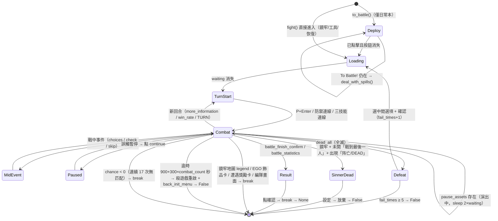
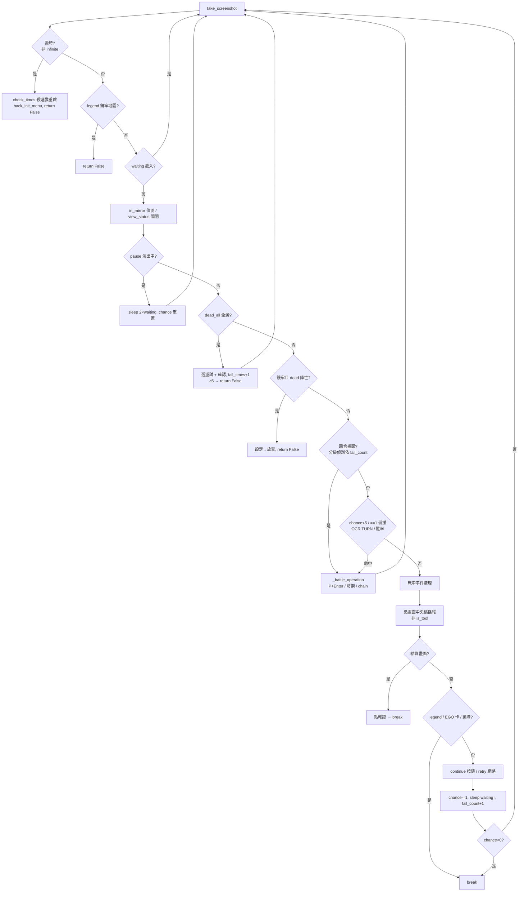

# 12 — 自動戰鬥（`tasks/battle/battle.py`）

> 來源：AALC @ `b0f439321987f5f7b126ebbc424f6ef144c1bff0`。本章只依程式碼與 repo 內文件（`assets/doc/zh/*`）。辨識/輸入原語（`find_element`、`click_element`、模板 bbox、`model` 策略）詳見 [02-recognition-and-input.md](02-recognition-and-input.md)。

## 目的

`Battle` 是 AALC 唯一的戰鬥模組，被三處共用：日常鏡像本（Luxcavation EXP/Thread）、鏡牢（Mirror Dungeon）、小工具「自動戰鬥 / 無限戰鬥」。它**不做真正的戰術決策**：主路徑就是在回合開始畫面按 `P`（遊戲內「依勝率自動選技能」）再按 `Enter` 開戰；另外提供四種可選的「手動」操作——全員防禦、第一回合防禦、「小指良單通」連續防禦 N 回合、以及以罪孽顏色偵測三技能後用拖曳連線（chain）避免或優先三技能。其餘工作是辨識畫面狀態、跳過演出、處理戰中事件、全滅重試、與判斷何時離開迴圈交還呼叫者。

- 類別與 singleton：`Battle` 定義於 [tasks/battle/battle.py:L36-L47](https://github.com/KIYI671/AhabAssistantLimbusCompany/blob/b0f439321987f5f7b126ebbc424f6ef144c1bff0/tasks/battle/battle.py#L36-L47)；`tasks/battle/__init__.py` 建立模組層級單例 `battle = Battle()` [tasks/battle/__init__.py:L1-L3](https://github.com/KIYI671/AhabAssistantLimbusCompany/blob/b0f439321987f5f7b126ebbc424f6ef144c1bff0/tasks/battle/__init__.py#L1-L3)。日常與鏡牢共用同一實例，因此 `identify_keyword_turn`、`mouse_click_rate`、`fail_times` 會**跨場戰鬥殘留**；小工具則另建 `Battle(is_tool=True)` [tasks/tools/infinite_battle.py:L41](https://github.com/KIYI671/AhabAssistantLimbusCompany/blob/b0f439321987f5f7b126ebbc424f6ef144c1bff0/tasks/tools/infinite_battle.py#L41)。
- 遊戲內並未使用「傷害優先」（Damage）自動模式、速度切換、E.G.O 施放、或依罪孽資源配色選技能；程式中完全沒有這些按鍵/模板（整份檔案的按鍵只有 `p`、`enter`，見 [tasks/battle/battle.py:L141-L178](https://github.com/KIYI671/AhabAssistantLimbusCompany/blob/b0f439321987f5f7b126ebbc424f6ef144c1bff0/tasks/battle/battle.py#L141-L178)、[L673](https://github.com/KIYI671/AhabAssistantLimbusCompany/blob/b0f439321987f5f7b126ebbc424f6ef144c1bff0/tasks/battle/battle.py#L673)）。Panic / 侵蝕（corrosion）沒有專屬處理，交由 `P` 自動選擇。

## 入口 API 與呼叫者

| API | 位置 | 回傳 |
|---|---|---|
| `Battle.to_battle()`（staticmethod） | [battle.py:L49-L86](https://github.com/KIYI671/AhabAssistantLimbusCompany/blob/b0f439321987f5f7b126ebbc424f6ef144c1bff0/tasks/battle/battle.py#L49-L86) | 成功點下「To Battle!」後 `break` → 隱式 `None`；嘗試次數耗盡 → `False` |
| `Battle.fight(avoid_skill_3, defense_first_round, infinite_battle, defense_all_time, defense_on_turn1, choice_event_handling, combat_count, defense_for_solo_state, prioritize_skill_3)` | [battle.py:L195-L556](https://github.com/KIYI671/AhabAssistantLimbusCompany/blob/b0f439321987f5f7b126ebbc424f6ef144c1bff0/tasks/battle/battle.py#L195-L556) | `False`（逾時 / 全滅 5 次 / 鏡牢陣亡放棄 / 網路重試失敗 / 開頭即見鏡牢地圖）；正常結束 `None`；`first_battle=True` 時回傳 `"EXP"`/`"thread"`/`None` |
| `DefenseForSoloState`（dataclass） | [battle.py:L22-L33](https://github.com/KIYI671/AhabAssistantLimbusCompany/blob/b0f439321987f5f7b126ebbc424f6ef144c1bff0/tasks/battle/battle.py#L22-L33) | 一次鏡牢共享的「剩餘連續防禦回合」計數 |

所有呼叫者（`rg` 全掃 `tasks/`、`app/`）：

| 呼叫者 | 呼叫方式 | 說明 |
|---|---|---|
| `onetime_EXP_process` | `select_battle_team` → `battle.to_battle()` → `battle.fight(combat_count=…)` → `back_init_menu()` [tasks/base/script_task_scheme.py:L52-L64](https://github.com/KIYI671/AhabAssistantLimbusCompany/blob/b0f439321987f5f7b126ebbc424f6ef144c1bff0/tasks/base/script_task_scheme.py#L52-L64) | 經驗本，見 [03-daily-tasks.md](03-daily-tasks.md) |
| `onetime_thread_process` | 同上 [tasks/base/script_task_scheme.py:L66-L80](https://github.com/KIYI671/AhabAssistantLimbusCompany/blob/b0f439321987f5f7b126ebbc424f6ef144c1bff0/tasks/base/script_task_scheme.py#L66-L80) | 紡錘本 |
| `script_task_scheme`（啟動時接手） | 若一開始就看得到 `battle/turn_assets.png` 就先 `get_reward = battle.fight()` [tasks/base/script_task_scheme.py:L382-L390](https://github.com/KIYI671/AhabAssistantLimbusCompany/blob/b0f439321987f5f7b126ebbc424f6ef144c1bff0/tasks/base/script_task_scheme.py#L382-L390) | 「中途啟動」恢復；`get_reward` 用來扣減日常次數 [L265-L276](https://github.com/KIYI671/AhabAssistantLimbusCompany/blob/b0f439321987f5f7b126ebbc424f6ef144c1bff0/tasks/base/script_task_scheme.py#L265-L276) |
| `Mirror._fight` | `battle.fight(avoid_skill_3, prioritize_skill_3, defense_first_round, defense_for_solo_state)`，回傳值被丟棄、只累計耗時 [tasks/mirror/mirror.py:L125-L133](https://github.com/KIYI671/AhabAssistantLimbusCompany/blob/b0f439321987f5f7b126ebbc424f6ef144c1bff0/tasks/mirror/mirror.py#L125-L133) | 鏡牢主迴圈 4 個觸發點 [L406-L424](https://github.com/KIYI671/AhabAssistantLimbusCompany/blob/b0f439321987f5f7b126ebbc424f6ef144c1bff0/tasks/mirror/mirror.py#L406-L424)，見 [10-mirror-dungeon-overview.md](10-mirror-dungeon-overview.md) |
| `BattleWorker.run`（小工具） | `Battle(is_tool=True).fight(infinite_battle=True, defense_on_turn1, defense_all_time, choice_event_handling)` [tasks/tools/infinite_battle.py:L22-L83](https://github.com/KIYI671/AhabAssistantLimbusCompany/blob/b0f439321987f5f7b126ebbc424f6ef144c1bff0/tasks/tools/infinite_battle.py#L22-L83) | 無限戰鬥：QThread、`running=False` 由熱鍵中斷 [L44-L48](https://github.com/KIYI671/AhabAssistantLimbusCompany/blob/b0f439321987f5f7b126ebbc424f6ef144c1bff0/tasks/tools/infinite_battle.py#L44-L48)；會強制開 `background_click` [L75-L83](https://github.com/KIYI671/AhabAssistantLimbusCompany/blob/b0f439321987f5f7b126ebbc424f6ef144c1bff0/tasks/tools/infinite_battle.py#L75-L83) |

注意：日常本走 `to_battle()`（含 `deal_with_spills` 超編修正），鏡牢**不呼叫** `to_battle()`，而是在自己的主迴圈點「To Battle!」[tasks/mirror/mirror.py:L374-L399](https://github.com/KIYI671/AhabAssistantLimbusCompany/blob/b0f439321987f5f7b126ebbc424f6ef144c1bff0/tasks/mirror/mirror.py#L374-L399)。

## 戰鬥狀態圖

## 主迴圈流程

## 逐步說明

### 1. 出擊前：`to_battle()`（日常本）

- 起始 `auto.model="clam"`、`loop_count=15`；點 `normal_to_battle_assets.png` 或 `chaim_to_battle_assets.png`（`chaim` 為原始碼拼寫，指 chain/連戰版按鈕）後 `sleep(2)` [battle.py:L49-L73](https://github.com/KIYI671/AhabAssistantLimbusCompany/blob/b0f439321987f5f7b126ebbc424f6ef144c1bff0/tasks/battle/battle.py#L49-L73)。
- 若已點過但按鈕仍在，代表編隊人數溢出，呼叫 `deal_with_spills()`：OCR 按鈕上方 115px 處的「n/m」，若 `now>max` 便取消多餘罪人 [battle.py:L58-L65](https://github.com/KIYI671/AhabAssistantLimbusCompany/blob/b0f439321987f5f7b126ebbc424f6ef144c1bff0/tasks/battle/battle.py#L58-L65)、[tasks/teams/team_formation.py:L197-L232](https://github.com/KIYI671/AhabAssistantLimbusCompany/blob/b0f439321987f5f7b126ebbc424f6ef144c1bff0/tasks/teams/team_formation.py#L197-L232)。
- 未命中時遞減：`<10` 切 `normal`（ROI 擴大 100px）、`<5` 切 `aggressive`（全螢幕）、`<0` 回傳 `False` [battle.py:L74-L84](https://github.com/KIYI671/AhabAssistantLimbusCompany/blob/b0f439321987f5f7b126ebbc424f6ef144c1bff0/tasks/battle/battle.py#L74-L84)。**`auto.model` 不會被還原**，會影響之後 `fight()` 內未指定 `model` 的匹配；鏡牢主迴圈在 `main_loop_count>=50` 時重設為 `clam` [tasks/mirror/mirror.py:L239-L240](https://github.com/KIYI671/AhabAssistantLimbusCompany/blob/b0f439321987f5f7b126ebbc424f6ef144c1bff0/tasks/mirror/mirror.py#L239-L240)，日常本則無此還原。
- 只要按鈕持續存在，`loop_count` 不遞減（每輪都 `continue`），理論上可無限循環。

### 2. `fight()` 初始化

- `chance = INIT_CHANCE = 16`、`waiting = 1.5s`、`event_chance = 15` [battle.py:L208-L223](https://github.com/KIYI671/AhabAssistantLimbusCompany/blob/b0f439321987f5f7b126ebbc424f6ef144c1bff0/tasks/battle/battle.py#L208-L223)、[L41](https://github.com/KIYI671/AhabAssistantLimbusCompany/blob/b0f439321987f5f7b126ebbc424f6ef144c1bff0/tasks/battle/battle.py#L41)。
- `defense_on_turn1`（僅工具）會強制 `defense_first_round=True` 並預載 `turn_ocr_assets.png` 的 bbox [battle.py:L217-L219](https://github.com/KIYI671/AhabAssistantLimbusCompany/blob/b0f439321987f5f7b126ebbc424f6ef144c1bff0/tasks/battle/battle.py#L217-L219)。
- 自適應等待：成功 −0.2/√n，失敗 +0.5/√n，夾在 0.5–3.0s [battle.py:L88-L108](https://github.com/KIYI671/AhabAssistantLimbusCompany/blob/b0f439321987f5f7b126ebbc424f6ef144c1bff0/tasks/battle/battle.py#L88-L108)。

### 3. 每輪偵測順序（[battle.py:L240-L542](https://github.com/KIYI671/AhabAssistantLimbusCompany/blob/b0f439321987f5f7b126ebbc424f6ef144c1bff0/tasks/battle/battle.py#L240-L542)）

1. **逾時**：`check_times(start_time, timeout=900+300*combat_count)`，若暫停熱鍵曾觸發則以 `get_restore_time()` 往後推 [battle.py:L246-L252](https://github.com/KIYI671/AhabAssistantLimbusCompany/blob/b0f439321987f5f7b126ebbc424f6ef144c1bff0/tasks/battle/battle.py#L246-L252)。`check_times` 逾時時直接 `kill_game()` + `restart_game()` [tasks/base/retry.py:L123-L135](https://github.com/KIYI671/AhabAssistantLimbusCompany/blob/b0f439321987f5f7b126ebbc424f6ef144c1bff0/tasks/base/retry.py#L123-L135)，之後 `back_init_menu()` 並回 `False`。無限戰鬥不檢查。
2. **已在鏡牢地圖**（`mirror/road_in_mir/legend_assets.png`）→ 回 `False`（無限模式則繼續）[battle.py:L256-L259](https://github.com/KIYI671/AhabAssistantLimbusCompany/blob/b0f439321987f5f7b126ebbc424f6ef144c1bff0/tasks/battle/battle.py#L256-L259)。
3. **載入中** `base/waiting_assets.png` → sleep 0.5 [battle.py:L262-L264](https://github.com/KIYI671/AhabAssistantLimbusCompany/blob/b0f439321987f5f7b126ebbc424f6ef144c1bff0/tasks/battle/battle.py#L262-L264)。
4. **鏡牢判定**：`in_mirror_assets.png`（E.G.O GIFT 方塊圖示）用 `aggressive` 全螢幕找到一次即 `in_mirror=True` [battle.py:L267-L268](https://github.com/KIYI671/AhabAssistantLimbusCompany/blob/b0f439321987f5f7b126ebbc424f6ef144c1bff0/tasks/battle/battle.py#L267-L268)。
5. **狀態檢視彈窗** `view_status_assets.png`（`clam`）→ 點其 (+100, −500)×scale 處關閉 [battle.py:L270-L273](https://github.com/KIYI671/AhabAssistantLimbusCompany/blob/b0f439321987f5f7b126ebbc424f6ef144c1bff0/tasks/battle/battle.py#L270-L273)。
6. **交戰演出中** `pause_assets.png`（右上暫停鍵）→ sleep `2×waiting`，重置 `chance`、`first_turn=False`、清本回合防禦旗標 [battle.py:L276-L281](https://github.com/KIYI671/AhabAssistantLimbusCompany/blob/b0f439321987f5f7b126ebbc424f6ef144c1bff0/tasks/battle/battle.py#L276-L281)。
7. **全滅** `dead_all.png`：多目標匹配若恰 3 個，依 y 排序點中間那個；否則點 `dead_all_confirm_assets.png` 的 (+200, −350)×scale；再點確認。重設 `start_time`、`fail_times += 1`，`>=5` 回 `False` [battle.py:L284-L307](https://github.com/KIYI671/AhabAssistantLimbusCompany/blob/b0f439321987f5f7b126ebbc424f6ef144c1bff0/tasks/battle/battle.py#L284-L307)。（中間選項的語意——重試/重編——程式未註明，見未解問題。）
8. **鏡牢罪人陣亡即放棄**：條件 `in_mirror and not cfg.fight_to_last_man and not infinite_battle`；找到 `dead.png` 後在其 ±100×±30 範圍 OCR「阵亡」/「dead」，命中就進入內迴圈：點 `setting_assets.png` → `give_up_assets.png` → `return False`，若途中回到地圖也回 `False` [battle.py:L309-L330](https://github.com/KIYI671/AhabAssistantLimbusCompany/blob/b0f439321987f5f7b126ebbc424f6ef144c1bff0/tasks/battle/battle.py#L309-L330)。
9. **回合數 OCR**（僅 `infinite_battle and defense_on_turn1`）：裁 `turn_ocr_assets.png` 區域 OCR 數字，`cur_turn==1` 時把 `first_turn` 設回 True，讓每場新戰鬥第一回合都防禦 [battle.py:L334-L349](https://github.com/KIYI671/AhabAssistantLimbusCompany/blob/b0f439321987f5f7b126ebbc424f6ef144c1bff0/tasks/battle/battle.py#L334-L349)。
10. **回合開始（技能選擇）畫面——分級偵測** [battle.py:L351-L381](https://github.com/KIYI671/AhabAssistantLimbusCompany/blob/b0f439321987f5f7b126ebbc424f6ef144c1bff0/tasks/battle/battle.py#L351-L381)：
    - 預設（`fail_count<5`）：`more_information_assets.png` 或 `win_rate_assets.png`。
    - `fail_count>=5`：`click_element(turn_assets.png)` 或 `win_rate_assets.png`。
    - `fail_count>=10` 或 `identify_keyword_turn is False`：裁 `turn_assets.png` 區域、`cv2.inRange(sc,50,255)` 二值化後 OCR，含 `turn` 才算；**一旦此路徑成功就把 `identify_keyword_turn` 設 False，之後（單例跨場）都優先走 OCR**。鏡牢主迴圈也讀這個旗標決定用模板還是 OCR 判斷「在戰鬥中」[tasks/mirror/mirror.py:L412-L421](https://github.com/KIYI671/AhabAssistantLimbusCompany/blob/b0f439321987f5f7b126ebbc424f6ef144c1bff0/tasks/mirror/mirror.py#L412-L421)。
11. **備援**：`chance<5` 時移開滑鼠，OCR TURN / 點 `turn_assets` / `win_rate_assets` / `win_rate_card.png`(0.75) 任一 [battle.py:L382-L403](https://github.com/KIYI671/AhabAssistantLimbusCompany/blob/b0f439321987f5f7b126ebbc424f6ef144c1bff0/tasks/battle/battle.py#L382-L403)；`chance==1` 時全畫面 OCR「胜率」/「rate」，操作後若 1 秒內無 `pause` 就開啟 `mouse_click_rate` [battle.py:L404-L414](https://github.com/KIYI671/AhabAssistantLimbusCompany/blob/b0f439321987f5f7b126ebbc424f6ef144c1bff0/tasks/battle/battle.py#L404-L414)；`mouse_click_rate` 時每輪找 `win_rate_card.png` [battle.py:L415-L419](https://github.com/KIYI671/AhabAssistantLimbusCompany/blob/b0f439321987f5f7b126ebbc424f6ef144c1bff0/tasks/battle/battle.py#L415-L419)。
12. **戰中事件**（`choice_event_handling`，預設 True）：`event/choices_assets.png` + `select_first_option_assets.png` 時選第一項；`event_chance` 由 15 遞減，≤5 改多目標點擊，耗盡後在 `event/continue_assets.png` 區域 OCR「conti/proc/comme/choices/confirm/行判/始战/继续」並點擊後 `break`；`perform_the_check_feature_assets.png` 交給 `event_handling.decision_event_handling()`；再依序嘗試點 continue / proceed / commence / skip(×6) [battle.py:L421-L475](https://github.com/KIYI671/AhabAssistantLimbusCompany/blob/b0f439321987f5f7b126ebbc424f6ef144c1bff0/tasks/battle/battle.py#L421-L475)。事件細節見 [14-md-navigation.md](14-md-navigation.md)。
13. **遭遇獎勵卡** `mirror/road_in_mir/select_encounter_reward_card_assets.png` → `break` [battle.py:L476-L479](https://github.com/KIYI671/AhabAssistantLimbusCompany/blob/b0f439321987f5f7b126ebbc424f6ef144c1bff0/tasks/battle/battle.py#L476-L479)。
14. **跳播報**：非工具模式每輪在畫面中心 ±10px 隨機點一下、sleep 0.15 [battle.py:L480-L488](https://github.com/KIYI671/AhabAssistantLimbusCompany/blob/b0f439321987f5f7b126ebbc424f6ef144c1bff0/tasks/battle/battle.py#L480-L488)。FAQ 說明結算拖延是因「等待播報員語音」選項 [assets/doc/zh/FAQ.md:L41-L43](https://github.com/KIYI671/AhabAssistantLimbusCompany/blob/b0f439321987f5f7b126ebbc424f6ef144c1bff0/assets/doc/zh/FAQ.md#L41-L43)。
15. **結算畫面** `battle_finish_confirm_assets.png`（只找不點）或 `mirror/claim_reward/battle_statistics_assets.png` → 若有 `base/leave_up_assets.png`（升級彈窗）先點它與確認；`first_battle` 時辨識首通獎勵（EXP 票 1/2/3 或 Thread），最後點確認並 `break` [battle.py:L490-L511](https://github.com/KIYI671/AhabAssistantLimbusCompany/blob/b0f439321987f5f7b126ebbc424f6ef144c1bff0/tasks/battle/battle.py#L490-L511)。
16. **其他離開點**：鏡牢地圖 legend、`acquire_ego_gift_card.png`、`chance<=9` 且 `teams/identify_assets.png`（回到編隊）→ `break` [battle.py:L513-L524](https://github.com/KIYI671/AhabAssistantLimbusCompany/blob/b0f439321987f5f7b126ebbc424f6ef144c1bff0/tasks/battle/battle.py#L513-L524)。
17. **誤觸暫停** `battle/continue_assets.png` → 點擊；`retry()` 處理網路重連（`retry()` 內部 90 秒卡死即重啟遊戲並回 False）[battle.py:L527-L531](https://github.com/KIYI671/AhabAssistantLimbusCompany/blob/b0f439321987f5f7b126ebbc424f6ef144c1bff0/tasks/battle/battle.py#L527-L531)、[tasks/base/retry.py:L138-L168](https://github.com/KIYI671/AhabAssistantLimbusCompany/blob/b0f439321987f5f7b126ebbc424f6ef144c1bff0/tasks/base/retry.py#L138-L168)。
18. 無匹配：`chance -= 1`、`sleep(waiting)`、`waiting` 上調、`fail_count += 1`；`chance<0` → `break` [battle.py:L533-L542](https://github.com/KIYI671/AhabAssistantLimbusCompany/blob/b0f439321987f5f7b126ebbc424f6ef144c1bff0/tasks/battle/battle.py#L533-L542)。
19. 收尾：清 `defense_all_time`、記錄匹配成功率；`first_battle` 為真才回傳獎勵字串，否則 `None` [battle.py:L544-L556](https://github.com/KIYI671/AhabAssistantLimbusCompany/blob/b0f439321987f5f7b126ebbc424f6ef144c1bff0/tasks/battle/battle.py#L544-L556)。

### 4. 回合操作 `_battle_operation`（[battle.py:L110-L193](https://github.com/KIYI671/AhabAssistantLimbusCompany/blob/b0f439321987f5f7b126ebbc424f6ef144c1bff0/tasks/battle/battle.py#L110-L193)）

先 `mouse_click_blank()`，然後四選一：

| 分支 | 條件 | 動作 |
|---|---|---|
| 小指良單通 / 第一回合防禦 | `defense_for_solo_state.remaining_turns>0` 且本回合未用；或 `first_turn and defense_first_round`；且 `gear_left.png`≥0.9 | `_defense_this_round()`；失敗則 `P`+`Enter`；成功時 `consume_turn()`。2 秒後若無 `pause` 再補 `P`+`Enter` [L120-L154](https://github.com/KIYI671/AhabAssistantLimbusCompany/blob/b0f439321987f5f7b126ebbc424f6ef144c1bff0/tasks/battle/battle.py#L120-L154) |
| 全程防禦 | `self.defense_all_time`（工具） + `gear_left`≥0.9 | `_defense_this_round()` [L155-L158](https://github.com/KIYI671/AhabAssistantLimbusCompany/blob/b0f439321987f5f7b126ebbc424f6ef144c1bff0/tasks/battle/battle.py#L155-L158) |
| 避免/優先三技能 | `avoid_skill_3 or prioritize_skill_3` + `gear_left`≥0.9 | `_chain_battle()`；失敗 `P`+`Enter`；2 秒後無 `pause` 補按 [L159-L174](https://github.com/KIYI671/AhabAssistantLimbusCompany/blob/b0f439321987f5f7b126ebbc424f6ef144c1bff0/tasks/battle/battle.py#L159-L174) |
| 預設 | 其餘 | `P`，0.5s，`Enter`；若 `mouse_click_rate` 則點 `win_rate_card` (+50, −50)×scale 再點 `gear_right`；否則 1 秒後無 `pause` → 下回合改用滑鼠點勝率 [L175-L191](https://github.com/KIYI671/AhabAssistantLimbusCompany/blob/b0f439321987f5f7b126ebbc424f6ef144c1bff0/tasks/battle/battle.py#L175-L191) |

FAQ 證實自動戰鬥依賴 `P` 與 `Enter`，中文輸入法會吃掉按鍵導致「一進戰鬥就不動」[assets/doc/zh/FAQ.md:L53-L57](https://github.com/KIYI671/AhabAssistantLimbusCompany/blob/b0f439321987f5f7b126ebbc424f6ef144c1bff0/assets/doc/zh/FAQ.md#L53-L57)。

### 5. 技能座標推算、防禦與連線

- 以 `gear_left.png`（左齒輪）與 `gear_right.png`（右齒輪）為錨：`skill_nums = (gear_2.x − gear_1.x) / (145×scale)` [battle.py:L605-L617](https://github.com/KIYI671/AhabAssistantLimbusCompany/blob/b0f439321987f5f7b126ebbc424f6ef144c1bff0/tasks/battle/battle.py#L605-L617)。
- 技能格座標：`gear_left + ((220 − 4.5×n) + 161×i, 250)×scale` [battle.py:L558-L581](https://github.com/KIYI671/AhabAssistantLimbusCompany/blob/b0f439321987f5f7b126ebbc424f6ef144c1bff0/tasks/battle/battle.py#L558-L581)。
- `_defense_this_round`：逐一點擊每格（下排=守備），間隔 `cfg.mouse_action_interval`（非模擬器時 `//1.5`，注意是整除），再從 `gear_left` 經所有格拖到 `gear_right + (5n, 150)×scale` 完成連線 [battle.py:L680-L715](https://github.com/KIYI671/AhabAssistantLimbusCompany/blob/b0f439321987f5f7b126ebbc424f6ef144c1bff0/tasks/battle/battle.py#L680-L715)。
- `_chain_battle`：在齒輪間上緣 15px 高的條帶（`n>=10` 時左側再縮 50px）擷取彩色截圖，對 7 種罪孽色各跑 `find_skill3`，取得「上排是三技能」的格序；避免模式把這些格改拖下排（+125px），優先模式則把其他格改拖下排；上排有三角形偏移 `custom_tune`（每格 8px）；`mouse_drag_link` 後 `Enter` [battle.py:L600-L678](https://github.com/KIYI671/AhabAssistantLimbusCompany/blob/b0f439321987f5f7b126ebbc424f6ef144c1bff0/tasks/battle/battle.py#L600-L678)、[L583-L598](https://github.com/KIYI671/AhabAssistantLimbusCompany/blob/b0f439321987f5f7b126ebbc424f6ef144c1bff0/tasks/battle/battle.py#L583-L598)。

### 6. 罪孽顏色偵測

- `sins` 為 **BGR**：wrath (0,0,254)、gloom (239,197,26)、sloth (49,205,251)、lust (0,108,254)、pride (213,75,1)、gluttony (1,228,146)、envy (222,1,150) [tasks/__init__.py:L79-L87](https://github.com/KIYI671/AhabAssistantLimbusCompany/blob/b0f439321987f5f7b126ebbc424f6ef144c1bff0/tasks/__init__.py#L79-L87)。全 repo 唯一使用點是 `_chain_battle` [battle.py:L625-L626](https://github.com/KIYI671/AhabAssistantLimbusCompany/blob/b0f439321987f5f7b126ebbc424f6ef144c1bff0/tasks/battle/battle.py#L625-L626)。
- `get_screenshot_crop` 把 RGB 截圖翻成 BGR 後裁切 [module/automation/automation.py:L875-L883](https://github.com/KIYI671/AhabAssistantLimbusCompany/blob/b0f439321987f5f7b126ebbc424f6ef144c1bff0/module/automation/automation.py#L875-L883)，與 `sins` 一致。
- `find_skill3(background, known_rgb, threshold=40, min_pixels=10)`：目標色 = 0.45×裁切區中位數色 + 0.55×罪孽色（模擬半透明疊色），容差 ±40；mask 經 erode×1、dilate×3，連通區面積 ≥10 且其 x±33、y 0–13 視窗內 ≥26 像素才算，最後 67px 內合併 [utils/utils.py:L65-L112](https://github.com/KIYI671/AhabAssistantLimbusCompany/blob/b0f439321987f5f7b126ebbc424f6ef144c1bff0/utils/utils.py#L65-L112)。格序 = `round(x / (145×scale))`。

## 辨識表

座標為 2560×1440 畫布上的模板有效 bbox（以 `ImageUtils.get_bbox` 規則量測）。檔名以 `_assets.png` 結尾者為全畫布遮罩模板，匹配 ROI = bbox ±30px（`clam`/預設）、±100px（`normal`）、全螢幕（`aggressive`）[utils/image_utils.py:L212-L247](https://github.com/KIYI671/AhabAssistantLimbusCompany/blob/b0f439321987f5f7b126ebbc424f6ef144c1bff0/utils/image_utils.py#L212-L247)、[module/automation/automation.py:L724-L740](https://github.com/KIYI671/AhabAssistantLimbusCompany/blob/b0f439321987f5f7b126ebbc424f6ef144c1bff0/module/automation/automation.py#L724-L740)；其他為小模板，全螢幕搜尋。方法皆 `cv2.TM_CCOEFF_NORMED`，預設 threshold 0.8 [module/automation/automation.py:L394-L399](https://github.com/KIYI671/AhabAssistantLimbusCompany/blob/b0f439321987f5f7b126ebbc424f6ef144c1bff0/module/automation/automation.py#L394-L399)。變體欄：`share` = `default/share`；zh/en = `default/zh_cn` 與 `default/en`；dark = `dark/share`。

| 狀態 / 用途 | 模板 | 變體 | 方法 / threshold | bbox（2560×1440） |
|---|---|---|---|---|
| 出擊（日常）  | [normal_to_battle_assets.png](https://github.com/KIYI671/AhabAssistantLimbusCompany/blob/b0f439321987f5f7b126ebbc424f6ef144c1bff0/assets/images/default/zh_cn/battle/normal_to_battle_assets.png) | zh_cn, en | click, 0.8, 模型隨 loop 升級 | zh (2159,1129)-(2427,1216)；en (2155,1135)-(2432,1214) |
| 出擊（連戰） | [chaim_to_battle_assets.png](https://github.com/KIYI671/AhabAssistantLimbusCompany/blob/b0f439321987f5f7b126ebbc424f6ef144c1bff0/assets/images/default/zh_cn/battle/chaim_to_battle_assets.png) | zh_cn, en | click, 0.8 | zh (2179,1149)-(2402,1205)；en (2166,1149)-(2419,1198) |
| 未指定編隊順序（鏡牢） | [select_none_assets.png](https://github.com/KIYI671/AhabAssistantLimbusCompany/blob/b0f439321987f5f7b126ebbc424f6ef144c1bff0/assets/images/default/zh_cn/battle/select_none_assets.png) | zh_cn, en | find, 0.8（mirror.py 用） | zh (985,601)-(1539,792) |
| 回合開始  | [more_information_assets.png](https://github.com/KIYI671/AhabAssistantLimbusCompany/blob/b0f439321987f5f7b126ebbc424f6ef144c1bff0/assets/images/default/share/battle/more_information_assets.png) | share | find, 0.8 | (2102,55)-(2152,103) |
| 回合開始（勝率鈕）  | [win_rate_assets.png](https://github.com/KIYI671/AhabAssistantLimbusCompany/blob/b0f439321987f5f7b126ebbc424f6ef144c1bff0/assets/images/default/share/battle/win_rate_assets.png) | share | find, 0.8 | (1987,1069)-(2027,1116) |
| 回合開始（TURN）  | [turn_assets.png](https://github.com/KIYI671/AhabAssistantLimbusCompany/blob/b0f439321987f5f7b126ebbc424f6ef144c1bff0/assets/images/default/share/battle/turn_assets.png) | share | click 0.8 或 bbox 裁切 + `inRange(50,255)` + OCR「turn」 | (26,126)-(89,170) |
| 回合數 OCR（工具） | [turn_ocr_assets.png](https://github.com/KIYI671/AhabAssistantLimbusCompany/blob/b0f439321987f5f7b126ebbc424f6ef144c1bff0/assets/images/default/share/battle/turn_ocr_assets.png) | share | 僅取 bbox，OCR `\d+` | (20,123)-(210,193) |
| 勝率卡（滑鼠模式）  | [win_rate_card.png](https://github.com/KIYI671/AhabAssistantLimbusCompany/blob/b0f439321987f5f7b126ebbc424f6ef144c1bff0/assets/images/default/share/battle/win_rate_card.png) | share | 小模板全螢幕, **0.75**；點 (+50,−50)×scale | 28×149 |
| 左齒輪錨點  | [gear_left.png](https://github.com/KIYI671/AhabAssistantLimbusCompany/blob/b0f439321987f5f7b126ebbc424f6ef144c1bff0/assets/images/default/share/battle/gear_left.png) | share | 小模板, **0.9**（判斷可操作）/0.8（定位） | 30×26 |
| 右齒輪錨點  | [gear_right.png](https://github.com/KIYI671/AhabAssistantLimbusCompany/blob/b0f439321987f5f7b126ebbc424f6ef144c1bff0/assets/images/default/share/battle/gear_right.png) | share | 小模板, 0.8 | 51×129 |
| 演出中（暫停鍵）  | [pause_assets.png](https://github.com/KIYI671/AhabAssistantLimbusCompany/blob/b0f439321987f5f7b126ebbc424f6ef144c1bff0/assets/images/default/share/battle/pause_assets.png) | share | find, 0.8（部分 0.75） | (2316,42)-(2400,125) |
| 誤觸暫停後繼續 | [continue_assets.png](https://github.com/KIYI671/AhabAssistantLimbusCompany/blob/b0f439321987f5f7b126ebbc424f6ef144c1bff0/assets/images/default/share/battle/continue_assets.png) | share | click, 0.8 | (2332,52)-(2390,111) |
| 戰鬥設定鍵 | [setting_assets.png](https://github.com/KIYI671/AhabAssistantLimbusCompany/blob/b0f439321987f5f7b126ebbc424f6ef144c1bff0/assets/images/default/share/battle/setting_assets.png) | share | click, 0.8 | (2427,42)-(2514,125) |
| 放棄戰鬥  | [give_up_assets.png](https://github.com/KIYI671/AhabAssistantLimbusCompany/blob/b0f439321987f5f7b126ebbc424f6ef144c1bff0/assets/images/default/share/battle/give_up_assets.png) | share, dark | click, 0.8 | (1147,821)-(1228,888)；dark (1173,832)-(1224,876) |
| 放棄（一般本確認） | [normal_give_up_assets.png](https://github.com/KIYI671/AhabAssistantLimbusCompany/blob/b0f439321987f5f7b126ebbc424f6ef144c1bff0/assets/images/default/share/battle/normal_give_up_assets.png) | share, dark | click（back_init_menu 用） | (1167,766)-(1228,830)；dark (1174,773)-(1225,826) |
| 鏡牢戰鬥判定  | [in_mirror_assets.png](https://github.com/KIYI671/AhabAssistantLimbusCompany/blob/b0f439321987f5f7b126ebbc424f6ef144c1bff0/assets/images/default/share/battle/in_mirror_assets.png) | share | find, **aggressive**, 0.8 | (2189,162)-(2253,228) |
| 狀態檢視彈窗 | [view_status_assets.png](https://github.com/KIYI671/AhabAssistantLimbusCompany/blob/b0f439321987f5f7b126ebbc424f6ef144c1bff0/assets/images/default/share/battle/view_status_assets.png) | share | find, clam；點 (+100,−500)×scale | (1315,1139)-(1403,1236) |
| 單一罪人陣亡  | [dead.png](https://github.com/KIYI671/AhabAssistantLimbusCompany/blob/b0f439321987f5f7b126ebbc424f6ef144c1bff0/assets/images/default/zh_cn/battle/dead.png) | zh_cn, en | 小模板 0.8 + OCR「阵亡」/「dead」(±100×±30) | zh 118×34；en 111×33 |
| 全滅  | [dead_all.png](https://github.com/KIYI671/AhabAssistantLimbusCompany/blob/b0f439321987f5f7b126ebbc424f6ef144c1bff0/assets/images/default/share/battle/dead_all.png) | share | find + `image_with_multiple_targets`（需 3 個） | 34×179 |
| 全滅確認 | [dead_all_confirm_assets.png](https://github.com/KIYI671/AhabAssistantLimbusCompany/blob/b0f439321987f5f7b126ebbc424f6ef144c1bff0/assets/images/default/share/battle/dead_all_confirm_assets.png) | share | click, 0.8 | (1207,1024)-(1283,1084) |
| 結算確認  | [battle_finish_confirm_assets.png](https://github.com/KIYI671/AhabAssistantLimbusCompany/blob/b0f439321987f5f7b126ebbc424f6ef144c1bff0/assets/images/default/share/battle/battle_finish_confirm_assets.png) | share | find 後 click, 0.8 | (2075,1077)-(2159,1155) |
| 首通獎勵 EXP | [clear_rewards_EXP_1/2/3_assets.png](https://github.com/KIYI671/AhabAssistantLimbusCompany/blob/b0f439321987f5f7b126ebbc424f6ef144c1bff0/assets/images/default/share/battle/clear_rewards_EXP_1_assets.png) | share | find, 0.8（`first_battle` 才查） | (1403,1131)-(1500,1173) |
| 首通獎勵 Thread | [clear_rewards_thread_assets.png](https://github.com/KIYI671/AhabAssistantLimbusCompany/blob/b0f439321987f5f7b126ebbc424f6ef144c1bff0/assets/images/default/share/battle/clear_rewards_thread_assets.png) | share | find, 0.8 | (1423,1110)-(1479,1172) |
| 文字：勝率 | OCR 全畫面 `find_language_text("胜率","rate")` | — | OCR | 全畫面 |

battle.py 另外使用的非 battle 目錄模板：`base/waiting_assets.png`、`base/leave_up_assets.png`、`base/leave_up_confirm_assets.png`、`mirror/road_in_mir/legend_assets.png`、`mirror/road_in_mir/select_encounter_reward_card_assets.png`、`mirror/road_in_mir/acquire_ego_gift_card.png`、`mirror/claim_reward/battle_statistics_assets.png`、`teams/identify_assets.png`、`event/*`（choices、select_first_option、perform_the_check_feature、continue、proceed、commence、skip）——見 [90-asset-index.md](90-asset-index.md)。

## 輸入動作表

| 動作 | 觸發 | 座標 / 鍵 | 位置 |
|---|---|---|---|
| 自動選技（勝率）+ 開戰 | 預設回合操作、各種失敗後備援 | `P`，0.5s，`Enter` | [battle.py:L175-L179](https://github.com/KIYI671/AhabAssistantLimbusCompany/blob/b0f439321987f5f7b126ebbc424f6ef144c1bff0/tasks/battle/battle.py#L175-L179) |
| 滑鼠點勝率 | `mouse_click_rate` | `win_rate_card` + (50,−50)×scale，再點 `gear_right` | [battle.py:L180-L185](https://github.com/KIYI671/AhabAssistantLimbusCompany/blob/b0f439321987f5f7b126ebbc424f6ef144c1bff0/tasks/battle/battle.py#L180-L185) |
| 全員防禦 | 防禦模式 | 逐格 click → `mouse_drag_link(gear_left→格→gear_right+(5n,150))` | [battle.py:L695-L710](https://github.com/KIYI671/AhabAssistantLimbusCompany/blob/b0f439321987f5f7b126ebbc424f6ef144c1bff0/tasks/battle/battle.py#L695-L710) |
| 三技能連線 | avoid/prioritize | `mouse_drag_link`（上/下排混合），`Enter` | [battle.py:L655-L673](https://github.com/KIYI671/AhabAssistantLimbusCompany/blob/b0f439321987f5f7b126ebbc424f6ef144c1bff0/tasks/battle/battle.py#L655-L673) |
| 清空懸停 | 每回合操作前 / 備援前 | `mouse_click_blank()` / `mouse_to_blank()` | [battle.py:L119](https://github.com/KIYI671/AhabAssistantLimbusCompany/blob/b0f439321987f5f7b126ebbc424f6ef144c1bff0/tasks/battle/battle.py#L119) |
| 跳播報 | 非工具每輪 | 畫面中心 ±10px 點一下 | [battle.py:L480-L488](https://github.com/KIYI671/AhabAssistantLimbusCompany/blob/b0f439321987f5f7b126ebbc424f6ef144c1bff0/tasks/battle/battle.py#L480-L488) |
| 全滅重試 | `dead_all` | 中間目標，或 confirm + (200,−350)×scale；再點 confirm | [battle.py:L284-L300](https://github.com/KIYI671/AhabAssistantLimbusCompany/blob/b0f439321987f5f7b126ebbc424f6ef144c1bff0/tasks/battle/battle.py#L284-L300) |
| 放棄 | 鏡牢陣亡 | setting → give_up | [battle.py:L320-L330](https://github.com/KIYI671/AhabAssistantLimbusCompany/blob/b0f439321987f5f7b126ebbc424f6ef144c1bff0/tasks/battle/battle.py#L320-L330) |
| 事件 | 戰中事件 | 第一選項 / continue / proceed / commence / skip×6 | [battle.py:L421-L475](https://github.com/KIYI671/AhabAssistantLimbusCompany/blob/b0f439321987f5f7b126ebbc424f6ef144c1bff0/tasks/battle/battle.py#L421-L475) |

## 影響戰鬥的設定鍵

| 鍵 | 範圍 | 預設 | 效果 |
|---|---|---|---|
| `avoid_skill_3` | 鏡牢隊伍設定 | False | 三技能改拖下排 [module/config/config_typing.py:L81-L82](https://github.com/KIYI671/AhabAssistantLimbusCompany/blob/b0f439321987f5f7b126ebbc424f6ef144c1bff0/module/config/config_typing.py#L81-L82) |
| `prioritize_skill_3` | 鏡牢隊伍設定 | False | 非三技能改拖下排；與 avoid 互斥（UI 勾選互斥 [app/team_setting_card.py:L757-L764](https://github.com/KIYI671/AhabAssistantLimbusCompany/blob/b0f439321987f5f7b126ebbc424f6ef144c1bff0/app/team_setting_card.py#L757-L764)，程式內 avoid 優先 [battle.py:L162](https://github.com/KIYI671/AhabAssistantLimbusCompany/blob/b0f439321987f5f7b126ebbc424f6ef144c1bff0/tasks/battle/battle.py#L162)） [config_typing.py:L84-L85](https://github.com/KIYI671/AhabAssistantLimbusCompany/blob/b0f439321987f5f7b126ebbc424f6ef144c1bff0/module/config/config_typing.py#L84-L85) |
| `defense_first_round` | 鏡牢隊伍設定 | False | 每場第一回合全員防禦 [config_typing.py:L102-L103](https://github.com/KIYI671/AhabAssistantLimbusCompany/blob/b0f439321987f5f7b126ebbc424f6ef144c1bff0/module/config/config_typing.py#L102-L103) |
| `defense_for_solo` / `defense_for_solo_turns` | 鏡牢隊伍設定 | False / 5 | 「小指良單通」：整趟鏡牢共享 N(1–5) 回合連續防禦 [config_typing.py:L105-L109](https://github.com/KIYI671/AhabAssistantLimbusCompany/blob/b0f439321987f5f7b126ebbc424f6ef144c1bff0/module/config/config_typing.py#L105-L109)、[tasks/mirror/mirror.py:L79-L83](https://github.com/KIYI671/AhabAssistantLimbusCompany/blob/b0f439321987f5f7b126ebbc424f6ef144c1bff0/tasks/mirror/mirror.py#L79-L83)；與 `defense_first_round` 互斥 [app/team_setting_card.py:L748-L755](https://github.com/KIYI671/AhabAssistantLimbusCompany/blob/b0f439321987f5f7b126ebbc424f6ef144c1bff0/app/team_setting_card.py#L748-L755) |
| `fight_to_last_man` | 全域 | False | False 時鏡牢一出現陣亡就放棄該戰 [assets/config/config.example.yaml:L138](https://github.com/KIYI671/AhabAssistantLimbusCompany/blob/b0f439321987f5f7b126ebbc424f6ef144c1bff0/assets/config/config.example.yaml#L138)；也影響鏡牢出擊前的存活人數檢查 [tasks/mirror/mirror.py:L380-L393](https://github.com/KIYI671/AhabAssistantLimbusCompany/blob/b0f439321987f5f7b126ebbc424f6ef144c1bff0/tasks/mirror/mirror.py#L380-L393) |
| `set_win_size` | 全域 | 1080 | 所有偏移量的 `scale = set_win_size/1440` [config.example.yaml:L88](https://github.com/KIYI671/AhabAssistantLimbusCompany/blob/b0f439321987f5f7b126ebbc424f6ef144c1bff0/assets/config/config.example.yaml#L88) |
| `mouse_action_interval`、`simulator` | 全域 | 0.5、False | 防禦逐格點擊間隔 [config.example.yaml:L53](https://github.com/KIYI671/AhabAssistantLimbusCompany/blob/b0f439321987f5f7b126ebbc424f6ef144c1bff0/assets/config/config.example.yaml#L53)、[L66](https://github.com/KIYI671/AhabAssistantLimbusCompany/blob/b0f439321987f5f7b126ebbc424f6ef144c1bff0/assets/config/config.example.yaml#L66) |
| `background_click` | 全域 | True | 無限戰鬥強制開啟 [tasks/tools/infinite_battle.py:L75-L83](https://github.com/KIYI671/AhabAssistantLimbusCompany/blob/b0f439321987f5f7b126ebbc424f6ef144c1bff0/tasks/tools/infinite_battle.py#L75-L83) |
| 工具 checkbox：defense / defense_on_turn1 / choice_event_handling | 小工具 | — | 對應 `defense_all_time`、`defense_on_turn1`、`choice_event_handling` 參數 [tasks/tools/infinite_battle.py:L29-L40](https://github.com/KIYI671/AhabAssistantLimbusCompany/blob/b0f439321987f5f7b126ebbc424f6ef144c1bff0/tasks/tools/infinite_battle.py#L29-L40) |

## 日常本 vs 鏡牢 vs 小工具

| 面向 | 日常本（Luxcavation） | 鏡牢 | 無限戰鬥工具 |
|---|---|---|---|
| 出擊 | `to_battle()` + `deal_with_spills` | mirror.py 自己點 To Battle!，先 `team_formation` / `check_team` 存活人數檢查 [mirror.py:L374-L404](https://github.com/KIYI671/AhabAssistantLimbusCompany/blob/b0f439321987f5f7b126ebbc424f6ef144c1bff0/tasks/mirror/mirror.py#L374-L404) | 使用者手動 |
| 參數 | 只傳 `combat_count`（連戰次數，放寬逾時） | 三技能 / 防禦 / 小指良 | `infinite_battle=True` 等 |
| 逾時 | 900+300×combat_count 秒 | 1200 秒 | 無 |
| 陣亡 | 不處理（`in_mirror` 為 False） | 未開 `fight_to_last_man` 即放棄 | 不處理 |
| 全滅 5 次 | `fight` 回 False 後照常 `back_init_menu` | `fail_times>=5` → `Mirror.re_start()` 放棄整趟鏡牢 [mirror.py:L362-L366](https://github.com/KIYI671/AhabAssistantLimbusCompany/blob/b0f439321987f5f7b126ebbc424f6ef144c1bff0/tasks/mirror/mirror.py#L362-L366)、[L1185-L1211](https://github.com/KIYI671/AhabAssistantLimbusCompany/blob/b0f439321987f5f7b126ebbc424f6ef144c1bff0/tasks/mirror/mirror.py#L1185-L1211) | 繼續 |
| 結束 | 結算確認 → `back_init_menu` | 回到地圖 / EGO 卡 / 獎勵卡即 break，交還鏡牢主迴圈 | 永不離開，直到 `running=False` |
| 跳播報點擊 | 有 | 有 | 無（`is_tool`） |

Boss 戰、異想體（abnormality）戰在 battle.py 中**沒有任何分支**——全部以同一迴圈與 `P`+`Enter` 處理。鏡牢層級的 Boss 與節點類型判斷在 [14-md-navigation.md](14-md-navigation.md)。

## 失敗、卡死與中途恢復

- **中途啟動**：主流程開始時若看得到 `turn_assets.png` 就先跑 `battle.fight()` [tasks/base/script_task_scheme.py:L383-L385](https://github.com/KIYI671/AhabAssistantLimbusCompany/blob/b0f439321987f5f7b126ebbc424f6ef144c1bff0/tasks/base/script_task_scheme.py#L383-L385)；鏡牢主迴圈只要偵測到 `more_information` / `in_mirror` / TURN / `win_rate_card + gear_right` 任一就進 `_fight()` [tasks/mirror/mirror.py:L406-L424](https://github.com/KIYI671/AhabAssistantLimbusCompany/blob/b0f439321987f5f7b126ebbc424f6ef144c1bff0/tasks/mirror/mirror.py#L406-L424)。`back_init_menu` 在戰鬥中會點 setting → give_up → normal_give_up 直接放棄 [tasks/base/back_init_menu.py:L99-L103](https://github.com/KIYI671/AhabAssistantLimbusCompany/blob/b0f439321987f5f7b126ebbc424f6ef144c1bff0/tasks/base/back_init_menu.py#L99-L103)。
- **首通獎勵扣次數（死碼）**：`fight()` 想在 `self.first_battle` 為真時回傳 `"EXP"`/`"thread"` 讓日常扣一次，但全 repo 沒有任何地方把 `Battle.first_battle` 設為 True（`rg first_battle` 只見 `Mirror.first_battle` 自身欄位），因此 `get_reward` 恆為 `None`，[battle.py:L499-L507](https://github.com/KIYI671/AhabAssistantLimbusCompany/blob/b0f439321987f5f7b126ebbc424f6ef144c1bff0/tasks/battle/battle.py#L499-L507) 與 [L553-L554](https://github.com/KIYI671/AhabAssistantLimbusCompany/blob/b0f439321987f5f7b126ebbc424f6ef144c1bff0/tasks/battle/battle.py#L553-L554) 實際上不會生效。
- **卡死**：兩層保護——`fight` 自己的 900+300×n 秒總逾時，以及每輪 `retry()` 的 90 秒卡死偵測；兩者都由 `check_times` 殺掉並重啟遊戲 [tasks/base/retry.py:L123-L168](https://github.com/KIYI671/AhabAssistantLimbusCompany/blob/b0f439321987f5f7b126ebbc424f6ef144c1bff0/tasks/base/retry.py#L123-L168)。全滅重試會重設 `start_time`。
- **遊戲崩潰**：`retry()` 偵測模擬器遊戲未啟動（`ensure_simulator_game_started`）或 Windows 視窗 handle 改變會重設計時；重啟後 `fight` 回 False，呼叫端（日常 `back_init_menu`、鏡牢主迴圈）重新導航 [tasks/base/retry.py:L143-L158](https://github.com/KIYI671/AhabAssistantLimbusCompany/blob/b0f439321987f5f7b126ebbc424f6ef144c1bff0/tasks/base/retry.py#L143-L158)。
- **無匹配**：連續 17 次（`chance` 16→−1）任何狀態都沒命中就 `break` 回 `None`，呼叫者視為戰鬥已結束。
- **使用者中斷**：`running=False`（只有工具使用）[battle.py:L240](https://github.com/KIYI671/AhabAssistantLimbusCompany/blob/b0f439321987f5f7b126ebbc424f6ef144c1bff0/tasks/battle/battle.py#L240)。

## 相關報告

- [README.md](README.md)、[01-architecture.md](01-architecture.md)
- [02-recognition-and-input.md](02-recognition-and-input.md)：`find_element` / `model` / 主題與語言路徑選擇 / `mouse_drag_link`
- [03-daily-tasks.md](03-daily-tasks.md)：Luxcavation 與無限戰鬥工具
- [10-mirror-dungeon-overview.md](10-mirror-dungeon-overview.md)：鏡牢主迴圈何時呼叫 `_fight`、`re_start`
- [11-md-team-formation.md](11-md-team-formation.md)：`team_formation`、`check_team`、`deal_with_spills`
- [13-md-ego-gifts.md](13-md-ego-gifts.md)：戰後 EGO 飾品卡
- [14-md-navigation.md](14-md-navigation.md)：事件與節點、`event_handling`
- [90-asset-index.md](90-asset-index.md)、[99-open-questions.md](99-open-questions.md)

## 未解問題

1. `dead_all.png` 多目標恰 3 個時點「中間」那個：對應全滅畫面哪個選項（重試？重新編隊？）程式未註明，需實機截圖確認 [battle.py:L285-L288](https://github.com/KIYI671/AhabAssistantLimbusCompany/blob/b0f439321987f5f7b126ebbc424f6ef144c1bff0/tasks/battle/battle.py#L285-L288)。
2. `Battle.first_battle` 從未被設為 True，首通獎勵扣次數邏輯是否為遺留死碼、還是原本預期由外部設定？
3. `to_battle()` 在按鈕一直存在時不遞減 `loop_count`，可能無限循環（每輪呼叫 `deal_with_spills`）[battle.py:L58-L73](https://github.com/KIYI671/AhabAssistantLimbusCompany/blob/b0f439321987f5f7b126ebbc424f6ef144c1bff0/tasks/battle/battle.py#L58-L73)。
4. `to_battle()` 把 `auto.model` 改成 `normal`/`aggressive` 後不還原，日常本後續 `fight()` 的匹配範圍會被放大，是否刻意？
5. `identify_keyword_turn` 一旦切成 OCR 就永不恢復（單例），長時間運行時是否造成較慢的回合偵測？
6. `_defense_this_round` 用 `cfg.mouse_action_interval // 1.5`（整除），預設 0.5 時結果為 0.0，點擊間無間隔，疑似應為 `/`。
7. 鏡牢陣亡放棄後回到哪個畫面（節點重打或直接判負）屬遊戲行為，程式只依後續 mirror 主迴圈偵測；`view_status_assets.png`（紅色火焰圖示）對應的遊戲彈窗語意未在 repo 文件中說明。
8. 模板只有 `give_up` / `normal_give_up` 有 dark 主題版本；其餘 battle 模板在 dark 主題下是否仍可匹配未驗證。
