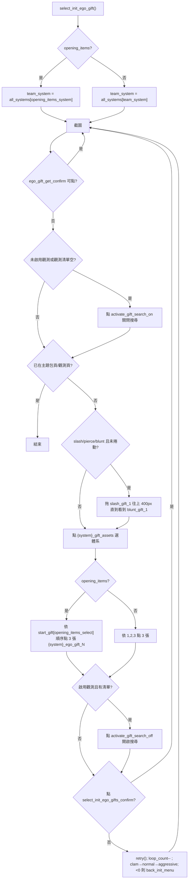
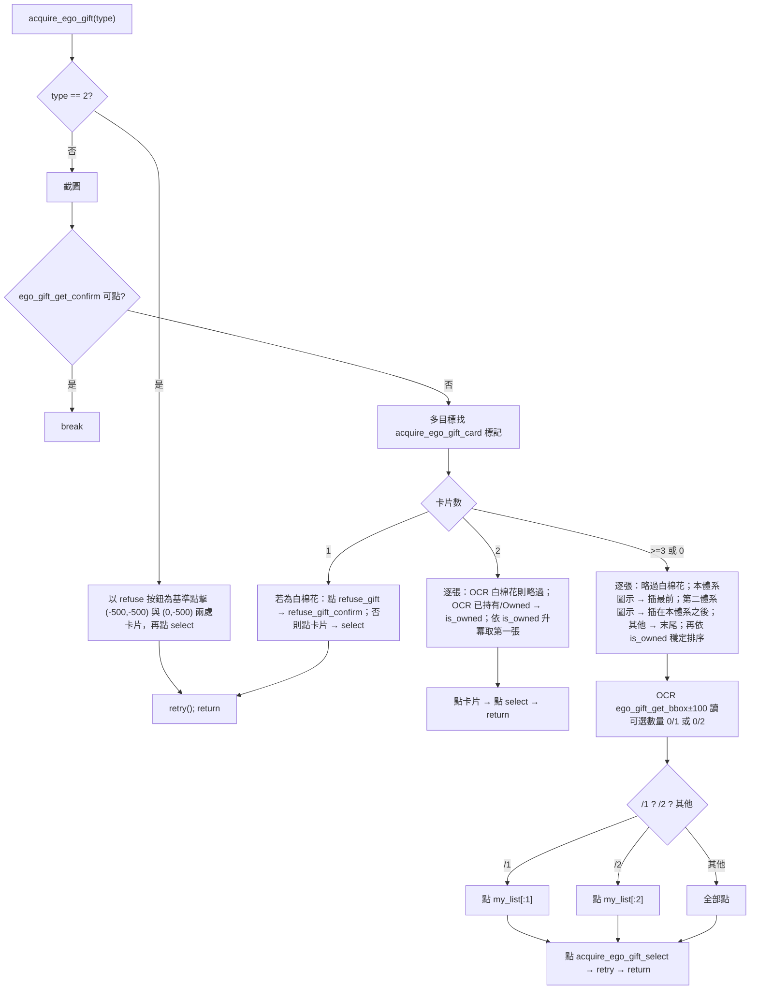
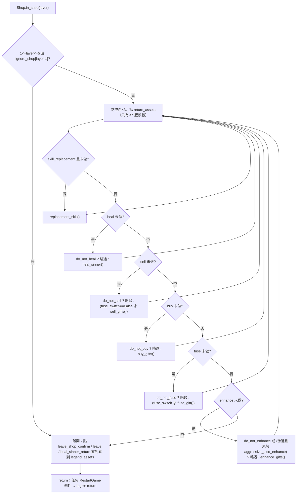
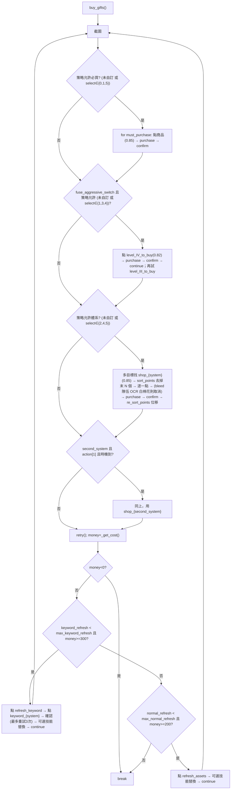
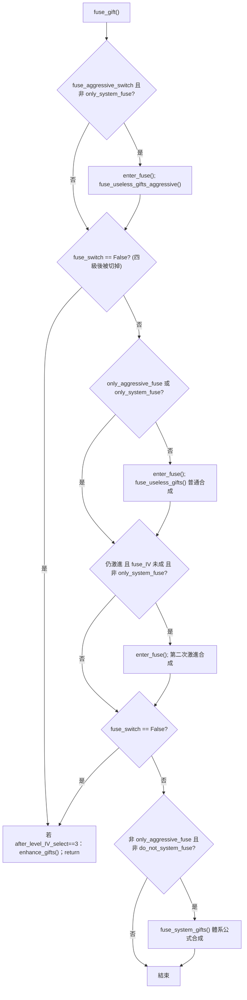

# 13 — 鏡牢 E.G.O 飾品（Gift）邏輯：初始飾品、觀測、戰後獲取與商店

> 原始碼版本：`KIYI671/AhabAssistantLimbusCompany` @ `b0f4393`。本章只依據程式碼與 repo 內文件（`assets/doc/zh/*`）。
> 主迴圈「何時呼叫本章函式」見 [10-mirror-dungeon-overview.md](10-mirror-dungeon-overview.md)；隊伍設定欄位全貌見 [11-md-team-formation.md](11-md-team-formation.md)。

## 1. 目的

AALC 在鏡牢中處理 E.G.O 飾品（程式內稱「饰品」/gift）的全部邏輯分散在兩個檔案：

| 階段 | 進入點 | 檔案 |
|---|---|---|
| 開局選體系＋3 個初始飾品 | `Mirror.select_init_ego_gift()` | [tasks/mirror/mirror.py:L869-L951](https://github.com/KIYI671/AhabAssistantLimbusCompany/blob/b0f439321987f5f7b126ebbc424f6ef144c1bff0/tasks/mirror/mirror.py#L869-L951) |
| 觀測 E.G.O 飾品（開局「飾品搜尋」） | `Mirror.select_observe_ego_gift()` | [tasks/mirror/mirror.py:L953-L1062](https://github.com/KIYI671/AhabAssistantLimbusCompany/blob/b0f439321987f5f7b126ebbc424f6ef144c1bff0/tasks/mirror/mirror.py#L953-L1062) |
| 戰鬥／事件後「選擇 E.G.O 飾品」 | `Mirror.acquire_ego_gift()` | [tasks/mirror/mirror.py:L1343-L1522](https://github.com/KIYI671/AhabAssistantLimbusCompany/blob/b0f439321987f5f7b126ebbc424f6ef144c1bff0/tasks/mirror/mirror.py#L1343-L1522) |
| 商店（治療、出售、購買、合成、升級、技能替換、刷新） | `Shop.in_shop(layer)` | [tasks/mirror/in_shop.py:L1335-L1444](https://github.com/KIYI671/AhabAssistantLimbusCompany/blob/b0f439321987f5f7b126ebbc424f6ef144c1bff0/tasks/mirror/in_shop.py#L1335-L1444) |

`Shop` 物件在每次 `Mirror(...)` 建構時建立一次（[tasks/mirror/mirror.py:L49-L55](https://github.com/KIYI671/AhabAssistantLimbusCompany/blob/b0f439321987f5f7b126ebbc424f6ef144c1bff0/tasks/mirror/mirror.py#L49-L55)），而 `Mirror` 每趟鏡牢重新建立（[tasks/base/script_task_scheme.py:L96-L96](https://github.com/KIYI671/AhabAssistantLimbusCompany/blob/b0f439321987f5f7b126ebbc424f6ef144c1bff0/tasks/base/script_task_scheme.py#L96-L96)），所以 `fuse_IV`、`enhance_gifts_list` 等狀態**跨樓層保留、跨趟重置**。`acquire_ego_gift` 也會讀 `self.shop.fuse_IV`（[tasks/mirror/mirror.py:L1458-L1461](https://github.com/KIYI671/AhabAssistantLimbusCompany/blob/b0f439321987f5f7b126ebbc424f6ef144c1bff0/tasks/mirror/mirror.py#L1458-L1461)）。

共用常數在 [tasks/__init__.py:L1-L13](https://github.com/KIYI671/AhabAssistantLimbusCompany/blob/b0f439321987f5f7b126ebbc424f6ef144c1bff0/tasks/__init__.py#L1-L13)：`all_systems` 把 `team_system` 整數 0–9 對到 `burn, bleed, tremor, rupture, poise, sinking, charge, slash, pierce, blunt`；`observe_system` 將 4/5 對調（觀測頁的 UI 順序是 sinking 在 poise 前）。`start_gift`（[tasks/__init__.py:L58-L65](https://github.com/KIYI671/AhabAssistantLimbusCompany/blob/b0f439321987f5f7b126ebbc424f6ef144c1bff0/tasks/__init__.py#L58-L65)）是 6 種 3 選順序的排列；`system_cn_zh`（[tasks/__init__.py:L66-L77](https://github.com/KIYI671/AhabAssistantLimbusCompany/blob/b0f439321987f5f7b126ebbc424f6ef144c1bff0/tasks/__init__.py#L66-L77)）供 OCR 判斷合成結果。

## 2. 辨識基礎（本章所有步驟共用）

- **模板命名規則**（repo 文件 [assets/doc/zh/image_recognition.md:L55-L81](https://github.com/KIYI671/AhabAssistantLimbusCompany/blob/b0f439321987f5f7b126ebbc424f6ef144c1bff0/assets/doc/zh/image_recognition.md#L55-L81)）：`*_assets.png` 是 2560×1440 全畫面「黑幕」圖，程式取非黑區域 bbox 為搜尋區；`*_bbox.png` 只用來給 ROI；其他（如飾品圖示）是只有核心圖像的小圖，於全畫面搜尋。實作：[module/automation/automation.py:L724-L740](https://github.com/KIYI671/AhabAssistantLimbusCompany/blob/b0f439321987f5f7b126ebbc424f6ef144c1bff0/module/automation/automation.py#L724-L740)、[utils/image_utils.py:L147-L163](https://github.com/KIYI671/AhabAssistantLimbusCompany/blob/b0f439321987f5f7b126ebbc424f6ef144c1bff0/utils/image_utils.py#L147-L163)。
- **比對方法**：`cv2.matchTemplate(TM_CCOEFF_NORMED)`，彩色（RGB 3 通道，alpha 被丟棄），預設 `threshold=0.8`（[module/automation/automation.py:L394-L458](https://github.com/KIYI671/AhabAssistantLimbusCompany/blob/b0f439321987f5f7b126ebbc424f6ef144c1bff0/module/automation/automation.py#L394-L458)、[utils/image_utils.py:L212-L250](https://github.com/KIYI671/AhabAssistantLimbusCompany/blob/b0f439321987f5f7b126ebbc424f6ef144c1bff0/utils/image_utils.py#L212-L250)）。`model` 決定 `_assets` 圖的搜尋範圍：`clam` = bbox±30px、`normal` = bbox±100px、`aggressive` = 全畫面（[utils/image_utils.py:L219-L245](https://github.com/KIYI671/AhabAssistantLimbusCompany/blob/b0f439321987f5f7b126ebbc424f6ef144c1bff0/utils/image_utils.py#L219-L245)）。
- **多目標**：`find_type="image_with_multiple_targets"` 回傳所有 ≥threshold 的點，依分數排序後以 `min_dist=10` 去重（[module/automation/automation.py:L461-L498](https://github.com/KIYI671/AhabAssistantLimbusCompany/blob/b0f439321987f5f7b126ebbc424f6ef144c1bff0/module/automation/automation.py#L461-L498)、[utils/image_utils.py:L252-L275](https://github.com/KIYI671/AhabAssistantLimbusCompany/blob/b0f439321987f5f7b126ebbc424f6ef144c1bff0/utils/image_utils.py#L252-L275)）。
- **OCR**：`find_language_text(zh, en, crop)` 對裁切區做一次 OCR，子字串比對（不分大小寫、可去空白），命中回傳 `[x, y]`（[module/automation/automation.py:L519-L631](https://github.com/KIYI671/AhabAssistantLimbusCompany/blob/b0f439321987f5f7b126ebbc424f6ef144c1bff0/module/automation/automation.py#L519-L631)）。
- **路徑解析**：`ImageUtils` 依 `dark/zh_cn → dark/en → dark/share → default/zh_cn → default/en → default/share` 尋找同名檔（[utils/path_manager.py:L10-L17](https://github.com/KIYI671/AhabAssistantLimbusCompany/blob/b0f439321987f5f7b126ebbc424f6ef144c1bff0/utils/path_manager.py#L10-L17)、[utils/image_utils.py:L14-L48](https://github.com/KIYI671/AhabAssistantLimbusCompany/blob/b0f439321987f5f7b126ebbc424f6ef144c1bff0/utils/image_utils.py#L14-L48)）。**本章所有飾品類模板只存在 `default/share`**；只有 `leave_shop_confirm_assets.png`、`sell_gift_confirm_assets.png` 另有 `dark/share` 版本，文字按鈕（購買、升級、離開…）有 `default/zh_cn` 與 `default/en` 兩版。
- **解析度**：模板以 2560×1440 製作，載入時依 `cfg.set_win_size/1440` 縮放（[utils/image_utils.py:L102-L125](https://github.com/KIYI671/AhabAssistantLimbusCompany/blob/b0f439321987f5f7b126ebbc424f6ef144c1bff0/utils/image_utils.py#L102-L125)）；程式中所有硬編碼偏移量也乘 `scale = cfg.set_win_size / 1440`。下文座標皆以 2560×1440 表示。

## 3. 初始飾品選擇（開局選體系＋3 飾品）

### 3.1 觸發

主迴圈只要畫面上有「飾品搜尋開關」`activate_gift_search_on/off_assets.png` 就呼叫 `select_init_ego_gift()`（[tasks/mirror/mirror.py:L486-L493](https://github.com/KIYI671/AhabAssistantLimbusCompany/blob/b0f439321987f5f7b126ebbc424f6ef144c1bff0/tasks/mirror/mirror.py#L486-L493)）。

### 3.2 流程

逐步說明：

1. **選哪個體系**：預設用隊伍體系 `team_system`；若勾「自選開局飾品」（`opening_items`），改用 `opening_items_system`（[tasks/mirror/mirror.py:L875-L877](https://github.com/KIYI671/AhabAssistantLimbusCompany/blob/b0f439321987f5f7b126ebbc424f6ef144c1bff0/tasks/mirror/mirror.py#L875-L877)）。
2. **觀測開關**：未啟用觀測或清單空時點 `activate_gift_search_on_assets.png`（把開關關掉）；啟用且有清單時點 `..._off_assets.png`（打開）（[tasks/mirror/mirror.py:L888-L890](https://github.com/KIYI671/AhabAssistantLimbusCompany/blob/b0f439321987f5f7b126ebbc424f6ef144c1bff0/tasks/mirror/mirror.py#L888-L890)、[tasks/mirror/mirror.py:L928-L930](https://github.com/KIYI671/AhabAssistantLimbusCompany/blob/b0f439321987f5f7b126ebbc424f6ef144c1bff0/tasks/mirror/mirror.py#L928-L930)）。
3. **離開條件**：看到主題包頁 `feature_theme_pack_assets.png` 或觀測頁 `observe_bleed/burn_assets.png` 即 `break`（[tasks/mirror/mirror.py:L891-L895](https://github.com/KIYI671/AhabAssistantLimbusCompany/blob/b0f439321987f5f7b126ebbc424f6ef144c1bff0/tasks/mirror/mirror.py#L891-L895)）。
4. **物理系捲動**：slash/pierce/blunt 三個體系在列表下方，先拖 `slash_gift_1.png` 向上 400px，直到出現 `blunt_gift_1_assets.png`（[tasks/mirror/mirror.py:L897-L906](https://github.com/KIYI671/AhabAssistantLimbusCompany/blob/b0f439321987f5f7b126ebbc424f6ef144c1bff0/tasks/mirror/mirror.py#L897-L906)）。
5. **點體系**：`mirror/road_to_mir/{system}_gift_assets.png`（zh_cn/en 兩版文字標籤）（[tasks/mirror/mirror.py:L908-L910](https://github.com/KIYI671/AhabAssistantLimbusCompany/blob/b0f439321987f5f7b126ebbc424f6ef144c1bff0/tasks/mirror/mirror.py#L908-L910)）。`select_system` 旗標只讓第一次點擊觸發 `continue`，之後仍會每圈重點（無害）。
6. **點 3 個飾品**：模板 `select_init_gift/{system}_ego_gift_{1,2,3}.png`。順序：`opening_items` 時取 `start_gift[opening_items_select]`（例如 `3: [2,3,1]`），否則 1→2→3（[tasks/mirror/mirror.py:L912-L926](https://github.com/KIYI671/AhabAssistantLimbusCompany/blob/b0f439321987f5f7b126ebbc424f6ef144c1bff0/tasks/mirror/mirror.py#L912-L926)）。GUI 選項文字 `"1→2→3"…"3→2→1"` 在 [app/__init__.py:L109-L109](https://github.com/KIYI671/AhabAssistantLimbusCompany/blob/b0f439321987f5f7b126ebbc424f6ef144c1bff0/app/__init__.py#L109-L109)。**沒有任何「已選取」偵測**：每圈都會再點一次三張圖；遊戲端的勾選狀態若是 toggle，理論上會被重複點擊取消，實際依賴下一步 confirm 成功就離開這頁。
7. **確認**：`select_init_ego_gifts_confirm_assets.png`（[tasks/mirror/mirror.py:L932-L934](https://github.com/KIYI671/AhabAssistantLimbusCompany/blob/b0f439321987f5f7b126ebbc424f6ef144c1bff0/tasks/mirror/mirror.py#L932-L934)）。
8. **失敗**：每圈 `retry()`；`loop_count` 30 次，<20 切 `normal`、<10 切 `aggressive`、<0 `back_init_menu()`（[tasks/mirror/mirror.py:L936-L951](https://github.com/KIYI671/AhabAssistantLimbusCompany/blob/b0f439321987f5f7b126ebbc424f6ef144c1bff0/tasks/mirror/mirror.py#L936-L951)）。

> 備註：`select_init_gift/random_ego_gift.png` 存在於 repo 但程式未引用（`rg random_ego_gift` 無呼叫端）。

### 3.3 初始飾品模板（31 張，僅 `default/share`）

| 體系 | 1 | 2 | 3 |
|---|---|---|---|
| burn | [assets/images/default/share/mirror/road_to_mir/select_init_gift/burn_ego_gift_1.png](https://github.com/KIYI671/AhabAssistantLimbusCompany/blob/b0f439321987f5f7b126ebbc424f6ef144c1bff0/assets/images/default/share/mirror/road_to_mir/select_init_gift/burn_ego_gift_1.png) | [assets/images/default/share/mirror/road_to_mir/select_init_gift/burn_ego_gift_2.png](https://github.com/KIYI671/AhabAssistantLimbusCompany/blob/b0f439321987f5f7b126ebbc424f6ef144c1bff0/assets/images/default/share/mirror/road_to_mir/select_init_gift/burn_ego_gift_2.png) | [assets/images/default/share/mirror/road_to_mir/select_init_gift/burn_ego_gift_3.png](https://github.com/KIYI671/AhabAssistantLimbusCompany/blob/b0f439321987f5f7b126ebbc424f6ef144c1bff0/assets/images/default/share/mirror/road_to_mir/select_init_gift/burn_ego_gift_3.png) |
| bleed | [assets/images/default/share/mirror/road_to_mir/select_init_gift/bleed_ego_gift_1.png](https://github.com/KIYI671/AhabAssistantLimbusCompany/blob/b0f439321987f5f7b126ebbc424f6ef144c1bff0/assets/images/default/share/mirror/road_to_mir/select_init_gift/bleed_ego_gift_1.png) | [assets/images/default/share/mirror/road_to_mir/select_init_gift/bleed_ego_gift_2.png](https://github.com/KIYI671/AhabAssistantLimbusCompany/blob/b0f439321987f5f7b126ebbc424f6ef144c1bff0/assets/images/default/share/mirror/road_to_mir/select_init_gift/bleed_ego_gift_2.png) | [assets/images/default/share/mirror/road_to_mir/select_init_gift/bleed_ego_gift_3.png](https://github.com/KIYI671/AhabAssistantLimbusCompany/blob/b0f439321987f5f7b126ebbc424f6ef144c1bff0/assets/images/default/share/mirror/road_to_mir/select_init_gift/bleed_ego_gift_3.png) |
| tremor | [assets/images/default/share/mirror/road_to_mir/select_init_gift/tremor_ego_gift_1.png](https://github.com/KIYI671/AhabAssistantLimbusCompany/blob/b0f439321987f5f7b126ebbc424f6ef144c1bff0/assets/images/default/share/mirror/road_to_mir/select_init_gift/tremor_ego_gift_1.png) | [assets/images/default/share/mirror/road_to_mir/select_init_gift/tremor_ego_gift_2.png](https://github.com/KIYI671/AhabAssistantLimbusCompany/blob/b0f439321987f5f7b126ebbc424f6ef144c1bff0/assets/images/default/share/mirror/road_to_mir/select_init_gift/tremor_ego_gift_2.png) | [assets/images/default/share/mirror/road_to_mir/select_init_gift/tremor_ego_gift_3.png](https://github.com/KIYI671/AhabAssistantLimbusCompany/blob/b0f439321987f5f7b126ebbc424f6ef144c1bff0/assets/images/default/share/mirror/road_to_mir/select_init_gift/tremor_ego_gift_3.png) |
| rupture | [assets/images/default/share/mirror/road_to_mir/select_init_gift/rupture_ego_gift_1.png](https://github.com/KIYI671/AhabAssistantLimbusCompany/blob/b0f439321987f5f7b126ebbc424f6ef144c1bff0/assets/images/default/share/mirror/road_to_mir/select_init_gift/rupture_ego_gift_1.png) | [assets/images/default/share/mirror/road_to_mir/select_init_gift/rupture_ego_gift_2.png](https://github.com/KIYI671/AhabAssistantLimbusCompany/blob/b0f439321987f5f7b126ebbc424f6ef144c1bff0/assets/images/default/share/mirror/road_to_mir/select_init_gift/rupture_ego_gift_2.png) | [assets/images/default/share/mirror/road_to_mir/select_init_gift/rupture_ego_gift_3.png](https://github.com/KIYI671/AhabAssistantLimbusCompany/blob/b0f439321987f5f7b126ebbc424f6ef144c1bff0/assets/images/default/share/mirror/road_to_mir/select_init_gift/rupture_ego_gift_3.png) |
| poise | [assets/images/default/share/mirror/road_to_mir/select_init_gift/poise_ego_gift_1.png](https://github.com/KIYI671/AhabAssistantLimbusCompany/blob/b0f439321987f5f7b126ebbc424f6ef144c1bff0/assets/images/default/share/mirror/road_to_mir/select_init_gift/poise_ego_gift_1.png) | [assets/images/default/share/mirror/road_to_mir/select_init_gift/poise_ego_gift_2.png](https://github.com/KIYI671/AhabAssistantLimbusCompany/blob/b0f439321987f5f7b126ebbc424f6ef144c1bff0/assets/images/default/share/mirror/road_to_mir/select_init_gift/poise_ego_gift_2.png) | [assets/images/default/share/mirror/road_to_mir/select_init_gift/poise_ego_gift_3.png](https://github.com/KIYI671/AhabAssistantLimbusCompany/blob/b0f439321987f5f7b126ebbc424f6ef144c1bff0/assets/images/default/share/mirror/road_to_mir/select_init_gift/poise_ego_gift_3.png) |
| sinking | [assets/images/default/share/mirror/road_to_mir/select_init_gift/sinking_ego_gift_1.png](https://github.com/KIYI671/AhabAssistantLimbusCompany/blob/b0f439321987f5f7b126ebbc424f6ef144c1bff0/assets/images/default/share/mirror/road_to_mir/select_init_gift/sinking_ego_gift_1.png) | [assets/images/default/share/mirror/road_to_mir/select_init_gift/sinking_ego_gift_2.png](https://github.com/KIYI671/AhabAssistantLimbusCompany/blob/b0f439321987f5f7b126ebbc424f6ef144c1bff0/assets/images/default/share/mirror/road_to_mir/select_init_gift/sinking_ego_gift_2.png) | [assets/images/default/share/mirror/road_to_mir/select_init_gift/sinking_ego_gift_3.png](https://github.com/KIYI671/AhabAssistantLimbusCompany/blob/b0f439321987f5f7b126ebbc424f6ef144c1bff0/assets/images/default/share/mirror/road_to_mir/select_init_gift/sinking_ego_gift_3.png) |
| charge | [assets/images/default/share/mirror/road_to_mir/select_init_gift/charge_ego_gift_1.png](https://github.com/KIYI671/AhabAssistantLimbusCompany/blob/b0f439321987f5f7b126ebbc424f6ef144c1bff0/assets/images/default/share/mirror/road_to_mir/select_init_gift/charge_ego_gift_1.png) | [assets/images/default/share/mirror/road_to_mir/select_init_gift/charge_ego_gift_2.png](https://github.com/KIYI671/AhabAssistantLimbusCompany/blob/b0f439321987f5f7b126ebbc424f6ef144c1bff0/assets/images/default/share/mirror/road_to_mir/select_init_gift/charge_ego_gift_2.png) | [assets/images/default/share/mirror/road_to_mir/select_init_gift/charge_ego_gift_3.png](https://github.com/KIYI671/AhabAssistantLimbusCompany/blob/b0f439321987f5f7b126ebbc424f6ef144c1bff0/assets/images/default/share/mirror/road_to_mir/select_init_gift/charge_ego_gift_3.png) |
| slash | [assets/images/default/share/mirror/road_to_mir/select_init_gift/slash_ego_gift_1.png](https://github.com/KIYI671/AhabAssistantLimbusCompany/blob/b0f439321987f5f7b126ebbc424f6ef144c1bff0/assets/images/default/share/mirror/road_to_mir/select_init_gift/slash_ego_gift_1.png) | [assets/images/default/share/mirror/road_to_mir/select_init_gift/slash_ego_gift_2.png](https://github.com/KIYI671/AhabAssistantLimbusCompany/blob/b0f439321987f5f7b126ebbc424f6ef144c1bff0/assets/images/default/share/mirror/road_to_mir/select_init_gift/slash_ego_gift_2.png) | [assets/images/default/share/mirror/road_to_mir/select_init_gift/slash_ego_gift_3.png](https://github.com/KIYI671/AhabAssistantLimbusCompany/blob/b0f439321987f5f7b126ebbc424f6ef144c1bff0/assets/images/default/share/mirror/road_to_mir/select_init_gift/slash_ego_gift_3.png) |
| pierce | [assets/images/default/share/mirror/road_to_mir/select_init_gift/pierce_ego_gift_1.png](https://github.com/KIYI671/AhabAssistantLimbusCompany/blob/b0f439321987f5f7b126ebbc424f6ef144c1bff0/assets/images/default/share/mirror/road_to_mir/select_init_gift/pierce_ego_gift_1.png) | [assets/images/default/share/mirror/road_to_mir/select_init_gift/pierce_ego_gift_2.png](https://github.com/KIYI671/AhabAssistantLimbusCompany/blob/b0f439321987f5f7b126ebbc424f6ef144c1bff0/assets/images/default/share/mirror/road_to_mir/select_init_gift/pierce_ego_gift_2.png) | [assets/images/default/share/mirror/road_to_mir/select_init_gift/pierce_ego_gift_3.png](https://github.com/KIYI671/AhabAssistantLimbusCompany/blob/b0f439321987f5f7b126ebbc424f6ef144c1bff0/assets/images/default/share/mirror/road_to_mir/select_init_gift/pierce_ego_gift_3.png) |
| blunt | [assets/images/default/share/mirror/road_to_mir/select_init_gift/blunt_ego_gift_1.png](https://github.com/KIYI671/AhabAssistantLimbusCompany/blob/b0f439321987f5f7b126ebbc424f6ef144c1bff0/assets/images/default/share/mirror/road_to_mir/select_init_gift/blunt_ego_gift_1.png) | [assets/images/default/share/mirror/road_to_mir/select_init_gift/blunt_ego_gift_2.png](https://github.com/KIYI671/AhabAssistantLimbusCompany/blob/b0f439321987f5f7b126ebbc424f6ef144c1bff0/assets/images/default/share/mirror/road_to_mir/select_init_gift/blunt_ego_gift_2.png) | [assets/images/default/share/mirror/road_to_mir/select_init_gift/blunt_ego_gift_3.png](https://github.com/KIYI671/AhabAssistantLimbusCompany/blob/b0f439321987f5f7b126ebbc424f6ef144c1bff0/assets/images/default/share/mirror/road_to_mir/select_init_gift/blunt_ego_gift_3.png) |
| （未使用） | [assets/images/default/share/mirror/road_to_mir/select_init_gift/random_ego_gift.png](https://github.com/KIYI671/AhabAssistantLimbusCompany/blob/b0f439321987f5f7b126ebbc424f6ef144c1bff0/assets/images/default/share/mirror/road_to_mir/select_init_gift/random_ego_gift.png) | | |

代表縮圖（bleed 1/2/3）：  

## 4. 觀測 E.G.O 飾品

### 4.1 設定格式（GUI 側）

[app/observe_ego_gift_selection.py:L1-L133](https://github.com/KIYI671/AhabAssistantLimbusCompany/blob/b0f439321987f5f7b126ebbc424f6ef144c1bff0/app/observe_ego_gift_selection.py#L1-L133) 只管 GUI 回顯與存檔：每筆格式固定為 `system_level_row_col`（如 `burn_3_2_5`），`system ∈ {burn, bleed, tremor, rupture, sinking, poise, charge, slash, pierce, blunt, general}`、`level ∈ 1..3`、`row ∈ 1..10`、`col ∈ 1..8`，最多 3 筆（[app/observe_ego_gift_selection.py:L12-L31](https://github.com/KIYI671/AhabAssistantLimbusCompany/blob/b0f439321987f5f7b126ebbc424f6ef144c1bff0/app/observe_ego_gift_selection.py#L12-L31)、[app/observe_ego_gift_selection.py:L57-L74](https://github.com/KIYI671/AhabAssistantLimbusCompany/blob/b0f439321987f5f7b126ebbc424f6ef144c1bff0/app/observe_ego_gift_selection.py#L57-L74)）。寫回 `TeamSetting.observe_ego_gift_selected`（[app/team_setting_card.py:L349-L350](https://github.com/KIYI671/AhabAssistantLimbusCompany/blob/b0f439321987f5f7b126ebbc424f6ef144c1bff0/app/team_setting_card.py#L349-L350)）。**換言之使用者是以「在觀測頁第幾階、第幾列、第幾欄」指定飾品**，程式不辨識飾品本身。

### 4.2 執行流程（`select_observe_ego_gift`）

觸發：主迴圈看到 `observe_bleed_assets.png` 或 `observe_burn_assets.png`（[tasks/mirror/mirror.py:L495-L500](https://github.com/KIYI671/AhabAssistantLimbusCompany/blob/b0f439321987f5f7b126ebbc424f6ef144c1bff0/tasks/mirror/mirror.py#L495-L500)）。

1. **基準點**：找 `observe_burn_assets.png`（中心約 (205,370)）；找不到改用 `observe_bleed_assets.png` 再左移 110px（[tasks/mirror/mirror.py:L985-L992](https://github.com/KIYI671/AhabAssistantLimbusCompany/blob/b0f439321987f5f7b126ebbc424f6ef144c1bff0/tasks/mirror/mirror.py#L985-L992)）。兩模板 bbox 分別為 (180,340)-(231,401) 與 (288,340)-(344,400)，正好相距約 110px，證明體系頁籤間距是 110px。
2. **ROI**：`gift_box_bbox.png` → (156,445)-(1584,1247)，作為捲動拖曳的錨點與「是否需捲動」的下界（[tasks/mirror/mirror.py:L994-L994](https://github.com/KIYI671/AhabAssistantLimbusCompany/blob/b0f439321987f5f7b126ebbc424f6ef144c1bff0/tasks/mirror/mirror.py#L994-L994)）。
3. 對每筆 `gift_id`：
   - 解析體系、階、列、欄（[tasks/mirror/mirror.py:L997-L1007](https://github.com/KIYI671/AhabAssistantLimbusCompany/blob/b0f439321987f5f7b126ebbc424f6ef144c1bff0/tasks/mirror/mirror.py#L997-L1007)）。
   - 體系頁籤索引：`general` 為 10，其他從 `observe_system` 反查（[tasks/mirror/mirror.py:L1009-L1013](https://github.com/KIYI671/AhabAssistantLimbusCompany/blob/b0f439321987f5f7b126ebbc424f6ef144c1bff0/tasks/mirror/mirror.py#L1009-L1013)）。依序點「索引+1、索引−1、索引」三個頁籤以重置頁面捲動（[tasks/mirror/mirror.py:L1014-L1020](https://github.com/KIYI671/AhabAssistantLimbusCompany/blob/b0f439321987f5f7b126ebbc424f6ef144c1bff0/tasks/mirror/mirror.py#L1014-L1020)）。
   - **階級（tier）定位**：找 `Level_I/II/III.png`（小模板，全畫面）；找不到就在 gift_box 內向上拖半個框高，最多 5 次（[tasks/mirror/mirror.py:L1022-L1038](https://github.com/KIYI671/AhabAssistantLimbusCompany/blob/b0f439321987f5f7b126ebbc424f6ef144c1bff0/tasks/mirror/mirror.py#L1022-L1038)）。
   - `_select_gift`：第一格 = 階級圖示中心 +80px(y)；目標格 = 第一格 + (col−1)×165、(row−1)×160；若超出 gift_box 下緣，按 300px 一步向上拖，再以扣掉拖曳量後的座標點擊（[tasks/mirror/mirror.py:L957-L979](https://github.com/KIYI671/AhabAssistantLimbusCompany/blob/b0f439321987f5f7b126ebbc424f6ef144c1bff0/tasks/mirror/mirror.py#L957-L979)）。
4. **完成**：OCR `select_gift_bbox.png` 區 (2035,1104)-(2352,1187) 找「选择/select」並點中心，接著點 `leave_shop_confirm_assets.png`（借用商店的確認鈕），最多 5 次；再點 5 次 `ego_gift_get_confirm`；之後 OCR `reject_gift_bbox.png` (1741,1108)-(1949,1189) 找「拒绝/reject」處理後續（[tasks/mirror/mirror.py:L1042-L1062](https://github.com/KIYI671/AhabAssistantLimbusCompany/blob/b0f439321987f5f7b126ebbc424f6ef144c1bff0/tasks/mirror/mirror.py#L1042-L1062)）。

觀測模板：[assets/images/default/share/mirror/road_to_mir/observe_ego_gift/observe_burn_assets.png](https://github.com/KIYI671/AhabAssistantLimbusCompany/blob/b0f439321987f5f7b126ebbc424f6ef144c1bff0/assets/images/default/share/mirror/road_to_mir/observe_ego_gift/observe_burn_assets.png)、[assets/images/default/share/mirror/road_to_mir/observe_ego_gift/observe_bleed_assets.png](https://github.com/KIYI671/AhabAssistantLimbusCompany/blob/b0f439321987f5f7b126ebbc424f6ef144c1bff0/assets/images/default/share/mirror/road_to_mir/observe_ego_gift/observe_bleed_assets.png)、[assets/images/default/share/mirror/road_to_mir/observe_ego_gift/Level_I.png](https://github.com/KIYI671/AhabAssistantLimbusCompany/blob/b0f439321987f5f7b126ebbc424f6ef144c1bff0/assets/images/default/share/mirror/road_to_mir/observe_ego_gift/Level_I.png) 、[assets/images/default/share/mirror/road_to_mir/observe_ego_gift/Level_II.png](https://github.com/KIYI671/AhabAssistantLimbusCompany/blob/b0f439321987f5f7b126ebbc424f6ef144c1bff0/assets/images/default/share/mirror/road_to_mir/observe_ego_gift/Level_II.png) 、[assets/images/default/share/mirror/road_to_mir/observe_ego_gift/Level_III.png](https://github.com/KIYI671/AhabAssistantLimbusCompany/blob/b0f439321987f5f7b126ebbc424f6ef144c1bff0/assets/images/default/share/mirror/road_to_mir/observe_ego_gift/Level_III.png) 、[assets/images/default/share/mirror/road_to_mir/observe_ego_gift/gift_box_bbox.png](https://github.com/KIYI671/AhabAssistantLimbusCompany/blob/b0f439321987f5f7b126ebbc424f6ef144c1bff0/assets/images/default/share/mirror/road_to_mir/observe_ego_gift/gift_box_bbox.png)、[assets/images/default/share/mirror/road_to_mir/observe_ego_gift/select_gift_bbox.png](https://github.com/KIYI671/AhabAssistantLimbusCompany/blob/b0f439321987f5f7b126ebbc424f6ef144c1bff0/assets/images/default/share/mirror/road_to_mir/observe_ego_gift/select_gift_bbox.png)、[assets/images/default/share/mirror/road_to_mir/observe_ego_gift/reject_gift_bbox.png](https://github.com/KIYI671/AhabAssistantLimbusCompany/blob/b0f439321987f5f7b126ebbc424f6ef144c1bff0/assets/images/default/share/mirror/road_to_mir/observe_ego_gift/reject_gift_bbox.png)（皆僅 `default/share`）。

## 5. 戰鬥／事件後獲取飾品（`acquire_ego_gift`）

### 5.1 觸發

主迴圈（[tasks/mirror/mirror.py:L433-L452](https://github.com/KIYI671/AhabAssistantLimbusCompany/blob/b0f439321987f5f7b126ebbc424f6ef144c1bff0/tasks/mirror/mirror.py#L433-L452)）：
- 看到卡片標記 `acquire_ego_gift_card.png` → `acquire_ego_gift()`（type 1，正常選擇）。
- 主迴圈前 50 圈看到 `acquire_ego_gift_box_assets.png` 且 `acquire_ego_gift_refuse_assets.png`，或前 30 圈 OCR 到「拒绝饰品/refuse」→ `acquire_ego_gift(type=2)`。
- 只剩獲得確認窗時直接點 `ego_gift_get_confirm_assets.png`。

### 5.2 流程

逐步說明（[tasks/mirror/mirror.py:L1343-L1522](https://github.com/KIYI671/AhabAssistantLimbusCompany/blob/b0f439321987f5f7b126ebbc424f6ef144c1bff0/tasks/mirror/mirror.py#L1343-L1522)）：

1. **type 2（盲選）**：以 `acquire_ego_gift_refuse_assets.png`（bbox (1547,1153)-(1795,1274)，中心約 (1671,1213)）為錨，點 (−500,−500) 與 (0,−500) 兩處（約 (1171,713)、(1671,713)）後點 `acquire_ego_gift_select_assets.png`（[tasks/mirror/mirror.py:L1347-L1357](https://github.com/KIYI671/AhabAssistantLimbusCompany/blob/b0f439321987f5f7b126ebbc424f6ef144c1bff0/tasks/mirror/mirror.py#L1347-L1357)）。不做任何飾品辨識。
2. **卡片定位**：`acquire_ego_gift_card.png`（47×219 小圖，全畫面多目標）每個命中點是一張卡片的標記；每張卡片的辨識框 = `(x−50, y−300, x+450, y+350)`（[tasks/mirror/mirror.py:L1365-L1383](https://github.com/KIYI671/AhabAssistantLimbusCompany/blob/b0f439321987f5f7b126ebbc424f6ef144c1bff0/tasks/mirror/mirror.py#L1365-L1383)）。
3. **白棉花過濾**：除非全域設定 `cfg.not_skip_whitegossypium`，OCR 卡片框中「白棉花」或 `white`/`gossypium` 命中即略過（[tasks/mirror/mirror.py:L1379-L1383](https://github.com/KIYI671/AhabAssistantLimbusCompany/blob/b0f439321987f5f7b126ebbc424f6ef144c1bff0/tasks/mirror/mirror.py#L1379-L1383)、[tasks/mirror/mirror.py:L1407-L1426](https://github.com/KIYI671/AhabAssistantLimbusCompany/blob/b0f439321987f5f7b126ebbc424f6ef144c1bff0/tasks/mirror/mirror.py#L1407-L1426)、[tasks/mirror/mirror.py:L1444-L1447](https://github.com/KIYI671/AhabAssistantLimbusCompany/blob/b0f439321987f5f7b126ebbc424f6ef144c1bff0/tasks/mirror/mirror.py#L1444-L1447)）。只有一張卡片且為白棉花時改按 `refuse_gift_assets.png` → `refuse_gift_confirm_assets.png` 拒絕。
4. **已持有偵測**：OCR「已持有」/「Owned」，命中則 `is_owned=True`（[tasks/mirror/mirror.py:L1384-L1384](https://github.com/KIYI671/AhabAssistantLimbusCompany/blob/b0f439321987f5f7b126ebbc424f6ef144c1bff0/tasks/mirror/mirror.py#L1384-L1384)、[tasks/mirror/mirror.py:L1448-L1448](https://github.com/KIYI671/AhabAssistantLimbusCompany/blob/b0f439321987f5f7b126ebbc424f6ef144c1bff0/tasks/mirror/mirror.py#L1448-L1448)），排序時已持有者往後（Python `sort` 為穩定排序，所以體系優先序在同一 is_owned 群組內保持）（[tasks/mirror/mirror.py:L1387-L1389](https://github.com/KIYI671/AhabAssistantLimbusCompany/blob/b0f439321987f5f7b126ebbc424f6ef144c1bff0/tasks/mirror/mirror.py#L1387-L1389)、[tasks/mirror/mirror.py:L1470-L1474](https://github.com/KIYI671/AhabAssistantLimbusCompany/blob/b0f439321987f5f7b126ebbc424f6ef144c1bff0/tasks/mirror/mirror.py#L1470-L1474)）。
5. **體系優先（≥3 張）**：在卡片框內以 `road_in_mir/acquire_ego_gift/{system}.png`（10 張關鍵字小圖示，threshold 0.85）比對，本體系插到最前；若啟用第二體系，第二體系圖示插在本體系群組之後；其餘附加在後（[tasks/mirror/mirror.py:L1449-L1469](https://github.com/KIYI671/AhabAssistantLimbusCompany/blob/b0f439321987f5f7b126ebbc424f6ef144c1bff0/tasks/mirror/mirror.py#L1449-L1469)）。
6. **可選數量**：`ego_gift_get_bbox.png`（(2330,1132)-(2396,1186)）外擴 100px 後 OCR，找 `0/1、1/1、1/2、/1…` 或 `0/2、2/2、/2`，決定點前 1 張、前 2 張或全部（[tasks/mirror/mirror.py:L1475-L1519](https://github.com/KIYI671/AhabAssistantLimbusCompany/blob/b0f439321987f5f7b126ebbc424f6ef144c1bff0/tasks/mirror/mirror.py#L1475-L1519)）。
7. **錯誤**：整段包在 `try/except Exception` 中，任何例外只 log 並重新截圖（[tasks/mirror/mirror.py:L1520-L1522](https://github.com/KIYI671/AhabAssistantLimbusCompany/blob/b0f439321987f5f7b126ebbc424f6ef144c1bff0/tasks/mirror/mirror.py#L1520-L1522)）——沒有次數上限。

關鍵字圖示（10 張，僅 `default/share`）：

| burn | bleed | tremor | rupture | poise | sinking | charge | slash | pierce | blunt |
|---|---|---|---|---|---|---|---|---|---|
|  |  |  |  |  |  |  |  |  |  |

（目錄：[assets/images/default/share/mirror/road_in_mir/acquire_ego_gift](https://github.com/KIYI671/AhabAssistantLimbusCompany/blob/b0f439321987f5f7b126ebbc424f6ef144c1bff0/assets/images/default/share/mirror/road_in_mir/acquire_ego_gift)）

> **疑似 bug（第二體系時機反轉）**：GUI 中 `second_system_setting` 0 =「合成第一體系四級飾品後」、1 =「一直」（[app/__init__.py:L110-L113](https://github.com/KIYI671/AhabAssistantLimbusCompany/blob/b0f439321987f5f7b126ebbc424f6ef144c1bff0/app/__init__.py#L110-L113)）。商店內判斷 `setting == 1 or (setting == 0 and fuse_IV)` 與此相符（[tasks/mirror/in_shop.py:L257-L257](https://github.com/KIYI671/AhabAssistantLimbusCompany/blob/b0f439321987f5f7b126ebbc424f6ef144c1bff0/tasks/mirror/in_shop.py#L257-L257)），但 `acquire_ego_gift` 寫成 `setting == 0 or (setting == 1 and self.shop.fuse_IV)`（[tasks/mirror/mirror.py:L1458-L1461](https://github.com/KIYI671/AhabAssistantLimbusCompany/blob/b0f439321987f5f7b126ebbc424f6ef144c1bff0/tasks/mirror/mirror.py#L1458-L1461)），語意剛好相反。此外 GUI 的第二體系第 3 個動作「选取胜利奖励」（`second_system_action[2]`，[app/__init__.py:L167-L172](https://github.com/KIYI671/AhabAssistantLimbusCompany/blob/b0f439321987f5f7b126ebbc424f6ef144c1bff0/app/__init__.py#L167-L172)）在 `tasks/` 中完全沒有被讀取，戰後選飾品只看 `second_system` 開關。

## 6. 商店（`tasks/mirror/in_shop.py`）

### 6.1 進入偵測與外層順序

主迴圈看到 `mirror/shop/shop_coins_assets.png`（bbox (1057,231)-(1148,317)）就呼叫 `Mirror.in_shop()` → `Shop.in_shop(self.floor)`（[tasks/mirror/mirror.py:L460-L464](https://github.com/KIYI671/AhabAssistantLimbusCompany/blob/b0f439321987f5f7b126ebbc424f6ef144c1bff0/tasks/mirror/mirror.py#L460-L464)、[tasks/mirror/mirror.py:L1601-L1603](https://github.com/KIYI671/AhabAssistantLimbusCompany/blob/b0f439321987f5f7b126ebbc424f6ef144c1bff0/tasks/mirror/mirror.py#L1601-L1603)）。

- 外層是「一次只做一件事、做完 `continue` 回頂端」的旗標機（[tasks/mirror/in_shop.py:L1336-L1410](https://github.com/KIYI671/AhabAssistantLimbusCompany/blob/b0f439321987f5f7b126ebbc424f6ef144c1bff0/tasks/mirror/in_shop.py#L1336-L1410)）。順序固定：**技能替換 → 治療 → 出售 → 購買 → 合成 → 升級**。
- 忽略樓層：`ignore_shop[layer-1]` 為真時直接跳到離開段（[tasks/mirror/in_shop.py:L1345-L1348](https://github.com/KIYI671/AhabAssistantLimbusCompany/blob/b0f439321987f5f7b126ebbc424f6ef144c1bff0/tasks/mirror/in_shop.py#L1345-L1348)）。
- 出售只在 `fuse_switch is False`（`shop_strategy == 0`「出售」或四級後被切換）時執行；合成只在 `fuse_switch` 為真時執行（[tasks/mirror/in_shop.py:L1371-L1397](https://github.com/KIYI671/AhabAssistantLimbusCompany/blob/b0f439321987f5f7b126ebbc424f6ef144c1bff0/tasks/mirror/in_shop.py#L1371-L1397)）。
- 離開：30 次內循環點 `leave_shop_confirm_assets` / `leave_assets` / `heal_sinner_return_assets`，直到看到地圖上的 `road_in_mir/legend_assets.png`；失敗則 `back_init_menu()`（[tasks/mirror/in_shop.py:L1412-L1441](https://github.com/KIYI671/AhabAssistantLimbusCompany/blob/b0f439321987f5f7b126ebbc424f6ef144c1bff0/tasks/mirror/in_shop.py#L1412-L1441)）。
- 任一子流程在 `retry()` 回傳 False（連線重試逾時）時拋 `Shop.RestartGame`，外層吞掉例外直接 return（[tasks/mirror/in_shop.py:L1442-L1444](https://github.com/KIYI671/AhabAssistantLimbusCompany/blob/b0f439321987f5f7b126ebbc424f6ef144c1bff0/tasks/mirror/in_shop.py#L1442-L1444)）；由主迴圈依當前畫面接續。

### 6.2 建構子：TeamSetting → 商店狀態

[tasks/mirror/in_shop.py:L17-L68](https://github.com/KIYI671/AhabAssistantLimbusCompany/blob/b0f439321987f5f7b126ebbc424f6ef144c1bff0/tasks/mirror/in_shop.py#L17-L68)：
- `self.system = all_systems[team_system]`。
- `shop_sell_list`：所有 `system_<name>` 為真且不等於本體系的體系——這組布林欄位在 TeamSetting 中註解為「弃置X饰品」（[module/config/config_typing.py:L27-L55](https://github.com/KIYI671/AhabAssistantLimbusCompany/blob/b0f439321987f5f7b126ebbc424f6ef144c1bff0/module/config/config_typing.py#L27-L55)），是「可賣/可拿去當合成素材」的體系清單。
- `fuse_switch = shop_strategy != 0`、`fuse_aggressive_switch = shop_strategy == 2`（GUI：0 出售、1 合成、2 合成：四級優先，[app/__init__.py:L80-L84](https://github.com/KIYI671/AhabAssistantLimbusCompany/blob/b0f439321987f5f7b126ebbc424f6ef144c1bff0/app/__init__.py#L80-L84)）。
- 執行期狀態：`fuse_IV`（已合成本體系四級）、`fuse_second_IV`、`the_first_line_position`（激進合成記錄第一列 y）、`replacement`、`enhance_gifts_list`（已升級位置）、`first_gift_enhance`。

### 6.3 讀取金錢（`_get_cost`）

[tasks/mirror/in_shop.py:L1446-L1523](https://github.com/KIYI671/AhabAssistantLimbusCompany/blob/b0f439321987f5f7b126ebbc424f6ef144c1bff0/tasks/mirror/in_shop.py#L1446-L1523)：
1. ROI：一般用 `my_money_bbox.png` → (1142,227)-(1315,321)（緊接金幣圖示右側）；治療頁用 `my_money_heal_bbox.png` → (2232,187)-(2391,277)。
2. `auto.get_text_from_screenshot(bbox)` 取 OCR 文字串列；去空白與逗號，若純數字即採用（[tasks/mirror/in_shop.py:L1463-L1477](https://github.com/KIYI671/AhabAssistantLimbusCompany/blob/b0f439321987f5f7b126ebbc424f6ef144c1bff0/tasks/mirror/in_shop.py#L1463-L1477)）。
3. 否則套字元校正表 `O/o/D/Q→0, I/l→1, Z→2, S→5, G→6, B→8, h→4` 後再試（[tasks/mirror/in_shop.py:L1447-L1461](https://github.com/KIYI671/AhabAssistantLimbusCompany/blob/b0f439321987f5f7b126ebbc424f6ef144c1bff0/tasks/mirror/in_shop.py#L1447-L1461)）。
4. 仍失敗則把 ROI 放大 2 倍（BICUBIC）重新 OCR（[tasks/mirror/in_shop.py:L1479-L1495](https://github.com/KIYI671/AhabAssistantLimbusCompany/blob/b0f439321987f5f7b126ebbc424f6ef144c1bff0/tasks/mirror/in_shop.py#L1479-L1495)）。
5. 全失敗回傳 `-1`；呼叫端：購買刷新時 `-1` → 跳過所有刷新（[tasks/mirror/in_shop.py:L293-L296](https://github.com/KIYI671/AhabAssistantLimbusCompany/blob/b0f439321987f5f7b126ebbc424f6ef144c1bff0/tasks/mirror/in_shop.py#L293-L296)），治療時 `-1` → `continue` 重試（[tasks/mirror/in_shop.py:L994-L1001](https://github.com/KIYI671/AhabAssistantLimbusCompany/blob/b0f439321987f5f7b126ebbc424f6ef144c1bff0/tasks/mirror/in_shop.py#L994-L1001)）。

**金錢只用在兩處判斷**：是否刷新（定向刷新需 ≥300、普通刷新需 ≥200）與是否治療（<100 停止）。**購買單一飾品前不比對價格**，買不起時靠 `purchase_assets.png` 點不到來自然失敗。

### 6.4 購買（`buy_gifts`）

逐步（[tasks/mirror/in_shop.py:L100-L345](https://github.com/KIYI671/AhabAssistantLimbusCompany/blob/b0f439321987f5f7b126ebbc424f6ef144c1bff0/tasks/mirror/in_shop.py#L100-L345)）：

1. **必買（回血飾品）**：遍歷 `must_purchase`，`click_element(commodity, threshold=0.85)`；命中後最多 10 次嘗試點 `purchase_assets.png`，中途若出現 `ego_gift_get_confirm` 視為已買（[tasks/mirror/in_shop.py:L152-L180](https://github.com/KIYI671/AhabAssistantLimbusCompany/blob/b0f439321987f5f7b126ebbc424f6ef144c1bff0/tasks/mirror/in_shop.py#L152-L180)）。**但見 §6.10：此清單在 runtime 為空，這一步實際不會執行。**
2. **激進模式買強化素材**：`fuse_aggressive_switch` 時找 `level_IV_to_buy.png`、`level_III_to_buy.png`（threshold 0.82，商品卡上的羅馬數字階級標記）購買（[tasks/mirror/in_shop.py:L182-L216](https://github.com/KIYI671/AhabAssistantLimbusCompany/blob/b0f439321987f5f7b126ebbc424f6ef144c1bff0/tasks/mirror/in_shop.py#L182-L216)）。這是本程式唯一的「商品階級」辨識。
3. **本體系飾品**：多目標比對 `enhance_gifts/shop_{system}.png`（threshold 0.85，商品卡上的關鍵字小圖示）（[tasks/mirror/in_shop.py:L218-L254](https://github.com/KIYI671/AhabAssistantLimbusCompany/blob/b0f439321987f5f7b126ebbc424f6ef144c1bff0/tasks/mirror/in_shop.py#L218-L254)）：
   - `sort_points(points, complete_count)`：以 x 排序後以 `y // 40` 分列排序，並**丟掉最後 `complete_count` 個點**——推論：已售出的商品被遊戲移到列表尾端，仍顯示圖示（[tasks/mirror/in_shop.py:L101-L107](https://github.com/KIYI671/AhabAssistantLimbusCompany/blob/b0f439321987f5f7b126ebbc424f6ef144c1bff0/tasks/mirror/in_shop.py#L101-L107)）。
   - 點擊後若是 bleed 隊伍且未設 `not_skip_whitegossypium`，OCR 全畫面同時含「白棉花」（en 需 `white` 與 `gossypium` 都命中）就點空白取消（[tasks/mirror/in_shop.py:L236-L239](https://github.com/KIYI671/AhabAssistantLimbusCompany/blob/b0f439321987f5f7b126ebbc424f6ef144c1bff0/tasks/mirror/in_shop.py#L236-L239)）。
   - 購買成功後 `re_sort_points`：以 `shop_coins_assets` 為錨，`first_grid_x = coins.x + 150`、格距 300px、每列 4 格，把剩餘點全部「左移一格，第一欄則跳到上一列最後一欄」（[tasks/mirror/in_shop.py:L109-L142](https://github.com/KIYI671/AhabAssistantLimbusCompany/blob/b0f439321987f5f7b126ebbc424f6ef144c1bff0/tasks/mirror/in_shop.py#L109-L142)）——對應遊戲把已購商品挪走後其餘商品前移。
4. **第二體系**：`second_system and second_system_action[1]`（GUI「购买」）且（`setting==1` 或 `setting==0 且 fuse_IV`）時，以 `shop_{second_system_select}.png` 重複上述（[tasks/mirror/in_shop.py:L256-L288](https://github.com/KIYI671/AhabAssistantLimbusCompany/blob/b0f439321987f5f7b126ebbc424f6ef144c1bff0/tasks/mirror/in_shop.py#L256-L288)）。
5. **刷新**（[tasks/mirror/in_shop.py:L290-L343](https://github.com/KIYI671/AhabAssistantLimbusCompany/blob/b0f439321987f5f7b126ebbc424f6ef144c1bff0/tasks/mirror/in_shop.py#L290-L343)）：
   - 定向（關鍵字）刷新：`keyword_refresh_count < max_keyword_refresh` 且金錢 ≥300 → `refresh_keyword_assets.png`（(2170,218)-(2230,269)）→ 選 `shop/keyword/keyword_{system}.png` → `refresh_keyword_confirm_assets.png`；確認鈕仍在則最多重試 3 次。
   - 普通刷新：`normal_refresh_count < max_normal_refresh` 且金錢 ≥200 → `refresh_assets.png`（(1882,218)-(1942,268)）。
   - 每次刷新後若啟用 `skill_replacement` 且 `replacement < 3` 就再跑技能替換，然後 `continue` 重新購買一輪。
   - 先用完定向刷新次數才會普通刷新；兩者 GUI 上限 0–5（[app/__init__.py:L122-L129](https://github.com/KIYI671/AhabAssistantLimbusCompany/blob/b0f439321987f5f7b126ebbc424f6ef144c1bff0/app/__init__.py#L122-L129)），預設各 1（[module/config/config_typing.py:L177-L181](https://github.com/KIYI671/AhabAssistantLimbusCompany/blob/b0f439321987f5f7b126ebbc424f6ef144c1bff0/module/config/config_typing.py#L177-L181)）。
6. **購物策略對照**（GUI 文字 [app/__init__.py:L101-L108](https://github.com/KIYI671/AhabAssistantLimbusCompany/blob/b0f439321987f5f7b126ebbc424f6ef144c1bff0/app/__init__.py#L101-L108) vs 程式條件）：

| `shopping_strategy_select` | GUI 文字 | 必買 | 3–4 級（僅激進） | 本體系 |
|---|---|---|---|---|
| 0 | 仅购买回血饰品 | ✔ | | |
| 1 | 启用四级优先时：仅购买所有3-4级饰品 | ✔ | ✔ | |
| 2 | 仅购买体系饰品 | | | ✔ |
| 3 | 不购买体系饰品 | | ✔ | |
| 4 | 不购买回血饰品 | | ✔ | ✔ |
| 5 | 启用四级优先时：不购买所有3-4级饰品 | ✔ | | ✔ |

   選項 1 也買必買品、選項 3 不買必買品，與文字不完全一致；第二體系購買不受此策略影響。

### 6.5 出售（`sell_gifts`）

[tasks/mirror/in_shop.py:L783-L873](https://github.com/KIYI671/AhabAssistantLimbusCompany/blob/b0f439321987f5f7b126ebbc424f6ef144c1bff0/tasks/mirror/in_shop.py#L783-L873)：
1. 先記錄第二體系四級飾品位置以保護（`second_system_action[0]`）（[tasks/mirror/in_shop.py:L811-L815](https://github.com/KIYI671/AhabAssistantLimbusCompany/blob/b0f439321987f5f7b126ebbc424f6ef144c1bff0/tasks/mirror/in_shop.py#L811-L815)）。
2. 點 `sell_gift_assets.png`（進入出售頁，(703,757)-(760,810)）、`sell_gift_confirm_assets.png`。
3. **體系出售**：對 `shop_sell_list` 每個體系找 `enhance_gifts/{system}.png`（單目標、預設 0.8），點擊後按 `enhance_and_fuse_and_sell_confirm_assets.png`；每賣一件 `sell_chance--`，20 次後結束（[tasks/mirror/in_shop.py:L824-L847](https://github.com/KIYI671/AhabAssistantLimbusCompany/blob/b0f439321987f5f7b126ebbc424f6ef144c1bff0/tasks/mirror/in_shop.py#L824-L847)）。
4. 找不到時若有捲軸 `gifts_list_block.png` 就往下拖 500px 一次（[tasks/mirror/in_shop.py:L849-L854](https://github.com/KIYI671/AhabAssistantLimbusCompany/blob/b0f439321987f5f7b126ebbc424f6ef144c1bff0/tasks/mirror/in_shop.py#L849-L854)）。
5. 之後只賣 `must_be_abandoned` 清單內的物品（[tasks/mirror/in_shop.py:L856-L869](https://github.com/KIYI671/AhabAssistantLimbusCompany/blob/b0f439321987f5f7b126ebbc424f6ef144c1bff0/tasks/mirror/in_shop.py#L856-L869)）——**runtime 為空，見 §6.10**。

### 6.6 合成（`fuse_gift` 與三種合成）

調度見 [tasks/mirror/in_shop.py:L922-L960](https://github.com/KIYI671/AhabAssistantLimbusCompany/blob/b0f439321987f5f7b126ebbc424f6ef144c1bff0/tasks/mirror/in_shop.py#L922-L960)。

**進入合成頁 `enter_fuse`**（[tasks/mirror/in_shop.py:L875-L920](https://github.com/KIYI671/AhabAssistantLimbusCompany/blob/b0f439321987f5f7b126ebbc424f6ef144c1bff0/tasks/mirror/in_shop.py#L875-L920)）：點 `fuse_gift_assets.png`（(466,755)-(526,811)）→ `fuse_to_select_keyword_assets.png` → 選 `shop/keyword/keyword_{system}.png` → `fuse_gift_confirm_assets.png`。若本體系四級已成且第二體系動作 0（合成四級）啟用、仍在激進模式，改選第二體系的 keyword。15 次失敗回傳 False。

#### 6.6.1 激進合成（四級優先）`fuse_useless_gifts_aggressive`

[tasks/mirror/in_shop.py:L347-L515](https://github.com/KIYI671/AhabAssistantLimbusCompany/blob/b0f439321987f5f7b126ebbc424f6ef144c1bff0/tasks/mirror/in_shop.py#L347-L515)：
1. 若已偵測到 `level_IV_gifts/{system}_level_IV.png`（0.75）→ `after_fuse_IV()`；若因此關閉激進即 return。若第二體系四級也有且 `fuse_IV` → 關閉全部合成、`fuse_second_IV=True`（[tasks/mirror/in_shop.py:L363-L382](https://github.com/KIYI671/AhabAssistantLimbusCompany/blob/b0f439321987f5f7b126ebbc424f6ef144c1bff0/tasks/mirror/in_shop.py#L363-L382)）。
2. **格子推算**：多目標找 `fuse_label.png`（0.9），依 (y,x) 排序取最後一個標記，第一格 = 標記 + (95,135)，產生 5 欄×2 列、間距 190px 的 10 個候選座標；第一次記下 `the_first_line_position = 第一格y + 100`（[tasks/mirror/in_shop.py:L393-L413](https://github.com/KIYI671/AhabAssistantLimbusCompany/blob/b0f439321987f5f7b126ebbc424f6ef144c1bff0/tasks/mirror/in_shop.py#L393-L413)）。
3. **保護**：`lunar_memory.png`、本體系四級、`must_be_abandoned/leave2_vestige2.png`、`leave3_vestige.png`（直接寫死路徑，不依賴空清單），及第二體系四級（若 action[0]），找到（0.7）就把 50px 內的候選格刪掉（[tasks/mirror/in_shop.py:L417-L428](https://github.com/KIYI671/AhabAssistantLimbusCompany/blob/b0f439321987f5f7b126ebbc424f6ef144c1bff0/tasks/mirror/in_shop.py#L417-L428)）。`aggressive_save_systems` 時再把格子 100×100 框內含本體系圖示的格子刪掉（[tasks/mirror/in_shop.py:L430-L445](https://github.com/KIYI671/AhabAssistantLimbusCompany/blob/b0f439321987f5f7b126ebbc424f6ef144c1bff0/tasks/mirror/in_shop.py#L430-L445)）。
4. **依序點選直到機率 90%**：每點一格就檢查 `fuse_90%_assets.png`（0.97），命中即停（[tasks/mirror/in_shop.py:L447-L455](https://github.com/KIYI671/AhabAssistantLimbusCompany/blob/b0f439321987f5f7b126ebbc424f6ef144c1bff0/tasks/mirror/in_shop.py#L447-L455)）。
5. 若沒有 90% 或沒有 `fusion_level_IV_gift_assets.png`（合成結果為四級的標記，0.9）就結束（[tasks/mirror/in_shop.py:L457-L461](https://github.com/KIYI671/AhabAssistantLimbusCompany/blob/b0f439321987f5f7b126ebbc424f6ef144c1bff0/tasks/mirror/in_shop.py#L457-L461)）。
6. 確認迴圈：可用 `fuse_use_starlight_assets.png` 花星光（最多 5 次）；按 `enhance_and_fuse_and_sell_confirm_assets`；出現獲得窗時 OCR 判斷：含「残片/罪孽」(fragment/corrosion/resources) → 表示合成出殘片/罪孽資源，`fuse=True` 繼續下一輪；否則 OCR 到本體系中文名（`system_cn_zh`）或英文名 → `after_fuse_IV()`（[tasks/mirror/in_shop.py:L463-L512](https://github.com/KIYI671/AhabAssistantLimbusCompany/blob/b0f439321987f5f7b126ebbc424f6ef144c1bff0/tasks/mirror/in_shop.py#L463-L512)）。

#### 6.6.2 普通合成 `fuse_useless_gifts`

[tasks/mirror/in_shop.py:L517-L681](https://github.com/KIYI671/AhabAssistantLimbusCompany/blob/b0f439321987f5f7b126ebbc424f6ef144c1bff0/tasks/mirror/in_shop.py#L517-L681)：
1. 候選 = `must_be_abandoned` 每張圖的所有命中（**runtime 為空**）＋ `shop_sell_list` 各體系 `enhance_gifts/{system}.png` 的所有命中（[tasks/mirror/in_shop.py:L563-L582](https://github.com/KIYI671/AhabAssistantLimbusCompany/blob/b0f439321987f5f7b126ebbc424f6ef144c1bff0/tasks/mirror/in_shop.py#L563-L582)）。若 bleed 在出售清單，白棉花模板被跳過以免重複。
2. 依 (y,x) 排序並以 40px 去重；激進模式下過濾掉第一列（y < `the_first_line_position`）（[tasks/mirror/in_shop.py:L532-L550](https://github.com/KIYI671/AhabAssistantLimbusCompany/blob/b0f439321987f5f7b126ebbc424f6ef144c1bff0/tasks/mirror/in_shop.py#L532-L550)）。
3. 移除第二體系四級附近的格子（[tasks/mirror/in_shop.py:L586-L590](https://github.com/KIYI671/AhabAssistantLimbusCompany/blob/b0f439321987f5f7b126ebbc424f6ef144c1bff0/tasks/mirror/in_shop.py#L586-L590)）。
4. 不足 3 個：第一次先拖捲軸（`gifts_list_block.png`，dy=500）再試，第二次則結束；足夠則點前 3 個（[tasks/mirror/in_shop.py:L592-L607](https://github.com/KIYI671/AhabAssistantLimbusCompany/blob/b0f439321987f5f7b126ebbc424f6ef144c1bff0/tasks/mirror/in_shop.py#L592-L607)、[tasks/mirror/in_shop.py:L669-L678](https://github.com/KIYI671/AhabAssistantLimbusCompany/blob/b0f439321987f5f7b126ebbc424f6ef144c1bff0/tasks/mirror/in_shop.py#L669-L678)）。
5. 確認迴圈最多 15 次；若過程中同時看到四級標記與 90%，結果窗 OCR 到本體系名即設 `fuse_IV=True` 並關閉激進（[tasks/mirror/in_shop.py:L609-L663](https://github.com/KIYI671/AhabAssistantLimbusCompany/blob/b0f439321987f5f7b126ebbc424f6ef144c1bff0/tasks/mirror/in_shop.py#L609-L663)）。

#### 6.6.3 體系公式合成 `fuse_system_gifts`

[tasks/mirror/in_shop.py:L683-L781](https://github.com/KIYI671/AhabAssistantLimbusCompany/blob/b0f439321987f5f7b126ebbc424f6ef144c1bff0/tasks/mirror/in_shop.py#L683-L781)：
1. 從 `fusion_result` 篩出檔名首段等於本體系者（`bleed_1.png`、`bleed_hard_2.png`…）（[tasks/mirror/in_shop.py:L689-L694](https://github.com/KIYI671/AhabAssistantLimbusCompany/blob/b0f439321987f5f7b126ebbc424f6ef144c1bff0/tasks/mirror/in_shop.py#L689-L694)）——**runtime 為空**。
2. `enter_fuse()`，捲軸往上拖 500px；多目標找 `fuse_label.png`（0.85），不足 2 個就結束；以最後一個標記的 y 為 `dividing_line`（其上是可用素材區）（[tasks/mirror/in_shop.py:L696-L713](https://github.com/KIYI671/AhabAssistantLimbusCompany/blob/b0f439321987f5f7b126ebbc424f6ef144c1bff0/tasks/mirror/in_shop.py#L696-L713)）。
3. 先找公式成品圖示（位於分隔線以上）點擊；找不到則改點本體系 `enhance_gifts/{system}.png` 中位於分隔線以上的第一個（[tasks/mirror/in_shop.py:L717-L746](https://github.com/KIYI671/AhabAssistantLimbusCompany/blob/b0f439321987f5f7b126ebbc424f6ef144c1bff0/tasks/mirror/in_shop.py#L717-L746)）。
4. 確認迴圈：每輪 `chance` 5 次，不成功就換下一個候選；出現 `ego_gift_get_confirm` 即完成一件並回到外層再找（[tasks/mirror/in_shop.py:L748-L781](https://github.com/KIYI671/AhabAssistantLimbusCompany/blob/b0f439321987f5f7b126ebbc424f6ef144c1bff0/tasks/mirror/in_shop.py#L748-L781)）。

> 換言之「配方選擇」並非演算法求解，而是**遊戲 UI 的「選定關鍵字後列出可合成成品」功能＋模板比對**：AALC 只決定點哪個成品圖示（由 `fusion_result` 提供）或退而點本體系素材。由於 `fusion_result` 為空，實際行為總是走第 3 步的後備分支。

#### 6.6.4 四級之後 `after_fuse_IV`

[tasks/mirror/in_shop.py:L1164-L1192](https://github.com/KIYI671/AhabAssistantLimbusCompany/blob/b0f439321987f5f7b126ebbc424f6ef144c1bff0/tasks/mirror/in_shop.py#L1164-L1192)，依 `after_level_IV_select`（GUI [app/__init__.py:L85-L90](https://github.com/KIYI671/AhabAssistantLimbusCompany/blob/b0f439321987f5f7b126ebbc424f6ef144c1bff0/app/__init__.py#L85-L90)）：0 → 關閉合成（改出售）；1 → 只關激進；2 → 若第二體系可合成四級則保持激進（之後 `enter_fuse` 改選第二體系 keyword）；3 → 把 `ignore_shop[0..4]` 全設 True（之後所有商店跳過），並在 `fuse_gift` 末做最後一次升級；未勾 `after_level_IV` 時預設只關激進。

> **疑似 bug（`is True` 對 int）**：`second_system_action` 宣告為 `List[int]`（[module/config/config_typing.py:L156-L157](https://github.com/KIYI671/AhabAssistantLimbusCompany/blob/b0f439321987f5f7b126ebbc424f6ef144c1bff0/module/config/config_typing.py#L156-L157)），設定檔載入時經 `ConfigModel(**...)` 驗證（[module/config/config.py:L251-L251](https://github.com/KIYI671/AhabAssistantLimbusCompany/blob/b0f439321987f5f7b126ebbc424f6ef144c1bff0/module/config/config.py#L251-L251)，`teams: dict[str, TeamSetting]` 見 [module/config/config_typing.py:L543-L543](https://github.com/KIYI671/AhabAssistantLimbusCompany/blob/b0f439321987f5f7b126ebbc424f6ef144c1bff0/module/config/config_typing.py#L543-L543)），pydantic v2 會把 `true` 轉成 `1`（本地以 pydantic 實測 `[True] → [1]`）。但 [tasks/mirror/in_shop.py:L884-L896](https://github.com/KIYI671/AhabAssistantLimbusCompany/blob/b0f439321987f5f7b126ebbc424f6ef144c1bff0/tasks/mirror/in_shop.py#L884-L896) 與 [tasks/mirror/in_shop.py:L1174-L1181](https://github.com/KIYI671/AhabAssistantLimbusCompany/blob/b0f439321987f5f7b126ebbc424f6ef144c1bff0/tasks/mirror/in_shop.py#L1174-L1181) 用 `self.second_system_action[0] is True` 判斷，`1 is True` 為 False，因此重啟程式後「合成第二體系四級」分支可能永遠不觸發（同次 GUI 勾選後直接執行時值仍是 `True`，則正常）。

### 6.7 升級（`enhance_gifts`）

[tasks/mirror/in_shop.py:L1009-L1162](https://github.com/KIYI671/AhabAssistantLimbusCompany/blob/b0f439321987f5f7b126ebbc424f6ef144c1bff0/tasks/mirror/in_shop.py#L1009-L1162)：
1. 進入：點 `enhance_gifts_assets.png`（(229,755)-(289,812)）直到看到 `sort_button_assets.png`，點排序鈕再點其下 200px 的選項（推測切換為依關鍵字/階級排序）（[tasks/mirror/in_shop.py:L1046-L1066](https://github.com/KIYI671/AhabAssistantLimbusCompany/blob/b0f439321987f5f7b126ebbc424f6ef144c1bff0/tasks/mirror/in_shop.py#L1046-L1066)）。
2. 優先序：
   1. 本體系四級 `level_IV_gifts/{system}_level_IV.png`（[tasks/mirror/in_shop.py:L1080-L1090](https://github.com/KIYI671/AhabAssistantLimbusCompany/blob/b0f439321987f5f7b126ebbc424f6ef144c1bff0/tasks/mirror/in_shop.py#L1080-L1090)）；
   2. 第二體系四級（`second_system_action[3]` 且時機到）（[tasks/mirror/in_shop.py:L1092-L1105](https://github.com/KIYI671/AhabAssistantLimbusCompany/blob/b0f439321987f5f7b126ebbc424f6ef144c1bff0/tasks/mirror/in_shop.py#L1092-L1105)）；
   3. 尚未升級過「第一件」且無四級時，若看到大圖示 `enhance_gifts/big_{system}.png` 就直接升級**當前選中**的飾品（程式未點擊 `f_gift`，依賴頁面預設選中第一件）（[tasks/mirror/in_shop.py:L1107-L1114](https://github.com/KIYI671/AhabAssistantLimbusCompany/blob/b0f439321987f5f7b126ebbc424f6ef144c1bff0/tasks/mirror/in_shop.py#L1107-L1114)）；
   4. 所有本體系小圖示 `enhance_gifts/{system}.png`，按 (y,x) 排序，過濾在相對 ROI `(0.5151,0.3380)-(0.8844,0.7130)` 之內（2560×1440 下約 (1319,487)-(2264,1027)）（[tasks/mirror/in_shop.py:L1010-L1034](https://github.com/KIYI671/AhabAssistantLimbusCompany/blob/b0f439321987f5f7b126ebbc424f6ef144c1bff0/tasks/mirror/in_shop.py#L1010-L1034)、[tasks/mirror/in_shop.py:L1116-L1136](https://github.com/KIYI671/AhabAssistantLimbusCompany/blob/b0f439321987f5f7b126ebbc424f6ef144c1bff0/tasks/mirror/in_shop.py#L1116-L1136)）。
3. `ego_gift_to_power_up()`：點 `power_up_assets.png` → `power_up_confirm_assets.png`；確認鈕點不到（例如錢不夠或已滿級）即回傳 True，仍停在確認頁則 False 並結束整個升級（[tasks/mirror/in_shop.py:L73-L98](https://github.com/KIYI671/AhabAssistantLimbusCompany/blob/b0f439321987f5f7b126ebbc424f6ef144c1bff0/tasks/mirror/in_shop.py#L73-L98)）。
4. **重複偵測**：`enhance_gifts_list` 存已升級座標，±10px 內視為已升級（[tasks/mirror/in_shop.py:L1036-L1040](https://github.com/KIYI671/AhabAssistantLimbusCompany/blob/b0f439321987f5f7b126ebbc424f6ef144c1bff0/tasks/mirror/in_shop.py#L1036-L1040)）。此清單跨樓層保留，但商店間飾品位置會變（購入/出售/排序），可能誤判。
5. 連續 3 輪無可升級或 30 次後離開；列表捲動程式碼已註解掉（[tasks/mirror/in_shop.py:L1138-L1150](https://github.com/KIYI671/AhabAssistantLimbusCompany/blob/b0f439321987f5f7b126ebbc424f6ef144c1bff0/tasks/mirror/in_shop.py#L1138-L1150)），因此只升級第一頁可見者。

### 6.8 治療（`heal_sinner`）

[tasks/mirror/in_shop.py:L962-L1007](https://github.com/KIYI671/AhabAssistantLimbusCompany/blob/b0f439321987f5f7b126ebbc424f6ef144c1bff0/tasks/mirror/in_shop.py#L962-L1007)：點 `heal_sinner/heal_sinner_assets.png`（(310,919)-(366,971)）→ `heal_all_sinner_assets.png`（(2227,637)-(2376,747)）→ `heal_sinner_return_assets.png`，回到看見 `shop_coins_assets` 即完成。10 次內，第 5 次後開始讀治療頁金錢，<100 放棄。

### 6.9 技能替換

`replacement_skill()`（[tasks/mirror/in_shop.py:L1296-L1332](https://github.com/KIYI671/AhabAssistantLimbusCompany/blob/b0f439321987f5f7b126ebbc424f6ef144c1bff0/tasks/mirror/in_shop.py#L1296-L1332)）：以 `super_shop_assets.png` 區分超級商店；已購標記 `ID_skill_replace_{0,1,2}_purchased_assets.png` 判斷剩餘次數。`id_skill_replacement` 在模組下方 OCR 罪人名（依 `skill_replacement_select` 取隊伍前 1/3/7/全部，[tasks/mirror/in_shop.py:L1194-L1239](https://github.com/KIYI671/AhabAssistantLimbusCompany/blob/b0f439321987f5f7b126ebbc424f6ef144c1bff0/tasks/mirror/in_shop.py#L1194-L1239)），`selected_id_skill_replacement` 則用寫死的 12 個罪人頭像 x 座標（198…1889, y=1299）（[tasks/mirror/in_shop.py:L1241-L1294](https://github.com/KIYI671/AhabAssistantLimbusCompany/blob/b0f439321987f5f7b126ebbc424f6ef144c1bff0/tasks/mirror/in_shop.py#L1241-L1294)）。三枚硬幣以 `skill_replacement_coins.png` 多目標、x 排序後依 `skill_replacement_mode`（`1→3`/`2→3`/`1→2`，[app/__init__.py:L120-L120](https://github.com/KIYI671/AhabAssistantLimbusCompany/blob/b0f439321987f5f7b126ebbc424f6ef144c1bff0/app/__init__.py#L120-L120)）選第 `2-mode` 個。

### 6.10 `tasks/mirror/__init__.py` 路徑問題：三份清單在 runtime 為空（確認）

[tasks/mirror/__init__.py:L1-L31](https://github.com/KIYI671/AhabAssistantLimbusCompany/blob/b0f439321987f5f7b126ebbc424f6ef144c1bff0/tasks/mirror/__init__.py#L1-L31) 在 import 時以 `os.walk("./assets/images/share/mirror/shop/{must_purchase,must_be_abandoned,fusion_result}")` 建清單。證據：

1. repo 內 `assets/images/` 只有 `dark/` 與 `default/` 兩個子目錄，**沒有 `assets/images/share/`**；這三個目錄實際位於 `assets/images/default/share/mirror/shop/...`（[assets/images/default/share/mirror/shop/must_purchase](https://github.com/KIYI671/AhabAssistantLimbusCompany/blob/b0f439321987f5f7b126ebbc424f6ef144c1bff0/assets/images/default/share/mirror/shop/must_purchase)、[assets/images/default/share/mirror/shop/must_be_abandoned](https://github.com/KIYI671/AhabAssistantLimbusCompany/blob/b0f439321987f5f7b126ebbc424f6ef144c1bff0/assets/images/default/share/mirror/shop/must_be_abandoned)、[assets/images/default/share/mirror/shop/fusion_result](https://github.com/KIYI671/AhabAssistantLimbusCompany/blob/b0f439321987f5f7b126ebbc424f6ef144c1bff0/assets/images/default/share/mirror/shop/fusion_result)）。
2. `os.walk` 遇到不存在的路徑不會拋錯，只會不產生任何項目，所以三份清單都是 `[]`。
3. 打包 [scripts/build.py:L38-L38](https://github.com/KIYI671/AhabAssistantLimbusCompany/blob/b0f439321987f5f7b126ebbc424f6ef144c1bff0/scripts/build.py#L38-L38) 只是 `copytree("assets", "dist/AALC/assets")` 原樣複製；圖片資源同步服務也以 `assets/images` 為根、保留 `default/share/...` 結構（[module/resource_sync/service.py:L22-L23](https://github.com/KIYI671/AhabAssistantLimbusCompany/blob/b0f439321987f5f7b126ebbc424f6ef144c1bff0/module/resource_sync/service.py#L22-L23)、[module/resource_sync/manifest.py:L30-L30](https://github.com/KIYI671/AhabAssistantLimbusCompany/blob/b0f439321987f5f7b126ebbc424f6ef144c1bff0/module/resource_sync/manifest.py#L30-L30)）；更新器亦整個刪除重建 `./assets/images`（[updater.py:L31-L31](https://github.com/KIYI671/AhabAssistantLimbusCompany/blob/b0f439321987f5f7b126ebbc424f6ef144c1bff0/updater.py#L31-L31)）。沒有任何程式碼產生 `assets/images/share`。
4. `PathManager` 的搜尋路徑全部帶主題前綴（`default/share` 等）（[utils/path_manager.py:L10-L17](https://github.com/KIYI671/AhabAssistantLimbusCompany/blob/b0f439321987f5f7b126ebbc424f6ef144c1bff0/utils/path_manager.py#L10-L17)），即使 `click_element("mirror/shop/must_purchase/x.png")` 能找到圖，清單本身已空，不會被呼叫。

影響：
- `buy_gifts` 的「必買（回血）飾品」迴圈（[tasks/mirror/in_shop.py:L157-L180](https://github.com/KIYI671/AhabAssistantLimbusCompany/blob/b0f439321987f5f7b126ebbc424f6ef144c1bff0/tasks/mirror/in_shop.py#L157-L180)）永不執行；`shopping_strategy_select == 0`（仅购买回血饰品）實際上什麼都不買（除非刷新後也無事可做）。
- `sell_gifts` 末段與 `fuse_useless_gifts` 的「必棄」候選永遠為空（[tasks/mirror/in_shop.py:L564-L572](https://github.com/KIYI671/AhabAssistantLimbusCompany/blob/b0f439321987f5f7b126ebbc424f6ef144c1bff0/tasks/mirror/in_shop.py#L564-L572)、[tasks/mirror/in_shop.py:L858-L866](https://github.com/KIYI671/AhabAssistantLimbusCompany/blob/b0f439321987f5f7b126ebbc424f6ef144c1bff0/tasks/mirror/in_shop.py#L858-L866)），普通合成只剩 `shop_sell_list` 體系來源；若使用者沒勾任何「弃置」體系，普通合成通常因候選不足 3 而直接結束。
- `fuse_system_gifts` 的公式成品永遠找不到，總是走「點任一本體系素材」後備分支（[tasks/mirror/in_shop.py:L689-L694](https://github.com/KIYI671/AhabAssistantLimbusCompany/blob/b0f439321987f5f7b126ebbc424f6ef144c1bff0/tasks/mirror/in_shop.py#L689-L694)、[tasks/mirror/in_shop.py:L727-L746](https://github.com/KIYI671/AhabAssistantLimbusCompany/blob/b0f439321987f5f7b126ebbc424f6ef144c1bff0/tasks/mirror/in_shop.py#L727-L746)）。
- 唯一例外：激進合成的保護清單直接寫死 `must_be_abandoned/leave2_vestige2.png`、`leave3_vestige.png`，這兩張仍會被載入（[tasks/mirror/in_shop.py:L417-L422](https://github.com/KIYI671/AhabAssistantLimbusCompany/blob/b0f439321987f5f7b126ebbc424f6ef144c1bff0/tasks/mirror/in_shop.py#L417-L422)）。

（此 repo 為單一 commit 的淺 clone，無法以 `git log` 確認 `share/` → `default/share/` 的搬遷時間。）

### 6.11 商店飾品模板清單

**must_purchase（5，回血飾品）** — 僅 `default/share`：

| 檔案 | 縮圖 |
|---|---|
| [assets/images/default/share/mirror/shop/must_purchase/carmilla.png](https://github.com/KIYI671/AhabAssistantLimbusCompany/blob/b0f439321987f5f7b126ebbc424f6ef144c1bff0/assets/images/default/share/mirror/shop/must_purchase/carmilla.png) |  |
| [assets/images/default/share/mirror/shop/must_purchase/homeward.png](https://github.com/KIYI671/AhabAssistantLimbusCompany/blob/b0f439321987f5f7b126ebbc424f6ef144c1bff0/assets/images/default/share/mirror/shop/must_purchase/homeward.png) | |
| [assets/images/default/share/mirror/shop/must_purchase/lithograph.png](https://github.com/KIYI671/AhabAssistantLimbusCompany/blob/b0f439321987f5f7b126ebbc424f6ef144c1bff0/assets/images/default/share/mirror/shop/must_purchase/lithograph.png) | |
| [assets/images/default/share/mirror/shop/must_purchase/phlebotomy_pack.png](https://github.com/KIYI671/AhabAssistantLimbusCompany/blob/b0f439321987f5f7b126ebbc424f6ef144c1bff0/assets/images/default/share/mirror/shop/must_purchase/phlebotomy_pack.png) |  |
| [assets/images/default/share/mirror/shop/must_purchase/piece_of_relationship.png](https://github.com/KIYI671/AhabAssistantLimbusCompany/blob/b0f439321987f5f7b126ebbc424f6ef144c1bff0/assets/images/default/share/mirror/shop/must_purchase/piece_of_relationship.png) | |

**must_be_abandoned（19）** — 檔名前綴 `leaveN_` 疑為優先度/分類（程式未解析）：

| leave0 | leave1 | leave2 | leave3 |
|---|---|---|---|
| [assets/images/default/share/mirror/shop/must_be_abandoned/leave0_fragment1.png](https://github.com/KIYI671/AhabAssistantLimbusCompany/blob/b0f439321987f5f7b126ebbc424f6ef144c1bff0/assets/images/default/share/mirror/shop/must_be_abandoned/leave0_fragment1.png) | [assets/images/default/share/mirror/shop/must_be_abandoned/leave1_1.png](https://github.com/KIYI671/AhabAssistantLimbusCompany/blob/b0f439321987f5f7b126ebbc424f6ef144c1bff0/assets/images/default/share/mirror/shop/must_be_abandoned/leave1_1.png) | [assets/images/default/share/mirror/shop/must_be_abandoned/leave2_child_within_a_flask.png](https://github.com/KIYI671/AhabAssistantLimbusCompany/blob/b0f439321987f5f7b126ebbc424f6ef144c1bff0/assets/images/default/share/mirror/shop/must_be_abandoned/leave2_child_within_a_flask.png) | [assets/images/default/share/mirror/shop/must_be_abandoned/leave3_blue_zippo_lighter.png](https://github.com/KIYI671/AhabAssistantLimbusCompany/blob/b0f439321987f5f7b126ebbc424f6ef144c1bff0/assets/images/default/share/mirror/shop/must_be_abandoned/leave3_blue_zippo_lighter.png) |
| [assets/images/default/share/mirror/shop/must_be_abandoned/leave0_fragment2.png](https://github.com/KIYI671/AhabAssistantLimbusCompany/blob/b0f439321987f5f7b126ebbc424f6ef144c1bff0/assets/images/default/share/mirror/shop/must_be_abandoned/leave0_fragment2.png) | [assets/images/default/share/mirror/shop/must_be_abandoned/leave1_grand_welcome.png](https://github.com/KIYI671/AhabAssistantLimbusCompany/blob/b0f439321987f5f7b126ebbc424f6ef144c1bff0/assets/images/default/share/mirror/shop/must_be_abandoned/leave1_grand_welcome.png) | [assets/images/default/share/mirror/shop/must_be_abandoned/leave2_coffee_and_cranes.png](https://github.com/KIYI671/AhabAssistantLimbusCompany/blob/b0f439321987f5f7b126ebbc424f6ef144c1bff0/assets/images/default/share/mirror/shop/must_be_abandoned/leave2_coffee_and_cranes.png) | [assets/images/default/share/mirror/shop/must_be_abandoned/leave3_perversion.png](https://github.com/KIYI671/AhabAssistantLimbusCompany/blob/b0f439321987f5f7b126ebbc424f6ef144c1bff0/assets/images/default/share/mirror/shop/must_be_abandoned/leave3_perversion.png) |
| [assets/images/default/share/mirror/shop/must_be_abandoned/leave0_fragment3.png](https://github.com/KIYI671/AhabAssistantLimbusCompany/blob/b0f439321987f5f7b126ebbc424f6ef144c1bff0/assets/images/default/share/mirror/shop/must_be_abandoned/leave0_fragment3.png) | [assets/images/default/share/mirror/shop/must_be_abandoned/leave1_vestige3.png](https://github.com/KIYI671/AhabAssistantLimbusCompany/blob/b0f439321987f5f7b126ebbc424f6ef144c1bff0/assets/images/default/share/mirror/shop/must_be_abandoned/leave1_vestige3.png) | [assets/images/default/share/mirror/shop/must_be_abandoned/leave2_gloden_urn.png](https://github.com/KIYI671/AhabAssistantLimbusCompany/blob/b0f439321987f5f7b126ebbc424f6ef144c1bff0/assets/images/default/share/mirror/shop/must_be_abandoned/leave2_gloden_urn.png) | [assets/images/default/share/mirror/shop/must_be_abandoned/leave3_vestige.png](https://github.com/KIYI671/AhabAssistantLimbusCompany/blob/b0f439321987f5f7b126ebbc424f6ef144c1bff0/assets/images/default/share/mirror/shop/must_be_abandoned/leave3_vestige.png) |
| [assets/images/default/share/mirror/shop/must_be_abandoned/leave0_fragment4.png](https://github.com/KIYI671/AhabAssistantLimbusCompany/blob/b0f439321987f5f7b126ebbc424f6ef144c1bff0/assets/images/default/share/mirror/shop/must_be_abandoned/leave0_fragment4.png) | | [assets/images/default/share/mirror/shop/must_be_abandoned/leave2_oracle.png](https://github.com/KIYI671/AhabAssistantLimbusCompany/blob/b0f439321987f5f7b126ebbc424f6ef144c1bff0/assets/images/default/share/mirror/shop/must_be_abandoned/leave2_oracle.png) | |
| [assets/images/default/share/mirror/shop/must_be_abandoned/leave0_fragment5.png](https://github.com/KIYI671/AhabAssistantLimbusCompany/blob/b0f439321987f5f7b126ebbc424f6ef144c1bff0/assets/images/default/share/mirror/shop/must_be_abandoned/leave0_fragment5.png) | | [assets/images/default/share/mirror/shop/must_be_abandoned/leave2_vestige2.png](https://github.com/KIYI671/AhabAssistantLimbusCompany/blob/b0f439321987f5f7b126ebbc424f6ef144c1bff0/assets/images/default/share/mirror/shop/must_be_abandoned/leave2_vestige2.png) | |
| [assets/images/default/share/mirror/shop/must_be_abandoned/leave0_fragment6.png](https://github.com/KIYI671/AhabAssistantLimbusCompany/blob/b0f439321987f5f7b126ebbc424f6ef144c1bff0/assets/images/default/share/mirror/shop/must_be_abandoned/leave0_fragment6.png) | | [assets/images/default/share/mirror/shop/must_be_abandoned/leave2_white_gossypium.png](https://github.com/KIYI671/AhabAssistantLimbusCompany/blob/b0f439321987f5f7b126ebbc424f6ef144c1bff0/assets/images/default/share/mirror/shop/must_be_abandoned/leave2_white_gossypium.png) | |
| [assets/images/default/share/mirror/shop/must_be_abandoned/leave0_fragment7.png](https://github.com/KIYI671/AhabAssistantLimbusCompany/blob/b0f439321987f5f7b126ebbc424f6ef144c1bff0/assets/images/default/share/mirror/shop/must_be_abandoned/leave0_fragment7.png) | | | |

代表縮圖：  

**fusion_result（31，體系公式成品；無 slash/pierce/blunt）**：

| 體系 | 普通 | 困難（`_hard_`） |
|---|---|---|
| bleed | [assets/images/default/share/mirror/shop/fusion_result/bleed_1.png](https://github.com/KIYI671/AhabAssistantLimbusCompany/blob/b0f439321987f5f7b126ebbc424f6ef144c1bff0/assets/images/default/share/mirror/shop/fusion_result/bleed_1.png)、[assets/images/default/share/mirror/shop/fusion_result/bleed_2.png](https://github.com/KIYI671/AhabAssistantLimbusCompany/blob/b0f439321987f5f7b126ebbc424f6ef144c1bff0/assets/images/default/share/mirror/shop/fusion_result/bleed_2.png)、[assets/images/default/share/mirror/shop/fusion_result/bleed_3.png](https://github.com/KIYI671/AhabAssistantLimbusCompany/blob/b0f439321987f5f7b126ebbc424f6ef144c1bff0/assets/images/default/share/mirror/shop/fusion_result/bleed_3.png) | [assets/images/default/share/mirror/shop/fusion_result/bleed_hard_1.png](https://github.com/KIYI671/AhabAssistantLimbusCompany/blob/b0f439321987f5f7b126ebbc424f6ef144c1bff0/assets/images/default/share/mirror/shop/fusion_result/bleed_hard_1.png)、[assets/images/default/share/mirror/shop/fusion_result/bleed_hard_2.png](https://github.com/KIYI671/AhabAssistantLimbusCompany/blob/b0f439321987f5f7b126ebbc424f6ef144c1bff0/assets/images/default/share/mirror/shop/fusion_result/bleed_hard_2.png)、[assets/images/default/share/mirror/shop/fusion_result/bleed_hard_3.png](https://github.com/KIYI671/AhabAssistantLimbusCompany/blob/b0f439321987f5f7b126ebbc424f6ef144c1bff0/assets/images/default/share/mirror/shop/fusion_result/bleed_hard_3.png) |
| burn | [assets/images/default/share/mirror/shop/fusion_result/burn_1.png](https://github.com/KIYI671/AhabAssistantLimbusCompany/blob/b0f439321987f5f7b126ebbc424f6ef144c1bff0/assets/images/default/share/mirror/shop/fusion_result/burn_1.png)、[assets/images/default/share/mirror/shop/fusion_result/burn_2.png](https://github.com/KIYI671/AhabAssistantLimbusCompany/blob/b0f439321987f5f7b126ebbc424f6ef144c1bff0/assets/images/default/share/mirror/shop/fusion_result/burn_2.png) | [assets/images/default/share/mirror/shop/fusion_result/burn_hard_1.png](https://github.com/KIYI671/AhabAssistantLimbusCompany/blob/b0f439321987f5f7b126ebbc424f6ef144c1bff0/assets/images/default/share/mirror/shop/fusion_result/burn_hard_1.png)、[assets/images/default/share/mirror/shop/fusion_result/burn_hard_2.png](https://github.com/KIYI671/AhabAssistantLimbusCompany/blob/b0f439321987f5f7b126ebbc424f6ef144c1bff0/assets/images/default/share/mirror/shop/fusion_result/burn_hard_2.png) |
| charge | [assets/images/default/share/mirror/shop/fusion_result/charge_1.png](https://github.com/KIYI671/AhabAssistantLimbusCompany/blob/b0f439321987f5f7b126ebbc424f6ef144c1bff0/assets/images/default/share/mirror/shop/fusion_result/charge_1.png)、[assets/images/default/share/mirror/shop/fusion_result/charge_2.png](https://github.com/KIYI671/AhabAssistantLimbusCompany/blob/b0f439321987f5f7b126ebbc424f6ef144c1bff0/assets/images/default/share/mirror/shop/fusion_result/charge_2.png) | [assets/images/default/share/mirror/shop/fusion_result/charge_hard_1.png](https://github.com/KIYI671/AhabAssistantLimbusCompany/blob/b0f439321987f5f7b126ebbc424f6ef144c1bff0/assets/images/default/share/mirror/shop/fusion_result/charge_hard_1.png) |
| poise | [assets/images/default/share/mirror/shop/fusion_result/poise_1.png](https://github.com/KIYI671/AhabAssistantLimbusCompany/blob/b0f439321987f5f7b126ebbc424f6ef144c1bff0/assets/images/default/share/mirror/shop/fusion_result/poise_1.png)、[assets/images/default/share/mirror/shop/fusion_result/poise_2.png](https://github.com/KIYI671/AhabAssistantLimbusCompany/blob/b0f439321987f5f7b126ebbc424f6ef144c1bff0/assets/images/default/share/mirror/shop/fusion_result/poise_2.png)、[assets/images/default/share/mirror/shop/fusion_result/poise_3.png](https://github.com/KIYI671/AhabAssistantLimbusCompany/blob/b0f439321987f5f7b126ebbc424f6ef144c1bff0/assets/images/default/share/mirror/shop/fusion_result/poise_3.png)、[assets/images/default/share/mirror/shop/fusion_result/poise_4.png](https://github.com/KIYI671/AhabAssistantLimbusCompany/blob/b0f439321987f5f7b126ebbc424f6ef144c1bff0/assets/images/default/share/mirror/shop/fusion_result/poise_4.png) | [assets/images/default/share/mirror/shop/fusion_result/poise_hard_1.png](https://github.com/KIYI671/AhabAssistantLimbusCompany/blob/b0f439321987f5f7b126ebbc424f6ef144c1bff0/assets/images/default/share/mirror/shop/fusion_result/poise_hard_1.png) |
| rupture | [assets/images/default/share/mirror/shop/fusion_result/rupture_1.png](https://github.com/KIYI671/AhabAssistantLimbusCompany/blob/b0f439321987f5f7b126ebbc424f6ef144c1bff0/assets/images/default/share/mirror/shop/fusion_result/rupture_1.png)、[assets/images/default/share/mirror/shop/fusion_result/rupture_2.png](https://github.com/KIYI671/AhabAssistantLimbusCompany/blob/b0f439321987f5f7b126ebbc424f6ef144c1bff0/assets/images/default/share/mirror/shop/fusion_result/rupture_2.png) | [assets/images/default/share/mirror/shop/fusion_result/rupture_hard_1.png](https://github.com/KIYI671/AhabAssistantLimbusCompany/blob/b0f439321987f5f7b126ebbc424f6ef144c1bff0/assets/images/default/share/mirror/shop/fusion_result/rupture_hard_1.png)、[assets/images/default/share/mirror/shop/fusion_result/rupture_hard_2.png](https://github.com/KIYI671/AhabAssistantLimbusCompany/blob/b0f439321987f5f7b126ebbc424f6ef144c1bff0/assets/images/default/share/mirror/shop/fusion_result/rupture_hard_2.png)、[assets/images/default/share/mirror/shop/fusion_result/rupture_hard_3.png](https://github.com/KIYI671/AhabAssistantLimbusCompany/blob/b0f439321987f5f7b126ebbc424f6ef144c1bff0/assets/images/default/share/mirror/shop/fusion_result/rupture_hard_3.png) |
| sinking | [assets/images/default/share/mirror/shop/fusion_result/sinking_1.png](https://github.com/KIYI671/AhabAssistantLimbusCompany/blob/b0f439321987f5f7b126ebbc424f6ef144c1bff0/assets/images/default/share/mirror/shop/fusion_result/sinking_1.png)、[assets/images/default/share/mirror/shop/fusion_result/sinking_2.png](https://github.com/KIYI671/AhabAssistantLimbusCompany/blob/b0f439321987f5f7b126ebbc424f6ef144c1bff0/assets/images/default/share/mirror/shop/fusion_result/sinking_2.png)、[assets/images/default/share/mirror/shop/fusion_result/sinking_3.png](https://github.com/KIYI671/AhabAssistantLimbusCompany/blob/b0f439321987f5f7b126ebbc424f6ef144c1bff0/assets/images/default/share/mirror/shop/fusion_result/sinking_3.png) | [assets/images/default/share/mirror/shop/fusion_result/sinking_hard_1.png](https://github.com/KIYI671/AhabAssistantLimbusCompany/blob/b0f439321987f5f7b126ebbc424f6ef144c1bff0/assets/images/default/share/mirror/shop/fusion_result/sinking_hard_1.png) |
| tremor | [assets/images/default/share/mirror/shop/fusion_result/tremor_1.png](https://github.com/KIYI671/AhabAssistantLimbusCompany/blob/b0f439321987f5f7b126ebbc424f6ef144c1bff0/assets/images/default/share/mirror/shop/fusion_result/tremor_1.png)、[assets/images/default/share/mirror/shop/fusion_result/tremor_2.png](https://github.com/KIYI671/AhabAssistantLimbusCompany/blob/b0f439321987f5f7b126ebbc424f6ef144c1bff0/assets/images/default/share/mirror/shop/fusion_result/tremor_2.png)、[assets/images/default/share/mirror/shop/fusion_result/tremor_3.png](https://github.com/KIYI671/AhabAssistantLimbusCompany/blob/b0f439321987f5f7b126ebbc424f6ef144c1bff0/assets/images/default/share/mirror/shop/fusion_result/tremor_3.png) | [assets/images/default/share/mirror/shop/fusion_result/tremor_hard_1.png](https://github.com/KIYI671/AhabAssistantLimbusCompany/blob/b0f439321987f5f7b126ebbc424f6ef144c1bff0/assets/images/default/share/mirror/shop/fusion_result/tremor_hard_1.png) |

代表縮圖： 

**enhance_gifts（30，關鍵字圖示三種尺寸）**：`{system}.png`（持有清單／合成／出售用小圖示）、`big_{system}.png`（升級頁大圖示）、`shop_{system}.png`（商品卡圖示）。目錄：[assets/images/default/share/mirror/shop/enhance_gifts](https://github.com/KIYI671/AhabAssistantLimbusCompany/blob/b0f439321987f5f7b126ebbc424f6ef144c1bff0/assets/images/default/share/mirror/shop/enhance_gifts)。

| 體系 | 小 | big | shop |
|---|---|---|---|
| burn |  |  |  |
| bleed | [assets/images/default/share/mirror/shop/enhance_gifts/bleed.png](https://github.com/KIYI671/AhabAssistantLimbusCompany/blob/b0f439321987f5f7b126ebbc424f6ef144c1bff0/assets/images/default/share/mirror/shop/enhance_gifts/bleed.png) | [assets/images/default/share/mirror/shop/enhance_gifts/big_bleed.png](https://github.com/KIYI671/AhabAssistantLimbusCompany/blob/b0f439321987f5f7b126ebbc424f6ef144c1bff0/assets/images/default/share/mirror/shop/enhance_gifts/big_bleed.png) | [assets/images/default/share/mirror/shop/enhance_gifts/shop_bleed.png](https://github.com/KIYI671/AhabAssistantLimbusCompany/blob/b0f439321987f5f7b126ebbc424f6ef144c1bff0/assets/images/default/share/mirror/shop/enhance_gifts/shop_bleed.png) |
| tremor | [assets/images/default/share/mirror/shop/enhance_gifts/tremor.png](https://github.com/KIYI671/AhabAssistantLimbusCompany/blob/b0f439321987f5f7b126ebbc424f6ef144c1bff0/assets/images/default/share/mirror/shop/enhance_gifts/tremor.png) | [assets/images/default/share/mirror/shop/enhance_gifts/big_tremor.png](https://github.com/KIYI671/AhabAssistantLimbusCompany/blob/b0f439321987f5f7b126ebbc424f6ef144c1bff0/assets/images/default/share/mirror/shop/enhance_gifts/big_tremor.png) | [assets/images/default/share/mirror/shop/enhance_gifts/shop_tremor.png](https://github.com/KIYI671/AhabAssistantLimbusCompany/blob/b0f439321987f5f7b126ebbc424f6ef144c1bff0/assets/images/default/share/mirror/shop/enhance_gifts/shop_tremor.png) |
| rupture | [assets/images/default/share/mirror/shop/enhance_gifts/rupture.png](https://github.com/KIYI671/AhabAssistantLimbusCompany/blob/b0f439321987f5f7b126ebbc424f6ef144c1bff0/assets/images/default/share/mirror/shop/enhance_gifts/rupture.png) | [assets/images/default/share/mirror/shop/enhance_gifts/big_rupture.png](https://github.com/KIYI671/AhabAssistantLimbusCompany/blob/b0f439321987f5f7b126ebbc424f6ef144c1bff0/assets/images/default/share/mirror/shop/enhance_gifts/big_rupture.png) | [assets/images/default/share/mirror/shop/enhance_gifts/shop_rupture.png](https://github.com/KIYI671/AhabAssistantLimbusCompany/blob/b0f439321987f5f7b126ebbc424f6ef144c1bff0/assets/images/default/share/mirror/shop/enhance_gifts/shop_rupture.png) |
| poise | [assets/images/default/share/mirror/shop/enhance_gifts/poise.png](https://github.com/KIYI671/AhabAssistantLimbusCompany/blob/b0f439321987f5f7b126ebbc424f6ef144c1bff0/assets/images/default/share/mirror/shop/enhance_gifts/poise.png) | [assets/images/default/share/mirror/shop/enhance_gifts/big_poise.png](https://github.com/KIYI671/AhabAssistantLimbusCompany/blob/b0f439321987f5f7b126ebbc424f6ef144c1bff0/assets/images/default/share/mirror/shop/enhance_gifts/big_poise.png) | [assets/images/default/share/mirror/shop/enhance_gifts/shop_poise.png](https://github.com/KIYI671/AhabAssistantLimbusCompany/blob/b0f439321987f5f7b126ebbc424f6ef144c1bff0/assets/images/default/share/mirror/shop/enhance_gifts/shop_poise.png) |
| sinking | [assets/images/default/share/mirror/shop/enhance_gifts/sinking.png](https://github.com/KIYI671/AhabAssistantLimbusCompany/blob/b0f439321987f5f7b126ebbc424f6ef144c1bff0/assets/images/default/share/mirror/shop/enhance_gifts/sinking.png) | [assets/images/default/share/mirror/shop/enhance_gifts/big_sinking.png](https://github.com/KIYI671/AhabAssistantLimbusCompany/blob/b0f439321987f5f7b126ebbc424f6ef144c1bff0/assets/images/default/share/mirror/shop/enhance_gifts/big_sinking.png) | [assets/images/default/share/mirror/shop/enhance_gifts/shop_sinking.png](https://github.com/KIYI671/AhabAssistantLimbusCompany/blob/b0f439321987f5f7b126ebbc424f6ef144c1bff0/assets/images/default/share/mirror/shop/enhance_gifts/shop_sinking.png) |
| charge | [assets/images/default/share/mirror/shop/enhance_gifts/charge.png](https://github.com/KIYI671/AhabAssistantLimbusCompany/blob/b0f439321987f5f7b126ebbc424f6ef144c1bff0/assets/images/default/share/mirror/shop/enhance_gifts/charge.png) | [assets/images/default/share/mirror/shop/enhance_gifts/big_charge.png](https://github.com/KIYI671/AhabAssistantLimbusCompany/blob/b0f439321987f5f7b126ebbc424f6ef144c1bff0/assets/images/default/share/mirror/shop/enhance_gifts/big_charge.png) | [assets/images/default/share/mirror/shop/enhance_gifts/shop_charge.png](https://github.com/KIYI671/AhabAssistantLimbusCompany/blob/b0f439321987f5f7b126ebbc424f6ef144c1bff0/assets/images/default/share/mirror/shop/enhance_gifts/shop_charge.png) |
| slash | [assets/images/default/share/mirror/shop/enhance_gifts/slash.png](https://github.com/KIYI671/AhabAssistantLimbusCompany/blob/b0f439321987f5f7b126ebbc424f6ef144c1bff0/assets/images/default/share/mirror/shop/enhance_gifts/slash.png) | [assets/images/default/share/mirror/shop/enhance_gifts/big_slash.png](https://github.com/KIYI671/AhabAssistantLimbusCompany/blob/b0f439321987f5f7b126ebbc424f6ef144c1bff0/assets/images/default/share/mirror/shop/enhance_gifts/big_slash.png) | [assets/images/default/share/mirror/shop/enhance_gifts/shop_slash.png](https://github.com/KIYI671/AhabAssistantLimbusCompany/blob/b0f439321987f5f7b126ebbc424f6ef144c1bff0/assets/images/default/share/mirror/shop/enhance_gifts/shop_slash.png) |
| pierce | [assets/images/default/share/mirror/shop/enhance_gifts/pierce.png](https://github.com/KIYI671/AhabAssistantLimbusCompany/blob/b0f439321987f5f7b126ebbc424f6ef144c1bff0/assets/images/default/share/mirror/shop/enhance_gifts/pierce.png) | [assets/images/default/share/mirror/shop/enhance_gifts/big_pierce.png](https://github.com/KIYI671/AhabAssistantLimbusCompany/blob/b0f439321987f5f7b126ebbc424f6ef144c1bff0/assets/images/default/share/mirror/shop/enhance_gifts/big_pierce.png) | [assets/images/default/share/mirror/shop/enhance_gifts/shop_pierce.png](https://github.com/KIYI671/AhabAssistantLimbusCompany/blob/b0f439321987f5f7b126ebbc424f6ef144c1bff0/assets/images/default/share/mirror/shop/enhance_gifts/shop_pierce.png) |
| blunt | [assets/images/default/share/mirror/shop/enhance_gifts/blunt.png](https://github.com/KIYI671/AhabAssistantLimbusCompany/blob/b0f439321987f5f7b126ebbc424f6ef144c1bff0/assets/images/default/share/mirror/shop/enhance_gifts/blunt.png) | [assets/images/default/share/mirror/shop/enhance_gifts/big_blunt.png](https://github.com/KIYI671/AhabAssistantLimbusCompany/blob/b0f439321987f5f7b126ebbc424f6ef144c1bff0/assets/images/default/share/mirror/shop/enhance_gifts/big_blunt.png) | [assets/images/default/share/mirror/shop/enhance_gifts/shop_blunt.png](https://github.com/KIYI671/AhabAssistantLimbusCompany/blob/b0f439321987f5f7b126ebbc424f6ef144c1bff0/assets/images/default/share/mirror/shop/enhance_gifts/shop_blunt.png) |

**level_IV_gifts（11）**：`{system}_level_IV.png` ×10 ＋ [assets/images/default/share/mirror/shop/level_IV_gifts/lunar_memory.png](https://github.com/KIYI671/AhabAssistantLimbusCompany/blob/b0f439321987f5f7b126ebbc424f6ef144c1bff0/assets/images/default/share/mirror/shop/level_IV_gifts/lunar_memory.png)。例：[assets/images/default/share/mirror/shop/level_IV_gifts/bleed_level_IV.png](https://github.com/KIYI671/AhabAssistantLimbusCompany/blob/b0f439321987f5f7b126ebbc424f6ef144c1bff0/assets/images/default/share/mirror/shop/level_IV_gifts/bleed_level_IV.png) ；目錄 [assets/images/default/share/mirror/shop/level_IV_gifts](https://github.com/KIYI671/AhabAssistantLimbusCompany/blob/b0f439321987f5f7b126ebbc424f6ef144c1bff0/assets/images/default/share/mirror/shop/level_IV_gifts)。

**keyword（10）**：`keyword_{system}.png`，用於定向刷新與合成頁選關鍵字。例：[assets/images/default/share/mirror/shop/keyword/keyword_bleed.png](https://github.com/KIYI671/AhabAssistantLimbusCompany/blob/b0f439321987f5f7b126ebbc424f6ef144c1bff0/assets/images/default/share/mirror/shop/keyword/keyword_bleed.png) ；目錄 [assets/images/default/share/mirror/shop/keyword](https://github.com/KIYI671/AhabAssistantLimbusCompany/blob/b0f439321987f5f7b126ebbc424f6ef144c1bff0/assets/images/default/share/mirror/shop/keyword)。

## 7. 辨識總表（2560×1440）

| 步驟 | 資產（變體） | 方法 | 門檻 | ROI / 點擊座標 |
|---|---|---|---|---|
| 初始：選體系 | [assets/images/default/zh_cn/mirror/road_to_mir/burn_gift_assets.png](https://github.com/KIYI671/AhabAssistantLimbusCompany/blob/b0f439321987f5f7b126ebbc424f6ef144c1bff0/assets/images/default/zh_cn/mirror/road_to_mir/burn_gift_assets.png) 等 10 張（zh_cn、en） | 模板，clam→aggressive | 0.8 | 例 burn zh bbox (392,321)-(461,355) |
| 初始：物理系捲動 | [assets/images/default/share/mirror/road_to_mir/slash_gift_1.png](https://github.com/KIYI671/AhabAssistantLimbusCompany/blob/b0f439321987f5f7b126ebbc424f6ef144c1bff0/assets/images/default/share/mirror/road_to_mir/slash_gift_1.png)、[assets/images/default/share/mirror/road_to_mir/blunt_gift_1_assets.png](https://github.com/KIYI671/AhabAssistantLimbusCompany/blob/b0f439321987f5f7b126ebbc424f6ef144c1bff0/assets/images/default/share/mirror/road_to_mir/blunt_gift_1_assets.png)（share） | 模板＋拖曳 dy=−400 | 0.8 | blunt_gift_1 bbox (621,1011)-(727,1112) |
| 初始：3 飾品 | `select_init_gift/{system}_ego_gift_{1..3}.png`（share） | 小模板全畫面 | 0.8 | 依模板命中點 |
| 初始：搜尋開關 | [assets/images/default/share/mirror/road_to_mir/activate_gift_search_on_assets.png](https://github.com/KIYI671/AhabAssistantLimbusCompany/blob/b0f439321987f5f7b126ebbc424f6ef144c1bff0/assets/images/default/share/mirror/road_to_mir/activate_gift_search_on_assets.png) / [assets/images/default/share/mirror/road_to_mir/activate_gift_search_off_assets.png](https://github.com/KIYI671/AhabAssistantLimbusCompany/blob/b0f439321987f5f7b126ebbc424f6ef144c1bff0/assets/images/default/share/mirror/road_to_mir/activate_gift_search_off_assets.png) | 模板 | 0.8 | (2225,299)-(2268,339) / (2300,300)-(2353,340) |
| 初始：確認 | [assets/images/default/zh_cn/mirror/road_to_mir/select_init_ego_gifts_confirm_assets.png](https://github.com/KIYI671/AhabAssistantLimbusCompany/blob/b0f439321987f5f7b126ebbc424f6ef144c1bff0/assets/images/default/zh_cn/mirror/road_to_mir/select_init_ego_gifts_confirm_assets.png)（zh_cn、en） | 模板 | 0.8 | zh (2062,1151)-(2154,1196) |
| 觀測：頁籤基準 | `observe_burn/bleed_assets.png`（share） | 模板 | 0.8 | burn (180,340)-(231,401)；頁籤間距 110 |
| 觀測：階級 | `Level_I/II/III.png`（share） | 小模板 | 0.8 | 格 = 階級點 +(0,80)+(col−1)·165,(row−1)·160；框 (156,445)-(1584,1247) |
| 觀測：完成/拒絕 | `select_gift_bbox.png`、`reject_gift_bbox.png` | OCR「选择/select」「拒绝/reject」 | 子字串 | (2035,1104)-(2352,1187)、(1741,1108)-(1949,1189) |
| 獲取：卡片 | [assets/images/default/share/mirror/road_in_mir/acquire_ego_gift_card.png](https://github.com/KIYI671/AhabAssistantLimbusCompany/blob/b0f439321987f5f7b126ebbc424f6ef144c1bff0/assets/images/default/share/mirror/road_in_mir/acquire_ego_gift_card.png)（share） | 多目標 | 0.8 | 卡片框 (x−50,y−300)-(x+450,y+350) |
| 獲取：體系 | `road_in_mir/acquire_ego_gift/{system}.png`（share） | 卡片框內模板 | 0.85 | 同上 |
| 獲取：已持有/白棉花 | — | OCR「已持有/Owned」「白棉花/white,gossypium」 | 子字串 | 同上 |
| 獲取：可選數 | [assets/images/default/share/mirror/road_in_mir/ego_gift_get_bbox.png](https://github.com/KIYI671/AhabAssistantLimbusCompany/blob/b0f439321987f5f7b126ebbc424f6ef144c1bff0/assets/images/default/share/mirror/road_in_mir/ego_gift_get_bbox.png) | OCR `0/1`、`/2`… | 子字串 | (2230,1032)-(2496,1286) |
| 獲取：選擇鈕 | [assets/images/default/zh_cn/mirror/road_in_mir/acquire_ego_gift_select_assets.png](https://github.com/KIYI671/AhabAssistantLimbusCompany/blob/b0f439321987f5f7b126ebbc424f6ef144c1bff0/assets/images/default/zh_cn/mirror/road_in_mir/acquire_ego_gift_select_assets.png)（zh_cn、en） | 模板 normal | 0.8 | zh (2233,1136)-(2324,1181) |
| 獲取/商店：確認 | [assets/images/default/share/mirror/road_in_mir/ego_gift_get_confirm_assets.png](https://github.com/KIYI671/AhabAssistantLimbusCompany/blob/b0f439321987f5f7b126ebbc424f6ef144c1bff0/assets/images/default/share/mirror/road_in_mir/ego_gift_get_confirm_assets.png) | 模板 | 0.8 | (1166,1026)-(1242,1101) |
| 商店：進入 | [assets/images/default/share/mirror/shop/shop_coins_assets.png](https://github.com/KIYI671/AhabAssistantLimbusCompany/blob/b0f439321987f5f7b126ebbc424f6ef144c1bff0/assets/images/default/share/mirror/shop/shop_coins_assets.png)  | 模板 | 0.8 | (1057,231)-(1148,317) |
| 商店：金錢 | [assets/images/default/share/mirror/shop/my_money_bbox.png](https://github.com/KIYI671/AhabAssistantLimbusCompany/blob/b0f439321987f5f7b126ebbc424f6ef144c1bff0/assets/images/default/share/mirror/shop/my_money_bbox.png)、[assets/images/default/share/mirror/shop/my_money_heal_bbox.png](https://github.com/KIYI671/AhabAssistantLimbusCompany/blob/b0f439321987f5f7b126ebbc424f6ef144c1bff0/assets/images/default/share/mirror/shop/my_money_heal_bbox.png) | OCR＋字元校正＋2× 放大重試 | 純數字 | (1142,227)-(1315,321)；治療 (2232,187)-(2391,277) |
| 商店：必買 | `shop/must_purchase/*.png` | 小模板 | 0.85 | （清單為空） |
| 商店：III/IV 商品 | [assets/images/default/share/mirror/shop/level_IV_to_buy.png](https://github.com/KIYI671/AhabAssistantLimbusCompany/blob/b0f439321987f5f7b126ebbc424f6ef144c1bff0/assets/images/default/share/mirror/shop/level_IV_to_buy.png) 、[assets/images/default/share/mirror/shop/level_III_to_buy.png](https://github.com/KIYI671/AhabAssistantLimbusCompany/blob/b0f439321987f5f7b126ebbc424f6ef144c1bff0/assets/images/default/share/mirror/shop/level_III_to_buy.png)  | 小模板 | 0.82 | 全畫面 |
| 商店：體系商品 | `enhance_gifts/shop_{system}.png` | 多目標 | 0.85 | 格距 300、每列 4、首欄 x = coins.x+150 |
| 商店：購買 | [assets/images/default/zh_cn/mirror/shop/purchase_assets.png](https://github.com/KIYI671/AhabAssistantLimbusCompany/blob/b0f439321987f5f7b126ebbc424f6ef144c1bff0/assets/images/default/zh_cn/mirror/shop/purchase_assets.png)（zh_cn、en） | 模板 | 0.8 | zh (1466,948)-(1549,989) |
| 商店：刷新 | [assets/images/default/share/mirror/shop/refresh_keyword_assets.png](https://github.com/KIYI671/AhabAssistantLimbusCompany/blob/b0f439321987f5f7b126ebbc424f6ef144c1bff0/assets/images/default/share/mirror/shop/refresh_keyword_assets.png)、[assets/images/default/share/mirror/shop/refresh_assets.png](https://github.com/KIYI671/AhabAssistantLimbusCompany/blob/b0f439321987f5f7b126ebbc424f6ef144c1bff0/assets/images/default/share/mirror/shop/refresh_assets.png)、[assets/images/default/share/mirror/shop/refresh_keyword_confirm_assets.png](https://github.com/KIYI671/AhabAssistantLimbusCompany/blob/b0f439321987f5f7b126ebbc424f6ef144c1bff0/assets/images/default/share/mirror/shop/refresh_keyword_confirm_assets.png) | 模板 | 0.8 | (2170,218)-(2230,269)、(1882,218)-(1942,268)、(1466,1098)-(1525,1143) |
| 商店：關鍵字選擇 | `shop/keyword/keyword_{system}.png` | 小模板 | 0.8 | 全畫面 |
| 出售 | [assets/images/default/share/mirror/shop/sell_gift_assets.png](https://github.com/KIYI671/AhabAssistantLimbusCompany/blob/b0f439321987f5f7b126ebbc424f6ef144c1bff0/assets/images/default/share/mirror/shop/sell_gift_assets.png)、[assets/images/default/share/mirror/shop/sell_gift_confirm_assets.png](https://github.com/KIYI671/AhabAssistantLimbusCompany/blob/b0f439321987f5f7b126ebbc424f6ef144c1bff0/assets/images/default/share/mirror/shop/sell_gift_confirm_assets.png)（default、dark） | 模板 | 0.8 | (703,757)-(760,810)、(1449,960)-(1508,1006) |
| 出售/合成/升級：體系飾品 | `enhance_gifts/{system}.png` | 單/多目標 | 0.8 | 全畫面；升級另限 (1319,487)-(2264,1027) |
| 合成：入口 | [assets/images/default/share/mirror/shop/fuse_gift_assets.png](https://github.com/KIYI671/AhabAssistantLimbusCompany/blob/b0f439321987f5f7b126ebbc424f6ef144c1bff0/assets/images/default/share/mirror/shop/fuse_gift_assets.png)、[assets/images/default/share/mirror/shop/fuse_to_select_keyword_assets.png](https://github.com/KIYI671/AhabAssistantLimbusCompany/blob/b0f439321987f5f7b126ebbc424f6ef144c1bff0/assets/images/default/share/mirror/shop/fuse_to_select_keyword_assets.png)、[assets/images/default/share/mirror/shop/fuse_gift_confirm_assets.png](https://github.com/KIYI671/AhabAssistantLimbusCompany/blob/b0f439321987f5f7b126ebbc424f6ef144c1bff0/assets/images/default/share/mirror/shop/fuse_gift_confirm_assets.png) | 模板 | 0.8 | (466,755)-(526,811)、(626,594)-(843,729)、(1475,1146)-(1524,1183) |
| 合成：格子錨 | [assets/images/default/share/mirror/shop/fuse_label.png](https://github.com/KIYI671/AhabAssistantLimbusCompany/blob/b0f439321987f5f7b126ebbc424f6ef144c1bff0/assets/images/default/share/mirror/shop/fuse_label.png)  | 多目標 | 0.9 / 0.85 | 激進：首格 = 標記+(95,135)，5×2、間距 190 |
| 合成：90% / 四級 | [assets/images/default/share/mirror/shop/fuse_90%_assets.png](https://github.com/KIYI671/AhabAssistantLimbusCompany/blob/b0f439321987f5f7b126ebbc424f6ef144c1bff0/assets/images/default/share/mirror/shop/fuse_90%25_assets.png)、[assets/images/default/share/mirror/shop/fusion_level_IV_gift_assets.png](https://github.com/KIYI671/AhabAssistantLimbusCompany/blob/b0f439321987f5f7b126ebbc424f6ef144c1bff0/assets/images/default/share/mirror/shop/fusion_level_IV_gift_assets.png) | 模板 | 0.97 / 0.9 | (855,906)-(962,961)、(601,907)-(659,963) |
| 合成：星光 | [assets/images/default/share/mirror/shop/fuse_use_starlight_assets.png](https://github.com/KIYI671/AhabAssistantLimbusCompany/blob/b0f439321987f5f7b126ebbc424f6ef144c1bff0/assets/images/default/share/mirror/shop/fuse_use_starlight_assets.png)、[assets/images/default/share/mirror/shop/fuse_use_starlight_confirm_assets.png](https://github.com/KIYI671/AhabAssistantLimbusCompany/blob/b0f439321987f5f7b126ebbc424f6ef144c1bff0/assets/images/default/share/mirror/shop/fuse_use_starlight_confirm_assets.png) | 模板 | 0.8 | (515,981)-(580,1038)、(1418,911)-(1467,948) |
| 合成/出售：確認 | [assets/images/default/share/mirror/shop/enhance_and_fuse_and_sell_confirm_assets.png](https://github.com/KIYI671/AhabAssistantLimbusCompany/blob/b0f439321987f5f7b126ebbc424f6ef144c1bff0/assets/images/default/share/mirror/shop/enhance_and_fuse_and_sell_confirm_assets.png) | 模板 normal | 0.8 | (1456,1150)-(1505,1188) |
| 合成結果判斷 | — | OCR「残片/罪孽」或體系名 | 子字串 | 全畫面 |
| 捲動 | [assets/images/default/share/mirror/shop/gifts_list_block.png](https://github.com/KIYI671/AhabAssistantLimbusCompany/blob/b0f439321987f5f7b126ebbc424f6ef144c1bff0/assets/images/default/share/mirror/shop/gifts_list_block.png) | 小模板＋拖曳 ±500 | 0.8 | 全畫面 |
| 持有四級 | `level_IV_gifts/{system}_level_IV.png` | 小模板 | 0.75（激進）/0.7（保護）/0.8 | 全畫面 |
| 升級 | [assets/images/default/share/mirror/shop/enhance_gifts_assets.png](https://github.com/KIYI671/AhabAssistantLimbusCompany/blob/b0f439321987f5f7b126ebbc424f6ef144c1bff0/assets/images/default/share/mirror/shop/enhance_gifts_assets.png)、[assets/images/default/share/mirror/shop/sort_button_assets.png](https://github.com/KIYI671/AhabAssistantLimbusCompany/blob/b0f439321987f5f7b126ebbc424f6ef144c1bff0/assets/images/default/share/mirror/shop/sort_button_assets.png)、[assets/images/default/zh_cn/mirror/shop/power_up_assets.png](https://github.com/KIYI671/AhabAssistantLimbusCompany/blob/b0f439321987f5f7b126ebbc424f6ef144c1bff0/assets/images/default/zh_cn/mirror/shop/power_up_assets.png)（zh_cn、en）、[assets/images/default/zh_cn/mirror/shop/power_up_confirm_assets.png](https://github.com/KIYI671/AhabAssistantLimbusCompany/blob/b0f439321987f5f7b126ebbc424f6ef144c1bff0/assets/images/default/zh_cn/mirror/shop/power_up_confirm_assets.png)（zh_cn、en） | 模板 | 0.8 | (229,755)-(289,812)、(2203,302)-(2237,321)、zh (1567,1151)-(1651,1192) |
| 治療 | [assets/images/default/share/mirror/shop/heal_sinner/heal_sinner_assets.png](https://github.com/KIYI671/AhabAssistantLimbusCompany/blob/b0f439321987f5f7b126ebbc424f6ef144c1bff0/assets/images/default/share/mirror/shop/heal_sinner/heal_sinner_assets.png)、[assets/images/default/share/mirror/shop/heal_sinner/heal_all_sinner_assets.png](https://github.com/KIYI671/AhabAssistantLimbusCompany/blob/b0f439321987f5f7b126ebbc424f6ef144c1bff0/assets/images/default/share/mirror/shop/heal_sinner/heal_all_sinner_assets.png)、[assets/images/default/zh_cn/mirror/shop/heal_sinner/heal_sinner_return_assets.png](https://github.com/KIYI671/AhabAssistantLimbusCompany/blob/b0f439321987f5f7b126ebbc424f6ef144c1bff0/assets/images/default/zh_cn/mirror/shop/heal_sinner/heal_sinner_return_assets.png)（zh_cn、en） | 模板 | 0.8 | (310,919)-(366,971)、(2227,637)-(2376,747) |
| 技能替換 | [assets/images/default/share/mirror/shop/skill_replacement_assets.png](https://github.com/KIYI671/AhabAssistantLimbusCompany/blob/b0f439321987f5f7b126ebbc424f6ef144c1bff0/assets/images/default/share/mirror/shop/skill_replacement_assets.png)、[assets/images/default/share/mirror/shop/skill_replacement_coins.png](https://github.com/KIYI671/AhabAssistantLimbusCompany/blob/b0f439321987f5f7b126ebbc424f6ef144c1bff0/assets/images/default/share/mirror/shop/skill_replacement_coins.png)、`super_shop*`、`ID_skill_*` | 模板＋OCR 罪人名 | 0.8 | 頭像 x=198…1889, y=1299 |
| 離開 | [assets/images/default/zh_cn/mirror/shop/leave_assets.png](https://github.com/KIYI671/AhabAssistantLimbusCompany/blob/b0f439321987f5f7b126ebbc424f6ef144c1bff0/assets/images/default/zh_cn/mirror/shop/leave_assets.png)（zh_cn、en）、[assets/images/default/share/mirror/shop/leave_shop_confirm_assets.png](https://github.com/KIYI671/AhabAssistantLimbusCompany/blob/b0f439321987f5f7b126ebbc424f6ef144c1bff0/assets/images/default/share/mirror/shop/leave_shop_confirm_assets.png)（default、dark）、[assets/images/default/share/mirror/road_in_mir/legend_assets.png](https://github.com/KIYI671/AhabAssistantLimbusCompany/blob/b0f439321987f5f7b126ebbc424f6ef144c1bff0/assets/images/default/share/mirror/road_in_mir/legend_assets.png) | 模板 | 0.8 | zh (2190,1257)-(2344,1335)、(1420,958)-(1491,1013)、(2435,180)-(2493,224) |
| 回到商店主頁 | [assets/images/default/en/mirror/shop/return_assets.png](https://github.com/KIYI671/AhabAssistantLimbusCompany/blob/b0f439321987f5f7b126ebbc424f6ef144c1bff0/assets/images/default/en/mirror/shop/return_assets.png)（**只有 en**） | 模板 | 0.8 | (2097,1222)-(2433,1356) |

（bbox 值由本地讀取模板非黑像素範圍計算，等同程式的 `ImageUtils.get_bbox`；`clam` 模式實際搜尋區為 bbox 外擴 30px。）

**飾品辨識細節小結**：
- **階級（I–IV）**：沒有通用的階級分類器。商店商品用 `level_III/IV_to_buy.png`；觀測頁用 `Level_I/II/III.png` 當行標；持有四級用各體系專屬的 `{system}_level_IV.png` 成品圖；合成時用 `fusion_level_IV_gift_assets.png` 判斷結果為四級。
- **關鍵字圖示**：純彩色模板比對（`TM_CCOEFF_NORMED`），每個情境有一套獨立尺寸的圖示（`acquire_ego_gift/`、`enhance_gifts/{,big_,shop_}`、`keyword/`）。`tasks/__init__.py` 的 `sins` BGR 色表與飾品無關（屬戰鬥罪孽）。
- **重複／已持有**：獲取時 OCR「已持有/Owned」降優先；商店購買以 `complete_count` 丟棄尾端已售商品；升級以座標 ±10px 記錄已升級；合成/出售以 40–50px 半徑去重與保護。
- **捲動**：觀測頁按需多段拖曳；商店出售與普通合成最多往下拖一次（500px）；體系合成先往上拖 500px；升級不捲動。

## 8. 設定欄位（TeamSetting 與相關全域設定）

| 欄位 | 定義 | GUI 值意義 | 消費端 |
|---|---|---|---|
| `team_system` | [module/config/config_typing.py:L9-L10](https://github.com/KIYI671/AhabAssistantLimbusCompany/blob/b0f439321987f5f7b126ebbc424f6ef144c1bff0/module/config/config_typing.py#L9-L10) | 0–9 → `all_systems` | [tasks/mirror/in_shop.py:L18-L18](https://github.com/KIYI671/AhabAssistantLimbusCompany/blob/b0f439321987f5f7b126ebbc424f6ef144c1bff0/tasks/mirror/in_shop.py#L18-L18)、[tasks/mirror/mirror.py:L56-L56](https://github.com/KIYI671/AhabAssistantLimbusCompany/blob/b0f439321987f5f7b126ebbc424f6ef144c1bff0/tasks/mirror/mirror.py#L56-L56) |
| `shop_strategy` | [module/config/config_typing.py:L15-L16](https://github.com/KIYI671/AhabAssistantLimbusCompany/blob/b0f439321987f5f7b126ebbc424f6ef144c1bff0/module/config/config_typing.py#L15-L16) | 0 出售 / 1 合成 / 2 四級優先 | [tasks/mirror/in_shop.py:L27-L28](https://github.com/KIYI671/AhabAssistantLimbusCompany/blob/b0f439321987f5f7b126ebbc424f6ef144c1bff0/tasks/mirror/in_shop.py#L27-L28) |
| `sinner_order` | [module/config/config_typing.py:L24-L25](https://github.com/KIYI671/AhabAssistantLimbusCompany/blob/b0f439321987f5f7b126ebbc424f6ef144c1bff0/module/config/config_typing.py#L24-L25) | 罪人順序 | [tasks/mirror/in_shop.py:L19-L19](https://github.com/KIYI671/AhabAssistantLimbusCompany/blob/b0f439321987f5f7b126ebbc424f6ef144c1bff0/tasks/mirror/in_shop.py#L19-L19)（技能替換） |
| `system_burn` … `system_blunt` | [module/config/config_typing.py:L27-L55](https://github.com/KIYI671/AhabAssistantLimbusCompany/blob/b0f439321987f5f7b126ebbc424f6ef144c1bff0/module/config/config_typing.py#L27-L55) | 「弃置」體系 | [tasks/mirror/in_shop.py:L21-L26](https://github.com/KIYI671/AhabAssistantLimbusCompany/blob/b0f439321987f5f7b126ebbc424f6ef144c1bff0/tasks/mirror/in_shop.py#L21-L26) → `shop_sell_list` |
| `do_not_heal/buy/fuse/sell/enhance` | [module/config/config_typing.py:L57-L70](https://github.com/KIYI671/AhabAssistantLimbusCompany/blob/b0f439321987f5f7b126ebbc424f6ef144c1bff0/module/config/config_typing.py#L57-L70) | 跳過該步驟 | [tasks/mirror/in_shop.py:L29-L33](https://github.com/KIYI671/AhabAssistantLimbusCompany/blob/b0f439321987f5f7b126ebbc424f6ef144c1bff0/tasks/mirror/in_shop.py#L29-L33)、[tasks/mirror/in_shop.py:L1363-L1408](https://github.com/KIYI671/AhabAssistantLimbusCompany/blob/b0f439321987f5f7b126ebbc424f6ef144c1bff0/tasks/mirror/in_shop.py#L1363-L1408) |
| `only_aggressive_fuse` | [module/config/config_typing.py:L72-L73](https://github.com/KIYI671/AhabAssistantLimbusCompany/blob/b0f439321987f5f7b126ebbc424f6ef144c1bff0/module/config/config_typing.py#L72-L73) | 只激進合成 | [tasks/mirror/in_shop.py:L35-L35](https://github.com/KIYI671/AhabAssistantLimbusCompany/blob/b0f439321987f5f7b126ebbc424f6ef144c1bff0/tasks/mirror/in_shop.py#L35-L35)、[tasks/mirror/in_shop.py:L936-L958](https://github.com/KIYI671/AhabAssistantLimbusCompany/blob/b0f439321987f5f7b126ebbc424f6ef144c1bff0/tasks/mirror/in_shop.py#L936-L958) |
| `do_not_system_fuse` / `only_system_fuse` | [module/config/config_typing.py:L75-L79](https://github.com/KIYI671/AhabAssistantLimbusCompany/blob/b0f439321987f5f7b126ebbc424f6ef144c1bff0/module/config/config_typing.py#L75-L79) | 體系合成開關 | [tasks/mirror/in_shop.py:L36-L37](https://github.com/KIYI671/AhabAssistantLimbusCompany/blob/b0f439321987f5f7b126ebbc424f6ef144c1bff0/tasks/mirror/in_shop.py#L36-L37)、[tasks/mirror/in_shop.py:L924-L958](https://github.com/KIYI671/AhabAssistantLimbusCompany/blob/b0f439321987f5f7b126ebbc424f6ef144c1bff0/tasks/mirror/in_shop.py#L924-L958) |
| `aggressive_also_enhance` | [module/config/config_typing.py:L96-L97](https://github.com/KIYI671/AhabAssistantLimbusCompany/blob/b0f439321987f5f7b126ebbc424f6ef144c1bff0/module/config/config_typing.py#L96-L97) | 激進期間也升級 | [tasks/mirror/in_shop.py:L57-L57](https://github.com/KIYI671/AhabAssistantLimbusCompany/blob/b0f439321987f5f7b126ebbc424f6ef144c1bff0/tasks/mirror/in_shop.py#L57-L57)、[tasks/mirror/in_shop.py:L1402-L1403](https://github.com/KIYI671/AhabAssistantLimbusCompany/blob/b0f439321987f5f7b126ebbc424f6ef144c1bff0/tasks/mirror/in_shop.py#L1402-L1403) |
| `aggressive_save_systems` | [module/config/config_typing.py:L99-L100](https://github.com/KIYI671/AhabAssistantLimbusCompany/blob/b0f439321987f5f7b126ebbc424f6ef144c1bff0/module/config/config_typing.py#L99-L100) | 激進時保護本體系 | [tasks/mirror/in_shop.py:L34-L34](https://github.com/KIYI671/AhabAssistantLimbusCompany/blob/b0f439321987f5f7b126ebbc424f6ef144c1bff0/tasks/mirror/in_shop.py#L34-L34)、[tasks/mirror/in_shop.py:L430-L445](https://github.com/KIYI671/AhabAssistantLimbusCompany/blob/b0f439321987f5f7b126ebbc424f6ef144c1bff0/tasks/mirror/in_shop.py#L430-L445) |
| `after_level_IV` / `_select` | [module/config/config_typing.py:L126-L130](https://github.com/KIYI671/AhabAssistantLimbusCompany/blob/b0f439321987f5f7b126ebbc424f6ef144c1bff0/module/config/config_typing.py#L126-L130) | 0 改出售 / 1 改普通合成 / 2 合成第二體系四級 / 3 跳過商店 | [tasks/mirror/in_shop.py:L39-L40](https://github.com/KIYI671/AhabAssistantLimbusCompany/blob/b0f439321987f5f7b126ebbc424f6ef144c1bff0/tasks/mirror/in_shop.py#L39-L40)、[tasks/mirror/in_shop.py:L1164-L1192](https://github.com/KIYI671/AhabAssistantLimbusCompany/blob/b0f439321987f5f7b126ebbc424f6ef144c1bff0/tasks/mirror/in_shop.py#L1164-L1192)、[tasks/mirror/in_shop.py:L931-L933](https://github.com/KIYI671/AhabAssistantLimbusCompany/blob/b0f439321987f5f7b126ebbc424f6ef144c1bff0/tasks/mirror/in_shop.py#L931-L933) |
| `shopping_strategy` / `_select` | [module/config/config_typing.py:L132-L136](https://github.com/KIYI671/AhabAssistantLimbusCompany/blob/b0f439321987f5f7b126ebbc424f6ef144c1bff0/module/config/config_typing.py#L132-L136) | 見 §6.4 表 | [tasks/mirror/in_shop.py:L42-L43](https://github.com/KIYI671/AhabAssistantLimbusCompany/blob/b0f439321987f5f7b126ebbc424f6ef144c1bff0/tasks/mirror/in_shop.py#L42-L43)、[tasks/mirror/in_shop.py:L152-L220](https://github.com/KIYI671/AhabAssistantLimbusCompany/blob/b0f439321987f5f7b126ebbc424f6ef144c1bff0/tasks/mirror/in_shop.py#L152-L220) |
| `opening_items` / `_select` / `_system` | [module/config/config_typing.py:L138-L145](https://github.com/KIYI671/AhabAssistantLimbusCompany/blob/b0f439321987f5f7b126ebbc424f6ef144c1bff0/module/config/config_typing.py#L138-L145) | 自選開局飾品、順序 0–5、體系 | [tasks/mirror/mirror.py:L66-L68](https://github.com/KIYI671/AhabAssistantLimbusCompany/blob/b0f439321987f5f7b126ebbc424f6ef144c1bff0/tasks/mirror/mirror.py#L66-L68)、[tasks/mirror/mirror.py:L875-L926](https://github.com/KIYI671/AhabAssistantLimbusCompany/blob/b0f439321987f5f7b126ebbc424f6ef144c1bff0/tasks/mirror/mirror.py#L875-L926) |
| `second_system` / `_select` / `_setting` | [module/config/config_typing.py:L147-L154](https://github.com/KIYI671/AhabAssistantLimbusCompany/blob/b0f439321987f5f7b126ebbc424f6ef144c1bff0/module/config/config_typing.py#L147-L154) | 啟用、體系、0 四級後 / 1 一直 | [tasks/mirror/in_shop.py:L45-L47](https://github.com/KIYI671/AhabAssistantLimbusCompany/blob/b0f439321987f5f7b126ebbc424f6ef144c1bff0/tasks/mirror/in_shop.py#L45-L47)、[tasks/mirror/mirror.py:L72-L74](https://github.com/KIYI671/AhabAssistantLimbusCompany/blob/b0f439321987f5f7b126ebbc424f6ef144c1bff0/tasks/mirror/mirror.py#L72-L74)、[tasks/mirror/mirror.py:L1458-L1467](https://github.com/KIYI671/AhabAssistantLimbusCompany/blob/b0f439321987f5f7b126ebbc424f6ef144c1bff0/tasks/mirror/mirror.py#L1458-L1467) |
| `second_system_action[0..3]` | [module/config/config_typing.py:L156-L157](https://github.com/KIYI671/AhabAssistantLimbusCompany/blob/b0f439321987f5f7b126ebbc424f6ef144c1bff0/module/config/config_typing.py#L156-L157) | 合成四級 / 購買 / 选取胜利奖励 / 升級四級 | [tasks/mirror/in_shop.py:L48-L48](https://github.com/KIYI671/AhabAssistantLimbusCompany/blob/b0f439321987f5f7b126ebbc424f6ef144c1bff0/tasks/mirror/in_shop.py#L48-L48)；[0] 用於 423、586、811、888、1178；[1] 256；[3] 1093；[2] 無消費端 |
| `observe_ego_gift` / `_selected` | [module/config/config_typing.py:L159-L163](https://github.com/KIYI671/AhabAssistantLimbusCompany/blob/b0f439321987f5f7b126ebbc424f6ef144c1bff0/module/config/config_typing.py#L159-L163) | 啟用、`system_level_row_col` ×≤3 | [tasks/mirror/mirror.py:L76-L77](https://github.com/KIYI671/AhabAssistantLimbusCompany/blob/b0f439321987f5f7b126ebbc424f6ef144c1bff0/tasks/mirror/mirror.py#L76-L77)、[tasks/mirror/mirror.py:L888-L930](https://github.com/KIYI671/AhabAssistantLimbusCompany/blob/b0f439321987f5f7b126ebbc424f6ef144c1bff0/tasks/mirror/mirror.py#L888-L930)、[tasks/mirror/mirror.py:L997-L1038](https://github.com/KIYI671/AhabAssistantLimbusCompany/blob/b0f439321987f5f7b126ebbc424f6ef144c1bff0/tasks/mirror/mirror.py#L997-L1038) |
| `skill_replacement` / `_select` / `_mode` | [module/config/config_typing.py:L165-L172](https://github.com/KIYI671/AhabAssistantLimbusCompany/blob/b0f439321987f5f7b126ebbc424f6ef144c1bff0/module/config/config_typing.py#L165-L172) | 首位/前3/前7/全部；1→3/2→3/1→2 | [tasks/mirror/in_shop.py:L50-L52](https://github.com/KIYI671/AhabAssistantLimbusCompany/blob/b0f439321987f5f7b126ebbc424f6ef144c1bff0/tasks/mirror/in_shop.py#L50-L52)、[tasks/mirror/in_shop.py:L1210-L1232](https://github.com/KIYI671/AhabAssistantLimbusCompany/blob/b0f439321987f5f7b126ebbc424f6ef144c1bff0/tasks/mirror/in_shop.py#L1210-L1232) |
| `ignore_shop[0..4]` | [module/config/config_typing.py:L174-L175](https://github.com/KIYI671/AhabAssistantLimbusCompany/blob/b0f439321987f5f7b126ebbc424f6ef144c1bff0/module/config/config_typing.py#L174-L175) | 忽略第 1–5 層商店 | [tasks/mirror/in_shop.py:L55-L55](https://github.com/KIYI671/AhabAssistantLimbusCompany/blob/b0f439321987f5f7b126ebbc424f6ef144c1bff0/tasks/mirror/in_shop.py#L55-L55)、[tasks/mirror/in_shop.py:L1345-L1348](https://github.com/KIYI671/AhabAssistantLimbusCompany/blob/b0f439321987f5f7b126ebbc424f6ef144c1bff0/tasks/mirror/in_shop.py#L1345-L1348)、[tasks/mirror/in_shop.py:L1184-L1185](https://github.com/KIYI671/AhabAssistantLimbusCompany/blob/b0f439321987f5f7b126ebbc424f6ef144c1bff0/tasks/mirror/in_shop.py#L1184-L1185) |
| `max_keyword_refresh` / `max_normal_refresh` | [module/config/config_typing.py:L177-L181](https://github.com/KIYI671/AhabAssistantLimbusCompany/blob/b0f439321987f5f7b126ebbc424f6ef144c1bff0/module/config/config_typing.py#L177-L181) | 0–5，預設 1 | [tasks/mirror/in_shop.py:L53-L54](https://github.com/KIYI671/AhabAssistantLimbusCompany/blob/b0f439321987f5f7b126ebbc424f6ef144c1bff0/tasks/mirror/in_shop.py#L53-L54)、[tasks/mirror/in_shop.py:L297-L334](https://github.com/KIYI671/AhabAssistantLimbusCompany/blob/b0f439321987f5f7b126ebbc424f6ef144c1bff0/tasks/mirror/in_shop.py#L297-L334) |
| `cfg.not_skip_whitegossypium`（全域） | [module/config/config_typing.py:L519-L519](https://github.com/KIYI671/AhabAssistantLimbusCompany/blob/b0f439321987f5f7b126ebbc424f6ef144c1bff0/module/config/config_typing.py#L519-L519) | 不跳過白棉花 | [tasks/mirror/in_shop.py:L236-L236](https://github.com/KIYI671/AhabAssistantLimbusCompany/blob/b0f439321987f5f7b126ebbc424f6ef144c1bff0/tasks/mirror/in_shop.py#L236-L236)、[tasks/mirror/in_shop.py:L270-L270](https://github.com/KIYI671/AhabAssistantLimbusCompany/blob/b0f439321987f5f7b126ebbc424f6ef144c1bff0/tasks/mirror/in_shop.py#L270-L270)、[tasks/mirror/mirror.py:L1379-L1379](https://github.com/KIYI671/AhabAssistantLimbusCompany/blob/b0f439321987f5f7b126ebbc424f6ef144c1bff0/tasks/mirror/mirror.py#L1379-L1379)、[tasks/mirror/mirror.py:L1407-L1407](https://github.com/KIYI671/AhabAssistantLimbusCompany/blob/b0f439321987f5f7b126ebbc424f6ef144c1bff0/tasks/mirror/mirror.py#L1407-L1407)、[tasks/mirror/mirror.py:L1444-L1444](https://github.com/KIYI671/AhabAssistantLimbusCompany/blob/b0f439321987f5f7b126ebbc424f6ef144c1bff0/tasks/mirror/mirror.py#L1444-L1444) |

repo 文件只補充一句：「當商店策略為『合成：四級優先』時，下方的激進合成選項、第二體系的合成 IV 級選項才會生效」（[assets/doc/zh/How_to_use.md:L117-L117](https://github.com/KIYI671/AhabAssistantLimbusCompany/blob/b0f439321987f5f7b126ebbc424f6ef144c1bff0/assets/doc/zh/How_to_use.md#L117-L117)）。

## 9. 失敗與續跑

| 情境 | 行為 | 依據 |
|---|---|---|
| 商店中途離開後再次進入（同樓層或下一層） | `in_shop` 內 heal/sell/buy/fuse/enhance 旗標是區域變數，每次呼叫重來一遍；`Shop` 實例欄位（`fuse_IV`、`enhance_gifts_list`、`first_gift_enhance`、`ignore_shop` 被改寫）保留到本趟鏡牢結束。購買／刷新計數在 `buy_gifts` 內，同樣每次重置，所以重入會再花刷新次數。 | [tasks/mirror/in_shop.py:L1336-L1341](https://github.com/KIYI671/AhabAssistantLimbusCompany/blob/b0f439321987f5f7b126ebbc424f6ef144c1bff0/tasks/mirror/in_shop.py#L1336-L1341)、[tasks/mirror/in_shop.py:L145-L147](https://github.com/KIYI671/AhabAssistantLimbusCompany/blob/b0f439321987f5f7b126ebbc424f6ef144c1bff0/tasks/mirror/in_shop.py#L145-L147)、[tasks/mirror/in_shop.py:L59-L68](https://github.com/KIYI671/AhabAssistantLimbusCompany/blob/b0f439321987f5f7b126ebbc424f6ef144c1bff0/tasks/mirror/in_shop.py#L59-L68) |
| 連線/當機 | 子流程 `retry()` 回 False → `RestartGame` → `in_shop` 直接 return，不做離開動作；之後由主迴圈辨識畫面（若仍在商店會因 `shop_coins_assets` 再次進入） | [tasks/mirror/in_shop.py:L1442-L1444](https://github.com/KIYI671/AhabAssistantLimbusCompany/blob/b0f439321987f5f7b126ebbc424f6ef144c1bff0/tasks/mirror/in_shop.py#L1442-L1444)、[tasks/mirror/mirror.py:L460-L464](https://github.com/KIYI671/AhabAssistantLimbusCompany/blob/b0f439321987f5f7b126ebbc424f6ef144c1bff0/tasks/mirror/mirror.py#L460-L464) |
| 錢不夠 | 購買：點不到 `purchase_assets` → 點空白×3 繼續下一個；刷新：<300 / <200 不刷新；治療：<100 放棄；升級：確認鈕點不到即當作完成 | [tasks/mirror/in_shop.py:L250-L254](https://github.com/KIYI671/AhabAssistantLimbusCompany/blob/b0f439321987f5f7b126ebbc424f6ef144c1bff0/tasks/mirror/in_shop.py#L250-L254)、[tasks/mirror/in_shop.py:L297-L334](https://github.com/KIYI671/AhabAssistantLimbusCompany/blob/b0f439321987f5f7b126ebbc424f6ef144c1bff0/tasks/mirror/in_shop.py#L297-L334)、[tasks/mirror/in_shop.py:L999-L1001](https://github.com/KIYI671/AhabAssistantLimbusCompany/blob/b0f439321987f5f7b126ebbc424f6ef144c1bff0/tasks/mirror/in_shop.py#L999-L1001)、[tasks/mirror/in_shop.py:L84-L85](https://github.com/KIYI671/AhabAssistantLimbusCompany/blob/b0f439321987f5f7b126ebbc424f6ef144c1bff0/tasks/mirror/in_shop.py#L84-L85) |
| OCR 讀錢失敗 | 校正表 → 2× 放大重試 → 回 −1；購買段直接 `break`（不刷新），治療段 `continue`（最多到 loop_count 用完） | [tasks/mirror/in_shop.py:L1498-L1523](https://github.com/KIYI671/AhabAssistantLimbusCompany/blob/b0f439321987f5f7b126ebbc424f6ef144c1bff0/tasks/mirror/in_shop.py#L1498-L1523)、[tasks/mirror/in_shop.py:L295-L296](https://github.com/KIYI671/AhabAssistantLimbusCompany/blob/b0f439321987f5f7b126ebbc424f6ef144c1bff0/tasks/mirror/in_shop.py#L295-L296)、[tasks/mirror/in_shop.py:L995-L998](https://github.com/KIYI671/AhabAssistantLimbusCompany/blob/b0f439321987f5f7b126ebbc424f6ef144c1bff0/tasks/mirror/in_shop.py#L995-L998) |
| OCR 誤讀錢（例如多讀/少讀位數） | 沒有合理性檢查（無上限、無與上次比較），誤讀成大數字會多刷新；誤讀成小數字則少刷新 | [tasks/mirror/in_shop.py:L1463-L1477](https://github.com/KIYI671/AhabAssistantLimbusCompany/blob/b0f439321987f5f7b126ebbc424f6ef144c1bff0/tasks/mirror/in_shop.py#L1463-L1477) |
| 離開商店失敗 | 30 次後 `back_init_menu()` | [tasks/mirror/in_shop.py:L1438-L1441](https://github.com/KIYI671/AhabAssistantLimbusCompany/blob/b0f439321987f5f7b126ebbc424f6ef144c1bff0/tasks/mirror/in_shop.py#L1438-L1441) |
| 進不了合成頁 | `enter_fuse` 15 次後回 False，`fuse_gift` 回傳 False 結束合成 | [tasks/mirror/in_shop.py:L912-L914](https://github.com/KIYI671/AhabAssistantLimbusCompany/blob/b0f439321987f5f7b126ebbc424f6ef144c1bff0/tasks/mirror/in_shop.py#L912-L914)、[tasks/mirror/in_shop.py:L926-L927](https://github.com/KIYI671/AhabAssistantLimbusCompany/blob/b0f439321987f5f7b126ebbc424f6ef144c1bff0/tasks/mirror/in_shop.py#L926-L927) |
| 獲取飾品頁異常 | `acquire_ego_gift` 主迴圈無次數上限，例外只 log 後 `continue`；若兩張卡都被白棉花過濾，會落到「可選數」分支以空清單點選擇鈕 | [tasks/mirror/mirror.py:L1358-L1398](https://github.com/KIYI671/AhabAssistantLimbusCompany/blob/b0f439321987f5f7b126ebbc424f6ef144c1bff0/tasks/mirror/mirror.py#L1358-L1398)、[tasks/mirror/mirror.py:L1520-L1522](https://github.com/KIYI671/AhabAssistantLimbusCompany/blob/b0f439321987f5f7b126ebbc424f6ef144c1bff0/tasks/mirror/mirror.py#L1520-L1522) |
| 初始飾品頁卡住 | 30 次後 `back_init_menu()` | [tasks/mirror/mirror.py:L948-L951](https://github.com/KIYI671/AhabAssistantLimbusCompany/blob/b0f439321987f5f7b126ebbc424f6ef144c1bff0/tasks/mirror/mirror.py#L948-L951) |

## 10. 相關報告

- [README.md](README.md)、[01-architecture.md](01-architecture.md)
- [02-recognition-and-input.md](02-recognition-and-input.md)：`find_element`/OCR/路徑淘汰機制細節
- [10-mirror-dungeon-overview.md](10-mirror-dungeon-overview.md)：主迴圈與本章函式的呼叫時機
- [11-md-team-formation.md](11-md-team-formation.md)：`team_system`、第二體系等 TeamSetting 欄位
- [12-md-battle.md](12-md-battle.md)：戰鬥結束後進入獲取飾品
- [14-md-navigation.md](14-md-navigation.md)：尋路至商店節點、事件與獎勵卡（`reward_card.py` 的飾品卡）
- [90-asset-index.md](90-asset-index.md)、[99-open-questions.md](99-open-questions.md)

## 11. 未解問題

1. `assets/images/share/` → `default/share/` 的搬遷是何時發生、必買/必棄/公式清單從何時開始失效？淺 clone 無歷史可查；需完整 history 或 issue 追蹤確認。 **（協調者補查，已解答）**：GitHub API 顯示搬遷發生在 commit [ebb6629](https://github.com/KIYI671/AhabAssistantLimbusCompany/commit/ebb662926301e8407bf187b6f53419094475f927)（2026-04-11，「feat: 添加语言的路径调整。」），該 commit 把 `assets/images/share/mirror/shop/must_purchase/*.png` 等檔 rename 到 `assets/images/default/share/...`，但 `tasks/mirror/__init__.py` 最後一次修改是 [d682d81](https://github.com/KIYI671/AhabAssistantLimbusCompany/commit/d682d81)（2026-03-31），之後沒有跟著改。因此三份清單自 ebb6629 起即為空。例外：從舊版升級、且本地殘留舊 `assets/images/share/` 目錄的安裝，清單可能仍有內容，直到圖片資源同步把不在 manifest 的檔案刪掉。
2. 遊戲商店購買後已售商品是否真的移到列表尾端？`sort_points` 丟掉尾端 `complete_count` 個點與 `re_sort_points` 的「前移一格」模型互相依賴，但程式中無註解說明，需實機確認。
3. 初始飾品頁每圈重點 3 張飾品圖：遊戲端若為 toggle 選取，重複點擊是否會取消已選？程式依賴 confirm 一次成功。
4. `enhance_gifts` 中 `big_{system}.png` 命中後不點擊即升級，依賴「升級頁預設選中第一件飾品」，以及排序鈕下方 200px 的選項具體是哪一種排序，皆需實機驗證。
5. `must_be_abandoned` 檔名 `leave0..3_` 前綴的語意（優先度？層級？）程式未使用。
6. `acquire_ego_gift` 第二體系時機條件與 GUI 語意相反、`second_system_action[2]` 無消費端——是刻意設計還是 bug？
7. `second_system_action[0] is True` 在設定檔重新載入後（值變 `1`）是否確實失效，需在實機以重啟後的設定跑一次第二體系四級流程驗證。
8. `return_assets.png` 只有 en 版；中文客戶端每次 `in_shop` 頂端的「回商店主頁」點擊是否一直失效？
9. 公式合成成品（`fusion_result`）沒有 slash/pierce/blunt；物理體系隊伍的體系合成只能走後備分支，這是否反映遊戲本身沒有對應公式？
