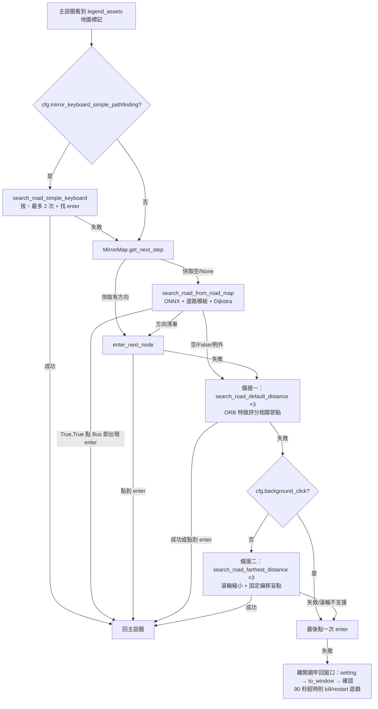
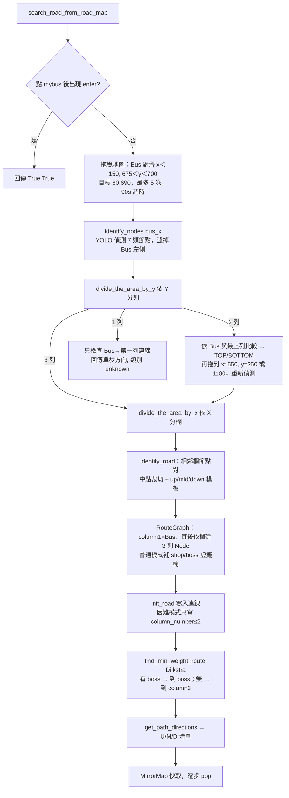
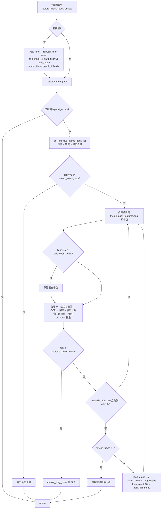
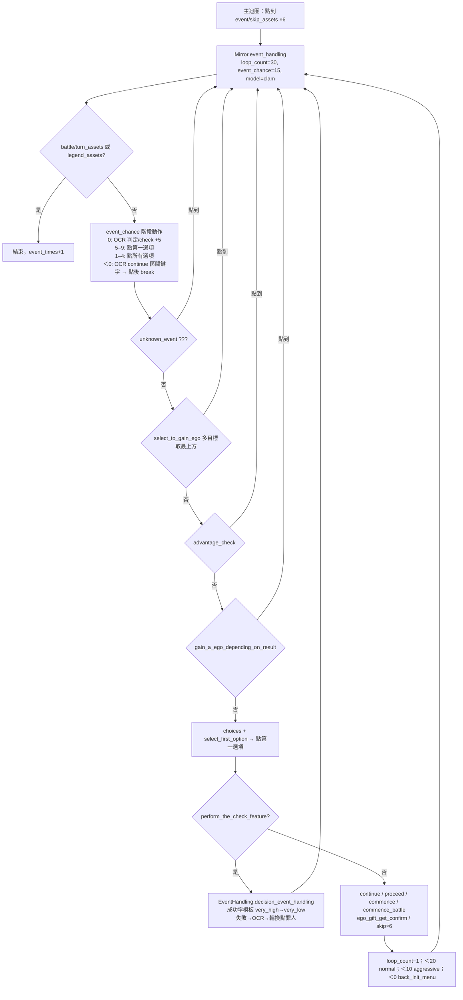

# 14 — 鏡牢自動導覽：地圖尋路、主題包選擇與事件處理

> 來源：AALC @ `b0f439321987f5f7b126ebbc424f6ef144c1bff0`。所有座標以 2560×1440 為基準（程式以 `cfg.set_win_size / 1440` 縮放，2560×1440 時 scale = 1）。
> 上層主迴圈見 [10-mirror-dungeon-overview.md](10-mirror-dungeon-overview.md)；辨識原語（`find_element` 的 `clam`/`normal`/`aggressive`、ORB 特徵比對、OCR）見 [02-recognition-and-input.md](02-recognition-and-input.md)。

## 1. 目的

本章說明 AALC 在鏡牢（Mirror Dungeon）裡，從「看到地圖」到「走進下一個節點」的整條路，以及兩個與地圖緊密相連的畫面：

1. **地圖尋路**（[tasks/mirror/search_road.py](https://github.com/KIYI671/AhabAssistantLimbusCompany/blob/b0f439321987f5f7b126ebbc424f6ef144c1bff0/tasks/mirror/search_road.py)，879 行）：用 YOLO ONNX 模型偵測節點，用方向模板確認道路，建立三列路線圖（`RouteGraph`），再用 Dijkstra 求最小權重路徑。失敗時改走兩套純模板的備援方法。
2. **主題包選擇**（[tasks/mirror/select_theme_pack.py](https://github.com/KIYI671/AhabAssistantLimbusCompany/blob/b0f439321987f5f7b126ebbc424f6ef144c1bff0/tasks/mirror/select_theme_pack.py)，165 行）：每層開始前，用 OCR 辨識卡包名稱，再查 YAML 權重表選卡包。
3. **事件處理**（[tasks/mirror/mirror.py:L1213-L1341](https://github.com/KIYI671/AhabAssistantLimbusCompany/blob/b0f439321987f5f7b126ebbc424f6ef144c1bff0/tasks/mirror/mirror.py#L1213-L1341) + [tasks/event/event_handling.py](https://github.com/KIYI671/AhabAssistantLimbusCompany/blob/b0f439321987f5f7b126ebbc424f6ef144c1bff0/tasks/event/event_handling.py)，165 行）：依固定優先序點選事件選項，並在需要判定時，挑成功率最高的罪人。

## 2. 在主迴圈中的位置

主迴圈 `Mirror.run`（詳見 10）每輪會比對畫面，與本章相關的分支如下：

| 觸發畫面 | 動作 | 引用 |
|---|---|---|
| `mirror/theme_pack/feature_theme_pack_assets.png`（卡包頁） | 在新樓層時：`get_floor` → `refresh_floor(reset=True)` → `switch_theme_pack_difficulty` → `select_theme_pack` | [tasks/mirror/mirror.py:L282-L305](https://github.com/KIYI671/AhabAssistantLimbusCompany/blob/b0f439321987f5f7b126ebbc424f6ef144c1bff0/tasks/mirror/mirror.py#L282-L305) |
| `mirror/road_in_mir/event_effect_button.png`（少見的增益選擇） | 點按鈕後確認 | [tasks/mirror/mirror.py:L313-L316](https://github.com/KIYI671/AhabAssistantLimbusCompany/blob/b0f439321987f5f7b126ebbc424f6ef144c1bff0/tasks/mirror/mirror.py#L313-L316) |
| `mirror/road_in_mir/legend_assets.png`（地圖畫面標記） | 排除 E.G.O 確認、編隊、商店、結算畫面後，呼叫 `self.search_road()` | [tasks/mirror/mirror.py:L318-L349](https://github.com/KIYI671/AhabAssistantLimbusCompany/blob/b0f439321987f5f7b126ebbc424f6ef144c1bff0/tasks/mirror/mirror.py#L318-L349) |
| `mirror/road_in_mir/enter_assets.png`（節點「進入」鈕殘留） | 直接點擊 | [tasks/mirror/mirror.py:L351-L353](https://github.com/KIYI671/AhabAssistantLimbusCompany/blob/b0f439321987f5f7b126ebbc424f6ef144c1bff0/tasks/mirror/mirror.py#L351-L353) |
| `event/skip_assets.png`（事件畫面） | 連點 skip 6 次後呼叫 `self.event_handling()` | [tasks/mirror/mirror.py:L455-L458](https://github.com/KIYI671/AhabAssistantLimbusCompany/blob/b0f439321987f5f7b126ebbc424f6ef144c1bff0/tasks/mirror/mirror.py#L455-L458) |

地圖節點與後續畫面的對應方式是「進入後由主迴圈辨識畫面」。節點類型不會傳給後續處理器：

- 事件節點進入後出現 skip 畫面，交給 `event_handling`。
- 戰鬥節點交給 `battle.fight`（見 [12-md-battle.md](12-md-battle.md)）。
- 商店節點出現 `shop_coins_assets`，交給 `in_shop`（見 [13-md-ego-gifts.md](13-md-ego-gifts.md)）。

`search_road_from_road_map` 雖然回傳節點類別清單 `road_class_list`，但只寫進 log，以及 `MirrorMap.map` 這個沒有讀取者的字典（[tasks/mirror/search_road.py:L46](https://github.com/KIYI671/AhabAssistantLimbusCompany/blob/b0f439321987f5f7b126ebbc424f6ef144c1bff0/tasks/mirror/search_road.py#L46-L46)；整個 repo 沒有任何地方讀取 `mirror_map.map`）。

## 3. 地圖尋路

### 3.1 總流程（`Mirror.search_road`）

引用：[tasks/mirror/mirror.py:L1109-L1183](https://github.com/KIYI671/AhabAssistantLimbusCompany/blob/b0f439321987f5f7b126ebbc424f6ef144c1bff0/tasks/mirror/mirror.py#L1109-L1183)。

- ONNX 路徑外包一層 `try/except`。任何例外（例如 `identify_nodes` 回 `None` 後 `sorted(None)` 拋出 `TypeError`）只會寫一行 debug log，然後進入備援（[tasks/mirror/mirror.py:L1116-L1127](https://github.com/KIYI671/AhabAssistantLimbusCompany/blob/b0f439321987f5f7b126ebbc424f6ef144c1bff0/tasks/mirror/mirror.py#L1116-L1127)）。
- 備援二在 `cfg.background_click` 為真時以 `continue` 整段跳過（[tasks/mirror/mirror.py:L1138-L1147](https://github.com/KIYI671/AhabAssistantLimbusCompany/blob/b0f439321987f5f7b126ebbc424f6ef144c1bff0/tasks/mirror/mirror.py#L1138-L1147)）。原因推測是後台點擊不支援滾輪。
- 若 `auto.mouse_scroll()` 回 False，會拋出 `InputAttributeError`，直接跳到「重進鏡牢」流程（[tasks/mirror/search_road.py:L251-L252](https://github.com/KIYI671/AhabAssistantLimbusCompany/blob/b0f439321987f5f7b126ebbc424f6ef144c1bff0/tasks/mirror/search_road.py#L251-L252)、[tasks/mirror/mirror.py:L1148-L1153](https://github.com/KIYI671/AhabAssistantLimbusCompany/blob/b0f439321987f5f7b126ebbc424f6ef144c1bff0/tasks/mirror/mirror.py#L1148-L1153)）。

### 3.2 節點選擇管線（ONNX 路線圖法）

#### 步驟 1：Bus 對齊（第一次拖曳）

1. 先試直接點 Bus（`mirror/mybus_default_distance.png`）。如果 0.75 秒後出現 `enter_assets`，代表 Bus 所在的節點還沒進入（例如中途續關），此時回傳 `(True, True)`，`get_next_step` 也回 True（[tasks/mirror/search_road.py:L282-L285](https://github.com/KIYI671/AhabAssistantLimbusCompany/blob/b0f439321987f5f7b126ebbc424f6ef144c1bff0/tasks/mirror/search_road.py#L282-L285)、[tasks/mirror/search_road.py:L39-L40](https://github.com/KIYI671/AhabAssistantLimbusCompany/blob/b0f439321987f5f7b126ebbc424f6ef144c1bff0/tasks/mirror/search_road.py#L39-L40)）。
2. 否則反覆用 `auto.mouse_drag(bus, dx, dy, drag_time=1.5)` 把 Bus 拖到 `(80, 690)·scale`。成功條件是 `675 < y < 700` 且 `x < 150`，最多 5 次。每輪都會呼叫 `check_times(start_time)`，預設超過 90 秒就 kill 並重啟遊戲、`back_init_menu()`，並回傳 `(False, [])`（[tasks/mirror/search_road.py:L287-L314](https://github.com/KIYI671/AhabAssistantLimbusCompany/blob/b0f439321987f5f7b126ebbc424f6ef144c1bff0/tasks/mirror/search_road.py#L287-L314)、[tasks/base/retry.py:L123-L135](https://github.com/KIYI671/AhabAssistantLimbusCompany/blob/b0f439321987f5f7b126ebbc424f6ef144c1bff0/tasks/base/retry.py#L123-L135)）。
3. 用 `auto.find_element(...) or bus` 取得 `bus_pos`。注意這一步不重新截圖，沿用上一張畫面（[tasks/mirror/search_road.py:L316](https://github.com/KIYI671/AhabAssistantLimbusCompany/blob/b0f439321987f5f7b126ebbc424f6ef144c1bff0/tasks/mirror/search_road.py#L316-L316)）。

#### 步驟 2：ONNX 節點偵測（`identify_nodes`）

[tasks/mirror/search_road.py:L404-L477](https://github.com/KIYI671/AhabAssistantLimbusCompany/blob/b0f439321987f5f7b126ebbc424f6ef144c1bff0/tasks/mirror/search_road.py#L404-L477)

1. 用 `auto.take_screenshot(gray=False)` 取得彩色截圖。GDI 後端以 `"BGRX"` raw mode 建立 PIL 影像，結果是 RGB（[module/automation/screenshot.py:L110-L116](https://github.com/KIYI671/AhabAssistantLimbusCompany/blob/b0f439321987f5f7b126ebbc424f6ef144c1bff0/module/automation/screenshot.py#L110-L116)）。之後取 `[:, :, :3]` 去掉 alpha。
2. **每次呼叫都新建** `ort.InferenceSession("./assets/model/best.onnx")`，沒有快取（[tasks/mirror/search_road.py:L423](https://github.com/KIYI671/AhabAssistantLimbusCompany/blob/b0f439321987f5f7b126ebbc424f6ef144c1bff0/tasks/mirror/search_road.py#L423-L423)）。
3. 前處理：letterbox 等比例縮放到 960×544，灰邊值 114，置中填充，再用 `blobFromImage(scalefactor=1/255, swapRB=False)` 轉成 NCHW（[tasks/mirror/search_road.py:L425-L440](https://github.com/KIYI671/AhabAssistantLimbusCompany/blob/b0f439321987f5f7b126ebbc424f6ef144c1bff0/tasks/mirror/search_road.py#L425-L440)）。以 2560×1440 為例：`image_scale = min(960/2560, 544/1440) = 0.375`，縮成 960×540，`pad_y = 2`。
4. 後處理：輸出 `[1, 11, 10710]` 轉置成 `(10710, 11)`。每列前 4 個值是 `cx, cy, w, h`，後 7 個是類別分數。取最大分數，低於 0.4 就丟棄（[tasks/mirror/search_road.py:L442-L454](https://github.com/KIYI671/AhabAssistantLimbusCompany/blob/b0f439321987f5f7b126ebbc424f6ef144c1bff0/tasks/mirror/search_road.py#L442-L454)）。
5. NMS 用 `cv2.dnn.NMSBoxes(boxes, scores, 0.4, 0.4, 0.5)`，也就是 score 0.4、IoU 0.4、**eta 0.5**（自適應 NMS 會逐步降低 IoU 門檻）。NMS 不分類別（[tasks/mirror/search_road.py:L456-L464](https://github.com/KIYI671/AhabAssistantLimbusCompany/blob/b0f439321987f5f7b126ebbc424f6ef144c1bff0/tasks/mirror/search_road.py#L456-L464)）。
6. 座標還原：中心點減去 pad 再除以 scale。只保留 `center_x >= bus_x + 520·scale/2` 的節點，也就是 Bus 右側超過半欄距的節點。輸出 `[[class_name, (cx, cy)], ...]`（[tasks/mirror/search_road.py:L466-L477](https://github.com/KIYI671/AhabAssistantLimbusCompany/blob/b0f439321987f5f7b126ebbc424f6ef144c1bff0/tasks/mirror/search_road.py#L466-L477)）。

**ONNX 細節表**

| 項目 | 值 | 來源 |
|---|---|---|
| 檔案 | [assets/model/best.onnx](https://github.com/KIYI671/AhabAssistantLimbusCompany/blob/b0f439321987f5f7b126ebbc424f6ef144c1bff0/assets/model/best.onnx)（約 9.8 MB） | — |
| 模型 | Ultralytics **YOLO26n** detect，Ultralytics 8.4.116，匯出時間 2026-08-15，opset 17，`nms: False`，`end2end: False` | 以 `onnx.load` 讀 metadata_props |
| 授權 | metadata 宣告 AGPL-3.0（Ultralytics） | metadata |
| 輸入 | `images` `[1, 3, 544, 960]` float，RGB，0–1 | metadata + [tasks/mirror/search_road.py:L408-L409](https://github.com/KIYI671/AhabAssistantLimbusCompany/blob/b0f439321987f5f7b126ebbc424f6ef144c1bff0/tasks/mirror/search_road.py#L408-L409) |
| 輸出 | `output0` `[1, 11, 10710]`：4 個 box 值 + 7 個類別；10710 = 68×120 + 34×60 + 17×30（stride 8/16/32） | metadata |
| 類別（模型內名稱 → 程式名稱） | 0 battle→`battle`；1 boss→`boss_battle`；2 event→`event`；3 focused→`focused_encounter`；4 risky→`risky_encounter`；5 shop→`shop`；6 abnormality→`abnormality_focused_encounter` | metadata `names` + [tasks/mirror/search_road.py:L411-L419](https://github.com/KIYI671/AhabAssistantLimbusCompany/blob/b0f439321987f5f7b126ebbc424f6ef144c1bff0/tasks/mirror/search_road.py#L411-L419) |
| 前處理 | letterbox，填充 114，置中 | [tasks/mirror/search_road.py:L425-L440](https://github.com/KIYI671/AhabAssistantLimbusCompany/blob/b0f439321987f5f7b126ebbc424f6ef144c1bff0/tasks/mirror/search_road.py#L425-L440) |
| conf 門檻 | 0.4 | [tasks/mirror/search_road.py:L410](https://github.com/KIYI671/AhabAssistantLimbusCompany/blob/b0f439321987f5f7b126ebbc424f6ef144c1bff0/tasks/mirror/search_road.py#L410-L410) |
| NMS | score 0.4 / IoU 0.4 / eta 0.5，不分類別 | [tasks/mirror/search_road.py:L456-L462](https://github.com/KIYI671/AhabAssistantLimbusCompany/blob/b0f439321987f5f7b126ebbc424f6ef144c1bff0/tasks/mirror/search_road.py#L456-L462) |
| Bus | **不由模型偵測**，改用模板 `mirror/mybus_default_distance.png` | [tasks/mirror/search_road.py:L287](https://github.com/KIYI671/AhabAssistantLimbusCompany/blob/b0f439321987f5f7b126ebbc424f6ef144c1bff0/tasks/mirror/search_road.py#L287-L287) |
| 道路 | **不由模型偵測**，改用模板 `up/mid/down.png` | [tasks/mirror/search_road.py:L526-L531](https://github.com/KIYI671/AhabAssistantLimbusCompany/blob/b0f439321987f5f7b126ebbc424f6ef144c1bff0/tasks/mirror/search_road.py#L526-L531) |
| Session | 每次呼叫重新載入，執行器預設（CPU） | [tasks/mirror/search_road.py:L423](https://github.com/KIYI671/AhabAssistantLimbusCompany/blob/b0f439321987f5f7b126ebbc424f6ef144c1bff0/tasks/mirror/search_road.py#L423-L423) |

#### 步驟 3：分列、判斷 Bus 所在列、第二次拖曳

- `divide_the_area_by_y`：依 Y 排序後分組，Y 差 ≤ `437·scale/4`（約 109）的歸為同一組（[tasks/mirror/search_road.py:L547-L568](https://github.com/KIYI671/AhabAssistantLimbusCompany/blob/b0f439321987f5f7b126ebbc424f6ef144c1bff0/tasks/mirror/search_road.py#L547-L568)）。
- **3 組**：`bus_row = Row.MID`，直接進入步驟 4。
- **2 組**：如果 `bus_y > 最上組第一個節點 y + 50`，判定 Bus 在 `BOTTOM`，把它拖到 y = 1100；否則判定在 `TOP`，拖到 y = 250。x 都拖到約 550，容差 ±50。拖完重新跑 `identify_nodes`，結果為空就回傳 `([], [])`（[tasks/mirror/search_road.py:L321-L372](https://github.com/KIYI671/AhabAssistantLimbusCompany/blob/b0f439321987f5f7b126ebbc424f6ef144c1bff0/tasks/mirror/search_road.py#L321-L372)）。
- **1 組**：只比對 Bus 到第一欄的連線。依 `row_delta` 回傳單步 `["U"|"M"|"D"]`，類別記為 `["unknown"]`；沒有連線就回傳 `([], [])`（[tasks/mirror/search_road.py:L328-L337](https://github.com/KIYI671/AhabAssistantLimbusCompany/blob/b0f439321987f5f7b126ebbc424f6ef144c1bff0/tasks/mirror/search_road.py#L328-L337)）。
- `_position_from_y`：`Row(bus_row.value + round((bus_y - y) / 437·scale))`。結果超出 ±1 的節點回傳 `None`，之後會被忽略（[tasks/mirror/search_road.py:L536-L544](https://github.com/KIYI671/AhabAssistantLimbusCompany/blob/b0f439321987f5f7b126ebbc424f6ef144c1bff0/tasks/mirror/search_road.py#L536-L544)）。

#### 步驟 4：道路（邊）偵測（`identify_road`）

[tasks/mirror/search_road.py:L480-L533](https://github.com/KIYI671/AhabAssistantLimbusCompany/blob/b0f439321987f5f7b126ebbc424f6ef144c1bff0/tasks/mirror/search_road.py#L480-L533)

- 來源欄 = `[[["bus", bus_position]], *nodes_column[:-1]]`，目標欄 = `nodes_column`。只檢查**相鄰欄**的節點對。
- 篩選條件：`|x_gap − 520·scale| ≤ 130·scale`。`row_delta = target_row − source_row` 只接受 1、0、−1，分別對應模板 `up`、`mid`、`down`。
- 在兩節點中點附近裁切 `520 × 437`（·scale）的區域，用 `find_element(f"mirror/road_in_mir/{template}.png", my_crop=crop, model="aggressive")` 比對。門檻是預設 0.8，`TM_CCOEFF_NORMED`。比對到就加入一條 `(column_number, source_row, target_row)`。
- 也就是說，邊是用**方向箭頭/線段模板**確認的，沒有做像素取樣。

#### 步驟 5：路線圖與權重

- `RouteGraph`：`columns["column1"]` 只放 Bus（權重 1）。之後每個 `nodes_column` 元素建立一欄，每欄固定有 TOP/MID/BOTTOM 三個 `Node`，空位權重為 `DEFAULT_WEIGHT = 999`（[tasks/mirror/search_road.py:L612-L679](https://github.com/KIYI671/AhabAssistantLimbusCompany/blob/b0f439321987f5f7b126ebbc424f6ef144c1bff0/tasks/mirror/search_road.py#L612-L679)）。
- **普通模式**的虛擬欄（[tasks/mirror/search_road.py:L680-L708](https://github.com/KIYI671/AhabAssistantLimbusCompany/blob/b0f439321987f5f7b126ebbc424f6ef144c1bff0/tasks/mirror/search_road.py#L680-L708)）：
  - 最後一欄沒有 `shop`/`boss_battle` 時，補一欄 MID=`shop`（權重 1），上一欄三列全部連過去。
  - 最後一欄沒有 `boss_battle` 時，再補一欄 MID=`boss_battle`（權重 1）。
  - 用途是讓畫面外的終點也能求出路徑。
- **困難模式**：不補虛擬欄。`init_road` 會丟掉 `column_number > 2` 的連線（[tasks/mirror/search_road.py:L710-L717](https://github.com/KIYI671/AhabAssistantLimbusCompany/blob/b0f439321987f5f7b126ebbc424f6ef144c1bff0/tasks/mirror/search_road.py#L710-L717)）。
- **節點權重**（越小越優先，Dijkstra 求最小總和；[tasks/mirror/search_road.py:L602-L610](https://github.com/KIYI671/AhabAssistantLimbusCompany/blob/b0f439321987f5f7b126ebbc424f6ef144c1bff0/tasks/mirror/search_road.py#L602-L610)）。權重是程式內常數，**沒有任何 config 可以調整**：

| 類別 | 權重 | 備援法 `get_node_weight`（越大越優先） |
|---|---|---|
| event | 1 | 3 |
| shop | 2 | 3（ORB 需 ≥ 50 個匹配點） |
| battle | 4 | 2 |
| boss_battle | 6 | （無模板） |
| focused_encounter | 6 | 0 |
| abnormality_focused_encounter | 6 | （無模板） |
| risky_encounter | 7 | 1 |
| 未辨識／空位 | 999 | −5（Bus 本身 −6） |

兩套評分的偏好一致：事件／商店 > 一般戰鬥 > 精英／集中遭遇。

#### 步驟 6：最短路徑與方向

- `find_min_weight_route`（[tasks/mirror/search_road.py:L728-L849](https://github.com/KIYI671/AhabAssistantLimbusCompany/blob/b0f439321987f5f7b126ebbc424f6ef144c1bff0/tasks/mirror/search_road.py#L728-L849)）：
  - 有 `boss_battle` 節點（偵測到的或虛擬的）時，用標準 Dijkstra，第一個彈出的 boss 就是答案。
  - 沒有 boss（只會發生在困難模式）時，把目標設為 `column{min(column_count, 3)}` 的任一節點，跑完整個 Dijkstra 取最小值。
- `get_path_directions`：比較相鄰兩個路徑節點的 `Row.value`，較大給 `U`、較小給 `D`、相同給 `M`（[tasks/mirror/search_road.py:L851-L879](https://github.com/KIYI671/AhabAssistantLimbusCompany/blob/b0f439321987f5f7b126ebbc424f6ef144c1bff0/tasks/mirror/search_road.py#L851-L879)）。

#### 步驟 7：執行一步（`MirrorMap`）

- `get_next_step`：從快取 `floor_map` 依序 pop。快取空了才重新辨識。換樓層時 `refresh_floor` 會清空快取（[tasks/mirror/search_road.py:L26-L52](https://github.com/KIYI671/AhabAssistantLimbusCompany/blob/b0f439321987f5f7b126ebbc424f6ef144c1bff0/tasks/mirror/search_road.py#L26-L52)、[tasks/mirror/search_road.py:L99-L105](https://github.com/KIYI671/AhabAssistantLimbusCompany/blob/b0f439321987f5f7b126ebbc424f6ef144c1bff0/tasks/mirror/search_road.py#L99-L105)）。**也就是說，一次辨識出的整條路線會在後續節點沿用，中途不會重新看地圖。**
- `enter_next_node`（[tasks/mirror/search_road.py:L54-L97](https://github.com/KIYI671/AhabAssistantLimbusCompany/blob/b0f439321987f5f7b126ebbc424f6ef144c1bff0/tasks/mirror/search_road.py#L54-L97)）：
  - 鍵盤模式（`cfg.mirror_keyboard_navigation`）：U/D/M 分別按 `up`/`down`/`right`，等 1 秒後找 `enter_assets`。
  - 滑鼠模式：重新找 Bus，點 `Bus + offset`。M = (+500, +50)，D = (+500, +450)，U = (+500, −400)，乘以 scale。等 1.25 秒後點 `enter_assets`。點不到就改點 Bus 本身，再找一次 enter。

### 3.3 備援一：預設縮放下評分相鄰節點（`search_road_default_distance`）

[tasks/mirror/search_road.py:L168-L244](https://github.com/KIYI671/AhabAssistantLimbusCompany/blob/b0f439321987f5f7b126ebbc424f6ef144c1bff0/tasks/mirror/search_road.py#L168-L244)

1. 找 Bus，對 M、D 兩個相鄰位置（同上述 offset）呼叫 `get_node_weight`：在節點中心 ±125 的範圍內，用 ORB+FLANN 特徵比對 `road_in_mir/{shop,event,battle,risky_encounter,focused_encounter}.png`。預設需 ≥ 8 個匹配點，shop 需 ≥ 50（[tasks/mirror/search_road.py:L108-L129](https://github.com/KIYI671/AhabAssistantLimbusCompany/blob/b0f439321987f5f7b126ebbc424f6ef144c1bff0/tasks/mirror/search_road.py#L108-L129)、[module/automation/automation.py:L657-L708](https://github.com/KIYI671/AhabAssistantLimbusCompany/blob/b0f439321987f5f7b126ebbc424f6ef144c1bff0/module/automation/automation.py#L657-L708)）。
2. 有權重 3（事件／商店）的位置就直接點它，再點 enter。
3. 沒有的話，垂直拖曳讓 Bus 落在 600 < y < 700（目標 650），一樣有 90 秒超時。接著補算 U 位置的權重，Bus 本身記 −6，依權重由大到小逐一點擊，直到出現 enter。M、D 沿用拖曳前算出的權重，用 `zip` 依順序對上。

### 3.4 備援二：縮小地圖盲點（`search_road_farthest_distance`）

[tasks/mirror/search_road.py:L248-L274](https://github.com/KIYI671/AhabAssistantLimbusCompany/blob/b0f439321987f5f7b126ebbc424f6ef144c1bff0/tasks/mirror/search_road.py#L248-L274)

點一下空白處後滾輪縮小，找 `mirror/mybus_maximum_distance.png`。依序點 Bus + (250, −200)、(250, 0)、(250, 225)（·scale），每點一次就找 enter；最後點 Bus 本身。這個方法完全不辨識節點類別。

### 3.5 鍵盤簡單模式（`search_road_simple_keyboard`）

需要同時開啟 `mirror_keyboard_navigation`。按 ↑ 最多 2 次，每次之後找 enter（[tasks/mirror/search_road.py:L143-L164](https://github.com/KIYI671/AhabAssistantLimbusCompany/blob/b0f439321987f5f7b126ebbc424f6ef144c1bff0/tasks/mirror/search_road.py#L143-L164)）。程式註解說明這是為了避開 Steam 環境下拖曳地圖導致卡死的問題。

## 4. 資料結構（對照 `镜牢寻路数据格式.md`）

| 結構 | 程式實際形狀 | 文件 [assets/doc/zh/镜牢寻路数据格式.md](https://github.com/KIYI671/AhabAssistantLimbusCompany/blob/b0f439321987f5f7b126ebbc424f6ef144c1bff0/assets/doc/zh/%E9%95%9C%E7%89%A2%E5%AF%BB%E8%B7%AF%E6%95%B0%E6%8D%AE%E6%A0%BC%E5%BC%8F.md) | 一致性 |
|---|---|---|---|
| ONNX 節點 | `[class_name: str, (cx: int, cy: int)]`（list 包 tuple）[tasks/mirror/search_road.py:L471-L476](https://github.com/KIYI671/AhabAssistantLimbusCompany/blob/b0f439321987f5f7b126ebbc424f6ef144c1bff0/tasks/mirror/search_road.py#L471-L476) | `[node_class, (center_x, center_y)]` [assets/doc/zh/镜牢寻路数据格式.md:L25-L49](https://github.com/KIYI671/AhabAssistantLimbusCompany/blob/b0f439321987f5f7b126ebbc424f6ef144c1bff0/assets/doc/zh/%E9%95%9C%E7%89%A2%E5%AF%BB%E8%B7%AF%E6%95%B0%E6%8D%AE%E6%A0%BC%E5%BC%8F.md#L25-L49) | 一致；7 類名稱一致 |
| `nodes_column` | `list[list[node]]`：外層依 X、內層依 Y 排序；`nodes_column[0]` = `column2` [tasks/mirror/search_road.py:L571-L599](https://github.com/KIYI671/AhabAssistantLimbusCompany/blob/b0f439321987f5f7b126ebbc424f6ef144c1bff0/tasks/mirror/search_road.py#L571-L599)、[tasks/mirror/search_road.py:L666-L678](https://github.com/KIYI671/AhabAssistantLimbusCompany/blob/b0f439321987f5f7b126ebbc424f6ef144c1bff0/tasks/mirror/search_road.py#L666-L678) | [assets/doc/zh/镜牢寻路数据格式.md:L5-L23](https://github.com/KIYI671/AhabAssistantLimbusCompany/blob/b0f439321987f5f7b126ebbc424f6ef144c1bff0/assets/doc/zh/%E9%95%9C%E7%89%A2%E5%AF%BB%E8%B7%AF%E6%95%B0%E6%8D%AE%E6%A0%BC%E5%BC%8F.md#L5-L23) | 結構一致。**範例座標與 1440 標定不符**：欄距 845−459 = 386、列距約 325。在 `set_win_size=1440` 下（容差 390–650），`identify_road` 會跳過這組欄對；數字只符合 1080p（520·0.75 = 390、437·0.75 ≈ 328）。文件沒有註明這個範例的解析度 |
| `divide_the_area_by_x` | 容差 `520·scale/4`，組內依 Y 排序 [tasks/mirror/search_road.py:L571-L599](https://github.com/KIYI671/AhabAssistantLimbusCompany/blob/b0f439321987f5f7b126ebbc424f6ef144c1bff0/tasks/mirror/search_road.py#L571-L599) | [assets/doc/zh/镜牢寻路数据格式.md:L51-L75](https://github.com/KIYI671/AhabAssistantLimbusCompany/blob/b0f439321987f5f7b126ebbc424f6ef144c1bff0/assets/doc/zh/%E9%95%9C%E7%89%A2%E5%AF%BB%E8%B7%AF%E6%95%B0%E6%8D%AE%E6%A0%BC%E5%BC%8F.md#L51-L75)（明示 1440） | 範例輸出與程式一致（450/460 同組、980 另組；組內 event(220) 排在 battle(700) 前） |
| 道路連線 | `(column_number: int, source: Row, target: Row)`，`column_number=1` 代表 Bus→column2 [tasks/mirror/search_road.py:L531](https://github.com/KIYI671/AhabAssistantLimbusCompany/blob/b0f439321987f5f7b126ebbc424f6ef144c1bff0/tasks/mirror/search_road.py#L531-L531) | [assets/doc/zh/镜牢寻路数据格式.md:L77-L102](https://github.com/KIYI671/AhabAssistantLimbusCompany/blob/b0f439321987f5f7b126ebbc424f6ef144c1bff0/assets/doc/zh/%E9%95%9C%E7%89%A2%E5%AF%BB%E8%B7%AF%E6%95%B0%E6%8D%AE%E6%A0%BC%E5%BC%8F.md#L77-L102) | 一致。範例 x_gap = 520、y_gap = 437，正好落在 1440 標定上 |
| `Row` | `TOP=1, MID=0, BOTTOM=-1` [tasks/mirror/search_road.py:L615-L618](https://github.com/KIYI671/AhabAssistantLimbusCompany/blob/b0f439321987f5f7b126ebbc424f6ef144c1bff0/tasks/mirror/search_road.py#L615-L618) | [assets/doc/zh/镜牢寻路数据格式.md:L79](https://github.com/KIYI671/AhabAssistantLimbusCompany/blob/b0f439321987f5f7b126ebbc424f6ef144c1bff0/assets/doc/zh/%E9%95%9C%E7%89%A2%E5%AF%BB%E8%B7%AF%E6%95%B0%E6%8D%AE%E6%A0%BC%E5%BC%8F.md#L79-L79) | 一致 |
| `init_road` | 回傳 None，`source.add_next_node(target)` 會去重；困難模式略過 `column_number > 2` [tasks/mirror/search_road.py:L710-L717](https://github.com/KIYI671/AhabAssistantLimbusCompany/blob/b0f439321987f5f7b126ebbc424f6ef144c1bff0/tasks/mirror/search_road.py#L710-L717) | [assets/doc/zh/镜牢寻路数据格式.md:L104-L122](https://github.com/KIYI671/AhabAssistantLimbusCompany/blob/b0f439321987f5f7b126ebbc424f6ef144c1bff0/assets/doc/zh/%E9%95%9C%E7%89%A2%E5%AF%BB%E8%B7%AF%E6%95%B0%E6%8D%AE%E6%A0%BC%E5%BC%8F.md#L104-L122)「困牢只写入前两列连接」 | 一致（寫入 column1→2 和 column2→3 兩層） |
| `RouteGraph.columns` | `{"column{n}": {Row: Node}}`；`Node(node_class, weight, next_nodes)` [tasks/mirror/search_road.py:L621-L659](https://github.com/KIYI671/AhabAssistantLimbusCompany/blob/b0f439321987f5f7b126ebbc424f6ef144c1bff0/tasks/mirror/search_road.py#L621-L659) | 只提到 column1 = Bus | **文件缺漏**：沒有寫普通模式自動補的 shop/boss 虛擬欄、權重表、空位權重 999 |
| `search_road_from_road_map` 回傳值 | `(True, True)` / `(False, [])` / `([], [])` / `(["U"], ["unknown"])` / `(directions, class_list)`；`class_list` 開頭是 `"bus"` | 未記載 | **文件缺漏** |
| `divide_the_area_by_y`、`_position_from_y` | 見 3.2 步驟 3 | 未記載 | **文件缺漏** |

## 5. 主題包選擇

### 5.1 流程

### 5.2 步驟

1. **難度切換**：用 `mirror/theme_pack/normal_assets.png` 和 `hard_assets.png` 判斷目前難度。不符合目標就點目前難度的按鈕，等 2 秒後再判斷一次並寫 log（[tasks/mirror/select_theme_pack.py:L11-L31](https://github.com/KIYI671/AhabAssistantLimbusCompany/blob/b0f439321987f5f7b126ebbc424f6ef144c1bff0/tasks/mirror/select_theme_pack.py#L11-L31)）。`hard_mode` 來自隊伍設定 `normal_to_hard_floor`：當樓層 ≥ 該值時切成困難（[tasks/mirror/mirror.py:L135-L140](https://github.com/KIYI671/AhabAssistantLimbusCompany/blob/b0f439321987f5f7b126ebbc424f6ef144c1bff0/tasks/mirror/mirror.py#L135-L140)），並同步給 `MirrorMap.hard_mode`，進而影響路線圖。
2. **權重表**：`get_effective_theme_pack_list` 的組成規則如下（[module/config/config.py:L667-L764](https://github.com/KIYI671/AhabAssistantLimbusCompany/blob/b0f439321987f5f7b126ebbc424f6ef144c1bff0/module/config/config.py#L667-L764)）：
   - 普通模式只用 `theme_pack_list[_cn]`。
   - 困難模式是 `theme_pack_list[_cn]` 加上 `theme_pack_list_hard[_cn]`，困難表覆蓋同名 key。
   - 如果隊伍勾選 `use_custom_theme_pack_weight`，改讀 `theme_pack_weight/theme_pack_weight_team_{N}.yaml`。
   - 語言未知時，中英兩套表都載入（[tasks/mirror/select_theme_pack.py:L40-L56](https://github.com/KIYI671/AhabAssistantLimbusCompany/blob/b0f439321987f5f7b126ebbc424f6ef144c1bff0/tasks/mirror/select_theme_pack.py#L40-L56)）。
3. **找卡包**：`theme_pack_features.png`（62×64 小模板，全畫面搜尋）用多目標比對找出每張卡的錨點（[tasks/mirror/select_theme_pack.py:L82-L86](https://github.com/KIYI671/AhabAssistantLimbusCompany/blob/b0f439321987f5f7b126ebbc424f6ef144c1bff0/tasks/mirror/select_theme_pack.py#L82-L86)）。
4. **名稱辨識 = OCR**，不是模板。每張卡裁切 `(x−210, y−60)–(x+60, y+390)`，乘以 `set_win_size/1080`（2560×1440 下約為 x−280…x+80、y−80…y+520），再呼叫 `auto.find_language_text(zh_dict, en_dict, crop)`（[tasks/mirror/select_theme_pack.py:L90-L109](https://github.com/KIYI671/AhabAssistantLimbusCompany/blob/b0f439321987f5f7b126ebbc424f6ef144c1bff0/tasks/mirror/select_theme_pack.py#L90-L109)）。
   - 字典比對是**依 YAML 插入順序**，找第一個「key 是 OCR 文字的子字串」的項目（不分大小寫，也會在去除空格後再比一次）。命中就回傳 `TextMatchResult(value=權重, text=key)`（[module/automation/automation.py:L519-L531](https://github.com/KIYI671/AhabAssistantLimbusCompany/blob/b0f439321987f5f7b126ebbc424f6ef144c1bff0/module/automation/automation.py#L519-L531)、[module/automation/automation.py:L557-L577](https://github.com/KIYI671/AhabAssistantLimbusCompany/blob/b0f439321987f5f7b126ebbc424f6ef144c1bff0/module/automation/automation.py#L557-L577)）。
   - 因此 YAML 裡用的是截短的關鍵字（`forgot`、`nagel`、`遗忘`…），另外有 `nag`、`dev`、`凤皇` 這類 OCR 備用短片段。
   - 沒有命中時，用 `未知`/`unknown` 的權重，預設 −5（[tasks/mirror/select_theme_pack.py:L57-L58](https://github.com/KIYI671/AhabAssistantLimbusCompany/blob/b0f439321987f5f7b126ebbc424f6ef144c1bff0/tasks/mirror/select_theme_pack.py#L57-L58)）。
5. **選擇**：權重最大值 ≥ `preferred_thresholds`（範例預設 0）時，就用 `mouse_drag_down` 把那張卡往下拖（1080 基準 300 px，在 1440 等於 400 px）來選取（[tasks/mirror/select_theme_pack.py:L111-L123](https://github.com/KIYI671/AhabAssistantLimbusCompany/blob/b0f439321987f5f7b126ebbc424f6ef144c1bff0/tasks/mirror/select_theme_pack.py#L111-L123)、[module/automation/input_handlers/input.py:L181-L193](https://github.com/KIYI671/AhabAssistantLimbusCompany/blob/b0f439321987f5f7b126ebbc424f6ef144c1bff0/module/automation/input_handlers/input.py#L181-L193)）。
6. **刷新**：
   - 低於門檻時點 `refresh_assets.png`。`refresh_times` 初值為 3，條件是 `≥ 0`，所以最多刷新 4 次。
   - `refresh_times ≤ 0` 後就選目前權重最大的卡（[tasks/mirror/select_theme_pack.py:L129-L153](https://github.com/KIYI671/AhabAssistantLimbusCompany/blob/b0f439321987f5f7b126ebbc424f6ef144c1bff0/tasks/mirror/select_theme_pack.py#L129-L153)）。
   - 迴圈上限 `loop_count = 30`。低於 20 時模板模式改用 `normal`，低於 10 改用 `aggressive`，低於 0 則 `back_init_menu()`（[tasks/mirror/select_theme_pack.py:L155-L165](https://github.com/KIYI671/AhabAssistantLimbusCompany/blob/b0f439321987f5f7b126ebbc424f6ef144c1bff0/tasks/mirror/select_theme_pack.py#L155-L165)）。
7. **第 5 層活動卡包**：`select_event_pack` 直接拖最左邊的卡；`skip_event_pack` 把最左邊的卡從候選中移除（[tasks/mirror/select_theme_pack.py:L68-L89](https://github.com/KIYI671/AhabAssistantLimbusCompany/blob/b0f439321987f5f7b126ebbc424f6ef144c1bff0/tasks/mirror/select_theme_pack.py#L68-L89)）。
8. **沒有「每層不同權重」的設定**：權重只依語言、難度、隊伍區分。所謂的黑名單就是負權重（UI 有「全部設為負」按鈕），白名單就是高權重搭配 `preferred_thresholds`。

### 5.3 設定 UI 與匯入匯出

- [app/theme_pack_setting_interface.py](https://github.com/KIYI671/AhabAssistantLimbusCompany/blob/b0f439321987f5f7b126ebbc424f6ef144c1bff0/app/theme_pack_setting_interface.py)（1248 行）的 `ThemePackSettingDialog`：
  - 依介面語言載入 `theme_pack_list[_hard][_cn]`，以每行 5 張卡片顯示，封面圖取自 `assets/app/theme_packs/`（[app/theme_pack_setting_interface.py:L300-L313](https://github.com/KIYI671/AhabAssistantLimbusCompany/blob/b0f439321987f5f7b126ebbc424f6ef144c1bff0/app/theme_pack_setting_interface.py#L300-L313)、[app/theme_pack_setting_interface.py:L760-L817](https://github.com/KIYI671/AhabAssistantLimbusCompany/blob/b0f439321987f5f7b126ebbc424f6ef144c1bff0/app/theme_pack_setting_interface.py#L760-L817)）。
  - 改一邊語言的權重時，會透過 `THEME_PACK_NAME_MAP`/`CN_TO_EN_*` 同步更新另一語言的表，也會同步 `CN_OCR_ALTERNATIVES`/`EN_OCR_ALTERNATIVES` 的備用 key（[app/theme_pack_setting_interface.py:L830-L909](https://github.com/KIYI671/AhabAssistantLimbusCompany/blob/b0f439321987f5f7b126ebbc424f6ef144c1bff0/app/theme_pack_setting_interface.py#L830-L909)、[app/theme_pack_setting_interface.py:L156-L179](https://github.com/KIYI671/AhabAssistantLimbusCompany/blob/b0f439321987f5f7b126ebbc424f6ef144c1bff0/app/theme_pack_setting_interface.py#L156-L179)）。
  - 對話框可設定 `preferred_thresholds`，並提供「重設預設／套用全域／全部設負」（[app/theme_pack_setting_interface.py:L919-L993](https://github.com/KIYI671/AhabAssistantLimbusCompany/blob/b0f439321987f5f7b126ebbc424f6ef144c1bff0/app/theme_pack_setting_interface.py#L919-L993)）。
- 對話框有兩個入口：
  - 全域設定，寫回 `./theme_pack_list.yaml`（[app/setting_interface.py:L726-L733](https://github.com/KIYI671/AhabAssistantLimbusCompany/blob/b0f439321987f5f7b126ebbc424f6ef144c1bff0/app/setting_interface.py#L726-L733)）。
  - 隊伍設定，會先 `create_team_weight_config` 再編輯隊伍檔（[app/team_setting_card.py:L385-L399](https://github.com/KIYI671/AhabAssistantLimbusCompany/blob/b0f439321987f5f7b126ebbc424f6ef144c1bff0/app/team_setting_card.py#L385-L399)）。
- 預設路徑定義在 [module/__init__.py:L4-L6](https://github.com/KIYI671/AhabAssistantLimbusCompany/blob/b0f439321987f5f7b126ebbc424f6ef144c1bff0/module/__init__.py#L4-L6)：範例 `./assets/config/theme_pack_list.example.yaml`、使用者 `./theme_pack_list.yaml`、隊伍目錄 `./theme_pack_weight`。
- 啟動同步：以範例檔為關鍵字的唯一來源，**只保留使用者對既有關鍵字設定的權重**，已改名或刪除的舊 key 會被丟掉，避免殘留的短 key 搶走子字串比對（[module/config/config.py:L717-L743](https://github.com/KIYI671/AhabAssistantLimbusCompany/blob/b0f439321987f5f7b126ebbc424f6ef144c1bff0/module/config/config.py#L717-L743)、[module/config/config.py:L796-L815](https://github.com/KIYI671/AhabAssistantLimbusCompany/blob/b0f439321987f5f7b126ebbc424f6ef144c1bff0/module/config/config.py#L796-L815)）。
- [module/config/theme_pack_import_export.py](https://github.com/KIYI671/AhabAssistantLimbusCompany/blob/b0f439321987f5f7b126ebbc424f6ef144c1bff0/module/config/theme_pack_import_export.py)：
  - 以 YAML 檔或 Base64 配置碼匯出／匯入。
  - 匯入時對隊伍檔做 `_deep_merge_dicts`，**不經過**上述關鍵字過濾，所以匯入檔中的舊 key 會留到下次啟動同步才被清掉（[module/config/theme_pack_import_export.py:L52-L100](https://github.com/KIYI671/AhabAssistantLimbusCompany/blob/b0f439321987f5f7b126ebbc424f6ef144c1bff0/module/config/theme_pack_import_export.py#L52-L100)、[module/config/theme_pack_import_export.py:L148-L175](https://github.com/KIYI671/AhabAssistantLimbusCompany/blob/b0f439321987f5f7b126ebbc424f6ef144c1bff0/module/config/theme_pack_import_export.py#L148-L175)）。
- [tests/test_theme_pack_catalog.py](https://github.com/KIYI671/AhabAssistantLimbusCompany/blob/b0f439321987f5f7b126ebbc424f6ef144c1bff0/tests/test_theme_pack_catalog.py) 驗證以下規則：關鍵字互不遮蔽、中英權重一致、備用片段雙邊都有設定、封面檔存在。

**YAML 結構**（[assets/config/theme_pack_list.example.yaml](https://github.com/KIYI671/AhabAssistantLimbusCompany/blob/b0f439321987f5f7b126ebbc424f6ef144c1bff0/assets/config/theme_pack_list.example.yaml)，203 行）：

| key | 內容 | 行 |
|---|---|---|
| `preferred_thresholds` | 優選門檻，預設 0 | [assets/config/theme_pack_list.example.yaml:L2](https://github.com/KIYI671/AhabAssistantLimbusCompany/blob/b0f439321987f5f7b126ebbc424f6ef144c1bff0/assets/config/theme_pack_list.example.yaml#L2-L2) |
| `theme_pack_list` | 英文普通卡包關鍵字 → 權重（含 `unknown: -5`） | [assets/config/theme_pack_list.example.yaml:L4-L65](https://github.com/KIYI671/AhabAssistantLimbusCompany/blob/b0f439321987f5f7b126ebbc424f6ef144c1bff0/assets/config/theme_pack_list.example.yaml#L4-L65) |
| `theme_pack_list_hard` | 英文困難限定 | [assets/config/theme_pack_list.example.yaml:L67-L75](https://github.com/KIYI671/AhabAssistantLimbusCompany/blob/b0f439321987f5f7b126ebbc424f6ef144c1bff0/assets/config/theme_pack_list.example.yaml#L67-L75) |
| `theme_pack_list_cn` | 中文普通（含 `未知: -5`） | [assets/config/theme_pack_list.example.yaml:L107-L166](https://github.com/KIYI671/AhabAssistantLimbusCompany/blob/b0f439321987f5f7b126ebbc424f6ef144c1bff0/assets/config/theme_pack_list.example.yaml#L107-L166) |
| `theme_pack_list_hard_cn` | 中文困難限定 | [assets/config/theme_pack_list.example.yaml:L168-L203](https://github.com/KIYI671/AhabAssistantLimbusCompany/blob/b0f439321987f5f7b126ebbc424f6ef144c1bff0/assets/config/theme_pack_list.example.yaml#L168-L203) |

### 5.4 主題包封面（`assets/app/theme_packs`，87 檔，僅供 UI 顯示）

共 87 檔，由 `get_image_path` 以 `THEME_PACK_*_IMAGE_MAP` 對應關鍵字（[app/theme_pack_setting_interface.py:L182-L313](https://github.com/KIYI671/AhabAssistantLimbusCompany/blob/b0f439321987f5f7b126ebbc424f6ef144c1bff0/app/theme_pack_setting_interface.py#L182-L313)）。執行期選卡**不使用**這些圖，只用 OCR。

| # | 檔案 | # | 檔案 | # | 檔案 |
|---|---|---|---|---|---|
| 1 | [A Certain World.png](https://github.com/KIYI671/AhabAssistantLimbusCompany/blob/b0f439321987f5f7b126ebbc424f6ef144c1bff0/assets/app/theme_packs/A%20Certain%20World.png) | 2 | [Abnormal Seismi Zone.png](https://github.com/KIYI671/AhabAssistantLimbusCompany/blob/b0f439321987f5f7b126ebbc424f6ef144c1bff0/assets/app/theme_packs/Abnormal%20Seismi%20Zone.png) | 3 | [Addicting Lust.png](https://github.com/KIYI671/AhabAssistantLimbusCompany/blob/b0f439321987f5f7b126ebbc424f6ef144c1bff0/assets/app/theme_packs/Addicting%20Lust.png) |
| 4 | [ASEA.png](https://github.com/KIYI671/AhabAssistantLimbusCompany/blob/b0f439321987f5f7b126ebbc424f6ef144c1bff0/assets/app/theme_packs/ASEA.png) | 5 | [Automated Factory.png](https://github.com/KIYI671/AhabAssistantLimbusCompany/blob/b0f439321987f5f7b126ebbc424f6ef144c1bff0/assets/app/theme_packs/Automated%20Factory.png) | 6 | [Blade and Artwork.png](https://github.com/KIYI671/AhabAssistantLimbusCompany/blob/b0f439321987f5f7b126ebbc424f6ef144c1bff0/assets/app/theme_packs/Blade%20and%20Artwork.png) |
| 7 | [Burning Haze.png](https://github.com/KIYI671/AhabAssistantLimbusCompany/blob/b0f439321987f5f7b126ebbc424f6ef144c1bff0/assets/app/theme_packs/Burning%20Haze.png) | 8 | [Charm,Wander,Doubt.png](https://github.com/KIYI671/AhabAssistantLimbusCompany/blob/b0f439321987f5f7b126ebbc424f6ef144c1bff0/assets/app/theme_packs/Charm%2CWander%2CDoubt.png) | 9 | [Crawling Abyss.png](https://github.com/KIYI671/AhabAssistantLimbusCompany/blob/b0f439321987f5f7b126ebbc424f6ef144c1bff0/assets/app/theme_packs/Crawling%20Abyss.png) |
| 10 | [Crushers & Breakers.png](https://github.com/KIYI671/AhabAssistantLimbusCompany/blob/b0f439321987f5f7b126ebbc424f6ef144c1bff0/assets/app/theme_packs/Crushers%20%26%20Breakers.png) | 11 | [Crushing External Force.png](https://github.com/KIYI671/AhabAssistantLimbusCompany/blob/b0f439321987f5f7b126ebbc424f6ef144c1bff0/assets/app/theme_packs/Crushing%20External%20Force.png) | 12 | [Deep Sigh.png](https://github.com/KIYI671/AhabAssistantLimbusCompany/blob/b0f439321987f5f7b126ebbc424f6ef144c1bff0/assets/app/theme_packs/Deep%20Sigh.png) |
| 13 | [Degraded Gloom.png](https://github.com/KIYI671/AhabAssistantLimbusCompany/blob/b0f439321987f5f7b126ebbc424f6ef144c1bff0/assets/app/theme_packs/Degraded%20Gloom.png) | 14 | [Devoured Gluttony.png](https://github.com/KIYI671/AhabAssistantLimbusCompany/blob/b0f439321987f5f7b126ebbc424f6ef144c1bff0/assets/app/theme_packs/Devoured%20Gluttony.png) | 15 | [Dizzying Waves.png](https://github.com/KIYI671/AhabAssistantLimbusCompany/blob/b0f439321987f5f7b126ebbc424f6ef144c1bff0/assets/app/theme_packs/Dizzying%20Waves.png) |
| 16 | [Dregs of the Manor.png](https://github.com/KIYI671/AhabAssistantLimbusCompany/blob/b0f439321987f5f7b126ebbc424f6ef144c1bff0/assets/app/theme_packs/Dregs%20of%20the%20Manor.png) | 17 | [Emotional Craving.png](https://github.com/KIYI671/AhabAssistantLimbusCompany/blob/b0f439321987f5f7b126ebbc424f6ef144c1bff0/assets/app/theme_packs/Emotional%20Craving.png) | 18 | [Emotional Flood.png](https://github.com/KIYI671/AhabAssistantLimbusCompany/blob/b0f439321987f5f7b126ebbc424f6ef144c1bff0/assets/app/theme_packs/Emotional%20Flood.png) |
| 19 | [Emotional Indolence.png](https://github.com/KIYI671/AhabAssistantLimbusCompany/blob/b0f439321987f5f7b126ebbc424f6ef144c1bff0/assets/app/theme_packs/Emotional%20Indolence.png) | 20 | [Emotional Judgment.png](https://github.com/KIYI671/AhabAssistantLimbusCompany/blob/b0f439321987f5f7b126ebbc424f6ef144c1bff0/assets/app/theme_packs/Emotional%20Judgment.png) | 21 | [Emotional Repression.png](https://github.com/KIYI671/AhabAssistantLimbusCompany/blob/b0f439321987f5f7b126ebbc424f6ef144c1bff0/assets/app/theme_packs/Emotional%20Repression.png) |
| 22 | [Emotional Seduction.png](https://github.com/KIYI671/AhabAssistantLimbusCompany/blob/b0f439321987f5f7b126ebbc424f6ef144c1bff0/assets/app/theme_packs/Emotional%20Seduction.png) | 23 | [Emotional Subservience.png](https://github.com/KIYI671/AhabAssistantLimbusCompany/blob/b0f439321987f5f7b126ebbc424f6ef144c1bff0/assets/app/theme_packs/Emotional%20Subservience.png) | 24 | [Excessive Gluttong.png](https://github.com/KIYI671/AhabAssistantLimbusCompany/blob/b0f439321987f5f7b126ebbc424f6ef144c1bff0/assets/app/theme_packs/Excessive%20Gluttong.png) |
| 25 | [Experience Memory.png](https://github.com/KIYI671/AhabAssistantLimbusCompany/blob/b0f439321987f5f7b126ebbc424f6ef144c1bff0/assets/app/theme_packs/Experience%20Memory.png) | 26 | [Faith & Erosion.png](https://github.com/KIYI671/AhabAssistantLimbusCompany/blob/b0f439321987f5f7b126ebbc424f6ef144c1bff0/assets/app/theme_packs/Faith%20%26%20Erosion.png) | 27 | [Falling Flowers.png](https://github.com/KIYI671/AhabAssistantLimbusCompany/blob/b0f439321987f5f7b126ebbc424f6ef144c1bff0/assets/app/theme_packs/Falling%20Flowers.png) |
| 28 | [Flat-broke Gamblers.png](https://github.com/KIYI671/AhabAssistantLimbusCompany/blob/b0f439321987f5f7b126ebbc424f6ef144c1bff0/assets/app/theme_packs/Flat-broke%20Gamblers.png) | 29 | [Four Houses and Greed.png](https://github.com/KIYI671/AhabAssistantLimbusCompany/blob/b0f439321987f5f7b126ebbc424f6ef144c1bff0/assets/app/theme_packs/Four%20Houses%20and%20Greed.png) | 30 | [Full-Stopped by a Bullet.png](https://github.com/KIYI671/AhabAssistantLimbusCompany/blob/b0f439321987f5f7b126ebbc424f6ef144c1bff0/assets/app/theme_packs/Full-Stopped%20by%20a%20Bullet.png) |
| 31 | [Hatred and Despair.png](https://github.com/KIYI671/AhabAssistantLimbusCompany/blob/b0f439321987f5f7b126ebbc424f6ef144c1bff0/assets/app/theme_packs/Hatred%20and%20Despair.png) | 32 | [Hell's Chicken.png](https://github.com/KIYI671/AhabAssistantLimbusCompany/blob/b0f439321987f5f7b126ebbc424f6ef144c1bff0/assets/app/theme_packs/Hell%27s%20Chicken.png) | 33 | [Inert Sloth.png](https://github.com/KIYI671/AhabAssistantLimbusCompany/blob/b0f439321987f5f7b126ebbc424f6ef144c1bff0/assets/app/theme_packs/Inert%20Sloth.png) |
| 34 | [Insignificant Envy.png](https://github.com/KIYI671/AhabAssistantLimbusCompany/blob/b0f439321987f5f7b126ebbc424f6ef144c1bff0/assets/app/theme_packs/Insignificant%20Envy.png) | 35 | [La Manchaland Reopening.png](https://github.com/KIYI671/AhabAssistantLimbusCompany/blob/b0f439321987f5f7b126ebbc424f6ef144c1bff0/assets/app/theme_packs/La%20Manchaland%20Reopening.png) | 36 | [Lake World.png](https://github.com/KIYI671/AhabAssistantLimbusCompany/blob/b0f439321987f5f7b126ebbc424f6ef144c1bff0/assets/app/theme_packs/Lake%20World.png) |
| 37 | [LCB Regular Checkup BokGak.png](https://github.com/KIYI671/AhabAssistantLimbusCompany/blob/b0f439321987f5f7b126ebbc424f6ef144c1bff0/assets/app/theme_packs/LCB%20Regular%20Checkup%20BokGak.png) | 38 | [Line 1.png](https://github.com/KIYI671/AhabAssistantLimbusCompany/blob/b0f439321987f5f7b126ebbc424f6ef144c1bff0/assets/app/theme_packs/Line%201.png) | 39 | [Marder on.the WARP Express BokGak.png](https://github.com/KIYI671/AhabAssistantLimbusCompany/blob/b0f439321987f5f7b126ebbc424f6ef144c1bff0/assets/app/theme_packs/Marder%20on.the%20WARP%20Express%20BokGak.png) |
| 40 | [Miracle in District 20 BokGak.png](https://github.com/KIYI671/AhabAssistantLimbusCompany/blob/b0f439321987f5f7b126ebbc424f6ef144c1bff0/assets/app/theme_packs/Miracle%20in%20District%2020%20BokGak.png) | 41 | [Mountain of Corpses, Sea of Blood.png](https://github.com/KIYI671/AhabAssistantLimbusCompany/blob/b0f439321987f5f7b126ebbc424f6ef144c1bff0/assets/app/theme_packs/Mountain%20of%20Corpses%2C%20Sea%20of%20Blood.png) | 42 | [Nagel and Hammer.png](https://github.com/KIYI671/AhabAssistantLimbusCompany/blob/b0f439321987f5f7b126ebbc424f6ef144c1bff0/assets/app/theme_packs/Nagel%20and%20Hammer.png) |
| 43 | [Nest, Workshop, and Technology.png](https://github.com/KIYI671/AhabAssistantLimbusCompany/blob/b0f439321987f5f7b126ebbc424f6ef144c1bff0/assets/app/theme_packs/Nest%2C%20Workshop%2C%20and%20Technology.png) | 44 | [Nocturnal Sweeping BokGak.png](https://github.com/KIYI671/AhabAssistantLimbusCompany/blob/b0f439321987f5f7b126ebbc424f6ef144c1bff0/assets/app/theme_packs/Nocturnal%20Sweeping%20BokGak.png) | 45 | [Piercers & Penetrators.png](https://github.com/KIYI671/AhabAssistantLimbusCompany/blob/b0f439321987f5f7b126ebbc424f6ef144c1bff0/assets/app/theme_packs/Piercers%20%26%20Penetrators.png) |
| 46 | [Pilgrimage of Compassion.png](https://github.com/KIYI671/AhabAssistantLimbusCompany/blob/b0f439321987f5f7b126ebbc424f6ef144c1bff0/assets/app/theme_packs/Pilgrimage%20of%20Compassion.png) | 47 | [Pitiful Envy.png](https://github.com/KIYI671/AhabAssistantLimbusCompany/blob/b0f439321987f5f7b126ebbc424f6ef144c1bff0/assets/app/theme_packs/Pitiful%20Envy.png) | 48 | [Poised Breathing.png](https://github.com/KIYI671/AhabAssistantLimbusCompany/blob/b0f439321987f5f7b126ebbc424f6ef144c1bff0/assets/app/theme_packs/Poised%20Breathing.png) |
| 49 | [Repressed Wrath.png](https://github.com/KIYI671/AhabAssistantLimbusCompany/blob/b0f439321987f5f7b126ebbc424f6ef144c1bff0/assets/app/theme_packs/Repressed%20Wrath.png) | 50 | [Rising Power Supply.png](https://github.com/KIYI671/AhabAssistantLimbusCompany/blob/b0f439321987f5f7b126ebbc424f6ef144c1bff0/assets/app/theme_packs/Rising%20Power%20Supply.png) | 51 | [Season of the Flame.png](https://github.com/KIYI671/AhabAssistantLimbusCompany/blob/b0f439321987f5f7b126ebbc424f6ef144c1bff0/assets/app/theme_packs/Season%20of%20the%20Flame.png) |
| 52 | [Sinking Deluge.png](https://github.com/KIYI671/AhabAssistantLimbusCompany/blob/b0f439321987f5f7b126ebbc424f6ef144c1bff0/assets/app/theme_packs/Sinking%20Deluge.png) | 53 | [Sinking Pang.png](https://github.com/KIYI671/AhabAssistantLimbusCompany/blob/b0f439321987f5f7b126ebbc424f6ef144c1bff0/assets/app/theme_packs/Sinking%20Pang.png) | 54 | [Slicers & Dicers.png](https://github.com/KIYI671/AhabAssistantLimbusCompany/blob/b0f439321987f5f7b126ebbc424f6ef144c1bff0/assets/app/theme_packs/Slicers%20%26%20Dicers.png) |
| 55 | [Spring Cultivation.png](https://github.com/KIYI671/AhabAssistantLimbusCompany/blob/b0f439321987f5f7b126ebbc424f6ef144c1bff0/assets/app/theme_packs/Spring%20Cultivation.png) | 56 | [Sunk Gloom.png](https://github.com/KIYI671/AhabAssistantLimbusCompany/blob/b0f439321987f5f7b126ebbc424f6ef144c1bff0/assets/app/theme_packs/Sunk%20Gloom.png) | 57 | [Tangling Lust.png](https://github.com/KIYI671/AhabAssistantLimbusCompany/blob/b0f439321987f5f7b126ebbc424f6ef144c1bff0/assets/app/theme_packs/Tangling%20Lust.png) |
| 58 | [Tearful Things.png](https://github.com/KIYI671/AhabAssistantLimbusCompany/blob/b0f439321987f5f7b126ebbc424f6ef144c1bff0/assets/app/theme_packs/Tearful%20Things.png) | 59 | [Textbook.png](https://github.com/KIYI671/AhabAssistantLimbusCompany/blob/b0f439321987f5f7b126ebbc424f6ef144c1bff0/assets/app/theme_packs/Textbook.png) | 60 | [The BE.png](https://github.com/KIYI671/AhabAssistantLimbusCompany/blob/b0f439321987f5f7b126ebbc424f6ef144c1bff0/assets/app/theme_packs/The%20BE.png) |
| 61 | [The Dream Ending.png](https://github.com/KIYI671/AhabAssistantLimbusCompany/blob/b0f439321987f5f7b126ebbc424f6ef144c1bff0/assets/app/theme_packs/The%20Dream%20Ending.png) | 62 | [The Dusk of Amber.png](https://github.com/KIYI671/AhabAssistantLimbusCompany/blob/b0f439321987f5f7b126ebbc424f6ef144c1bff0/assets/app/theme_packs/The%20Dusk%20of%20Amber.png) | 63 | [The Evil Defining.png](https://github.com/KIYI671/AhabAssistantLimbusCompany/blob/b0f439321987f5f7b126ebbc424f6ef144c1bff0/assets/app/theme_packs/The%20Evil%20Defining.png) |
| 64 | [The Forgotten.png](https://github.com/KIYI671/AhabAssistantLimbusCompany/blob/b0f439321987f5f7b126ebbc424f6ef144c1bff0/assets/app/theme_packs/The%20Forgotten.png) | 65 | [The Heartbreaking.png](https://github.com/KIYI671/AhabAssistantLimbusCompany/blob/b0f439321987f5f7b126ebbc424f6ef144c1bff0/assets/app/theme_packs/The%20Heartbreaking.png) | 66 | [The Infinite Procession.png](https://github.com/KIYI671/AhabAssistantLimbusCompany/blob/b0f439321987f5f7b126ebbc424f6ef144c1bff0/assets/app/theme_packs/The%20Infinite%20Procession.png) |
| 67 | [The Moon of Violet.png](https://github.com/KIYI671/AhabAssistantLimbusCompany/blob/b0f439321987f5f7b126ebbc424f6ef144c1bff0/assets/app/theme_packs/The%20Moon%20of%20Violet.png) | 68 | [The Outcast.png](https://github.com/KIYI671/AhabAssistantLimbusCompany/blob/b0f439321987f5f7b126ebbc424f6ef144c1bff0/assets/app/theme_packs/The%20Outcast.png) | 69 | [The Surrendered Witnessing.png](https://github.com/KIYI671/AhabAssistantLimbusCompany/blob/b0f439321987f5f7b126ebbc424f6ef144c1bff0/assets/app/theme_packs/The%20Surrendered%20Witnessing.png) |
| 70 | [The Unchanging.png](https://github.com/KIYI671/AhabAssistantLimbusCompany/blob/b0f439321987f5f7b126ebbc424f6ef144c1bff0/assets/app/theme_packs/The%20Unchanging.png) | 71 | [The Unconfronting.png](https://github.com/KIYI671/AhabAssistantLimbusCompany/blob/b0f439321987f5f7b126ebbc424f6ef144c1bff0/assets/app/theme_packs/The%20Unconfronting.png) | 72 | [The Unloving.png](https://github.com/KIYI671/AhabAssistantLimbusCompany/blob/b0f439321987f5f7b126ebbc424f6ef144c1bff0/assets/app/theme_packs/The%20Unloving.png) |
| 73 | [The Unsevering.png](https://github.com/KIYI671/AhabAssistantLimbusCompany/blob/b0f439321987f5f7b126ebbc424f6ef144c1bff0/assets/app/theme_packs/The%20Unsevering.png) | 74 | [Thunder and Lightning.png](https://github.com/KIYI671/AhabAssistantLimbusCompany/blob/b0f439321987f5f7b126ebbc424f6ef144c1bff0/assets/app/theme_packs/Thunder%20and%20Lightning.png) | 75 | [Timekilling Time BokGak.png](https://github.com/KIYI671/AhabAssistantLimbusCompany/blob/b0f439321987f5f7b126ebbc424f6ef144c1bff0/assets/app/theme_packs/Timekilling%20Time%20BokGak.png) |
| 76 | [To be Cleaved.png](https://github.com/KIYI671/AhabAssistantLimbusCompany/blob/b0f439321987f5f7b126ebbc424f6ef144c1bff0/assets/app/theme_packs/To%20be%20Cleaved.png) | 77 | [To be Crushed.png](https://github.com/KIYI671/AhabAssistantLimbusCompany/blob/b0f439321987f5f7b126ebbc424f6ef144c1bff0/assets/app/theme_packs/To%20be%20Crushed.png) | 78 | [To be Pierced.png](https://github.com/KIYI671/AhabAssistantLimbusCompany/blob/b0f439321987f5f7b126ebbc424f6ef144c1bff0/assets/app/theme_packs/To%20be%20Pierced.png) |
| 79 | [Treadwheel Sloth.png](https://github.com/KIYI671/AhabAssistantLimbusCompany/blob/b0f439321987f5f7b126ebbc424f6ef144c1bff0/assets/app/theme_packs/Treadwheel%20Sloth.png) | 80 | [Trickled Sanguin Blood.png](https://github.com/KIYI671/AhabAssistantLimbusCompany/blob/b0f439321987f5f7b126ebbc424f6ef144c1bff0/assets/app/theme_packs/Trickled%20Sanguin%20Blood.png) | 81 | [Twining Threads.png](https://github.com/KIYI671/AhabAssistantLimbusCompany/blob/b0f439321987f5f7b126ebbc424f6ef144c1bff0/assets/app/theme_packs/Twining%20Threads.png) |
| 82 | [Tyrannical Pride.png](https://github.com/KIYI671/AhabAssistantLimbusCompany/blob/b0f439321987f5f7b126ebbc424f6ef144c1bff0/assets/app/theme_packs/Tyrannical%20Pride.png) | 83 | [Unbound Wrath.png](https://github.com/KIYI671/AhabAssistantLimbusCompany/blob/b0f439321987f5f7b126ebbc424f6ef144c1bff0/assets/app/theme_packs/Unbound%20Wrath.png) | 84 | [Unknown.png](https://github.com/KIYI671/AhabAssistantLimbusCompany/blob/b0f439321987f5f7b126ebbc424f6ef144c1bff0/assets/app/theme_packs/Unknown.png) |
| 85 | [Unrelenting Might.png](https://github.com/KIYI671/AhabAssistantLimbusCompany/blob/b0f439321987f5f7b126ebbc424f6ef144c1bff0/assets/app/theme_packs/Unrelenting%20Might.png) | 86 | [Vain Pride.png](https://github.com/KIYI671/AhabAssistantLimbusCompany/blob/b0f439321987f5f7b126ebbc424f6ef144c1bff0/assets/app/theme_packs/Vain%20Pride.png) | 87 | [Vield My Flesh to Claim Their Bones BokGak.png](https://github.com/KIYI671/AhabAssistantLimbusCompany/blob/b0f439321987f5f7b126ebbc424f6ef144c1bff0/assets/app/theme_packs/Vield%20My%20Flesh%20to%20Claim%20Their%20Bones%20BokGak.png) |

## 6. 事件處理

### 6.1 流程

### 6.2 步驟

1. **進入**：事件節點進入後出現 `event/skip_assets.png`（右下 2083,1225–2448,1370），主迴圈連點 6 次後呼叫 `event_handling`（[tasks/mirror/mirror.py:L455-L458](https://github.com/KIYI671/AhabAssistantLimbusCompany/blob/b0f439321987f5f7b126ebbc424f6ef144c1bff0/tasks/mirror/mirror.py#L455-L458)）。
2. **結束條件**：看到 `battle/turn_assets.png`（事件轉成戰鬥）或 `legend_assets.png`（回到地圖）（[tasks/mirror/mirror.py:L1226-L1231](https://github.com/KIYI671/AhabAssistantLimbusCompany/blob/b0f439321987f5f7b126ebbc424f6ef144c1bff0/tasks/mirror/mirror.py#L1226-L1231)）。
3. **選項優先序**（[tasks/mirror/mirror.py:L1275-L1314](https://github.com/KIYI671/AhabAssistantLimbusCompany/blob/b0f439321987f5f7b126ebbc424f6ef144c1bff0/tasks/mirror/mirror.py#L1275-L1314)，原註解：「优先选???与直接获取的，再选需要判定的，再选后续事件的，最后第一个事项」）：
   1. `unknown_event.png`（「???」選項）
   2. `select_to_gain_ego.png`（直接獲得 E.G.O 飾品；多目標比對，門檻 0.75，取 y 最小的）
   3. `advantage_check.png`（優勢判定）
   4. `gain_a_ego_depending_on_result.png`（依結果獲得 E.G.O）
   5. `choices_assets.png` 與 `select_first_option_assets.png` 同時出現時，點第一個選項
   6. 出現 `perform_the_check_feature_assets.png`（門檻 0.75，「選擇罪人進行判定」畫面）時，呼叫 `decision_event_handling`
   7. 依序嘗試 `continue`/`proceed`/`commence`/`commence_battle`、`ego_gift_get_confirm_assets`（獲得飾品確認，後續見 13）、`skip`×6
4. **`event_chance` 卡住升級**（[tasks/mirror/mirror.py:L1233-L1273](https://github.com/KIYI671/AhabAssistantLimbusCompany/blob/b0f439321987f5f7b126ebbc424f6ef144c1bff0/tasks/mirror/mirror.py#L1233-L1273)）：每次點擊選項就減 1。
   - 降到 9–5：點第一個選項。
   - 4–1：點所有符合的選項。
   - 剛好 0：OCR 全畫面找 `判定`/`check` 並點擊，同時加 5。
   - 小於 0：在 `continue_assets` 的 bbox 內 OCR 找 `continue/proceed/commence/choices/confirm/行判/始战/继续`，找到就點 bbox 中心並 `break`。
5. **罪人判定（`EventHandling`）**（[tasks/event/event_handling.py:L8-L73](https://github.com/KIYI671/AhabAssistantLimbusCompany/blob/b0f439321987f5f7b126ebbc424f6ef144c1bff0/tasks/event/event_handling.py#L8-L73)）：
   - 兩次動作至少間隔 `ACTION_RETRY_INTERVAL = 0.75` 秒，以 `time.monotonic` 計時。
   - 依 `very_high → high → normal → low → very_low` 的順序，用門檻 **0.74**（比預設 0.8 低，註解說是為了相容 MuMu 縮放）比對成功率文字模板，找到第一個就點它，並把 `fallback_offset` 歸零。
   - 模板全部失敗時改用 OCR（全畫面，不裁切）：`extract_levels` 用編輯距離 ≤ 1 做模糊比對，`low` 只接受精確比對（[tasks/event/event_handling.py:L76-L165](https://github.com/KIYI671/AhabAssistantLimbusCompany/blob/b0f439321987f5f7b126ebbc424f6ef144c1bff0/tasks/event/event_handling.py#L76-L165)）。取優先序最高的等級在 OCR 結果中的序號 `order`，點擊 `((150 + 140·((order + fallback_offset) % 12))·scale, 1300·scale)`，也就是畫面底部 12 位罪人的頭像列。每次呼叫後 `fallback_offset + 1`，所以 OCR 失敗時會逐一輪換罪人。
   - 注意：OCR 的序號是文字出現順序，**不保證**等於罪人的槽位序號。
6. **戰鬥中出現的事件**：`battle.fight(choice_event_handling=True)` 有一套平行的簡化版處理（第一選項 → 判定 → continue/proceed/commence/skip）（[tasks/battle/battle.py:L421-L475](https://github.com/KIYI671/AhabAssistantLimbusCompany/blob/b0f439321987f5f7b126ebbc424f6ef144c1bff0/tasks/battle/battle.py#L421-L475)）。無限戰鬥工具可以透過 `not_choose_event_box` 關閉這套處理（[tasks/tools/infinite_battle.py:L172](https://github.com/KIYI671/AhabAssistantLimbusCompany/blob/b0f439321987f5f7b126ebbc424f6ef144c1bff0/tasks/tools/infinite_battle.py#L172-L172)）。
7. **異想體遭遇**：不是事件。它是 ONNX 類別 `abnormality_focused_encounter`，屬於戰鬥節點（權重 6），進入後由戰鬥流程處理。
8. **統計**：結束時累加 `event_total_time` 與 `event_times`（[tasks/mirror/mirror.py:L1337-L1341](https://github.com/KIYI671/AhabAssistantLimbusCompany/blob/b0f439321987f5f7b126ebbc424f6ef144c1bff0/tasks/mirror/mirror.py#L1337-L1341)）。

## 7. 辨識表（2560×1440）

`_assets.png` 是 2560×1440 的透明畫布，以非零像素的 bbox 決定 ROI。`clam` 模式外擴 30，`normal` 外擴 100，`aggressive` 搜全圖。非 `_assets` 的小模板一律搜全畫面，或搜 `my_crop` 指定的範圍（[utils/image_utils.py:L212-L247](https://github.com/KIYI671/AhabAssistantLimbusCompany/blob/b0f439321987f5f7b126ebbc424f6ef144c1bff0/utils/image_utils.py#L212-L247)）。路徑解析順序與 dark/default 的切換見 02。門檻沒有特別寫出的，都是 `find_element` 預設 0.8。

| 步驟 | 資產與變體 | 方法 | 門檻 | ROI／點擊（2560×1440） |
|---|---|---|---|---|
| 地圖畫面標記 |  只有 default/share | 模板 `clam` | 0.8 | bbox 2435,180–2493,224（右上圖例） |
| Bus（預設縮放） |  58×122，只有 default/share | 模板，全畫面 | 0.8 | 拖曳目標 (80,690)；2 列時 (550,250/1100)；備援一 y=650 |
| Bus（最遠縮放） | [assets/images/default/share/mirror/mybus_maximum_distance.png](https://github.com/KIYI671/AhabAssistantLimbusCompany/blob/b0f439321987f5f7b126ebbc424f6ef144c1bff0/assets/images/default/share/mirror/mybus_maximum_distance.png) 27×64，只有 default/share | 模板，全畫面 | 0.8 | 點 Bus+(250,−200/0/225) |
| 節點偵測 | [assets/model/best.onnx](https://github.com/KIYI671/AhabAssistantLimbusCompany/blob/b0f439321987f5f7b126ebbc424f6ef144c1bff0/assets/model/best.onnx) | YOLO26n | conf 0.4、NMS 0.4 | 全截圖；保留 x ≥ bus_x+260 |
| 道路：上／中／下 |    84×62／60×40／71×74，只有 share | 模板 `aggressive` + `my_crop` | 0.8 | 兩節點中點 ±(260, 218.5) |
| 備援節點分類 |    [assets/images/default/share/mirror/road_in_mir/risky_encounter.png](https://github.com/KIYI671/AhabAssistantLimbusCompany/blob/b0f439321987f5f7b126ebbc424f6ef144c1bff0/assets/images/default/share/mirror/road_in_mir/risky_encounter.png) [assets/images/default/share/mirror/road_in_mir/focused_encounter.png](https://github.com/KIYI671/AhabAssistantLimbusCompany/blob/b0f439321987f5f7b126ebbc424f6ef144c1bff0/assets/images/default/share/mirror/road_in_mir/focused_encounter.png) 只有 share | ORB+FLANN 特徵 | ≥ 8 匹配點（shop ≥ 50）、ratio 0.7 | 節點中心 ±125 |
| 節點偏移（滑鼠） | — | 固定偏移 | — | M (+500,+50)、D (+500,+450)、U (+500,−400) |
| 進入節點 |  只有 share | 模板 `clam` | 0.8 | bbox 2171,1046–2230,1123 |
| 離開鏡牢（最終備援） | [assets/images/default/share/mirror/road_in_mir/setting_assets.png](https://github.com/KIYI671/AhabAssistantLimbusCompany/blob/b0f439321987f5f7b126ebbc424f6ef144c1bff0/assets/images/default/share/mirror/road_in_mir/setting_assets.png)、[assets/images/default/share/mirror/road_in_mir/to_window_assets.png](https://github.com/KIYI671/AhabAssistantLimbusCompany/blob/b0f439321987f5f7b126ebbc424f6ef144c1bff0/assets/images/default/share/mirror/road_in_mir/to_window_assets.png)（+dark/share）、[assets/images/default/share/mirror/road_in_mir/towindow&forfeit_confirm_assets.png](https://github.com/KIYI671/AhabAssistantLimbusCompany/blob/b0f439321987f5f7b126ebbc424f6ef144c1bff0/assets/images/default/share/mirror/road_in_mir/towindow%26forfeit_confirm_assets.png)（+dark/share） | 模板 | 0.8；to_window 0.75 | setting 2431,52–2498,129；to_window 1412,772–1541,853；confirm 1403,946–1482,1004 |
| 增益事件 | [assets/images/default/share/mirror/road_in_mir/event_effect_button.png](https://github.com/KIYI671/AhabAssistantLimbusCompany/blob/b0f439321987f5f7b126ebbc424f6ef144c1bff0/assets/images/default/share/mirror/road_in_mir/event_effect_button.png)；[assets/images/default/share/mirror/road_in_mir/select_event_effect_confirm.png](https://github.com/KIYI671/AhabAssistantLimbusCompany/blob/b0f439321987f5f7b126ebbc424f6ef144c1bff0/assets/images/default/share/mirror/road_in_mir/select_event_effect_confirm.png)（+zh_cn） | 模板 | 0.75／0.8 | 全畫面 |
| 卡包頁標記 | [assets/images/default/share/mirror/theme_pack/feature_theme_pack_assets.png](https://github.com/KIYI671/AhabAssistantLimbusCompany/blob/b0f439321987f5f7b126ebbc424f6ef144c1bff0/assets/images/default/share/mirror/theme_pack/feature_theme_pack_assets.png) | 模板 `clam` | 0.8 | 2371,190–2466,285 |
| 卡包錨點 |  62×64 | 多目標模板 | 0.8 | 全畫面；名稱 OCR 區為錨點 (−280,−80)–(+80,+520) |
| 卡包名稱 | （無模板） | OCR + 字典子字串比對 | — | 同上 |
| 難度切換 | [assets/images/default/share/mirror/theme_pack/normal_assets.png](https://github.com/KIYI671/AhabAssistantLimbusCompany/blob/b0f439321987f5f7b126ebbc424f6ef144c1bff0/assets/images/default/share/mirror/theme_pack/normal_assets.png)、[assets/images/default/share/mirror/theme_pack/hard_assets.png](https://github.com/KIYI671/AhabAssistantLimbusCompany/blob/b0f439321987f5f7b126ebbc424f6ef144c1bff0/assets/images/default/share/mirror/theme_pack/hard_assets.png) | 模板 `clam` | 0.8 | 1663,63–1791,123／1825,62–1914,118 |
| 刷新卡包 |  | 模板 | 0.8 | 2015,63–2081,125 |
| 拖選卡包 | — | `mouse_drag_down` | — | 錨點往下拖 400 px，耗時 0.4 s |
| 事件入口 |  只有 share | 模板，點 6 次 | 0.8 | 2083,1225–2448,1370 |
| ??? 選項 | [assets/images/default/share/event/unknown_event.png](https://github.com/KIYI671/AhabAssistantLimbusCompany/blob/b0f439321987f5f7b126ebbc424f6ef144c1bff0/assets/images/default/share/event/unknown_event.png)、[assets/images/default/zh_cn/event/unknown_event.png](https://github.com/KIYI671/AhabAssistantLimbusCompany/blob/b0f439321987f5f7b126ebbc424f6ef144c1bff0/assets/images/default/zh_cn/event/unknown_event.png)（en 共用 share） | 模板，全畫面 | 0.8 | — |
| 直接獲得 E.G.O | [assets/images/default/zh_cn/event/select_to_gain_ego.png](https://github.com/KIYI671/AhabAssistantLimbusCompany/blob/b0f439321987f5f7b126ebbc424f6ef144c1bff0/assets/images/default/zh_cn/event/select_to_gain_ego.png)、[assets/images/default/en/event/select_to_gain_ego.png](https://github.com/KIYI671/AhabAssistantLimbusCompany/blob/b0f439321987f5f7b126ebbc424f6ef144c1bff0/assets/images/default/en/event/select_to_gain_ego.png) | 多目標模板 | 0.75 | 取最上方 |
| 優勢判定 | [assets/images/default/zh_cn/event/advantage_check.png](https://github.com/KIYI671/AhabAssistantLimbusCompany/blob/b0f439321987f5f7b126ebbc424f6ef144c1bff0/assets/images/default/zh_cn/event/advantage_check.png)、[assets/images/default/en/event/advantage_check.png](https://github.com/KIYI671/AhabAssistantLimbusCompany/blob/b0f439321987f5f7b126ebbc424f6ef144c1bff0/assets/images/default/en/event/advantage_check.png) | 模板 | 0.8 | — |
| 依結果獲得 E.G.O | [assets/images/default/zh_cn/event/gain_a_ego_depending_on_result.png](https://github.com/KIYI671/AhabAssistantLimbusCompany/blob/b0f439321987f5f7b126ebbc424f6ef144c1bff0/assets/images/default/zh_cn/event/gain_a_ego_depending_on_result.png)、[assets/images/default/en/event/gain_a_ego_depending_on_result.png](https://github.com/KIYI671/AhabAssistantLimbusCompany/blob/b0f439321987f5f7b126ebbc424f6ef144c1bff0/assets/images/default/en/event/gain_a_ego_depending_on_result.png) | 模板 | 0.8 | — |
| 選項畫面 | [assets/images/default/zh_cn/event/choices_assets.png](https://github.com/KIYI671/AhabAssistantLimbusCompany/blob/b0f439321987f5f7b126ebbc424f6ef144c1bff0/assets/images/default/zh_cn/event/choices_assets.png)、[assets/images/default/en/event/choices_assets.png](https://github.com/KIYI671/AhabAssistantLimbusCompany/blob/b0f439321987f5f7b126ebbc424f6ef144c1bff0/assets/images/default/en/event/choices_assets.png)；[assets/images/default/share/event/select_first_option_assets.png](https://github.com/KIYI671/AhabAssistantLimbusCompany/blob/b0f439321987f5f7b126ebbc424f6ef144c1bff0/assets/images/default/share/event/select_first_option_assets.png) | 模板 | 0.8；多目標 0.75 | choices 約 1376,221–1674,303；first option 1370,336–1421,452（`clam`，所以只會比對到第一個選項的位置） |
| 判定畫面 |  | 模板 | 0.75 | 1520,567–1674,713 |
| 成功率 |  high／normal／low／very_low，zh_cn 與 en 各一套，無 share | 模板，全畫面 | **0.74** | 點命中位置 |
| 判定 OCR 備援 | — | OCR 全畫面 | 編輯距離 ≤ 1 | 罪人列 (150+140·i, 1300)，i ∈ 0..11 |
| 繼續類按鈕 | [assets/images/default/zh_cn/event/continue_assets.png](https://github.com/KIYI671/AhabAssistantLimbusCompany/blob/b0f439321987f5f7b126ebbc424f6ef144c1bff0/assets/images/default/zh_cn/event/continue_assets.png)、proceed、commence、commence_battle（zh_cn/en 各一） | 模板；卡住時改在 bbox 內 OCR | 0.8 | 約 2111–2426 × 1245–1344 |

## 8. 設定表

| 欄位 | 來源 | 消費位置 |
|---|---|---|
| `set_win_size` | 主設定 | 所有座標縮放；例如 [tasks/mirror/search_road.py:L78](https://github.com/KIYI671/AhabAssistantLimbusCompany/blob/b0f439321987f5f7b126ebbc424f6ef144c1bff0/tasks/mirror/search_road.py#L78-L78)、[tasks/mirror/search_road.py:L475](https://github.com/KIYI671/AhabAssistantLimbusCompany/blob/b0f439321987f5f7b126ebbc424f6ef144c1bff0/tasks/mirror/search_road.py#L475-L475)；卡包用 /1080 [tasks/mirror/select_theme_pack.py:L39](https://github.com/KIYI671/AhabAssistantLimbusCompany/blob/b0f439321987f5f7b126ebbc424f6ef144c1bff0/tasks/mirror/select_theme_pack.py#L39-L39) |
| `mirror_keyboard_navigation` | [module/config/config_typing.py:L537](https://github.com/KIYI671/AhabAssistantLimbusCompany/blob/b0f439321987f5f7b126ebbc424f6ef144c1bff0/module/config/config_typing.py#L537-L538)，預設 False | [tasks/mirror/search_road.py:L55](https://github.com/KIYI671/AhabAssistantLimbusCompany/blob/b0f439321987f5f7b126ebbc424f6ef144c1bff0/tasks/mirror/search_road.py#L55-L64)、[tasks/mirror/search_road.py:L148-L150](https://github.com/KIYI671/AhabAssistantLimbusCompany/blob/b0f439321987f5f7b126ebbc424f6ef144c1bff0/tasks/mirror/search_road.py#L148-L150) |
| `mirror_keyboard_simple_pathfinding` | [module/config/config_typing.py:L540](https://github.com/KIYI671/AhabAssistantLimbusCompany/blob/b0f439321987f5f7b126ebbc424f6ef144c1bff0/module/config/config_typing.py#L540-L541) | [tasks/mirror/mirror.py:L1111](https://github.com/KIYI671/AhabAssistantLimbusCompany/blob/b0f439321987f5f7b126ebbc424f6ef144c1bff0/tasks/mirror/mirror.py#L1111-L1114) |
| `background_click` | [module/config/config_typing.py:L249](https://github.com/KIYI671/AhabAssistantLimbusCompany/blob/b0f439321987f5f7b126ebbc424f6ef144c1bff0/module/config/config_typing.py#L249-L249) | 跳過滾輪備援 [tasks/mirror/mirror.py:L1139-L1140](https://github.com/KIYI671/AhabAssistantLimbusCompany/blob/b0f439321987f5f7b126ebbc424f6ef144c1bff0/tasks/mirror/mirror.py#L1139-L1140) |
| `floor_3_exit` | [module/config/config_typing.py:L498](https://github.com/KIYI671/AhabAssistantLimbusCompany/blob/b0f439321987f5f7b126ebbc424f6ef144c1bff0/module/config/config_typing.py#L498-L499) | 第 4 層以後不尋路 [tasks/mirror/mirror.py:L341-L342](https://github.com/KIYI671/AhabAssistantLimbusCompany/blob/b0f439321987f5f7b126ebbc424f6ef144c1bff0/tasks/mirror/mirror.py#L341-L342) |
| `select_event_pack` / `skip_event_pack` | [module/config/config_typing.py:L510-L514](https://github.com/KIYI671/AhabAssistantLimbusCompany/blob/b0f439321987f5f7b126ebbc424f6ef144c1bff0/module/config/config_typing.py#L510-L514) | [tasks/mirror/select_theme_pack.py:L68](https://github.com/KIYI671/AhabAssistantLimbusCompany/blob/b0f439321987f5f7b126ebbc424f6ef144c1bff0/tasks/mirror/select_theme_pack.py#L68-L79)、[tasks/mirror/select_theme_pack.py:L87-L89](https://github.com/KIYI671/AhabAssistantLimbusCompany/blob/b0f439321987f5f7b126ebbc424f6ef144c1bff0/tasks/mirror/select_theme_pack.py#L87-L89) |
| 隊伍 `normal_to_hard_floor` | [module/config/config_typing.py:L90](https://github.com/KIYI671/AhabAssistantLimbusCompany/blob/b0f439321987f5f7b126ebbc424f6ef144c1bff0/module/config/config_typing.py#L90-L90) | [tasks/mirror/mirror.py:L70](https://github.com/KIYI671/AhabAssistantLimbusCompany/blob/b0f439321987f5f7b126ebbc424f6ef144c1bff0/tasks/mirror/mirror.py#L70-L70)、[tasks/mirror/mirror.py:L135-L140](https://github.com/KIYI671/AhabAssistantLimbusCompany/blob/b0f439321987f5f7b126ebbc424f6ef144c1bff0/tasks/mirror/mirror.py#L135-L140) → `MirrorMap.hard_mode` → `RouteGraph`／難度切換 |
| 隊伍 `use_custom_theme_pack_weight` | [module/config/config_typing.py:L186](https://github.com/KIYI671/AhabAssistantLimbusCompany/blob/b0f439321987f5f7b126ebbc424f6ef144c1bff0/module/config/config_typing.py#L186-L186) | [tasks/mirror/mirror.py:L89](https://github.com/KIYI671/AhabAssistantLimbusCompany/blob/b0f439321987f5f7b126ebbc424f6ef144c1bff0/tasks/mirror/mirror.py#L89-L89)、[tasks/mirror/mirror.py:L294](https://github.com/KIYI671/AhabAssistantLimbusCompany/blob/b0f439321987f5f7b126ebbc424f6ef144c1bff0/tasks/mirror/mirror.py#L294-L294)；[module/config/config.py:L753](https://github.com/KIYI671/AhabAssistantLimbusCompany/blob/b0f439321987f5f7b126ebbc424f6ef144c1bff0/module/config/config.py#L753-L764) |
| `preferred_thresholds` | theme_pack_list.yaml | [tasks/mirror/select_theme_pack.py:L115](https://github.com/KIYI671/AhabAssistantLimbusCompany/blob/b0f439321987f5f7b126ebbc424f6ef144c1bff0/tasks/mirror/select_theme_pack.py#L115-L115) |
| `theme_pack_list[_hard][_cn]` | theme_pack_list.yaml／隊伍檔 | [module/config/config.py:L667-L674](https://github.com/KIYI671/AhabAssistantLimbusCompany/blob/b0f439321987f5f7b126ebbc424f6ef144c1bff0/module/config/config.py#L667-L674)、[module/config/config.py:L745-L764](https://github.com/KIYI671/AhabAssistantLimbusCompany/blob/b0f439321987f5f7b126ebbc424f6ef144c1bff0/module/config/config.py#L745-L764) |
| `unknown` / `未知` | 同上 | [tasks/mirror/select_theme_pack.py:L58](https://github.com/KIYI671/AhabAssistantLimbusCompany/blob/b0f439321987f5f7b126ebbc424f6ef144c1bff0/tasks/mirror/select_theme_pack.py#L58-L58) |
| `choice_event_handling`（函式參數，不是 config） | 無限戰鬥 UI | [tasks/battle/battle.py:L203](https://github.com/KIYI671/AhabAssistantLimbusCompany/blob/b0f439321987f5f7b126ebbc424f6ef144c1bff0/tasks/battle/battle.py#L203-L203)、[tasks/tools/infinite_battle.py:L172](https://github.com/KIYI671/AhabAssistantLimbusCompany/blob/b0f439321987f5f7b126ebbc424f6ef144c1bff0/tasks/tools/infinite_battle.py#L172-L172) |
| 節點權重、ONNX 門檻、`ROAD_COLUMN_GAP=520`、`ROAD_ROW_GAP=437` | **寫死在程式** | [tasks/mirror/search_road.py:L14-L16](https://github.com/KIYI671/AhabAssistantLimbusCompany/blob/b0f439321987f5f7b126ebbc424f6ef144c1bff0/tasks/mirror/search_road.py#L14-L16)、[tasks/mirror/search_road.py:L602-L610](https://github.com/KIYI671/AhabAssistantLimbusCompany/blob/b0f439321987f5f7b126ebbc424f6ef144c1bff0/tasks/mirror/search_road.py#L602-L610) |

## 9. 失敗與續行

| 情境 | 行為 | 引用 |
|---|---|---|
| 中途啟動、停在地圖上 | `road_to_mir` 看到 `legend_assets` 就交給主迴圈；`MirrorMap` 快取為空，所以第一次一定重新辨識。樓層未知時在地圖上呼叫 `get_floor`，失敗就不重試，`floor = 0`；尋路本身不依賴樓層 | [tasks/mirror/mirror.py:L163-L164](https://github.com/KIYI671/AhabAssistantLimbusCompany/blob/b0f439321987f5f7b126ebbc424f6ef144c1bff0/tasks/mirror/mirror.py#L163-L164)、[tasks/mirror/mirror.py:L335-L339](https://github.com/KIYI671/AhabAssistantLimbusCompany/blob/b0f439321987f5f7b126ebbc424f6ef144c1bff0/tasks/mirror/mirror.py#L335-L339) |
| 中途啟動、Bus 停在未進入的節點 | 點 Bus 後出現 enter，回傳 `(True, True)` | [tasks/mirror/search_road.py:L282-L285](https://github.com/KIYI671/AhabAssistantLimbusCompany/blob/b0f439321987f5f7b126ebbc424f6ef144c1bff0/tasks/mirror/search_road.py#L282-L285) |
| 中途啟動、停在事件／獎勵卡畫面 | `road_to_mir` 直接 break，交給主迴圈的 skip／獎勵卡分支 | [tasks/mirror/mirror.py:L165-L169](https://github.com/KIYI671/AhabAssistantLimbusCompany/blob/b0f439321987f5f7b126ebbc424f6ef144c1bff0/tasks/mirror/mirror.py#L165-L169) |
| ONNX 沒偵測到節點／載入失敗 | `identify_nodes` 回 None → `TypeError`（或拋出 onnxruntime 例外）→ 外層 except → 備援一 | [tasks/mirror/search_road.py:L463-L464](https://github.com/KIYI671/AhabAssistantLimbusCompany/blob/b0f439321987f5f7b126ebbc424f6ef144c1bff0/tasks/mirror/search_road.py#L463-L464)、[tasks/mirror/mirror.py:L1123-L1124](https://github.com/KIYI671/AhabAssistantLimbusCompany/blob/b0f439321987f5f7b126ebbc424f6ef144c1bff0/tasks/mirror/mirror.py#L1123-L1124) |
| 錯誤偵測（漏節點或漏線） | 少了邊，Dijkstra 可能找不到 boss → `([], [])` →「未能检测到有效路径」→ 備援一 | [tasks/mirror/search_road.py:L394-L397](https://github.com/KIYI671/AhabAssistantLimbusCompany/blob/b0f439321987f5f7b126ebbc424f6ef144c1bff0/tasks/mirror/search_road.py#L394-L397) |
| 快取路線與實際狀況脫節 | `enter_next_node` 失敗時，已 pop 的方向不會放回去，快取也不會清空。備援進入的節點可能和計畫不同，之後 pop 的方向就會錯位，直到快取耗盡或換樓層才重新辨識 | [tasks/mirror/search_road.py:L26-L31](https://github.com/KIYI671/AhabAssistantLimbusCompany/blob/b0f439321987f5f7b126ebbc424f6ef144c1bff0/tasks/mirror/search_road.py#L26-L31)、[tasks/mirror/mirror.py:L1117-L1123](https://github.com/KIYI671/AhabAssistantLimbusCompany/blob/b0f439321987f5f7b126ebbc424f6ef144c1bff0/tasks/mirror/mirror.py#L1117-L1123) |
| 拖曳卡住 | 每個拖曳迴圈都有 `check_times`，超過 90 秒就 kill／restart 遊戲並 `back_init_menu` | [tasks/mirror/search_road.py:L292-L298](https://github.com/KIYI671/AhabAssistantLimbusCompany/blob/b0f439321987f5f7b126ebbc424f6ef144c1bff0/tasks/mirror/search_road.py#L292-L298) |
| 三套方法全失敗 | 進入「重進鏡牢」迴圈：設定 → 回窗口 → 確認（遊戲保存進度，之後由 `road_to_mir` 的 `resume_assets` 續關）。90 秒超時則重啟 | [tasks/mirror/mirror.py:L1154-L1183](https://github.com/KIYI671/AhabAssistantLimbusCompany/blob/b0f439321987f5f7b126ebbc424f6ef144c1bff0/tasks/mirror/mirror.py#L1154-L1183) |
| 卡包頁卡住 | 30 輪後 `back_init_menu`；比對過程的例外會被 `continue` 吞掉，而且**不扣 loop_count** | [tasks/mirror/select_theme_pack.py:L125-L127](https://github.com/KIYI671/AhabAssistantLimbusCompany/blob/b0f439321987f5f7b126ebbc424f6ef144c1bff0/tasks/mirror/select_theme_pack.py#L125-L127) |
| 事件卡住 | 30 輪後 `back_init_menu` | [tasks/mirror/mirror.py:L1321-L1335](https://github.com/KIYI671/AhabAssistantLimbusCompany/blob/b0f439321987f5f7b126ebbc424f6ef144c1bff0/tasks/mirror/mirror.py#L1321-L1335) |
| 未知地圖／新節點類型 | ONNX 只有 7 類；新圖示若被誤判，就拿到錯誤的權重，若沒偵測到就形同空位。新卡包名稱會套用 `unknown` 權重 | — |

## 10. 相關報告

- [README.md](README.md)
- [01-architecture.md](01-architecture.md)：模組分層
- [02-recognition-and-input.md](02-recognition-and-input.md)：`find_element`、ORB、OCR、輸入後端、ONNX wrapper 概述
- [10-mirror-dungeon-overview.md](10-mirror-dungeon-overview.md)：主迴圈、`get_floor`、`road_to_mir`
- [11-md-team-formation.md](11-md-team-formation.md)：每層重新編隊、星光
- [12-md-battle.md](12-md-battle.md)：戰鬥節點、`battle.fight` 的事件分支
- [13-md-ego-gifts.md](13-md-ego-gifts.md)：事件後的 E.G.O 飾品獲取與商店
- [90-asset-index.md](90-asset-index.md)：完整資產索引
- [99-open-questions.md](99-open-questions.md)

## 11. 未解問題

1. **困難模式下路線圖可能找不到路**：困難模式不補虛擬欄，且丟掉 `column_number > 2` 的連線。可是只要 ONNX 在畫面中偵測到真的 `boss_battle`，`end_nodes` 就不為空，Dijkstra 只會找 boss，而 boss 在第 4 欄以後時無法到達，於是回傳空路徑並進入備援。這是設計如此（困牢只看兩步），還是缺陷？（[tasks/mirror/search_road.py:L713-L714](https://github.com/KIYI671/AhabAssistantLimbusCompany/blob/b0f439321987f5f7b126ebbc424f6ef144c1bff0/tasks/mirror/search_road.py#L713-L714)、[tasks/mirror/search_road.py:L737-L743](https://github.com/KIYI671/AhabAssistantLimbusCompany/blob/b0f439321987f5f7b126ebbc424f6ef144c1bff0/tasks/mirror/search_road.py#L737-L743)）
2. **只有 2 列時的 TOP/BOTTOM 判定**：判斷式是「Bus 比最上列低 50 px 以上 → BOTTOM」。如果兩個可見列其實是 TOP+MID，Bus 在 MID，也會被判成 BOTTOM。這個判定是否依賴遊戲固定的地圖形狀？（[tasks/mirror/search_road.py:L321-L327](https://github.com/KIYI671/AhabAssistantLimbusCompany/blob/b0f439321987f5f7b126ebbc424f6ef144c1bff0/tasks/mirror/search_road.py#L321-L327)）
3. **ORB 特徵比對的縮放方向**：`find_feature_element` 在 `set_win_size > 1440` 時用 `fx = size/1440` **放大**截圖，而不是縮回 1440，和 `< 1440` 的分支方向相反。結果只能靠 ORB 的尺度金字塔吸收差異（[module/automation/automation.py:L679-L700](https://github.com/KIYI671/AhabAssistantLimbusCompany/blob/b0f439321987f5f7b126ebbc424f6ef144c1bff0/module/automation/automation.py#L679-L700)）。歸屬 02，但會影響備援一的準確度。
4. **事件判定 OCR 備援的 `order`**：這是等級文字在 OCR 結果中的序號，不是罪人槽位，再加上 `fallback_offset` 輪換，實際上接近盲點擊。有沒有依罪人頭像位置對應的需求？
5. **刷新按鈕不存在時（次數用完）**：如果 `refresh_times > 0` 但點不到 refresh，`refresh_times ≤ 0` 的「選最大權重」分支永遠不會觸發，只能耗盡 30 輪後 `back_init_menu`，可能讓整趟鏡牢被放棄（[tasks/mirror/select_theme_pack.py:L129-L163](https://github.com/KIYI671/AhabAssistantLimbusCompany/blob/b0f439321987f5f7b126ebbc424f6ef144c1bff0/tasks/mirror/select_theme_pack.py#L129-L163)）。這需要實機確認刷新按鈕在次數用完後的外觀。
6. **ONNX 模型的訓練資料與版本**：metadata 只寫了 `E:\yolo\dataset_yolo26\data.yaml`，repo 內沒有資料集與訓練腳本。模型以 AGPL-3.0 聲明（Ultralytics），與專案授權是否相容，本章沒有查證。
7. **`MirrorMap.map` 與 `road_class_list`**：已計算並儲存，但沒有任何讀取者，也許是為未來「依節點類別預先準備（例如進商店前）」保留的。
8. 任務描述提到的 `assets/mirror/theme_pack` **不存在**。實際路徑是 `assets/images/default/share/mirror/theme_pack/`（6 檔，只有 share 變體）。
