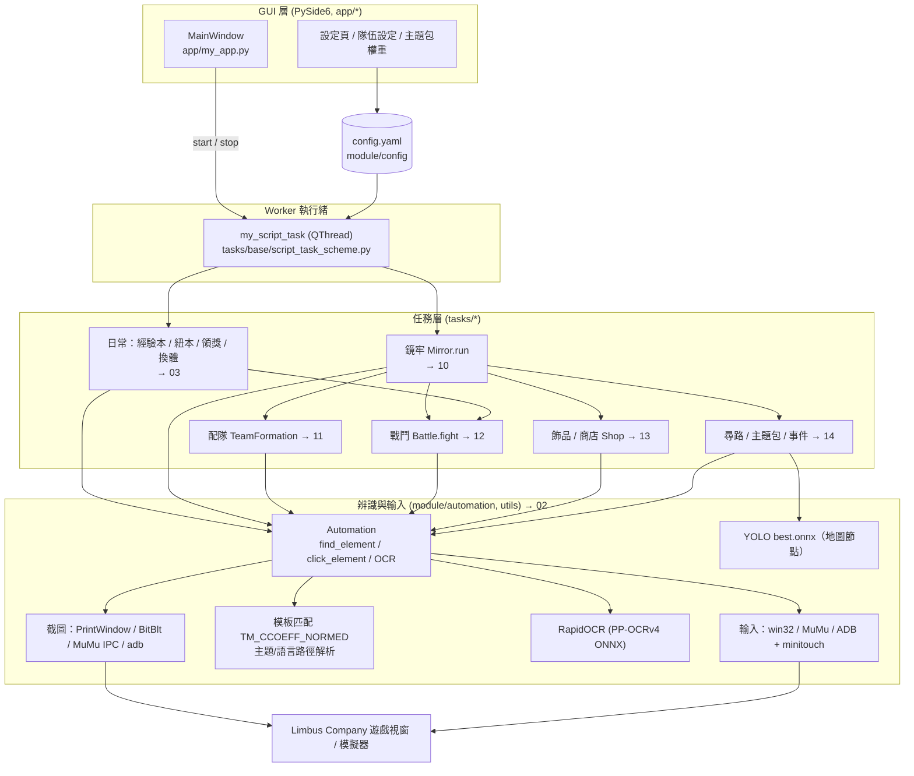
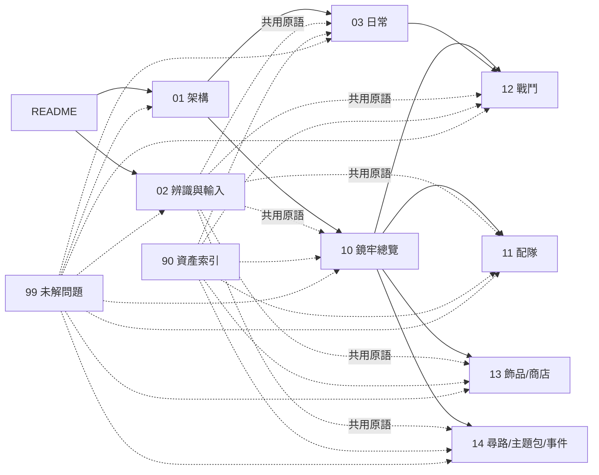

# AALC（AhabAssistantLimbusCompany）原始碼研究報告

> 研究對象：[KIYI671/AhabAssistantLimbusCompany](https://github.com/KIYI671/AhabAssistantLimbusCompany)
> 固定版本：commit [`b0f4393`](https://github.com/KIYI671/AhabAssistantLimbusCompany/commit/b0f439321987f5f7b126ebbc424f6ef144c1bff0)（`b0f439321987f5f7b126ebbc424f6ef144c1bff0`，2026-10-09，Merge branch 'loadingying-codex/pr-command-queue'）
> 來源：僅依該 commit 的程式碼與 repo 自帶文件（`assets/doc/zh`、`assets/doc/en`、`README.md`）。所有引用都是釘在此 SHA 的 GitHub permalink。
> 方法：純靜態閱讀，**沒有實機執行**。標示「推測」的內容只來自讀程式碼。

## 報告索引

| 檔案 | 內容 |
|---|---|
| [01-architecture.md](01-architecture.md) | 進入點、提權與單一實例、任務排程與執行順序、設定系統、GUI ↔ worker、日誌、遊戲啟動與視窗、更新與圖片資源同步、command queue |
| [02-recognition-and-input.md](02-recognition-and-input.md) | 截圖後端、模板匹配、主題／語言路徑解析、OCR、座標縮放、輸入後端（PC 前景／背景、MuMu、BlueStacks、ADB）、重試與逾時、ONNX 推論包裝 |
| [03-daily-tasks.md](03-daily-tasks.md) | 回主選單、狂氣換體／合成模組、經驗本與紐本、郵件／通行證／任務獎勵、各工具（無限戰鬥、自動換餅、截圖等） |
| [10-mirror-dungeon-overview.md](10-mirror-dungeon-overview.md) | 鏡牢主迴圈、畫面狀態機、樓層辨識、獎勵卡、結算、斷點接續與錯誤恢復 |
| [11-md-team-formation.md](11-md-team-formation.md) | 自動配隊、選隊（OCR／序號）、隊伍輪替、`TeamSetting` 全欄位、開局星光 |
| [12-md-battle.md](12-md-battle.md) | 自動戰鬥迴圈、回合偵測、罪孽顏色、防禦／技能鏈、全滅與逾時 |
| [13-md-ego-gifts.md](13-md-ego-gifts.md) | 初始飾品、觀測飾品、戰後獲取飾品、商店（購買、出售、合成、升級、治療、技能替換）、讀錢 OCR |
| [14-md-navigation.md](14-md-navigation.md) | 地圖自動尋路（YOLO ONNX + 模板 + Dijkstra）、備援、主題包選擇、事件處理 |
| [90-asset-index.md](90-asset-index.md) | 資產 → 程式引用 → 報告章節對照（491 張圖、模型、設定檔） |
| [99-open-questions.md](99-open-questions.md) | 無法確定的事項與疑似缺陷總表 |

## 建議閱讀順序

1. 先看本頁的架構圖與術語表。
2. [01](01-architecture.md) 了解程式怎麼啟動、任務按什麼順序跑。
3. [02](02-recognition-and-input.md) 了解所有任務共用的 `find_element` / `click_element` / OCR / 輸入原語，後面各章都假設你已讀過。
4. 只關心日常 → [03](03-daily-tasks.md)。
5. 鏡牢 → 先讀 [10](10-mirror-dungeon-overview.md)（主迴圈決定何時呼叫誰），再依興趣讀 [11](11-md-team-formation.md)、[12](12-md-battle.md)、[13](13-md-ego-gifts.md)、[14](14-md-navigation.md)。
6. 想從某張圖反查用途 → [90](90-asset-index.md)。

## 架構總覽

### 各報告之間的關係

## 一頁摘要

- **執行模型**：GUI 把勾選與參數寫進 `config.yaml`，按下開始後由 `my_script_task`（`QThread`）依固定順序執行：先接手打到一半的戰鬥 → 日常本 → 領獎 → 狂氣換體 → 鏡牢。停止用 `QThread.terminate()` 硬殺。詳見 [01](01-architecture.md)。
- **辨識**：所有模板都在 Steam 全螢幕 2560×1440 下截取，載入時依 `set_win_size/1440` 縮放；灰階單一尺度 `cv2.TM_CCOEFF_NORMED`，預設閾值 0.8。檔名結尾 `assets.png` 的是整張 2560×1440 透明底圖，自動取非黑區 bbox 當搜尋範圍（`clam` ±30、`normal` ±100、`aggressive` 全螢幕）。路徑依 `dark/default × zh_cn/en/share` 逐一嘗試並自動判定主題與語言。文字用 RapidOCR，比對是不分大小寫的子字串。詳見 [02](02-recognition-and-input.md)。
- **地圖尋路**：Ultralytics YOLO26n（`assets/model/best.onnx`，960×544 輸入，7 類節點）只負責偵測節點；道路連線靠 `up/mid/down.png` 模板確認；路徑用 Dijkstra 加寫死的權重（event 1、shop 2、battle 4、boss/焦點/異想體 6、risky 7）。詳見 [14](14-md-navigation.md)。
- **戰鬥**：沒有戰術決策，主路徑就是按 `P`（依勝率）再按 `Enter`；可選的只有全員防禦、首回合防禦、連續防禦 N 回合、三技能避免/優先。詳見 [12](12-md-battle.md)。
- **斷點接續**：沒有任務層級的進度檔。鏡牢主迴圈完全依畫面判斷狀態，所以從地圖、商店、事件、戰鬥、獎勵卡、結算任一畫面啟動都能直接接手；回到主界面時點「繼續」續關。唯一跨重啟持久化的是 `config.yaml` 裡的隊伍輪替佇列、困牢次數等。截圖持續失敗 60 秒、或卡住 90 秒會殺遊戲並重啟。詳見 [10 斷點接續](10-mirror-dungeon-overview.md)。

## 重要發現（疑似缺陷，已由協調者對照原始碼複核）

| # | 發現 | 證據 | 章節 |
|---|---|---|---|
| 1 | 必買、必棄、合成公式三份清單在執行時為空：`tasks/mirror/__init__.py` 遍歷不存在的 `./assets/images/share/...`（實際在 `assets/images/default/share/...`），`os.walk` 靜默回傳空 | [tasks/mirror/__init__.py:L1-L31](https://github.com/KIYI671/AhabAssistantLimbusCompany/blob/b0f439321987f5f7b126ebbc424f6ef144c1bff0/tasks/mirror/__init__.py#L1-L31)、[scripts/build.py:L38](https://github.com/KIYI671/AhabAssistantLimbusCompany/blob/b0f439321987f5f7b126ebbc424f6ef144c1bff0/scripts/build.py#L38) | [13](13-md-ego-gifts.md) |
| 2 | 鏡牢失敗會無上限重試：`onetime_mir_process` 用 `except Exception` 吞掉所有例外，失敗不扣次數也不輪替隊伍；`raise backMainWinError("请手动操作")` 實際不會停下腳本 | [tasks/base/script_task_scheme.py:L86-L107](https://github.com/KIYI671/AhabAssistantLimbusCompany/blob/b0f439321987f5f7b126ebbc424f6ef144c1bff0/tasks/base/script_task_scheme.py#L86-L107) | [01](01-architecture.md)、[10](10-mirror-dungeon-overview.md) |
| 3 | 戰後選飾品時第二體系的生效條件與商店相反（`mirror.py` 為 `setting==0 or (setting==1 and fuse_IV)`，`in_shop.py` 為 `setting==1 or (setting==0 and fuse_IV)`） | [tasks/mirror/mirror.py:L1458-L1461](https://github.com/KIYI671/AhabAssistantLimbusCompany/blob/b0f439321987f5f7b126ebbc424f6ef144c1bff0/tasks/mirror/mirror.py#L1458-L1461)、[tasks/mirror/in_shop.py:L256-L257](https://github.com/KIYI671/AhabAssistantLimbusCompany/blob/b0f439321987f5f7b126ebbc424f6ef144c1bff0/tasks/mirror/in_shop.py#L256-L257) | [13](13-md-ego-gifts.md) |
| 4 | `second_system_action` 宣告為 `List[int]`，卻以 `is True` 判斷，「合成第二體系四級」路徑可能永不觸發 | [module/config/config_typing.py:L156](https://github.com/KIYI671/AhabAssistantLimbusCompany/blob/b0f439321987f5f7b126ebbc424f6ef144c1bff0/module/config/config_typing.py#L156)、[tasks/mirror/in_shop.py:L885-L889](https://github.com/KIYI671/AhabAssistantLimbusCompany/blob/b0f439321987f5f7b126ebbc424f6ef144c1bff0/tasks/mirror/in_shop.py#L885-L889) | [13](13-md-ego-gifts.md) |
| 5 | repo 文件 `image_recognition.md` 說各路徑「並發」匹配、依遊戲語言初始化路徑；實作是逐路徑序列迴圈且固定 6 條路徑 | [module/automation/automation.py:L838-L861](https://github.com/KIYI671/AhabAssistantLimbusCompany/blob/b0f439321987f5f7b126ebbc424f6ef144c1bff0/module/automation/automation.py#L838-L861)、[utils/path_manager.py:L30-L44](https://github.com/KIYI671/AhabAssistantLimbusCompany/blob/b0f439321987f5f7b126ebbc424f6ef144c1bff0/utils/path_manager.py#L30-L44) | [02](02-recognition-and-input.md) |

更多項目見 [99-open-questions.md](99-open-questions.md)。

## 術語表（遊戲術語中英對照）

程式碼與 repo 文件使用簡體中文遊戲譯名；本報告轉為繁體，括號內為程式碼中常見的識別字或英文原名。

| 繁中（本報告） | 簡中（原始碼/文件） | English / 識別字 | 說明 |
|---|---|---|---|
| 鏡牢 | 镜牢 | Mirror Dungeon（`mirror`） | 肉鴿式主要週常玩法 |
| 困牢 / 困難鏡牢 | 困牢 | Hard Mirror（`hard_mirror`） | 困難難度，每週有額外獎勵 |
| 罪人 | 罪人 | Sinner（`all_sinners_name`） | 12 名可操作角色 |
| 編隊 / 配隊 | 编队 | Team / Formation（`TeamFormation`） | |
| E.G.O 飾品 | 饰品 / E.G.O饰品 | E.G.O Gift（`ego_gift`） | 鏡牢內的被動道具 |
| 體系 / 關鍵字 | 体系 | Keyword / Status system（`system`, `all_systems`） | 燒傷 burn、流血 bleed、震顫 tremor、破裂 rupture、呼吸 poise、沉淪 sinking、充能 charge、斬擊 slash、突刺 pierce、打擊 blunt |
| 初始飾品 | 初始饰品 | Starting Gift（`select_init_gift`） | |
| 觀測飾品 | 观测饰品 | Observe E.G.O Gift | 開局前預先觀測 |
| 合成 | 合成 | Fusion（`fuse_*`） | 商店內兩三件合成一件 |
| 升級 | 升级 | Enhance（`enhance_gifts`） | |
| 主題包 | 主题包 / 卡包 | Theme Pack（`theme_pack`） | 每層開始時選擇 |
| 星光 / 開局加成 | 星光 | Starlight / Opening Bonus（`opening_bonus`, `dreaming_star`） | |
| 獎勵卡 | 奖励卡 | Reward Card（`get_reward_card`） | 戰後/結算選擇 |
| 節點：戰鬥 / 事件 / 商店 / 焦點遭遇 / 危險遭遇 / 異想體遭遇 / Boss | — | `battle` / `event` / `shop` / `focused_encounter` / `risky_encounter` / `abnormality_focused_encounter` / `boss_battle` | ONNX 7 類 |
| Bus（巴士） | — | `mybus` | 地圖上代表目前位置的標記 |
| 罪孽 | 罪孽 | Sin（`sins`）：憤怒 wrath、憂鬱 gloom、怠惰 sloth、色慾 lust、傲慢 pride、暴食 gluttony、嫉妒 envy | 技能屬性顏色 |
| 勝率 / 自動戰鬥 | 胜率 | Win Rate（`P` 鍵） | |
| 狂氣 | 狂气 | Lunacy | 付費貨幣 |
| 腦啡肽 / 體力 | 脑啡肽 | Enkephalin | 體力 |
| 腦啡肽模組（餅） | 模块 / 饼 | Enkephalin Module | |
| 經驗本 | 经验本 | EXP Luxcavation | |
| 紐本 / 紡錘本 | 纽本 | Thread Luxcavation | |
| 採光 | 采光 | Luxcavation | 上兩者總稱 |
| 通行證 | 通行证 | Pass（`pass`） | 賽季通行證 |
| 每週加成 | 每周加成 | Weekly Bonus | 鏡牢結算額外獎勵 |
| 全滅 / 陣亡 | 全灭 / 阵亡 | `dead_all` / `dead` | |

## 研究方法與分工

這份報告由一個協調者加上多個平行子代理完成：資產清點（Haiku）；架構、辨識與輸入、日常任務（Sonnet）；鏡牢主迴圈、配隊、戰鬥、飾品／商店、尋路（Opus）。各章由子代理撰寫；協調者對照原始碼複核了上表的發現和章節間的分歧，並修正了 [90](90-asset-index.md) 的「無引用資源」分類。
